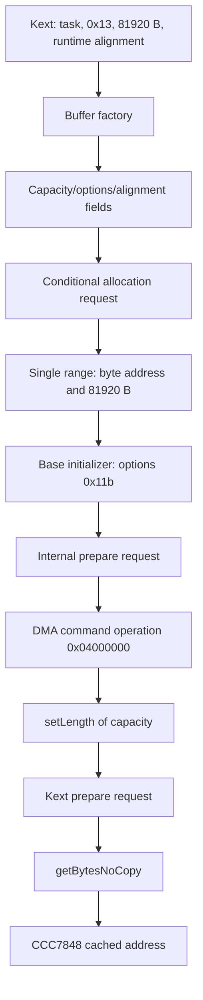

# Shared-buffer construction: capacity, range, preparation and getter prerequisites

The FairPlay buffer request reaches `IOBufferMemoryDescriptor::initWithPhysicalMask` with options 0x13, capacity 81920 B, the kernel-task value, runtime-derived alignment and physical mask zero. Original constructor stores bind capacity to descriptor +0xc0, raw options to +0xd0 and effective alignment to +0xc8. The later `setLength` call uses that capacity; its original body updates descriptor +0x50 and the single range's length when the unsigned capacity guard admits the request. These are source metadata and request contracts. Actual allocated capacity and writable backing remain unknown. [BC1-BC4]

The admitted route also exposes an initialization detail: the base initializer receives options 0x11b, whose bit 3 selects an internal `prepare(0)` request. The kext requests `prepare(0)` again after the factory returns. Between base initialization and final length publication, the buffer constructor calls nominal `dmaCommandOperation(0x04000000,request,40)`. These source interfaces refine the preparation/lifetime questions beneath the inner routine's CCC7848 staging accesses. They do not establish native operation counts, successful preparation or balanced lifetime transitions. [BC2-BC4,BC7]

Evidence: [original source and complete inventories](triage_evidence/buffer_construction_flow_source.json.zst), [source equations and certificates](triage_evidence/buffer_construction_flow_checks.json.zst), [extractor](triage_evidence/recover_buffer_construction_flow.py), [validator](triage_evidence/validate_buffer_construction_flow.py), [preservation audit](triage_evidence/buffer_construction_flow_delivery.json), [quality gates](triage_evidence/buffer_construction_flow_quality_gates.json), [sealer](triage_evidence/seal_buffer_construction_flow.py), [publication audit](triage_evidence/verify_buffer_construction_flow_publication.py). Context: [inner staging/write frontier](inner_write_frontier_report.md), [existing factory/getter/cleanup contracts](kext_buffer_report.md), [cold initialization](kext_cold_init_report.md), [hardware-AES handoff](kext_aes_handoff_report.md), [interface index](interface_abi_report.md).



Edges require the stated ordinary-return, root, field and selected-path premises. The complete constructor CFG is not proved. No target instructions, emulator, API, allocator, preparation, hardware operation, IPC, IDB mutation or memory update execute. Retained files and original collection source suffice; no new IDA access is used. [BC1-BC8]

## Primary evidence and coverage

| Evidence | Coverage |
| --- | --- |
| Normalized kext SHA-256 | `2ec5e76ffc0a1873d284cbc50846b63f3576df2e5af98738df81faae33954a2c` |
| Kernel collection SHA-256 | `d5f0b4d49520744ebcd777a66be7ff69225a8ef2879773340854eab0b1370afe` |
| Complete captured functions | 11 bodies, 1948 instructions, 7792 B |
| Original large bodies retained | Buffer initializer 427 instructions; base initializer 517; DMA operation 619 |
| Source equations | 38 fragments; 212 distinct instructions, 848 B; 21 static branch predicates |
| Pointer/symbol provenance | Six original descriptor slots and three original import pointers; exact method/data symbols where available |
| Accepted checks | 43 UNSAT, one explicitly abstract SAT control, 32 enumerated alignment-formula values, one replayed staging-root proposition, six altered-evidence rejection checks |

Captured bodies shared with the earlier buffer report match exactly. The kext initializer also matches the preceding inner-write source capture. Full-body capture supports bounded censuses; it is not a claim that all 1948 instructions have recovered semantics. The 21 predicates describe local control conditions, not a target execution trace or a closed graph. [BC1,BC5-BC6]

## Factory and constructor fields

The source caller at `0xfffffe000a5080a4..0xfffffe000a5080d4` obtains TASK through the original `_kernel_task` cell and SHIFT through `_PAGE_SHIFT_CONST`. Its factory arguments are:

```text
X0 = TASK
W1 = 0x13
X2 = 0x14000 = 81920 B
X3 = sign_extend64(1U << (SHIFT32 AND 31))
```

The factory at `0xfffffe000c526070` forwards TASK, options, capacity and alignment as constructor X1..X4; X0 is its allocated descriptor and X5=0 is the physical mask. The factory's original return test uses bit 0 of the initializer result. Original source continues to distinguish a null allocation, false initialization and successful construction; actual outcomes remain unknown. [BC1-BC4]

Let B be the descriptor, R the allocated range-pair address, d the returned backing address, and A the requested alignment. The constructor's explicit publications are:

| Location | Source site | Value or role |
| --- | --- | --- |
| B+0xd0, u32 | `0xfffffe000c524c10` | Raw request options 0x13 |
| B+0xc0, u64 | `0xfffffe000c524c14` | Requested capacity 81920 B |
| B+0x60, u64 | `0xfffffe000c524c74` | R, followed by zero stores to R+0 and R+8 |
| B+0xc8, u64 | `0xfffffe000c524d60` | Effective alignment A for physical mask zero/options 0x13 |
| B+0xb8, u64 | `0xfffffe000c524fc4` | Returned backing value d, followed by a null branch |
| R+0, u64 | `0xfffffe000c52506c` | Reloaded d |
| R+8, u64 | `0xfffffe000c525078` | Reloaded capacity |
| B+0x50, u64 | `0xfffffe000c537db8` | Base initializer's accumulated range length on the admitted one-range path |
| B+0x50 and R+8, u64 | `0xfffffe000c524bcc`, `0xfffffe000c524bd4` | Later admitted `setLength` argument |

Within the complete buffer initializer there is one literal capacity store at B+0xc0 and one raw-options store at B+0xd0, both at entry. Calls and arbitrary-pointer stores still require noninterference and disjointness contracts before these values can be carried across the whole constructor. A syntactic self-field census does not prove that no alias can overwrite a field. [BC2-BC4,BC6]

For options 0x13, a preexisting nonnull B+0x60 is rejected at the original entry gate: a nonnull task reaches the bit-5 test, and bit 5 is clear. The admitted fresh-range branch publishes a new typed range pair. Native allocation, object zeroing and typed allocator capacity are separate lower-layer obligations. [BC3-BC4,BC7]

## Alignment and the three allocation requests

The original `_page_size` symbol is at `0xfffffe000cb5b840`. Mapper presence derives from exact `IOMapper::gSystem` at `0xfffffe000caac278`, after the source's readiness handling. Let P be the applicable page-size snapshot and m be the source's canonical mapper-presence Boolean, 0 or 1. These are runtime snapshots, not fixed image constants. [BC1-BC2]

With physical mask zero and options 0x13, the alignment calculation preserves A. The optional literal 16384 B rounding leaves this request unchanged because 81920=5*16384. The effective options remain 0x13 even where the source conditionally ORs bit 0x10, which is already set. The constructor separately checks the arithmetic expression `81920+A` against its capacity; that guard and allocation outcomes remain part of the admitted path. [BC2,BC5-BC6]

For nonnull TASK, the fresh ordinary route and inherited guard bit 5 clear, the source allocation alternatives are:

| Source condition | Direct backend target | Arguments at the call |
| --- | --- | --- |
| m=1, A<=P, A<2 | `0xfffffe000c4b9328` | X0=heap selector, X1=81920, X2=0x1004 |
| m=1, 2<=A<=P | `0xfffffe000c4b9628` | X0=heap selector, X1=81920, X2=A, X3=0x1004 |
| m=0 or A>P | `0xfffffe000c4b9b8c` | X0=heap selector, X1=81920, X2=0 physical mask, X3=A, W4=1-m, X5=0 |

No exact matching symbol exists for these three backend entry addresses in the consumed symbol tables; their numeric request ABIs are recovered without assigning an allocator API name. Other inherited flag paths, backend internals, memory pressure, backing extent and failure behavior remain outside these component contracts. The table describes request selection under its premises, not successful allocations. [BC1-BC4,BC6]

The caller alignment expression has 32 possible source-formula values, determined solely by SHIFT's low five bits. Low-five value 14 gives 16384; value 31 produces signed64 -2147483648, represented by u64 `0xffffffff80000000`. This is the source's 32-bit shift followed by sign extension. It does not establish the runtime shift or that every formula value is an accepted native allocator alignment. [BC2,BC5,BC8]

## Base initializer, preparation and final length

After publishing a nonnull backing value, the source forms base options `0x118 OR 3 = 0x11b`. Options 0x13 select the branch that resets the extra-mapping task local to zero. The subsequent base initializer call at `0xfffffe000c5250a4` receives:

| Register | Source value |
| --- | --- |
| X0 | B |
| X1 | R |
| W2 | 1 range |
| W3 | 0 |
| X4 | TASK |
| W5 | 0x11b |
| X6 | 0 |

The target is exact `IOGeneralMemoryDescriptor::initWithOptions(void *,unsigned int,unsigned int,task *,unsigned int,IOMapper *)` at `0xfffffe000c537720`. On the selected flag path it retains 0x11b, records TASK at B+0x70, and uses bit 8's borrowed-range branch to store R at B+0x60. Type bits are 0x10. The admitted one-range accumulation publishes 81920 to B+0x50 without arithmetic overflow. Map validation, internal bookkeeping, preparation and every actual successful predecessor remain separate obligations. [BC2-BC4,BC6]

The original type/flag continuation tests bit 16 and bit 3. For 0x11b, it skips the bit-16 helper and selects nominal `prepare(0)` at call `0xfffffe000c537ed0`. A nonzero preparation status reaches the base false-result path; the admitted successful continuation returns canonical true. The later kext call is `0xfffffe000a508108`, after a nonnull factory result. These are two distinct source request sites on the declared initialization continuation. No actual native count, successful wire operation, lock acquisition or reference balance is inferred. [BC2-BC4,BC6-BC8]

The buffer constructor also requests descriptor virtual +0x150 at `0xfffffe000c5250e8`, with X1=0x04000000, X2 pointing to its stack request at S+0x28 and W3=40 B. The exact nominal target is `IOGeneralMemoryDescriptor::dmaCommandOperation(unsigned int,void *,unsigned int) const` at `0xfffffe000c5365e8`. The selector arithmetic maps this operation to case 3. Its complete 619-instruction body is retained; all effects of that case and its internal-record allocation branch are not proved here. Its success and field effects cannot be replaced by an assumed no-op. [BC1,BC3-BC4,BC6]

The final constructor request at `0xfffffe000c525254` selects exact `IOBufferMemoryDescriptor::setLength(unsigned long)` through vptr +0x2f0 and passes the reloaded B+0xc0 capacity. Under the admitted stable capacity/range epochs, it sets length to 81920. This is a metadata publication, with backing validity still supplied by the lower allocation and construction contracts. [BC2-BC4]

| Nominal descriptor method | Original slot | Target / diversity |
| --- | --- | --- |
| `dmaCommandOperation` +0x150 | `0xfffffe0007f85ed0` | `0xfffffe000c5365e8` / 0xa8a7 |
| `prepare` +0x218 | `0xfffffe0007f85f98` | `0xfffffe000c5353b4` / 0xf5b3 |
| `initWithPhysicalMask` +0x268 | `0xfffffe0007f85fe8` | `0xfffffe000c524bdc` / 0x1c03 |
| `setLength` +0x2f0 | `0xfffffe0007f86070` | `0xfffffe000c524bbc` / 0x544c |
| `getCapacity` +0x300 | `0xfffffe0007f86080` | `0xfffffe000c524b98` / 0x98e1 |
| `getBytesNoCopy` +0x308 | `0xfffffe0007f86088` | `0xfffffe000c524b60` / 0xf4f4 |

All six original authenticated format-8 entries have verified chain membership and exact symbols. The nominal vptr is `0xfffffe0007f85d80`; live class identity and authentication remain premises. `getCapacity` is a three-instruction leaf returning full64 B+0xc0. `setLength` is an eight-instruction leaf: an unsigned NEWLEN>capacity returns without publication; the admitted branch writes NEWLEN to B+0x50 and u64[B+0x60]+8. A valid disjoint range/object contract is needed to exclude aliased effects on other fields. [BC1,BC3-BC5]

## Getter prerequisites and the CCC7848 join

For source type nibble 0x10, `getBytesNoCopy()` takes its indirect branch and returns the first qword through B+0x60, provided byte B+0xe0 has bit 6 clear. The published range head supplies d under the stated reaching-field and lower-call contracts. The getter performs no capacity check. The preceding inner-write proof is replayed to bind its reused frame cell to the address of CCC7848; the kext initializer caches the getter result there. This links the source metadata/range construction to the inner staging route while retaining the native extent and lifetime boundary. [BC2-BC4,BC7]

The local bare C++ constructor explicitly writes only u32 value 1 at +8, zero at +0x18, zero at +0x90 and the signed nominal vptr at +0. The class allocator contains those same publications after its lower allocation routes. These direct publications do not themselves zero B+0x60 or B+0xe0. Allocation zeroing must come from the lower allocation contract if used as a construction premise. The typed/fallback allocation flag operands are retained in the full class-allocator body; this increment does not infer the complete allocator/cache invariant from a raw flag value. [BC3-BC4,BC7]

The buffer initializer's selected local OR 1 and OR 8 updates preserve inherited flag bit 6. A SAT control with abstract inherited flags 0x40 confirms that these local updates alone cannot prove it clear. This control establishes an additional premise; it is not a constructed successful descriptor, a reachable native null getter or a demonstrated lifetime defect. The caller's existing lack of a separate getter-result test therefore remains distinct from a proof that a null pointer can arise after successful native construction and preparation. [BC3-BC8]

Numerically, 81920 B equals twenty 4096 B fill spans and five literal 16384 B rounding units. A 4096 B fill starting at the same d fits within an actual 81920 B allocation if the metadata faithfully describes that allocation and the base/lifetime epochs coincide. Offset copies still require their own bounds. The metadata ratio does not establish additional buffers, protocol records, concurrency capacity or permission to access memory. No new incoming/outgoing Mach right or emission site is established; the recovered interfaces are descriptor fields, stack request records, private/global pointers and virtual methods. [BC3-BC4,BC7-BC8]

## Assumption register

| ID | Assumption and dependent results | Stress test or falsification probe |
| --- | --- | --- |
| BC1 | The pinned kext/KC, compiler bounds, original chains and symbol tables identify the analyzed build. | Rehash both images; compare shared complete bodies to retained captures; verify six method slots, three imports and exact data symbols. Native build pairing remains unknown. |
| BC2 | The declared task, mapper/page snapshots, nominal vptr, saved registers and source field epochs reach each local component. | Recheck all supplied-load addresses, task identity, alignment cuts and 21 branch predicates. Trace actual reaching paths and intervening writers before whole-constructor composition. |
| BC3 | Objects, range pairs, caller frames and cached backing have valid/disjoint extents and compatible lifetimes. | Check capacity/length/range store sites; establish actual allocator extent and alias exclusions. A requested capacity or metadata value alone does not establish writable memory. |
| BC4 | Lower calls return ordinarily with their stated ABI and field effects; the selected allocation and preparation results permit continuation. | Retain allocation, map validation, base preparation, DMA-operation effects and noninterference as separate boundaries. Do not replace their effects with empty summaries. |
| BC5 | A64 widths, unsigned guards, flag conditions, shifts and source SSA describe the selected code. | Retain 212 translated sites, 43 UNSAT checks, the abstract SAT control, all 32 alignment-formula values and six fresh-source alteration rejections. Reject errors, stderr, timeout and unknown. |
| BC6 | Local path predicates and compiler-envelope censuses are narrower than all-path constructor recovery. | Keep 427/517/619-instruction bodies, five complete store/call censuses and explicit unproved CFG flags. Separate taken-path premises from independent predicate equations. |
| BC7 | Allocation zeroing and deeper derived-field/range preservation are needed for a nonnull getter and compatible preparation lifetime. | Trace the class allocator's lower routes, B+0xe0 bit 6, B+0x60, DMA operation 0x04000000 and every preparation/completion/free predecessor. The abstract flags control is not native reachability evidence. |
| BC8 | Static requests, metadata and algebra are distinct from native outcomes. | Keep execution/API/IPC/IDB flags false; retain actual backing capacity, successful preparation, native balance and complete daemon-kext transactions as unknown. |

## Bounded continuation

| Impact | Next evidence | Question resolved |
| --- | --- | --- |
| High | Follow typed/fallback class allocation and its cache/zeroing invariant | Which derived fields are initialized before this source constructor |
| High | Close base initializer and DMA operation 0x04000000 effects on the admitted route | Whether range, type and backing publications survive to the getter |
| High | Join two initialization preparation requests with provider prepare/complete and descriptor free | Actual lifetime accounting and unwind obligations |
| High | Establish actual CCC7848 backing extent, offset-copy ranges and serialization | Applicability of the nominal 81920 B metadata to inner staging accesses |
| High | Recover remaining inner dispatch states and header interference | Whether the private delta's exact zero condition survives complete operations |
| Medium | Recover runtime page-shift/page-size initialization and mapper epochs | The actual alignment and selected allocation backend for this build |
| Medium | Match native provider/descriptor/build and daemon transport | Applicability of the recovered software interfaces to an actual exchange |

## Scoped quality gates

- QG1: Factual source, ABI, field, count and proof-boundary claims require no normative conclusion.
- QG2: BC1-BC8 identify assumptions, dependencies and falsification probes.
- QG3: The constructor request, capacity/alignment/options fields, three allocation alternatives, range/base publication, preparation requests, DMA operation, length/capacity methods and CCC7848 getter prerequisites are covered. The broad interface goal remains active.
- QG4: 1948*4=7792 B; 212*4=848 B selected source. Capacity is 81920 B=80 KiB=20*4096 B=5*16384 B. Request size is 40 B; source pointer/size fields are 64 bits and option/status fields 32 bits. Extraction/census uses O(B+I+N) time/space for consumed bytes B, instructions I and symbol entries N, plus bounded pointer-chain work and retained equations. General SMT complexity is separate; each query has 45000 ms/50 s limits.
- QG5: Requested capacity, stored capacity, logical length and backing extent; nominal/live methods; local/global epochs; source requests/completed native operations; two preparation sites/reference balance; and abstract flags/native reachability remain distinct.
- QG6: Primary image hashes, compiler bounds, raw code/chain words, exact method/data symbols, 43 accepted UNSAT certificates, one abstract SAT control, one replayed staging proposition and six freshness alterations supply scoped provenance.
- QG7: Continuation addresses precise allocator, base/DMA effects, preparation/free, staging-bound, runtime environment and native-pairing dependencies without claiming complete construction or a native defect.
