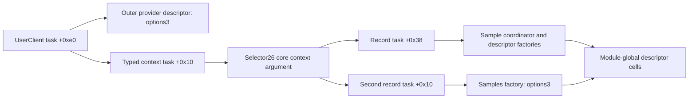

# Typed UserClient context to descriptor-task interfaces

Selector26 forwards two separate kernel operands:the UserClient's context pointer and its task pointer. Its provider uses the direct task for the outer user-memory descriptor,but passes only `(staging buffer,extent,context)` into `_PRnut72j9`. Within that core,three literal consumers read the context's task field and two read its mode. Two task-bearing record builders conditionally select the sample coordinator and a second descriptor consumer. The latter forwards the task to exact `_createSamplesIOMD`. These findings connect the typed24 B context to descriptor arguments under explicit frame/lifetime premises;they do not establish native mappings,task-reference balance or complete paths from fairplayd. [DF1-DF8]

Evidence: [original functions,census and bindings](triage_evidence/context_descriptor_task_flow_source.json.zst), [source models and certificates](triage_evidence/context_descriptor_task_flow_checks.json.zst), [extractor](triage_evidence/recover_context_descriptor_task_flow.py), [validator](triage_evidence/validate_context_descriptor_task_flow.py), [preservation](triage_evidence/context_descriptor_task_flow_delivery.json), [quality gates](triage_evidence/context_descriptor_task_flow_quality_gates.json), [sealer](triage_evidence/seal_context_descriptor_task_flow.py), [publication audit](triage_evidence/verify_context_descriptor_task_flow_publication.py). Context: [typed UserClient lifecycle](userclient_context_lifecycle_report.md), [sample coordinator and caller records](sample_caller_report.md), [global descriptor factories](sample_descriptor_report.md), [selector21 ABI](versioned_request_abi_report.md), [interface index](interface_abi_report.md).



The diagram is a conditional source composition. The same initializer task can supply both routes when the saved fields,context and frames remain valid and unchanged. A current field read is not automatically the original initializer value. Selector21 has its separate direct task argument;this report does not establish that two native calls used the same connection or task. No target instructions,emulator,descriptor operation,FairPlay request,IPC or IDB mutation execute. The supplied files and existing captures suffice;no new IDA access is used. [DF2-DF4,DF8]

## Primary source and selected proof coverage

| Evidence | Scope |
| --- | --- |
| Normalized kext SHA-256 |`2ec5e76ffc0a1873d284cbc50846b63f3576df2e5af98738df81faae33954a2c`|
| Original collection SHA-256 |`d5f0b4d49520744ebcd777a66be7ff69225a8ef2879773340854eab0b1370afe`|
| Complete captured functions |7 compiler-bounded functions,53728 instructions,214912 B;original and normalized code agree|
| `_PRnut72j9` compiler envelope |`0xfffffe000a635208..0xfffffe000a666930`,50634 instructions,202536 B|
| Current equations |30 source fragments,1424 B,356 distinct instructions;547 instruction instances across composed models|
| Pointer/bank evidence |6 arrays,3 selections,768 exhaustive byte-input cases,8 original pointer records,2 mode-branch pointers,16 B factory-import stub|
| Accepted checks |43 UNSAT including4 predecessor replays;3 abstract SAT controls;7 altered-evidence rejection checks|

The selected equations cover the declared ABI,field,carrier and delta propositions. Capturing the complete compiler envelope does not prove the remaining core instructions or arbitrary control flow. The earlier sample report supplies its coordinator setup mapping;the new evidence closes typed-context and task-carrier relationships under the assumptions below. Historical emulator profiles are neither rerun nor treated as native evidence. [DF1-DF4]

## Outer and inner task channels

| Boundary / source site | Source arguments |
| --- | --- |
|UserClient call `0xfffffe000a50408c`|X0 provider;X1=u64[input+0] address;W2=u32[input+8] extent;X3=u64[UserClient+0xe8] context;X4=u64[UserClient+0xe0] task|
|Provider entry `0xfffffe000a5051b8..0xfffffe000a5051d4`|Save context in X21 and zero-extended extent in X22;forward address64,extent64,raw options3 and task64 to `withAddressRange`|
|Provider core call `0xfffffe000a5052fc`|X0 staging pointer from X24;X1 saved extent;X2 saved context;no separate task argument in this three-argument core interface|
|Core stores `0xfffffe000a63524c..0xfffffe000a635254`|Context -> current SP+0x738;extent -> SP+0x878;staging pointer -> SP+0x8f8|

The input descriptor supplies address/extent. Context and task come from UserClient fields rather than those descriptor words. Applying their initializer provenance requires an authentic constructed object and the unchanged-field/lifetime premises. The context's head/mode/task layout remains the preceding typed allocation contract. Three predecessor certificates replay initializer task publication,start forwarding and context publication. [DF2-DF4,DF7]

## Whole-envelope literal-root census

A raw A64 mask scan finds exactly11 unsigned-immediate64-bit loads from SP+0x738 in the core envelope. A separate explicit-SP overlap scan finds one literal store overlapping that8 B cell:the entry store of X2. Pair widths are included. The bounded direct-register scan continues at most64 instructions and stops at a clobber or branch. It is a syntactic inventory,not an alias/interference or reaching-definition proof. [DF1,DF3,DF5]

| Root-load sites,suffix after `0xfffffe000` | Local role |
| --- | --- |
|`a63c7c0`,`a63dd14`,`a642dc8`,`a64323c`|Local nullness/control uses;complete branch semantics not recovered here|
|`a63c82c`,`a642e4c`|Following u32 load of context+8,mode|
|`a642c64`|Copy context pointer to an internal record's first qword|
|`a647d94`,`a64b348`,`a651568`|Following u64 load of context+0x10,task|
|`a65ed54`|Copy context pointer to object+0x118;load its head and copy head to object+0x410|

Computed loads,other roots,aliases and other frames are not excluded by this inventory. The core also has23 explicit SP accesses overlapping the task scratch cell at+0x9d0,using both u32 and u64 widths. A saved pointer cannot be propagated through that whole function solely because later code names the same stack offset. [DF3,DF5]

## Mode,head and context-pointer roles

The first mode gate at `0xfffffe000a63c810..0xfffffe000a63c858` depends on the incoming u32 phase P in W12. Fresh source equations give:

```text
T = (((P + 0xf6499962) AND 0x09b660ef) - 0xe6) mod2^32
R = ((P - 0x5ae) XOR0xe5) mod2^32
I = P OR (mode32 == T ? R : 0)
load branch pointer at TABLE + 8*sign_extend64(I)
TABLE =0xfffffe0008472f20; IA diversity =0x1fcb
```

This is not a universal mode==1 test. Actual phase values,valid selected slots and complete arrival conditions remain open. The other gate,at `0xfffffe000a642e4c..0xfffffe000a642e80`,does test mode==1 directly:

| Predicate | Index / original target |
| --- | --- |
|mode=1|0x8f3 ->`0xfffffe000a644b5c`|
|mode!=1|0x916 ->`0xfffffe000a642e84`|

Both latter branch pointers have verified original chain membership and IA diversity0x991b. The context's mode is distinct from the daemon's previously recovered local working modes and from internal encoded selectors. The head and context-pointer stores establish additional consumers/aliases;they do not establish node ownership or complete list mutation. [DF2-DF5]

## Three task-field consumers and two record protocols

| Source consumer | Exact publication / next interface |
| --- | --- |
|`0xfffffe000a647d98`|Read task64 at context+0x10;store to SP+0x9d0 at`0xfffffe000a647d9c`. Under preserved bytes/frame,read at`0xfffffe000a64a07c` stores it to object+0x2e0. Complete intervening path is not proved.|
|`0xfffffe000a64b34c`|Read task64;the second effect of STP at`0xfffffe000a64b434` writes it to record+0x38. Call at`0xfffffe000a64b498` supplies this record to sample coordinator`0xfffffe000a6247a4`.|
|`0xfffffe000a65156c`|Read task64;the second effect of STP at`0xfffffe000a651668` writes it to a different record+0x10. Call at`0xfffffe000a651714` supplies that record to consumer`0xfffffe000a61c404`.|

The two record offsets are different protocols;the records are not equated. Full-width task stores and exact8-byte little-endian store/load joins are proved. Other fields,record extents,allocation owners and admitted business operations are not fully recovered here. [DF3-DF6]

| Original indirect call | Exhaustive selector / pointer binding |
| --- | --- |
|`a64b498`,IA0x6353|Bank key0x73 ->constant0x47;index0xf63;slot`0xfffffe000847aa38` -> sample coordinator`0xfffffe000a6247a4`|
|`a651714`,IA0x1e46|Bank key0x47 ->constant0x7b;index0xf82;slot`0xfffffe000847ab30` -> second consumer`0xfffffe000a61c404`|
|`a61c8e4`,IA0x55db|Bank key0xac ->constant6;index0xfab;slot`0xfffffe000847ac78` -> exact `_createSamplesIOMD` at`0xfffffe000a509980`|

Fresh source proofs bind the bank read addresses and original table entries. Short original pool/bias and frame-publication fragments corroborate the bank roots. Carrying those roots to later visits still requires valid table/frame epochs and ordinary call preservation;it is not a whole-core path proof. [DF2-DF4]

The sample coordinator reads record+0x38 at`0xfffffe000a624900` and saves it at its SP+0xa0,using FP=SP+0x130. Its sample-size factory call at`0xfffffe000a624b44` reloads that saved u64 into X2. The preceding sample report establishes the selected target as `_createSampleSizesIOMD`. Its broader descriptor setup and status protocol remain that report's conditional contract. [DF3-DF4,DF7]

The second consumer's newly checked prefix reads its different record+0x10 at`0xfffffe000a61c84c` into X2. It resolves the samples factory above and supplies X0=its saved address operand,X1=`ENCODED XOR0xd26b7d290a2e6311`,X2=task64. The complete production/decoding of that size operand and the consumer's input gates,algorithm,cleanup and status continuations remain open. The task-forwarding fact does not depend on assigning those other values a complete packet schema. [DF3-DF4,DF6]

## Descriptor factories and global environment

| Helper | Arguments to exact `IOMemoryDescriptor::withAddressRange` | Publication after ordinary return |
| --- | --- | --- |
|`_createSampleSizesIOMD`,call`0xfffffe000a509960`|X0 address64;X1 length64;W2=2;X3 task64|u64 descriptor at`0xfffffe000ccc7858`|
|`_createSamplesIOMD`,call`0xfffffe000a509998`|X0 address64;X1 length64;W2=3;X3 task64|u64 descriptor at`0xfffffe000ccc7860`|

The original16 B import stub at`0xfffffe000a69f1e4` uses slot`0xfffffe000847c420`,whose exact target is`0xfffffe000c53a934`. Both factories store the returned pointer,including null. They return raw u32 status0 for nonnull and0xffff5bd4 for null. Pointer publication,status normalization and actual allocation/mapping/reference effects are separate. [DF1-DF4]

The prior task-type-bit certificate is replayed:the inspected factory's null-task versus nonnull-task paths select different raw type bits. Together with this task-argument provenance,it identifies an address-interpretation interface. Actual memory access,policy acceptance and mapping success remain unknown. The module-global descriptor cells are distinct from the per-client context;the source arguments do not prove per-client isolation,serialization or balanced global replacement. No new Mach message,port-name emission or right-retirement event is established. [DF6-DF8]

## Private SP deltas and retained-slot limits

The full core census records9 SP mutation sites,including prologue/epilogue writebacks and3 private return-driven `MOV SP` sites. For current pre-return SP F,the original four-instruction suffix reads the following u64 cell D and performs `SP=F+D`:

| Helper call / SP write | Delta cell |
| --- | --- |
|`0xfffffe000a63cd48` /`0xfffffe000a63cd58`|F+0xc30|
|`0xfffffe000a6439e4` /`0xfffffe000a6439f4`|F+0xc20|
|`0xfffffe000a644074` /`0xfffffe000a644084`|F+0xc28|

Each source suffix is proved independently. The new SP+0x738 address equals the old F+0x738 address iff D=0 modulo2^64. If a path visits all three suffixes in sequence and otherwise preserves SP,the original entry-cell address is restored iff D0+D1+D2=0 modulo2^64. This does not require each individual delta to be zero:an abstract16/-16/0 SAT control demonstrates cancellation. Neither that path nor those actual delta values is observed. A separate16-byte-delta control changes the slot address. [DF3-DF5]

A u32 scratch-write control also changes the low half of a previously saved task64. The23 source overlaps substantiate that this slot has multiple width/epoch roles;the control is not a recovered execution ordering or native corruption. The report's argument joins therefore remain conditional on the actual frame base,preserved fields and intervening writes. [DF3,DF5,DF8]

## Assumption register

| ID | Assumption and dependent results | Stress test or falsification probe |
| --- | --- | --- |
| DF1 |Pinned kext/KC identify the build;raw code and normalized pointer meanings correspond.|Rehash both inputs,compare7 complete bodies and import stub,verify original chained records and all768 bank-input cases. No native loaded-build pairing follows.|
| DF2 |Original bank/table roots and declared provider routes retain their epochs.|Freshly prove3 bank/address reductions,pool roots and selected frame publications. Native override/PAC and complete reaching roots remain separate requirements.|
| DF3 |UserClient,context,record,controller and frame regions have valid extents,lifetimes and the stated noninterference.|Retain distinct frame domains and fields;track3 SP deltas and23 scratch overlaps. A nonzero delta or u32 overwrite falsifies an unconditional retained-slot claim.|
| DF4 |Selected calls return ordinarily,preserve ABI callee-saved state/SP and unrelated caller cells.|Prove surrounding argument/result instructions. Keep outer descriptor calls,core calls and inner factories separate;no actual helper outcome is supplied.|
| DF5 |A64 widths,sign/zero extension,pair ordering,byte memory and explicit SP addressing match the selected models.|Retain356 translated sites,source pair effects and exact8-byte joins;cross-check raw reload masks and explicit-SP overlap widths. The census does not cover computed aliases or all control flow.|
| DF6 |Task,context,mode,record offsets,global descriptor pointers and Mach names remain distinct architectural values.|Check both task-bearing record layouts and factory X3 width. No per-client isolation,wire schema or complete algorithm is inferred from field similarity.|
| DF7 |Previous typed-context/sample/factory contracts supply only their stated conditional propositions.|Pin their hashes and replay4 exact certificates. Historical emulator fixtures supply no native task,mapping or ownership premise.|
| DF8 |SAT controls are abstract sensitivity checks;source requests are not native observations.|Keep execution/IPC/IDB flags false;reject7 altered artifacts. Native identities,mappings,references,concurrency and complete daemon-kext processing remain unknown.|

## Bounded continuation

| Impact | Next evidence | Question resolved |
| --- | --- | --- |
| High |Recover the3 private helper delta producers and actual core paths|Which context and bank-frame publications reach each consumer.|
| High |Close global descriptor replacement,serialization and task-reference acquisition/retirement|How per-client task values remain valid through module-global descriptor use.|
| High |Recover the second consumer's size decoder,input gates and full descriptor lifecycle|Its complete record ABI and function beyond the proved task-forwarding prefix.|
| High |Trace context-head node producers and populated-list cleanup|How the same typed context owns operation state beyond its empty head.|
| High |Attest actual connection/provider/build correspondence and matched transport|Whether these conditional source interfaces participate in a native fairplayd-kext transaction.|
| Medium |Extend the literal census to computed roots,aliases and path-sensitive stack writes|Completeness of the context-consumer and interference inventory.|

## Scoped quality gates

- QG1:Factual source,ABI,width,frame and ownership-boundary analysis requires no normative conclusion.
- QG2:DF1-DF8 list assumptions,dependent claims and falsification probes.
- QG3:The increment covers selector26's two task/context channels,the11-site literal census,mode/head/task uses,two record/task joins,selected descriptor factories,global pointer/status publication and3 SP-delta boundaries. Full core semantics and the full goal remain active.
- QG4:53728*4=214912 B;50634*4=202536 B;356*4=1424 B selected code;547 composed instruction instances. Task fields/stores are8 B and mode fields4 B. Capture/census/bank work uses O(B+I+64L+256R+N) time and space for bytes B,instructions I,root sites L,bank rules R and symbol/chain records N. Stored SSA/query text scales with retained instances;general SMT complexity is separate. Per-query limits are45000 ms/50 s.
- QG5:Direct UserClient task versus embedded context task,current versus entry SP,phase-dependent versus literal mode gates,two record offsets,per-client context versus global descriptor cells,and raw status versus native success remain distinct.
- QG6:Original hashes,compiler envelopes,instructions,chained pointer words,banks,356 source sites,43 UNSAT including4 replays,3 abstract SAT and7 freshness alterations supply scoped provenance. No current IDA or native-execution claim is made.
- QG7:The continuation covers the remaining frame,global lifetime,second-consumer,populated-list,native-pairing and inventory gaps without claiming a completed exchange.
