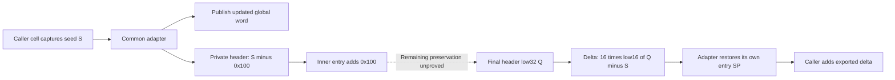

# Core private stack-delta adapter and seed/header ABI

The three previously unresolved private calls in `_PRnut72j9` select the same136-instruction adapter at`0xfffffe000a688ebc`. It captures a mutable control word,allocates a private16..256 B span,calls inner routine`0xfffffe000a687ee0`,and exports a caller-stack delta through its second argument. The delta is a nonnegative multiple of16,at most1,048,560 B. It is zero exactly when the final header's low16 bits equal the captured word's low16 bits. The inner entry restores that word,but preservation through the rest of its body remains unproved. [SD1-SD8]

Evidence: [original source,bindings and inventories](triage_evidence/core_stack_delta_abi_source.json.zst), [source equations and certificates](triage_evidence/core_stack_delta_abi_checks.json.zst), [extractor](triage_evidence/recover_core_stack_delta_abi.py), [validator](triage_evidence/validate_core_stack_delta_abi.py), [preservation](triage_evidence/core_stack_delta_abi_delivery.json), [quality gates](triage_evidence/core_stack_delta_abi_quality_gates.json), [sealer](triage_evidence/seal_core_stack_delta_abi.py), [publication audit](triage_evidence/verify_core_stack_delta_abi_publication.py). Context: [context-to-descriptor task flow](context_descriptor_task_flow_report.md), [typed UserClient lifecycle](userclient_context_lifecycle_report.md), [sample caller contracts](sample_caller_report.md), [cold initialization](kext_cold_init_report.md), [interface index](interface_abi_report.md).



This is a source-bound private control/data ABI. No target instructions,emulator,FairPlay request,stack probe,hardware initialization,IPC or IDB mutation execute. The associated files and retained source captures suffice;no new IDA access is used. Zero deltas for actual complete calls and native frame continuity remain unknown. [SD4,SD7-SD8]

## Primary source and verification scope

| Evidence | Verified coverage |
| --- | --- |
| Normalized kext SHA-256 |`2ec5e76ffc0a1873d284cbc50846b63f3576df2e5af98738df81faae33954a2c`|
| Kernel collection SHA-256 |`d5f0b4d49520744ebcd777a66be7ff69225a8ef2879773340854eab0b1370afe`|
| Complete captured functions |5 functions,1260 instructions,5040 B:adapter,inner routine,probe thunk,probe body and hardware initializer|
| Core recapture |All50634 core instructions and202536 B match the preceding source artifact and original collection|
| Selected equations |25 fragments,1364 B including a3-instruction overlap;338 distinct instructions/1352 B;1248 instruction instances across composed models|
| Original tables |10 byte arrays,11 selections,2816 exhaustive byte-input cases,11 pool/import pointer records|
| Accepted checks |47 UNSAT,3 abstract SAT,16 exact allocation-size witnesses and6 altered-evidence rejection checks|
| Explicit preservation frontier |Inner routine:40 store instructions,15 calls,1 return. Hardware initializer:21 direct-branch CFG sites audited for incoming X1 deadness|

Full capture does not imply complete semantic recovery. The inner routine has1015 instructions;the new proof recovers its arithmetic prefix,header restoration and first selected call. The complete store/call inventory supports a later interference proof;it does not supply one. The40 stores include the initial header store and other frame/global/record effects. [SD1-SD5]

## Three callers and common target

Each caller loads a pointer from its current frame+0x868,reads its u64 word S,and stores S to a local cell C immediately before the private call. Fresh source equations bind that saved pointer to global address`0xfffffe000ccc30c8` under the declared root/frame epoch. Seed denotes this arithmetic control word. [SD2-SD3]

| Call site | Cell C relative to current caller SP F | Original selection |
| --- | --- | --- |
|`0xfffffe000a63cd48`|F+0xc30|Original bank key0xef,constant0x61,add0xeea -> index0xf4b|
|`0xfffffe000a6439e4`|F+0xc20|Key0x92,constant0xa2,add0xea9 -> index0xf4b|
|`0xfffffe000a644074`|F+0xc28|Key0xef,constant0x61,add0xeea -> index0xf4b|

All use original slot`0xfffffe000847a978`,target`0xfffffe000a688ebc`,IA diversity0x7787. Arguments are X0=operation-record pointer and X1=&C. Discriminator equality alone did not establish this target;the byte-bank selectors and original pointer chain do. The first call's register-root gap includes one call at`0xfffffe000a63cc2c`;carrying X22/X26/W28 through it requires ordinary callee-saved preservation. A fresh instruction scan finds no explicit writes to those registers in the captured gap. [SD2-SD4]

The original on-disk control word is`0xe39588de7c77caf1`,not a zero initializer. Runtime contents are unknown. The adapter writes this global on each selected visit,so the image word is not a stable runtime premise. Every new arithmetic certificate quantifies over arbitrary S. [SD1-SD3]

## Captured word,global update and private allocation

The adapter saves the second argument in X19 and loads its word into X21. It subsequently publishes the following u64 P to the same global control-word address:

```text
P = (S * 0x2e95 + 1) mod2^64
A = ((P >> 56) AND0xf0) + 0x10
```

A is the private allocation size in bytes. Its exact possible values are16,32,...,256. All16 are represented by exact abstract witnesses. Multiplication by0x2e95 is invertible modulo2^64;the certificate verifies its modular inverse. P flips S's low bit and therefore always differs from S. Comparing a later global read with the captured S would require a separate epoch argument. [SD2-SD5]

The publication at`0xfffffe000a688ffc` is a full u64 store. Fresh original-bank/address proofs bind its destination to`0xfffffe000ccc30c8`. Independent controller snapshots may differ between reads;the bank equalities hold for every selector value. Original array/table stability remains a separate premise. [SD2]

## Stack probe and two distinct stack effects

Original import slot`0xfffffe000847c618` selects exact`__chkstk_darwin` at`0xfffffe000a5a1cc4`. Its two-instruction thunk branches to the11-instruction body at`0xfffffe000a5a1ccc`. The adapter passes A in X8 and X9. Since A<=256<4096,the original `B.LO` skips the page loop and executes one discarded byte read at current SP-A. The small path preserves X0,X8,X9 and SP;it changes X10 and flags. Readable probe memory and an ordinary return remain assumptions. [SD1,SD4-SD5]

The supplied C describes the stack-probe result as an argument to the inner routine. Original source instead preserves the incoming operation-record value in X0 through the selected probe path. The subsequent inner call receives that original record,not a newly established probe result. [SD4-SD5]

Let F be adapter-entry SP,which is also the caller's pre-call SP. The original fixed prologue reserves0x40 B. Let K=F-0x40;FP=K+0x30=F-0x10. Then:

| Stage | Source SP / header relationship |
| --- | --- |
|After fixed prologue|SP=K|
|After bounded private allocation|H=K-A;SP=H|
|Inner entry,after its own fixed reservation|SP=H-0x1c0;header remains at H|
|Adapter epilogue reset|SP=FP-0x20=K+0x10|
|Final literal0x30 B writeback|SP=F|

The adapter restores its own SP independently of the exported delta. Only after it returns does the outer caller read C and add C to its SP. Private allocation A and exported delta D are different quantities and different frame transitions. [SD3-SD5]

## Header initialization,inner entry and return channels

Before the inner call,the adapter writes u64 `(S-0x100) mod2^64` at H. Original bank selection resolves call`0xfffffe000a6890b4` through slot`0xfffffe000847a798` to inner routine`0xfffffe000a687ee0`,IA diversity0x6a0f. Arguments are X0=original record,X1=H. [SD2-SD4]

The inner arithmetic prefix writes two controller globals at`0xfffffe000ccc7740` and`0xfffffe000ccc32f8`. Their pointer/address reductions are freshly proved. It then executes:

```text
0xfffffe000a687ff0  LDR X10,[X1]
0xfffffe000a687ff4  ADD X10,X10,#0x100
0xfffffe000a687ff8  STR X10,[X1]
```

Thus an initialized header becomes exactly S modulo2^64 before the first record-dispatch branch,under valid/disjoint frame/global premises. This closes the prefix restoration;it does not close later writes or callee effects. [SD2-SD5]

The first selected inner call at`0xfffffe000a6881dc` resolves through original slot`0xfffffe000847a920` to exact `_initKernelAESHW` at`0xfffffe000a508030`,IA diversity0x327a. The checked call prefix preserves its incoming X1. If that value is H,a conservative direct-branch audit of the initializer proves it is never read or passed to a call before X1 is overwritten at`0xfffffe000a50806c`,or the early path returns. This rules out that specific incoming-argument route as a header consumer. It proves neither general global/frame noninterference nor preservation through the remaining inner calls. [SD1-SD4,SD7]

On ordinary inner return,let Q=u32[H]. The adapter executes a32-bit subtraction followed by a64-bit UBFIZ and stores8 B through its saved caller-cell pointer:

```text
D = 16 * ((Q - low32(S)) mod2^16)
C = D
```

The source store is`0xfffffe000a6890c4`. The adapter's X0 is left as the incidental inner-return register;the new proof assigns it no complete business-status meaning. The caller's immediate suffix uses the exported cell to change SP and does not interpret X0 there. Header contents,the caller-cell delta,and any record/API status remain distinct channels. [SD4-SD6]

## Exact delta domain and zero condition

| Property | Fresh source result |
| --- | --- |
|Range|0<=D<=0xffff0=1,048,560 B|
|Alignment|D mod16=0|
|Zero condition|D=0 iff low16(Q)=low16(S)|
|Sufficient preserved span|Only the header's low2 bytes need retain the restored value for zero D|
|Changed low16 control|An abstract Q=low32(S)+1 produces D=16 B|
|Changed upper16 control|Q=low32(S) XOR0xffff0000 changes upper header bits while preserving D=0|

These SAT controls describe the adapter's algebra. They are not observed inner outcomes,source-path constructions or native stack changes. Entry restoration alone cannot establish the final low16 equality. The artifact flags retain full inner header preservation and actual zero deltas as unproved. [SD5-SD8]

For a declared sequence visiting each of the three caller suffixes once,the sum of their actual adapter-domain deltas is at most3*0xffff0=0x2fffd0=3,145,680 B. It cannot wrap u64. Consequently their sum is zero iff every delta is zero. The preceding report's16/-16/0 SAT cancellation was explicitly over unrestricted deltas;negative16 cannot be returned by this adapter. This refines the applicable domain while preserving that earlier unconstrained arithmetic result. Complete control flow and unbounded repeat visits remain outside the three-visit theorem. [SD3-SD6]

Under per-call zero deltas,the caller's saved-context cell retains its original SP-relative address across these suffixes. Actual cell contents,intervening aliases,context lifetime and reaching paths still need their own proofs. No complete native fairplayd-kext transaction follows. No new Mach-port emission or port-right retirement is established;the cells and control word here are private stack/global ABI values. [SD3,SD6-SD8]

## Assumption register

| ID | Assumption and dependent results | Stress test or falsification probe |
| --- | --- | --- |
| SD1 |Pinned kext/KC and original pointer chains define the build.|Rehash inputs,compare5 complete bodies and all50634 core instructions;verify11 original pool/import pointers and selected branch words. No loaded/native build pairing follows.|
| SD2 |Original banks,decoded pool/table roots and selected frame publications retain their epochs.|Exhaust2816 byte inputs and prove11 fresh source cuts with address bounds. Global controller values may differ by read;immutable-array/table correspondence remains required.|
| SD3 |Caller cells,private headers,records,controller globals and frames have valid/disjoint extents and the stated reaching definitions.|Track separate F/K/H bases,seed snapshots,mutable global updates and the first caller's intervening call. Address equality does not prove unchanged saved contents.|
| SD4 |Calls return ordinarily with the stated ordinary/custom ABI preservation;probe reads are valid.|Prove the bounded probe path,X0 preservation,inner arguments,caller-cell store and SP reset. Retain native fault/PAC/probe and lower-call outcomes as unknown.|
| SD5 |A64 widths,pair effects,UBFIZ,discarded WZR read,bit arithmetic and source SSA describe the selected code.|Retain338 distinct translated sites,16 exact allocation witnesses,byte widths and47 UNSAT checks. Six altered-evidence checks must be rejected.|
| SD6 |The bounded composition concerns three specified caller visits;the actual CFG is a separate obligation.|Prove D range/alignment and sum<=3,145,680 B. Exclude negative16 from the actual domain;do not infer a complete or unbounded execution trace.|
| SD7 |Inner entry restoration and the hardware-X1 audit are local facts,not a complete write-preservation contract.|Inventory40 inner stores,15 calls and1 return. Resolve aliases/footprints,remaining callees and branch targets against H's low2 bytes before claiming actual D=0.|
| SD8 |Abstract witnesses and SAT controls are not native observations.|Keep execution,IPC and IDB flags false;retain actual zero deltas,full inner preservation,native frame identity and complete transactions as unknown.|

## Bounded continuation

| Impact | Next evidence | Question resolved |
| --- | --- | --- |
| High |Close the40 inner store footprints and15 call effects against H's low2 bytes|Whether the exact zero-delta condition survives to the normal return.|
| High |Resolve inner branch targets and reaching paths through its single return|Whether the entry restoration and later preservation compose for every admitted operation.|
| High |Join zero-delta results with the context/task/core frame aliases|Which saved context and bank publications actually reach descriptor consumers.|
| High |Establish actual connection/provider/build and matched transport|Applicability to a native fairplayd-kext exchange.|
| Medium |Trace writers and epochs of global0xfffffe000ccc30c8|Its complete control-state lifecycle and concurrent behavior.|
| Medium |Recover operation-record status consumers separately from the incidental X0 return|The complete inner business/result ABI.|

## Scoped quality gates

- QG1:This report makes factual source,ABI,frame,width and preservation-boundary claims;no normative conclusion is required.
- QG2:SD1-SD8 identify assumptions,dependencies and falsification probes.
- QG3:Three callers,the common adapter,mutable-word update,private allocation/probe,inner entry restoration,delta encoding/domain and conditional frame composition are covered. Full inner preservation and the overall interaction goal remain active.
- QG4:1260*4=5040 B;338*4=1352 B distinct selected code;25 spans contain1364 B because3 instructions overlap. A=16..256 B;Dmax=16*65535=1,048,560 B;three-visit maximum=3,145,680 B. Source/census/table analysis uses O(B+I+256R+V+E) time/space for bytes B,instructions I,bank rules R and audited graph vertices/edges V/E;stored model/query text scales with retained instances. SMT limits are45000 ms/50 s per query;general solver complexity is separate.
- QG5:Captured versus updated control word,private allocation versus caller delta,entry versus final header,low2 versus whole8 bytes,incidental X0 versus delta/status cells,and unrestricted versus adapter-bounded deltas remain distinct.
- QG6:Original hashes,compiler boundaries,raw pointer/code bytes,338 source sites,47 UNSAT,3 abstract SAT,16 witnesses and6 freshness alterations provide scoped provenance. The21-site argument audit has its own explicit graph boundary.
- QG7:Continuation targets the remaining write/call/CFG,frame,global-state and native-pairing obligations without presenting entry restoration as full zero-delta proof.


## Inner write frontier and shared staging interface

The complete inner write/call frontier now has a source-bound census and nominal callee selections. Thirty-six direct stores and seven private destination-call extents exclude the header under the declared frame/callee contracts. The zero-fill footprint and CCC7848 staging join are established;external spans,provider effects and reaching CFG still prevent an actual D=0 conclusion. [Evidence and exact boundaries](inner_write_frontier_report.md).
