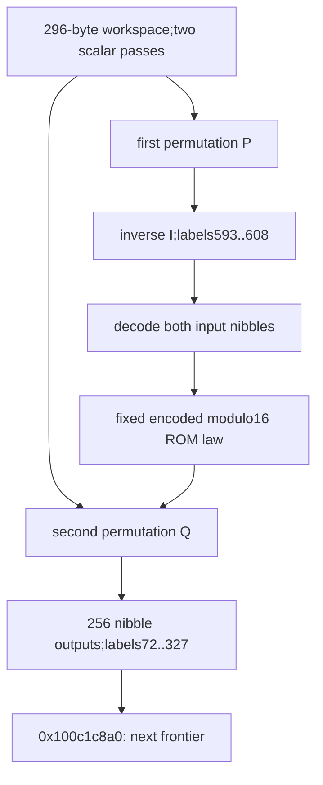

# Inverse nibble map and separately encoded addition modulo16

The successor chain constructs a256-entry nibble table implementing addition modulo16 under separate input and output encodings. It first builds the inverse of the preceding16-value permutation P,then replaces P's forward cells with a second workspace-derived permutation Q. The builder reads both input nibbles through inverse(P),evaluates a fixed image-resident operation A,and reads the result through Q. The captured ROM law is exactly a cyclic group of order16 under a fixed symbol map E. Thus the generated table is `D[x+16*y]=Eout((Ein_inverse(x)+Ein_inverse(y))mod16)`,where Ein=P composed with E and Eout=Q composed with E. This identifies the local operation;native output,whole-algorithm identity and daemon/kext pairing remain unknown. [EA1-EA8]

Evidence: [source,fixups and ROM bytes](triage_evidence/daemon_mode_one_encoded_addition_source.json.zst), [685 UNSAT /one SAT and complete ledgers](triage_evidence/daemon_mode_one_encoded_addition_checks.json.zst), [extractor](triage_evidence/recover_daemon_mode_one_encoded_addition.py), [validator](triage_evidence/validate_daemon_mode_one_encoded_addition.py), [preservation](triage_evidence/daemon_mode_one_encoded_addition_delivery.json), [quality gates](triage_evidence/daemon_mode_one_encoded_addition_quality_gates.json), [sealer](triage_evidence/seal_daemon_mode_one_encoded_addition.py), [publication audit](triage_evidence/verify_daemon_mode_one_encoded_addition_publication.py). Context: [workspace passes and first permutation](daemon_mode_one_workspace_passes_report.md), [checkpoint and LOCAL gate](daemon_mode_one_record_checkpoint_report.md), [image-root lineage](daemon_mode_one_record_rounds_report.md), [word-grid root](daemon_mode_one_record_word_gather_report.md), [interface ABI](interface_abi_report.md).

| Evidence | Verified scope |
| --- | --- |
| Image | `fairplayd.arm64e`,SHA-256 `4ffe3ea1dbd27c5026b448ffe06e8489b02cd9064500bcc67792d4ac36ffb63e` |
| Current source |Three complete BRAA-terminated fragments,438 instructions /1752 B;435 nonbranch sites translated |
| Prior recapture |12 ranges /97016 B |
| Original data |Two256-byte selector banks and928-byte ROM;1440 B captured |
| Pointer provenance |Four authenticated continuation records /five source bindings,and one separate data rebase record |
| ISA checks |18 UMULL,one UDIV,one UBFIZ,one ADRP,one immediate TST and three corrected comparison GPR-write reports;no SP write |
| Accepted checks |685 UNSAT /one abstract SAT,including all174 predecessor queries replayed |
| Inverse construction |16 iterations,16 source-address cases,16 destination-address cases and16 coherent-array cell proofs |
| Second shuffle |16 identity stores,15 swaps,14 bounded source replacements and133 exhaustive selected-address cases |
| Builder |256 iterations;32 inverse-address cases,16 Q-address cases and256 selected-ROM-address cases |
| ROM algebra |256 exact encoded-addition cases,4096 associativity cases,eight order16 generators |
| Integrity |Eight source/stride/ROM/rebase/selector/target/lineage/native-claim alterations rejected |

F denotes the private frame. Define the physical coordinate function

```text
C(label) = F+0x8b0 + ((799*label) mod962)
```

All source addresses use the preferred image placement;runtime ASLR and native mapping identity remain outside this increment. Arithmetic is modular u32/u64 unless explicitly stated otherwise;offsets/extents are bytes. Valid coherent nonwrapping mappings,stable saved roots,immutable selected image bytes,frame/object disjointness and no outside mutation remain premises. No target execution,emulation,API/IPC request,IDA access,IDB mutation or hardware PAC test occurred. These entries are private continuations;public API and compiler-function identities are not established. [EA1-EA4]

## Inverse map and second state stream

At `0x100a4f144`,j starts at zero. The21-instruction body reads the first permutation at C(j) and stores j to C(593+P[j]). Its complete loop contract is

```text
for j in 0..15:
    I[P[j]] = j
physical I[k] = byte[C(593+k)]
```

The source read is at `0x100a4f15c`;the inverse-byte store is at `0x100a4f170`. The16 source and16 destination cases cover the complete nibble domain. The actual bias0x73acf equals799*593. Original pointer slots select0x8721 back to the body for j<15 and0xa206 -> `0x100dcaa6c` after j=15,modifier0xaf8b. [EA2-EA5]

The inverse destinations are distinct and disjoint from the original16 forward cells. The predecessor proof establishes that P permutes0..15. Sixteen symbolic array-cell proofs establish I[P[j]]=j under that bijection;finite-domain bijectivity supplies both inverse directions. The original P cells remain unchanged throughout these16 stores. [EA3-EA5]

The preceding first shuffle and this inverse loop preserve W8,W9,W10,W12,W14. Those are exactly the scalar data inputs consumed by the next shuffle. They come from the second74-word workspace pass. The first shuffle instead consumed preserved first-pass outputs. This establishes two separate data-flow streams from the shared workspace;it does not prove statistical independence or that the resulting P and Q values differ. [EA2-EA4,EA7]

The333-instruction continuation at `0x100dcaa6c` reinitializes C(0)..C(15) to0..15 before its first byte read,then performs15 suffix swaps. A fresh source proof repeats the typed quotient/mask decomposition,checks133 exhaustive selected-address cases and verifies every read-before-write swap effect. Its swaps remain within cells i..15;the final swap selects14 or15. The preserved first inverse bank C(593)..C(608) is untouched. [EA3-EA5]

The new forward table is Q. It uses the same physical C(0)..C(15) cells formerly holding P,so the old forward-P interpretation ends at the identity stores. The inverse I remains available. The second shuffle branches through0x422b -> `0x100cbe01c`,modifier0xd429,with counter W13=0 and image/controller roots prepared for the next loop. [EA3-EA4,EA7]

## Fixed image bank and loader context

The builder loads two u32 controller words through saved pointers:

```text
CELL0 = u64[F+0x580]; C0 = u32[CELL0]
CELL1 = u64[F+0x438]; C1 = u32[CELL1]
m = u32(((C1+C0) XOR0xa6)*0x0a5cd4cf)
s = low8(m)
selector = s XOR RIGHT[LEFT[s] XOR0xa3]
LEFT  = image bytes at 0x100fc4130
RIGHT = image bytes at 0x101031ea0
```

The exact scalar projection and both byte-read addresses are proved from the original source. All256 original selector-byte cases yield0x72,and a universal8-bit lookup proof agrees. Hence these controller values cannot change this component's selected ROM bank under the stated root/image premises. They can change the two selector-byte read addresses. This is not a proof of native ownership,external authorization or observer/side-channel noninterference. CELL0/CELL1 owners remain unknown. [EA2-EA5,EA8]

The selected data-pointer slot is

```text
0x1010a1960 + 8*(0x2fd+0x72) = 0x1010a34d8
```

Its original dyld rebase record supplies value0x129c240c7. Adding the source's u64 bias0xffffffffd7251529 gives ROM base0x100e755f0. The stored file word0x8000029c240c7 is chained-fixup data,not the loaded pointer value. The model uses the rebase target for this addition. Confusing the file word with the loaded value produces an unbacked address and is excluded. This is loader-aware static provenance;it does not verify a native runtime mapping. [EA1-EA3,EA7]

The captured ROM region has928 bytes with a broad byte codomain. Only256 cells are selected by this component. For input symbol byte b=x+16*y,those cells are

```text
R(b) = (653*(290+(b XOR0x88))) mod928
ROM[R(b)] is in 0x40..0x4f
A(x,y) = ROM[R(x+16*y)] XOR0x40
```

The source bias0x2e3ba equals653*290. The256 physical offsets are distinct. The nibble-encoded range applies to these256 cells;it does not apply to the complete928-byte region. Every selected cell,its physical offset,encoded byte and decoded nibble is retained in the source ledger. [EA1,EA3-EA6]

## Recovered ROM operation

The decoded16-by16 table is Latin and commutative. Its identity symbol is12. All4096 associativity cases pass. Eight symbols have order16:0,4,5,6,11,13,14,15. One valid encoding,obtained by repeated operation with generator symbol0,is

```text
E = [12,0,10,13,1,14,8,15,2,6,7,5,9,11,3,4]
E(0)=12
A(a,b) = E((E_inverse(a)+E_inverse(b)) mod16)
```

All256 operand pairs match that equation against the original selected ROM bytes. A separate universal4-bit operand proof checks the same equality. Thus the captured ROM operation is addition modulo16 under E. The eight generator choices supply alternative valid encodings;the selected E is not asserted to be unique. No larger cryptographic algorithm is identified from this local operation. [EA1,EA3,EA6]

## Exact generated-table composition

The84-instruction builder at `0x100cbe01c` takes j=0..255. Let x=j AND15,y=j>>4. It reads I[x] and I[y] from the first inverse bank,combines them as a byte,looks up the selected ROM cell,decodes its byte and reads Q at that decoded nibble. The byte-decoding arithmetic is independently proved equivalent to XOR0x40 for all256 byte values;the selected-ROM range then restricts the Q lookup to0..15. [EA3-EA6]

The source-level construction is

```text
for j in 0..255:
    x = j AND15
    y = j >>4
    a = I[x]
    b = I[y]
    r = ROM[(653*(290+((a+16*b) XOR0x88))) mod928] XOR0x40
    byte[C(72+j)] = Q[r]
```

The source read cases cover both inverse operands,all256 ROM combinations and all16 Q operands. The actual output destination is C(72+j);its obfuscated coefficient simplifies to799. The counter advances by one,with slot0x422b repeating for j<255 and0xaae2 -> `0x100c1c8a0` after j=255,modifier0xd429. [EA3-EA5,EA7]

Write D[j]=byte[C(72+j)]. Substituting I=inverse(P) and the recovered ROM law gives

```text
D[x+16*y] = Q(A(P_inverse(x),P_inverse(y)))
Ein  = P composed with E
Eout = Q composed with E
D[x+16*y] = Eout((Ein_inverse(x)+Ein_inverse(y)) mod16)
```

The construction is separately encoded addition modulo16. Because P,Q,E are bijections and A is a commutative Latin operation,the generated table is commutative,each row/column is a permutation of0..15,and each output symbol occurs16 times across256 entries. Its outputs are nibbles;it is not a256-value byte permutation. These are compositional consequences of the source/array contracts and finite ROM proof,not native samples. [EA3-EA6]

Associativity and an identity do not generally survive different input/output encoding roles. One abstract SAT control uses identity input encoding and an output encoding that swaps0 and1;the resulting operation is nonassociative. This does not establish that a particular native workspace produces those encodings. The ROM law and generated table must therefore retain distinct semantic descriptions. [EA6,EA8]



## Preserved state and architectural boundaries

The final initialized domains are disjoint:

| Logical labels | Meaning | Cells |
| --- | --- | --- |
|0..15 |Second forward permutation Q |16 |
|72..327 |Generated encoded-addition table D |256 |
|593..608 |First inverse permutation I |16 |

They provide288 known cells in the coordinate modulus962. The remaining cells are not claimed initialized by this increment. The builder writes one byte per iteration,256 bytes total,and makes six byte reads per iteration:three from the private nibble domains and three from image lookup data. Its output cells are disjoint from I/Q,so both input maps remain stable through the loop under the no-outside-mutation premise. [EA3-EA5,EA7]

The source preserves the296-byte workspace,saved request/LOCAL words and derived frame views. The earlier F+0x750=F+0xc80 root is not consumed by these three continuations. Reaching image roots at F+0x568/F+0x588 and controller pointers at F+0x438/F+0x580 are retained ABI/mapping premises;the checkpoint write census has zero intersections with their32 bytes. The current accesses stay within the proved byte banks and private-cell domains. [EA2-EA4,EA7]

All three fragments terminate in one authenticated branch and contain no internal call,branch or trap. They expose no new Mach send/receive,port allocation,right transfer or message-emission site. Actual LOCAL/output ownership,external serialization and a matched daemon/kext contract remain unknown. The next source frontier is `0x100c1c8a0`;its semantics are not included in this proof. [EA1,EA4,EA8]

## Assumption register and bounded continuation

| ID | Assumption / dependent result | Stress test or falsification probe |
| --- | --- | --- |
| EA1 |Pinned image,ROM and fixup metadata identify this variant |Recapture1752 current/97016 prior code bytes,1440 data bytes,four authenticated continuation records and one separate rebase;reject eight alterations |
| EA2 |Predecessor state,root values and separate scalar streams compose |Replay all174 predecessor queries;check five preserved second-pass outputs,actual second-shuffle ABI and protected root slots;CELL0/CELL1 ownership remains unknown |
| EA3 |ISA widths,SSA,load interfaces and array composition are accurate |Translate435 sites;verify raw opcode fields,inverse array cells,all current source shapes,byte value flow,selector projection and typed decoding |
| EA4 |Mappings are coherent/nonwrapping,roots and image bytes stable,objects disjoint and no outside mutation occurs |Check all288 distinct physical cells,read-before-write swaps,disjoint inverse/output banks and all saved-slot intersections;native maps/owners remain unproved |
| EA5 |Finite domains cover the actual branches and address equations |Prove16-iteration inverse,133 shuffle cases,32 inverse-builder cases,256 ROM cases,16 Q cases and exact256 progress/destinations;bounded cuts retain their original expressions |
| EA6 |ROM algebra and generated-table algebra are distinguished |Check256 encoded-addition/4096 associativity cases,eight generators and universal ROM proof;retain the abstract nonassociative encoding counterexample |
| EA7 |Frame/register epochs and loader representations are respected |Check forward-P replacement,inverse retention,Q/output labels,rebased data pointer versus raw file word,and the unconsumed F750 root |
| EA8 |Local semantics do not establish native output,reachability or cross-layer linkage |Analyze0x100c1c8a0 and actual owners/serialization/peer ABI;controller address-trace variation and native encoding reachability remain separate |

| Impact | Next investigation | Required evidence |
| --- | --- | --- |
| High |`0x100c1c8a0` and successors |Actual consumers of D/I/Q and the saved F750 root |
| High |Caller-visible output and daemon/kext linkage |LOCAL/result consumers,owner/extents,serialization and matched external contract |
| Medium |Other generated operation tables |Recover their ROM laws and input/output encoding relations independently |
| Medium |Scalar-to-symbol encoding functions |Compose both74-word recurrences with the exact P/Q shuffle choices rather than their bounded invariant models |
| Medium |Controller-pointer provenance |Identify CELL0/CELL1 producers and mutation context without conflating bank-choice constancy with access-trace constancy |

The fixed construction uses bounded work/space per invocation. For an m-symbol generalization,the inverse and suffix shuffle take O(m) work,the output table O(m^2) work/space,and the explicit associativity audit O(m^3) verification work. Here m=16:16 inverse stores,46 second-shuffle byte stores and256 builder stores total318 byte-write effects. Source extraction/translation is linear in captured bytes/instructions;SMT runtime is solver-dependent,limited to15000 ms per query and20 s per process.

QG1:Claims concern factual source,private ABI,loader context,finite algebra and provenance.

QG2:EA1-EA8 identify assumptions,dependent results and falsification probes.

QG3:The increment covers inverse construction,separate second-shuffle state,ROM selection/fixup/codomain,exact encoded operation,generated-table layout,architectural limits and publication artifacts;the broader objective remains active.

QG4:438*4=1752 B of current code;512+928=1440 B of data;16+16+256=288 distinct initialized cells;16+46+256=318 byte-write effects. Symbol widths,preferred addresses and modular arithmetic are explicit.

QG5:The static ROM group is distinguished from its separately encoded table;whole-bank versus selected-cell codomains,raw file word versus rebased pointer,and changing frame epochs remain separate.

QG6:Claims trace to the pinned image,original fixups,captured byte tables,fresh source comparison,685 UNSAT/one abstract SAT,complete finite ledgers and174 replayed predecessor queries. No native behavior is inferred.

QG7:Impact-ranked next steps cover table consumers,LOCAL/output/cross-layer ownership,other encoded operations,exact encoding functions and controller provenance. No unrelated target probing is included.
