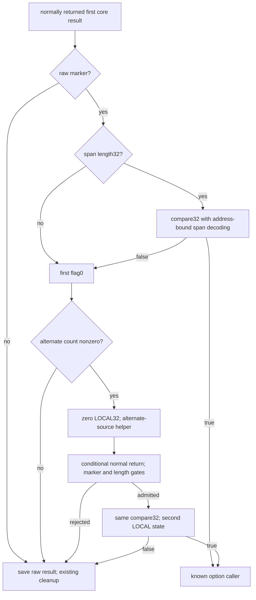

# Mode1 output verification, address-bound span codec and alternate-source retry

The caller consumes the recovered 32-byte LOCAL result as a verification candidate. After raw result 0x8b3dc651, it requires the first-key span's decoded length to be 32 B and compares every byte against an address-dependent decoding of that span. A match rejoins the established option accessor. A mismatch can zero LOCAL and retry the protected helper with source OBJ+0x38/count OBJ+0x5c, replacing the initial OBJ+0x18/count OBJ+0x58 interface. These are conditional static contracts: ordinary protected returns, zero wrapper SP delta and preserved frame/owner relationships remain premises. No native comparison, complete processing budget history, whole algorithm or daemon-kext transport is established. [OV1-OV8]

Evidence: [original bytes and dispatch records](triage_evidence/daemon_mode_one_output_verification_source.json.zst), [proofs, compact mask equations and ledgers](triage_evidence/daemon_mode_one_output_verification_checks.json.zst), [extractor](triage_evidence/recover_daemon_mode_one_output_verification.py), [validator](triage_evidence/validate_daemon_mode_one_output_verification.py), [preservation](triage_evidence/daemon_mode_one_output_verification_delivery.json), [quality gates](triage_evidence/daemon_mode_one_output_verification_quality_gates.json), [sealer](triage_evidence/seal_daemon_mode_one_output_verification.py), [publication audit](triage_evidence/verify_daemon_mode_one_output_verification_publication.py). Context: [private result serialization](daemon_mode_one_result_publication_report.md), [protected adapter and SP delta](daemon_mode_one_adapter_report.md), [first-key span and mode selection](daemon_outer_first_key_report.md), [outer object and LOCAL reservation](daemon_reader_outer_lifecycle_report.md), [option/default contract](daemon_reader_option_default_report.md).

| Evidence | Verified scope |
| --- | --- |
| Image | fairplayd.arm64e, SHA-256 `4ffe3ea1dbd27c5026b448ffe06e8489b02cd9064500bcc67792d4ac36ffb63e` |
| Current source | 24 ranges; 555 instructions / 2220 B; all 533 nonbranch sites translated |
| Prior recapture | 67 ranges / 49428 B |
| Control provenance | 32 source/slot/modifier bindings, four saved continuations, 30 original authenticated pointer records |
| Internal call | Original 8 B modifier/BLRAA pair to retained adapter; no call executed |
| ISA checks | Eight ROR/EXTR aliases, six rotated EOR operands, three logical immediates, one UBFIZ, one register-LSR, one EON and 16 zero halfword stores: 36 checks |
| Comparison metadata | 11 Capstone comparison GPR-write reports corrected to no architectural GPR write |
| Accepted checks | 71 UNSAT / three abstract SAT; 13 predecessor propositions replayed |
| Fixed comparison | 32 iterations; 32 SPAN byte reads and 32 LOCAL byte reads; no data-dependent early exit in this source loop |
| Retry initialization | 16 u16 stores / 32 distinct LOCAL bytes zeroed |
| Seed preservation | 97-instruction wrapper prefix preserves five required seeds; save/restore pairs and the actual retry cycle are source-proved under ordinary callee preservation |
| Integrity | Eight altered source, bound, retry operand, target, shift, continuation, lineage and native claims rejected |

K is the shared outer frame, OBJ its saved object, LOCAL the earlier reserved 32-byte scratch record, SPAN the first-key fitted payload, and ENCLEN its stored u32 extent. Offsets/constants are hexadecimal; byte extents are decimal. Arithmetic is modular u8/u32/u64. The first-key lookup uses encoded key 0xd719dce3 / decoded identifier 0x5c241ab2. The retained span producer saves SPAN at K+0x58a0 and ENCLEN=`payload_length XOR 0x8b3dc651` at K+0xf7c. This does not establish a public request type or the native owner of the borrowed span. No target execution/emulation, API/IPC request, new IDA access, IDB change or hardware PAC test occurred. [OV1-OV4,OV8]

## Return boundary and exact encoded-length gate

The prior core writes LOCAL+0..31 and raw result 0x8b3dc651 to REQUEST+0. The original wrapper reloads this result through an anchored saved base, but reloads its continuation relative to K+delta. Equality with the original saved continuation cell requires delta=0. The result store alone proves neither that delta nor a normal canary/PAC return. The prerequisite source queries are replayed; complete processing-path budget preservation remains unknown. [OV2-OV4,OV8]

Under that ordinary-return/zero-delta boundary, saved selector 0x15db / IA diversity 0x3275 reaches `0x100911fe0`. This consumer admits exact raw result 0x8b3dc651 through slot 0xa1da to `0x10084fbc4`; every other u32 result takes slot 0xb9a to common result staging `0x100975d34`. Thus the raw marker has a concrete caller-defined role: admission to verification. It does not by itself establish outer success or an external reply. [OV2-OV4,OV6]

Setup `0x10090151c` derives these seven saved words from low32(K+0x9d0)=0x6cf4; the phase's high 32 bits remain arbitrary:

| Field | Exact u32 value |
| --- | --- |
| K+0x990 | 0x00000b9a |
| K+0x9a0 | 0x8b3dc671 |
| K+0x988 | 0x0000aa40 |
| K+0x998 | 0x0000e2f6 |
| K+0x980 | 0x8b3dc651 |
| K+0x978 | 0x00007b31 |
| K+0x970 | 0x00000c0b |

The length gate compares ENCLEN at K+0xf7c with K+0x9a0. Equality is exactly decoded length 32 B because `0x8b3dc671 XOR 0x8b3dc651 = 0x20`. Its source routing is:

| ENCLEN | Slot / target | Consequence |
| --- | --- | --- |
| 0x8b3dc671 | 0x865d / 0x1006cb98c | Establish comparator seeds and enter shared setup |
| Every other u32 | 0x8653 / 0x100901ec4 | Store byte 0 at K+0x4e17; continue to alternate-count gate |

The unequal-length component reads neither payload buffer. It clears the comparison flag rather than returning an independently interpreted public error. [OV2-OV4,OV6]

## Shared comparator and address-dependent byte predicate

The first seed selects slot 0x7dc8 -> `0x10093cec4`, supplying W8=0x7b9 and W12=0x6cf4. Setup loads LOCAL from K+0x2290 and SPAN from K+0x58a0, saves the selected return code pointer at K+0x9b8, and initializes u64[K+0x9bf0]=0. The latter cell is the counter; K+0x9b8 has changed epoch from an earlier context role to a saved continuation. It supplies the complete live-register seed map retained in the checks and enters the loop at `0x100baddd0` through slot 0x5619 / IA 0x837a. [OV2-OV5]

For iteration j, the two actual data reads are:

| Source PC | Exact address / width |
| --- | --- |
| 0x100bade40 | SPAN+j / u8 |
| 0x100bade78 | LOCAL+j / u8 |

Let A=u64(SPAN+j). The source computes a u64 mask M from `A AND 0xfffffffffffffff8`, then selects its byte lane by shifting right `8*(A AND 7)`. Independent compact u64 equations in the validator match the complete original mask expression for every address. They retain six two-state rotate/XOR/add steps, the actual intervening transforms, and all original constants; no sampled mask value replaces the source computation. The UBFIZ lane construction, register shift, eight ROR aliases and six rotated EOR operands are independently decoded from original instruction words. [OV1,OV4-OV5]

This mask depends on the aligned address, not on the input byte values. Retained abstract source valuations give:

| Aligned abstract address | Mask word |
| --- | --- |
| 0x0 | 0x762302ed1a6caef6 |
| 0x8 | 0xa844fe0de088744e |

These are satisfiable bit-vector component valuations, not native readable addresses or test requests. The distinct words refute an address-independent mask. The source computes a word from address arithmetic; it does not load an aligned qword from SPAN. The only SPAN/LOCAL data loads are the two u8 operations above, even for an unaligned SPAN base. [OV3-OV5,OV8]

The exact low-byte difference is:

```text
maskbyte[j] = low8(M(align_down8(SPAN+j)) >> (8*((SPAN+j) AND7)))
D[j] = LOCAL[j] XOR SPAN[j] XOR 0xd1 XOR maskbyte[j]
```

The LOCAL-side arithmetic reduces modulo 256 to XOR 0xd1. The initial accumulator is u32 0x155e2952. Each original source iteration applies:

```text
A_next = (A_current AND NOT zero_extend32(D[j]))
         OR (0xad AND zero_extend32(D[j]))
```

The low-byte constants 0x52 and 0xad are complements. A separate 32-step algebra certificate therefore proves:

```text
A_final = 0x155e2952 XOR zero_extend32(D[0] OR ... OR D[31])
A_final == 0x155e2952  iff  every D[j] == 0
```

One retained abstract counterexample sets both stored input bytes to zero at abstract address zero. The selected mask byte is 0xf6, D=0x27, and one accumulator step becomes 0x155e2975. This rejects plain memcmp as the source predicate; it constructs no native transaction or failure. [OV4-OV5,OV8]

The counter advances by one, and the sole loop branch tests the incremented u64 counter against 31. Under the initialized counter, iterations 0..30 repeat through slot 0x2b3f; iteration 31 exits through 0x2b4b to `0x1006d5464`. Live roots/seeds are preserved or restored on every iteration. The counter ledger plus the universal source-iteration theorem establish exactly 32 reads from each buffer. There is no data-dependent early exit in this loop; native timing properties are not proved. [OV3-OV5]

The finish component compares the accumulator with 0x155e2952 and sets W13 to exactly 0 or 1. Slot 0x5667 reaches relay `0x10087a3b8`, which branches through the saved code pointer with IA diversity 0x7af9. The first saved selector 0x7b9 resolves to `0x1006a9f68`. That consumer stores the boolean at K+0x4e17. True selects slot 0x96b9 -> `0x1009aab5c`; false selects 0x744f -> `0x10075b2f8`. [OV2-OV6]

Equivalent analytical pseudocode, under the stated source/mapping contracts, is:

```text
bad = u8(0)
for j in 0..31:
    a = u64(SPAN+j)
    k = low8(stream64(a AND ~u64(7)) >> (8*(a AND7)))
    bad = bad OR (LOCAL[j] XOR SPAN[j] XOR0xd1 XOR k)
return bad == 0
```

The exact stream64 equations are retained and universally compared with the original source in the checks. The algorithm reads 64 data bytes and uses constant scalar state. Generalized to N bytes, this form is O(N) time / O(1) auxiliary space; the source component has fixed N=32. An algorithm identity for the earlier eight-word computation does not follow from this comparison. [OV4-OV5,OV8]

## Alternate source and second comparison

On the first false flag, `0x10075b2f8` reads u32[OBJ+0x5c]. Zero selects slot 0x4382 -> `0x100941a74` with raw result 0x74c29d77. Nonzero selects slot 0x43c1 -> `0x1006869dc`. The retry block performs 16 zero/u16 stores at LOCAL+0,2,...,30, covering exactly 32 B. It then reuses helper entry `0x100729920` with:

| Operand | First invocation | Retry |
| --- | --- | --- |
| Collection input | u64[OBJ+0] | u64[OBJ+0] |
| Source address | OBJ+0x18 | OBJ+0x38 |
| Count cell | OBJ+0x58 / u32 | OBJ+0x5c / u32 |
| LOCAL | Earlier 32-byte scratch root | Same root, zeroed before helper entry |
| Private selector W9 | 0xd1a433c1 | 0xd1a433c1 |
| Saved return selector W24 | 0x15db | 0x15cc |

The retry source is an inline object address, not a pointer loaded from OBJ+0x38. The count-cell address is likewise distinct from its u32 contents. The helper entry loads that count and C0, saves the retry continuation from slot 0x15cc at K+0x2300, and uses the existing C0 NULL/non-NULL dispatch. Full alternate-input processing and the resulting 32-byte values are not newly proved. [OV2-OV4,OV6-OV7]

The original wrapper prefix before 0x1009bb534 contains 97 instructions, no calls and no write to X21/X25/X26/X28/X30. At 0x1009bb534/538 it saves X21 into X27 and X30 into X23. The ordinary callee-preservation premise carries those pairs across the adapter; the post-call source restores X21/X30, resets X0/X27 and W23, and retains X25/X26/X28. The actual retry-cycle composition proves that all comparator seeds reach the second setup unchanged or are reestablished there. A coincident frame offset or a hand-inserted seed map is not the sole evidence for this join. [OV2-OV4,OV7]

With the same zero-delta/saved-frame premise, selector 0x15cc reaches `0x10070815c`. Exact raw result 0x8b3dc651 selects slot 0x5c9d -> `0x1009b19ac`; every other result selects the common staging block. The second length gate derives the same expected encoded value 0x8b3dc671 from K+0x970 and preserves the first comparison flag. Equal length selects 0x87a3 -> `0x1008f0ba4`; unequal length selects 0x7b31 -> the common flag gate. [OV2-OV4,OV6-OV7]

The second seed reuses comparator entry 0x10093cec4 with the distinct saved return selector 0x7b7. The same 32-byte predicate applies to the second LOCAL contents. Its saved continuation resolves to `0x10068ab84`: second true selects 0x7b40 directly to the option caller; second false selects 0x7b31 to the common first-flag gate. In the actual stable first-failure retry path, that first flag is zero, so a second false result selects failure. The generic shared gate still admits an independently supplied exact first flag 1; this is a broader component contract, not a claim that this value occurs on the actual retry path. [OV3-OV4,OV6-OV7]

## Option join, failure staging and external interfaces

Both option routes supply W10=0x935 to `0x1008b35a4`. This is the already established option caller:

```text
X8 = OBJ
W9 = 0xf24be74b                    // option key
X11 = K+0x53ac                    // borrowed u32 output cell F
W22 = 0x6cf4
slot0x3b01 ->0x100847998
IA diversity0x5722
```

The earlier option/default contract subsequently selects a decoded u32 or its retained default under exact status conditions. The new result connects mode1 verification to that existing interface; it does not prove complete later parsing, final output construction or external delivery. [OV2-OV4,OV6,OV8]

Verification failure reaches `0x100941a74`, stores raw 0x74c29d77 at K+0x5f60, and selects existing cleanup through slot 0xc04f. Nonmarker core results instead enter `0x100975d34`, which saves their actual raw u32 at the same cell before resetting W6 to 0x8b3dc651 on both outgoing arms. That reset must not be interpreted as universal outer success. Public error names and the final transport status remain unknown. [OV2-OV4,OV6,OV8]



The comparator emits no LOCAL bytes and performs no direct Mach/IOKit/API call. Its writes are the counter and, in surrounding components, saved control pointers, byte flags, the LOCAL retry clear and raw result staging. The captured 8 B call pair is the existing internal protected adapter call, not a new transport site. This increment identifies zero new Mach port emissions, right transfers, port allocations or receive sites. The candidate buffer has a verified local consumer; no serialization of those bytes into a Mach message, XPC reply or IOKit argument is established. [OV1-OV4,OV8]

## Assumption register and falsification probes

| ID | Assumption / dependent result | Stress test or falsification probe |
| --- | --- | --- |
| OV1 | Pinned image and original pointer records match the analyzed build. | Rehash the image; recapture all current/prior ranges; independently check 36 instruction encodings and reject source/fixup changes. |
| OV2 | Retained request, span, LOCAL, phase and saved-return contracts reach the stated boundaries. | Replay 13 predecessor propositions; match actual selectors, both request-source/count interfaces and the option-call operands; a reaching-state mismatch breaks composition. |
| OV3 | Stable coherent nonwrapping mappings and required owner separation hold. | Audit writable extents and aliases: counter/control writes must not alter input buffers; retry zeros/helper writes must preserve any prior SPAN state used in composition. The readonly comparator alone does not require the two buffers to be distinct. |
| OV4 | The recorded ARM lowerings and byte/word widths are exact. | Check ROR/EXTR, rotated EOR, UBFIZ, register-LSR, EON, immediate masks, zero halfword stores and the 11 corrected comparison roles; reject altered bounds/shift evidence. |
| OV5 | The comparator starts at counter0 with the proven live seeds and initial accumulator. | Prove its complete entry map, universal iteration, live-register invariants, 31-repeat/final-exit split and 32-step reduction; a different seed/counter invalidates the predicate. |
| OV6 | Raw markers, boolean flags and frame epochs retain their source roles. | Test exact marker versus other u32 results and both boolean arms; track the new K+0x9b8 continuation epoch and saved raw result before W6 resets. |
| OV7 | Ordinary callee preservation, normal canary/PAC returns, zero wrapper delta and outer-frame continuity hold across each protected invocation. | Verify the 97-instruction prefix and explicit seed save/restore pairs; audit all core budget writers and return guards before promoting the conditional source joins to execution claims. |
| OV8 | Static component proofs and abstract SAT examples are not native observations or whole-algorithm/transport proofs. | Reject invented native claims; require a continuous owner/return/serialization contract before asserting a native transaction or daemon-kext pairing. |

## Bounded continuation

| Impact | Next evidence | Question resolved |
| --- | --- | --- |
| High | Complete selected-path core budget-write and return-guard audit | Whether processing returns delta0, closing the remaining actual-call boundary for the verified consumer. |
| High | Compare this exact address-mask function with the stored-span producers/readers and their buffer epochs | Where the address-bound representation is introduced; whether apparent equal logical payloads can use different stored bytes at different aligned addresses. |
| High | Trace option-parser output and its callers to existing serialization/transport sites | Whether any verified candidate affects an XPC reply, IOKit selector or matched kext interface. |
| Medium | Source/extent producers for OBJ+0x38 and OBJ+0x5c | Actual alternate-input roles, admissible count and native owner/alias constraints. |
| Medium | Compact eight-word core recurrence with independently valid lookup values | Algorithm identity of the candidate producer, beyond its established verification role. |

## Scoped quality gates

- QG1: Source, ABI, representation and control-flow claims require no normative conclusion.
- QG2: OV1-OV8 enumerate assumptions, dependencies and falsification probes.
- QG3: The increment covers result consumption, both length gates, complete fixed32 comparison, address mask, retry source/count/clear, seed continuity, option join, failure staging and captured transport boundaries. The broader interface objective remains active.
- QG4: All extents are bytes and arithmetic widths are explicit. 16*2=32 B are zeroed; 32*2=64 data-byte reads occur per comparator invocation. Source extraction/modeling is O(captured instructions/effects); the generalized byte loop is O(N) time/O(1) auxiliary space. QF_BV solving has exponential worst-case Boolean complexity; query/process limits are 45000 ms / 50 s.
- QG5: Direct byte equality is refuted; address-derived mask words are separated from memory reads; first/second LOCAL states, continuation epochs, generic shared-flag behavior and actual first-failure retry state are distinguished. Normal return, zero delta and ownership remain explicit premises.
- QG6: Original executable/fixup bytes, 67 recaptures, 36 ISA checks, 71 UNSAT proofs, three abstract SAT checks, 13 predecessor replays and eight rejected alterations provide scoped provenance. Strict solver acceptance rejects nonzero exits, stderr, errors, unknowns and timeouts; the earlier invalid probe is excluded.
- QG7: Impact-ranked continuation targets remaining return, representation, owner, algorithm and serialization questions without inferring native or cross-layer completion.
