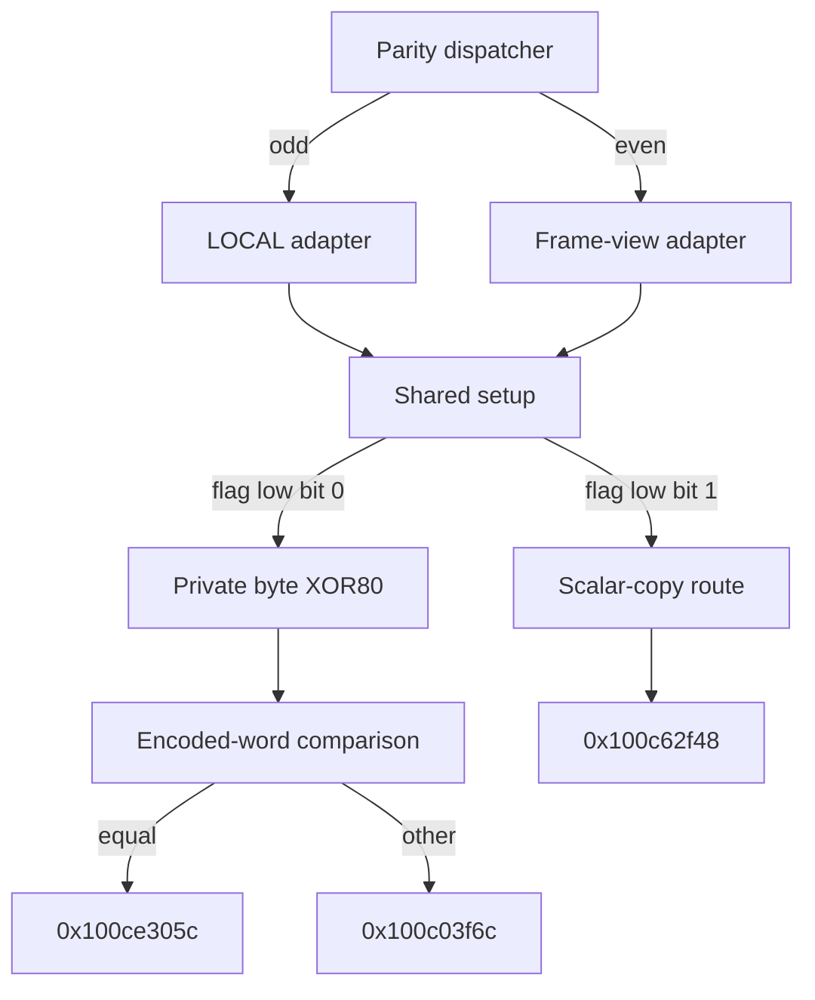

# Parity-specific state interfaces and conditional private-byte update

The initializer successor dispatches on a private u32 word's low bit. The odd adapter restores LOCAL+bias and X0=0;the even adapter retains a numeric bias at the same slot and restores X0 from a saved frame view. Both reach one setup routine. A following conditional update flips bit7 of one byte selected through modulo962,then reaches another comparison fork. The component index can address every cell in that962-byte domain;an actual plane-only bound requires additional correlated-producer evidence. The previous800-cell retention guarantee therefore ends before this update. [PA1-PA8]

Evidence: [source and authenticated edges](triage_evidence/daemon_mode_one_parity_state_adapters_source.json.zst), [proofs and state ledgers](triage_evidence/daemon_mode_one_parity_state_adapters_checks.json.zst), [extractor](triage_evidence/recover_daemon_mode_one_parity_state_adapters.py), [validator](triage_evidence/validate_daemon_mode_one_parity_state_adapters.py), [preservation](triage_evidence/daemon_mode_one_parity_state_adapters_delivery.json), [quality gates](triage_evidence/daemon_mode_one_parity_state_adapters_quality_gates.json), [sealer](triage_evidence/seal_daemon_mode_one_parity_state_adapters.py), [publication audit](triage_evidence/verify_daemon_mode_one_parity_state_adapters_publication.py). Context: [workspace/state installation](daemon_mode_one_workspace_state_install_report.md), [LOCAL and saved frame views](daemon_mode_one_record_checkpoint_report.md), [arithmetic/codec suite](daemon_mode_one_nibble_operation_suite_report.md), [preceding state epochs](daemon_mode_one_record_rounds_report.md), [interface ABI](interface_abi_report.md).

| Evidence | Verified scope |
| --- | --- |
| Image | `fairplayd.arm64e`,SHA-256 `4ffe3ea1dbd27c5026b448ffe06e8489b02cd9064500bcc67792d4ac36ffb63e` |
| Current source | Seven complete BRAA-terminated ranges;1,227 instructions /4,908 B;1,220 nonbranch sites translated |
| Prior source | Nine recaptured ranges /51,004 B;fresh4,869-site incoming initializer translation |
| Dispatch provenance | Nine authenticated records /ten source slot-modifier bindings |
| ISA checks | Original UMULL encoding,one corrected comparison GPR-write report;zero SP writes |
| Accepted results |34 UNSAT /four abstract SAT;15 predecessor queries replayed |
| Source effects |68 load /43 store instructions,including one u8 read and one u8 store |
| ABI contexts | Two parity adapters,two composed initial-context setup entries and one generic flag partition |
| Coordinate proof | Exact source BV expression plus integer reciprocal/remainder/width theorem;symbolic preimages for all962 component cells |
| Integrity | Eight source/control/multiply/modifier/lineage/SP/native alterations rejected |

F denotes the private frame. Offsets/extents are bytes. Scalar operations are modular u32/u64 except where the integer theorem is explicit. Valid nonwrapping coherent frame/table mappings and no outside mutation remain premises. The inherited LOCAL-selected context supplies F+0x358=LOCAL+0x2c238c16ca76f3a8,F+0x368=F+0x1150,F+0x370=F+0x1100. LOCAL's native ownership and accessible extent remain unknown. No target execution,emulation,API/IPC request,IDA access,IDB mutation or hardware PAC test occurred. [PA1-PA4,PA7]



## Incoming epoch and parity dispatcher

Fresh translation of the preceding initializer proves:

```text
F+0x708 : u32 0xc83d
F+0x4f8 : u32 0
F+0x380 : u64 0
X11     : u64 1
F+0x350 : u64 0x2c238c16ca76f3a8
F+0x358 : saved LOCAL+bias,preserved
```

The zero store at `0x100b5ad68` establishes F+0x380's current value;the zero store at `0x100b57f24` establishes F+0x4f8. These are current machine representations,not inherited pointer/counter identities. [PA2,PA3,PA6]

The19-instruction dispatcher at `0x100b6fe00` saves incoming W11 as u32 PAR at F+0x4b4. It reads F+0x708 and selects

```text
PAR low bit1 -> slot0xc86a -> 0x100c22ec4
PAR low bit0 -> slot0xc83d -> 0x100be0eac
W12=W15=0x255c
W20=the u32 word reloaded from F+0x748
```

The BRAA at `0x100b6fe48` uses modifier0xb0ef. This partition is proved for every u32 PAR. The actual recorded incoming X11=1 selects the odd adapter. PAR is a private phase word;its identity as an iteration count,public selector or externally supplied field is not established. The broader even-entry composition is a component contract and does not prove a later native even iteration. [PA2,PA3,PA5]

## Two adapters,one setup continuation

| Contract | Odd adapter | Even adapter |
| --- | --- | --- |
| Source entry | `0x100c22ec4`,644 instructions | `0x100be0eac`,294 instructions |
| Selected scalar bank | Lower frame slots including F+0x2b0..0x2fc | Separate slots including F+0x30c..0x348 |
| F+0x350 | Copy of saved LOCAL+bias from F+0x358 | Initializer's numeric bias word remains |
| F+0x360 | Initializer's0x0ff0ed06a1ef8a89 remains | Copy of initializer's64-bit F+0x300 word |
| X0 |0,u64 | Saved F+0x370 value,F+0x1100 |
| X21 | F+0x8b0 | F+0x8b0 |
| W20 |0xd6 |0xd6 |
| Final branch | `0x100c238d0`,modifier0x5630 | `0x100be1340`,modifier0x5630 |
| Selected slot/target |0x255c -> `0x100d74e68` |0x255c -> `0x100d74e68` |

The odd adapter restores the LOCAL representation with the u64 load/store at `0x100c238b8`/`0x100c238bc`. The even adapter instead copies F+0x300 to F+0x360 at `0x100be1304`/`0x100be1308` and restores the saved frame view at `0x100be1328`. Neither dereferences LOCAL. Both adapters perform12 literal frame stores /52 B;their24/22 loads read116/108 B respectively. Complete register expressions and scalar-bank reads/writes are retained in the SSA/effect ledgers. A decoded equivalence between the two scalar banks is not claimed. [PA2-PA4,PA6]

The200-instruction setup at `0x100d74e68` has15 frame stores /64 B and five loads /28 B. It saves X0 back to F+0x380,so that slot is zero in the odd composition and a frame view in the even composition. A phase-independent pointer or counter type for X0/F+0x380 would be incorrect. Setup preserves X21 and establishes W9=0x9654,W12=0x1e31,W2=0x4a62f57c. [PA2,PA3,PA6]

At `0x100d75154`,setup chooses slot0x966a -> `0x100c2ab70` when F+0x4f8's low bit is0,or0x9654 -> `0x100dc4288` when it is1. BRAA at `0x100d75184` uses modifier0xb9e1. Both compositions with the freshly initialized frame retain flag0 and therefore select the byte-update route. The generic flag1 contract is proved separately;later native reachability remains unknown. [PA2,PA3,PA5]

## One conditional byte mutation

The31-instruction continuation at `0x100c2ab70` reads A=word32(F+0x4ac),B=word32(F+0x4a4) and the private root X21=F+0x8b0. Its exact coordinate calculation is

```text
N = u32(799*u32(B-u32(0x4a62f57c+A)+0x94b008bb)+0xcdb8383b)
M = floor(N/2)
C = 0x883fddf1
q = floor((M*C)/2^40)
r = N-962*q = N mod962
address = F+0x8b0+r
byte[address] = byte[address] XOR0x80
```

The load/store sites are `0x100c2abc8`/`0x100c2abd0`. The original UMULL consumes two32-bit words and yields a64-bit product. The source expression,quotient shape,read/store address equality and XOR byte value are proved without replacing source values by cipher operations. The integer theorem uses

```text
481*C = 2^40+465
0 <= M < 2^31
M = 481*Q+R, 0<=R<481
N = 2*M+E, E in {0,1}
```

It proves that the product/shift quotient equals Q,that0<=N-962*Q<962,and that every product,quotient and subtraction used by the machine expression fits its claimed width. The64-bit product and32-bit remainder are therefore exact under the documented mapping premises. The private byte destination is always within F+0x8b0..F+0xc71 inclusive. [PA3,PA4]

The unrestricted full-source and standalone-tail bit-vector bound queries returned `unknown` at15,000 ms and are excluded from accepted certificates. The accepted bound derives from the exact source bit-vector shape and independent QF_LIA theorem,not those queries. [PA3]

The independent-word component model admits every physical residue r in0..961. One symbolic preimage is

```text
A = 0
B = u32(0x4a62f57c-0x94b008bb
        +1365358815*u32(r-0xcdb8383b))
(799*1365358815) mod2^32 = 1
```

One universal source query proves N=r and the exact destination for every such r. Two fully specified abstract examples select the first and last domain cells and map input byte0 to0x80. These are internal component valuations,not decoded native requests. Actual A/B and register/workspace correlations may restrict the selected cell. No actual plane-only,arithmetic-table-only or fixed-cell classification has been established. Accordingly,the predecessor's800 preserved arithmetic/codec cells are proved intact through initialization and the adapters/setup;their complete preservation past this byte update is not proved. [PA3-PA5]

The byte continuation selects slot0x1e31 -> `0x100c55454`,modifier0xe346 at `0x100c2abe8`. Its outgoing W8=0x4d20 and W10=u32(0x4a62f57c+A) bind the next comparison. [PA2,PA3]

## Following fork and alternate route

The20-instruction comparison at `0x100c55454` saves W2 at F+0x37c and selects

```text
u32(word32(F+0x4b0)-u32(0x4a62f57c+A)+0xc4b76cdf) == 0xe34e8780
    equal -> slot0x662c -> 0x100ce305c
    other -> slot0x4d20 -> 0x100c03f6c
```

Its BRAA at `0x100c554a0` uses modifier0x1aad. The operand is an encoded source-state comparison;neither a decoded length threshold nor a public status meaning is assigned. [PA2,PA3,PA5]

The alternate19-instruction setup-flag1 continuation at `0x100dc4288` copies F+0x4ac to F+0x4a8,restores another scalar word from F+0x720 and copies incoming X14 into X2. It has no byte access. Slot0x34d0 -> `0x100c62f48` is selected at BRAA `0x100dc42d0`,modifier0x63f8. This route does not rejoin the20-instruction comparison at the same entry. Semantics beyond these three outgoing targets remain unproved in this increment. [PA2,PA3,PA5]

All literal frame stores in the seven ranges end below F+0x768. The computed byte store is confined to the962-byte private domain. F+0x358,F+0x368/F+0x370,F+0x388,TABLE at F+0x740,the roots at F+0x750/F+0x758 and all296 workspace bytes are preserved. F+0x350,F+0x360,F+0x380 and F+0x37c have the new explicit phase-specific roles above. Zero Mach-port emissions occur in these selected ranges;all their control transfers are the recorded private BRAA edges. No new daemon/kext pairing,object ownership or externally exposed control field follows from these local contracts. [PA2-PA7]

## Assumption register and bounded continuation

| Assumption | Dependent result | Stress test or falsification probe |
| --- | --- | --- |
| PA1 | Pinned image and prior selected-path evidence identify this build | Rehash image;recapture all source/fixup bytes and parent ranges;reject source/lineage alterations |
| PA2 | Selected LOCAL-context roots and incoming initializer contracts compose | Replay15 prior queries;freshly translate initializer;prove both adapter entry interfaces and initial flag/position values |
| PA3 | Instruction,byte-forwarding and integer models match the selected source | Cover1,220 new nonbranch sites;decode UMULL;reject multiply/modifier/SP alterations;accept no unknown/error/timeout as a proof |
| PA4 | Frame/table mappings are valid,coherent,nonwrapping and privately stable | Prove every effect address,scalar-slot disjointness and exact962-byte reduction;native mapping/alias validity remains unknown |
| PA5 | Generic parity,flag,A/B and byte inputs overapproximate component entries | Prove all-u32 partitions and all962 symbolic preimages;label abstract samples;seek correlated-producer invariants before classifying actual byte cells |
| PA6 | Frame/register identities are specific to a phase | Track LOCAL copy,numeric bias,frame-view restoration and F+0x380 save separately;reject one global pointer/counter interpretation |
| PA7 | Fixup/modifier records prove static dispatch rather than native PAC success or IPC | Compare nine original records/ten bindings;reject changed targets/modifiers and invented execution claims |
| PA8 | This is an increment of the continuing interface investigation | Keep the three consumer frontiers,producer correlations,algorithm identity,native ownership/output and daemon/kext linkage unresolved |

High impact: establish actual A/B producer correlations before carrying arithmetic-table contracts beyond the byte update. High impact: follow `0x100ce305c`,`0x100c03f6c` and the distinct `0x100c62f48` route,retaining their different register contracts. Medium impact: determine whether PAR/F+0x4b4 and F+0x4f8 implement bounded iteration or another private phase convention. Medium impact: trace the first actual use of LOCAL or the saved frame-view words as data addresses;their restoration alone proves no native access. Low impact: compare parity-bank encodings only after their exact consumers are known. [PA5-PA8]

Capture/hash work is O(B+I+D) for image bytes B,instructions I and dependency bytes D. Fixed instruction fragments translate in O(I) source steps;SMT solving has no claimed linear runtime bound. Exact queries and integer-width bounds accompany the source SSA. The962-byte range is inclusive:0xc71-0x8b0+1=962 B.

QG1: No normative judgment is required. QG2: PA1-PA8 list premises,dependent claims and falsification probes. QG3: Routine identities,parity-specific state,control/data flow,external-control limits,environment and IPC scope are covered for this increment;the full objective remains active. QG4: Scalar widths,byte extents,quotient/remainder and effect counts are mechanically checked. QG5: Actual initial entry,generic later-entry contracts,abstract cell reachability and table-lifetime limits are distinct. QG6: Claims are pinned to executable/fixup bytes,fresh recaptures and accepted certificates. QG7: Impact-ranked continuation opportunities and unresolved consumers are bounded above. All gates apply to this increment;native success and the complete cross-layer objective remain unproved.

## Word XOR and plane-refresh follow-up

The equal-comparison continuation reduces to a four-cell word XOR before rejoining the other arm at a secondary-root seed. The alternate scalar-copy route refreshes both64-byte planes;it writes no arithmetic/codec cells but does not establish their validity after the earlier bit7 mutation. See [word XOR and plane refresh](daemon_mode_one_word_xor_plane_refresh_report.md).
