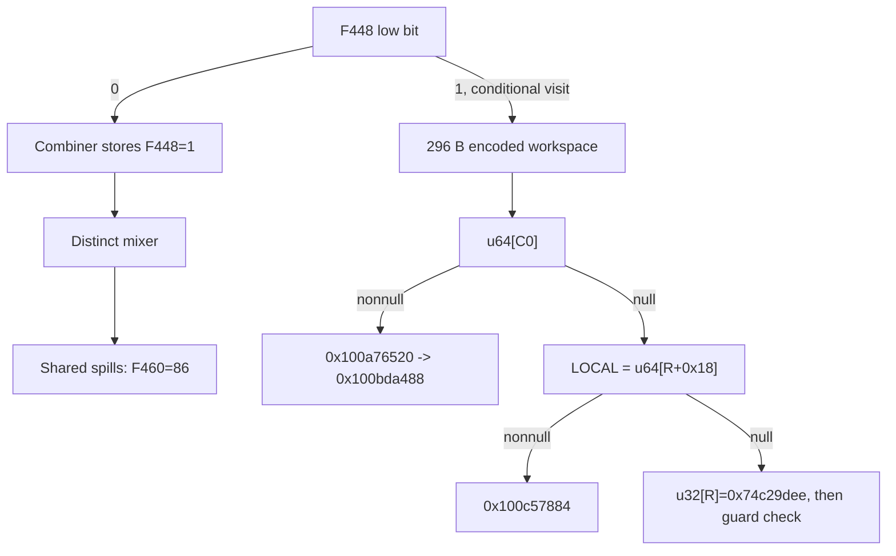

# Mode1 internal phase latch, word encoding and C0/LOCAL handoff

Continuation: [C0 record scan and selected-record ABI](daemon_mode_one_record_scan_report.md) proves the address-keyed BE32 header predicate, equality-driven next-link traversal, LOCAL fallback and selected buffer/u32-field gates. All691 captured nonbranch sites translate;53 UNSAT and four SAT results pass, including six predecessor replays. Native reachability, record ownership, successful output, budget history and daemon-kext pairing remain unknown. The earlier conditional-entry and F460=86 reachability boundaries remain open.

The selected post-round path repacks 16 words, tests the private phase bit at F+0x448, and re-enters the established combiner with W0=1. Its data formulas carry over, but its selector reaches a distinct mixer at `0x100d41af4`, then the shared spill block with F+0x460=86. A conditional set-bit visit instead builds a complete 296 B workspace: 128 B of bijectively encoded words and 168 B of constants. That suffix reads the original request's C0 and LOCAL fields; if both *C0 and LOCAL are null, it joins the raw-result writer `u32[R]=0x74c29dee` at `0x100d7cc54`. Later set-bit-visit reachability, record-processing semantics, successful output publication, full budget history and native daemon/kext pairing remain unknown. [PH1-PH8]

Evidence: [source/fixups](triage_evidence/daemon_mode_one_phase_handoff_source.json), [131 queries and source/value ledgers](triage_evidence/daemon_mode_one_phase_handoff_checks.json), [extractor](triage_evidence/recover_daemon_mode_one_phase_handoff.py), [validator](triage_evidence/validate_daemon_mode_one_phase_handoff.py), [SSA/candidate helper](triage_evidence/daemon_mode_one_handoff_tools.py), [preservation](triage_evidence/daemon_mode_one_phase_handoff_delivery.json), [quality gates](triage_evidence/daemon_mode_one_phase_handoff_quality_gates.json), [publication audit](triage_evidence/verify_daemon_mode_one_phase_handoff_publication.py). Context: [64-round predecessor](daemon_mode_one_word_rounds_report.md), [first combiner entry](daemon_mode_one_bank_combine_report.md), [first mixer](daemon_mode_one_word_mix_report.md), [48 B request/return ABI](daemon_mode_one_adapter_report.md), [initial literal bank](daemon_mode_one_post_table_passes_report.md).

| Evidence | Verified scope |
| --- | --- |
| Original image | `fairplayd.arm64e`, SHA-256 `4ffe3ea1dbd27c5026b448ffe06e8489b02cd9064500bcc67792d4ac36ffb63e` |
| Source | Eleven ranges, 889 instructions / 3556 B; all 880 distinct nonbranch sites translate |
| Prior source | 22 ranges / 58724 B freshly recaptured |
| Interface records | Seventeen original pointer records and fourteen branch bindings |
| Added decoding checks | Two ADRP page targets and two signed unscaled-access immediates |
| Proofs | 122 UNSAT and nine SAT; includes 60 predecessor queries, with 55 UNSAT and five SAT |
| New local queries | 67 UNSAT and four SAT controls/domains |
| Word recovery | All 32 encoded words source-certified; 31 positive and one negative multiplier |
| Combiner reuse | Fourteen compact word formulas rechecked with two source-bound circuit cuts |
| Alteration controls | Six source/request/STUR/pointer/target/native-claim alterations rejected |
| Execution | No target execution, emulation, IPC/API request, new IDA access, IDB mutation or hardware PAC check |

## Equality gate and sixteen-word repacking

The predecessor supplies W14=0x32ff, W27=52 and W4=0x528cdb78. These are checked against its actual final source registers, not inferred only from the destination address. At `0x100cec684`, the equality threshold is `(0x32ff XOR0x32fd)*0x187d XOR0x30ce=52`. Equality selects index 0x56a0 ->`0x100db4af0`; inequality selects 0x32ff ->`0x100c8df0c`. The selected gate also supplies W16=0x30fa. [PH1-PH2]

The repacker at `0x100db4af0` makes sixteen distinct u32 frame stores, totaling 64 B. All arithmetic below wraps to u32; register inputs refer to this block's entry and frame inputs to their current values. Source SSA retains the exact live bindings.

| Destination | Recovered value |
| --- | --- |
| F+0x408 | W7 + F444 +0xe2b587fa |
| F+0x410 | F508 + W6 +0xb6b1549e |
| F+0x3dc | W1 +0x34edd591 |
| F+0x414 | F51c +0x5055dd69 |
| F+0x3d0 | F514 +0x0e2ee34a |
| F+0x3b8 | F518 |
| F+0x3e4 | F534 |
| F+0x3e0 | F52c |
| F+0x3f4 | F550 |
| F+0x3cc | F520 |
| F+0x3fc | F530 |
| F+0x430 | F540 |
| F+0x3f0 | F548 |
| F+0x3c0 | F558 |
| F+0x42c | F538 |
| F+0x3b0 | F510 |

It derives W14=0x6284 and dispatches index 0x30fa to `0x100c4c834`. These stores refresh sixteen positions in the earlier 32-word sparse bank. The other positions retain their previous values under the frame-continuity premise; F+0x424 remains outside the word bank and is not assigned a fabricated zero. [PH2-PH4]

## Internal phase bit and distinct re-entry mixer

The gate at `0x100c4c834` uses only bit 0 of F+0x448:

| Condition | Selector | Target |
| --- | --- | --- |
| Bit clear | 0x6284 | `0x100bdba34` |
| Bit set | 0x8aaf | `0x100d9d804` |

For either bit value it sets W0=1, W20=0x4cdb, W22=0xad732488, W12=0x7a8c and W27=86. The first combiner entry previously stored zero into F+0x448. The recorded mixer/materializer/absorption/gather/extension/round footprints preserve that cell through the newly analyzed gate; the same check also preserves the saved request pointer at F+0x388. Thus the selected first visit takes the clear-bit branch, and the combiner's store at `0x100bdba34` rearms F+0x448 to one. This is an internal source-path phase latch; no public flag meaning is assigned. [PH2-PH3]

The fourteen previously recovered combiner word formulas hold again for the new bank operands. Both circuit cuts are rebound to actual source values. The new continuation is 0x4cdb ->`0x100d41af4`, IA diversity 0x74b2; the first entry had selected 0x4cf9 ->`0x100dab3d0`. The changed selector was checked independently rather than imported with the old data formulas. The first entry's X21 frame-view interpretation is not imposed on the current live X21. [PH2,PH4]

The distinct mixer has 78 instructions, no stores and no scalar data reads beyond its dispatch-table access. It supplies W8=0x3146 and W16=0x17d8, selecting the shared spill block `0x100bf3160`, IA 0x9c42. Its W27=86 reaches that block unchanged. The shared source explicitly stores W27 into F+0x460 at `0x100bf3390`; the new proof establishes F460=86 and phase bit one. Its selector 0x3146 then reaches `0x100c9d2b8`, IA 0x4076. [PH2-PH4]

This closes a re-entry boundary, not an entire second pass. The earlier round report's F460=52 continuation theorem must not be reused after this store. Reachability and control of the later set-bit visit remain a separate proof obligation. The following workspace and request suffixes are conditional source contracts for that visit. [PH7-PH8]

## Complete 296 B workspace and word encoding

At `0x100d9d804`, the gate-proved W12=0x7a8c and inherited W4=0x528cdb78 determine the encoding parameters. The routine reads all 32 source words at offsets 0x3b0..0x430, excluding 0x424. Its 65 frame stores cover 312 distinct bytes with no overlap: the complete 296 B workspace F+0x768..F+0x88f and two separate saved u64 roots at F+0x568/+0x588. The workspace is the same extent as the original bounded 296 B fill, rather than a recovered external allocation. [PH1-PH4]

| Workspace region | Contents | Extent |
| --- | --- | --- |
| F+0x768..0x7e7 | 32 encoded u32 words | 128 B |
| F+0x7e8..0x88f | Literal constant words/bytes | 168 B |

Each encoded word has the source-certified form `y=u32(a*(x XOR k)+b)`. For 31 words, `a=0x883dd861,b=0xfb872ec2`; one word uses `a=0x77c2279f,b=0x73495661`. Every source word maps to exactly one destination, and every destination is distinct. The multipliers are odd, with inverses 0x9c46cba1 and 0x63b9345f modulo 2^32. Their products modulo 2^32 are checked as one. Consequently `x=u32(a_inverse*(y-b)) XOR k` recovers each word, and the complete 128 B transform is bijective under the established entry constants. No algorithm identity is inferred from this encoding. [PH4]

| Destination offset | Input offset | XOR mask k | Form |
| --- | --- | --- | --- |
| 0x768 | 0x3d0 | 0xd5b8b964 | + |
| 0x76c | 0x3b8 | 0xd5b8b964 | + |
| 0x770 | 0x3cc | 0xd5b8b964 | + |
| 0x774 | 0x3dc | 0xd5b8b964 | + |
| 0x778 | 0x408 | 0xd5b8b964 | + |
| 0x77c | 0x3fc | 0xd5b8b964 | + |
| 0x780 | 0x414 | 0xd5b8b964 | + |
| 0x784 | 0x410 | 0xd5b8b964 | + |
| 0x788 | 0x3b0 | 0x08943482 | + |
| 0x78c | 0x3c0 | 0x08943482 | + |
| 0x790 | 0x3f0 | 0x08943482 | + |
| 0x794 | 0x3f4 | 0x08943482 | + |
| 0x798 | 0x3e0 | 0x08943482 | + |
| 0x79c | 0x3e4 | 0x08943482 | + |
| 0x7a0 | 0x42c | 0x08943482 | + |
| 0x7a4 | 0x430 | 0x08943482 | + |
| 0x7a8 | 0x3bc | 0xa01f273e | + |
| 0x7ac | 0x3b4 | 0xa01f273e | + |
| 0x7b0 | 0x3d4 | 0xa01f273e | + |
| 0x7b4 | 0x3d8 | 0xa01f273e | + |
| 0x7b8 | 0x40c | 0xa01f273e | + |
| 0x7bc | 0x3f8 | 0xa01f273e | + |
| 0x7c0 | 0x41c | 0xa01f273e | + |
| 0x7c4 | 0x418 | 0xa01f273e | + |
| 0x7c8 | 0x3c8 | 0x77d7694e | + |
| 0x7cc | 0x3c4 | 0x882896b1 | - |
| 0x7d0 | 0x3e8 | 0x77d7694e | + |
| 0x7d4 | 0x3ec | 0x77d7694e | + |
| 0x7d8 | 0x400 | 0x77d7694e | + |
| 0x7dc | 0x404 | 0x77d7694e | + |
| 0x7e0 | 0x420 | 0x77d7694e | + |
| 0x7e4 | 0x428 | 0x77d7694e | + |

The table's + form uses the positive multiplier/bias above; the - form uses the negative multiplier/bias. Two apparent cross-word dependencies disappear only after original-source universal checks. A further apparent dependency in the write to F+0x87c cancels completely: that field is the fixed word 0xbfe219af. The candidate DAG proposes compact expressions; all 32 word forms and every literal store are accepted only by queries over the original source SSA. [PH4]

The STUR at `0x100d9db74` uses X19=F+0x735 and signed immediate 255, giving F+0x834. Its u64 store is therefore private and unaligned to 8 B relative to an aligned frame. The original instruction's signed immediate is independently decoded, and the original address is proved equal to the normalized frame address. Native access validity/alignment policy remains a premise. [PH4,PH6]

## Saved request, C0 pointee and LOCAL suffixes

The source at `0x100cf037c` saves the incoming private request R into F+0x388. The wrapper's independently replayed 48 B record contract supplies R+8=C0, where C0=u64[OBJ], and R+0x18=LOCAL. C0 itself is nonnull on the processing path selected by the earlier entry. The new test concerns the u64 value inside that cell, which can independently be null. No public object type is inferred. [PH2,PH5-PH6]

| Boundary | Source site | Recovered data/control contract |
| --- | --- | --- |
| Saved request reload | `0x100d9dc10` | X13=R from F+0x388 |
| Request field read | `0x100d9dc14` | X13=u64[R+8]=C0 |
| Pointee read | `0x100d9dccc` | X0=u64[C0] |
| Pointee nonnull | `0x100d9dd18` | Index 0x7a8c ->`0x100a76520`, IA 0xa2fc |
| Pointee null | `0x100d9dd18` | Index 0x7acf ->`0x100cbddd0`, IA 0xa2fc |
| LOCAL read after null pointee | `0x100cbddd4` | X10=u64[R+0x18]=LOCAL |
| LOCAL nonnull | `0x100cbddf0` | Index 0x4928 ->`0x100c57884`, IA 0xe138 |
| LOCAL null | `0x100cbddf0` | Index 0x4923 ->`0x100d7cc50`, IA 0xe138 |

The null-pointee suffix sets W9=0x74c29dee. When LOCAL is null, the shared routine stores that raw u32 at R+0 at `0x100d7cc54`, then reads/checks the stack guard. Equal guards and ordinary authenticated return behavior remain prerequisites for a normal return. The existing adapter's result/budget/continuation ABI is not replaced by a guessed direct return or public error name. Full processing-budget preservation and the later caller-visible join remain unproved. [PH5-PH8]

On the nonnull-pointee route, `0x100a76520` preserves X0 as that pointee, constructs X26=F+0xd10, stores that u64 pointer at F+0x750, and selects 0xac4c ->`0x100bda488`, IA 0xef9d. The record-processing behavior beyond that target is not established here. The LOCAL-nonnull route's body at `0x100c57884` is also a frontier. The report therefore identifies request-field consumers and a conditional error publication, without assigning a successful output format to either remaining branch. [PH5-PH8]

No loop-back edge from the shared spills to the set-bit visit is asserted by this diagram. That reachability requires the later control/data path to be proved under its new context.

## Frame epochs and architectural consequences

| Cell | Earlier role | New source-proved role |
| --- | --- | --- |
| F+0x448 | Zero written by first combiner | One written by the post-round re-entry combiner; low-bit phase selector |
| F+0x460 | 52 in the first spill/round context | 86 stored by shared spills after the distinct re-entry mixer |
| F+0x568 | Saved biased frame view F+0x8348 | Image-bank root 0x101031ea0 after workspace setup |
| F+0x588 | u64 shift count 7 in the round context | Image-bank root 0x100fc4130 after workspace setup |
| F+0x750 | u32 round counter, then a data word | u64 pointer F+0xd10 on the nonnull-pointee route |

The image roots come from original rebase slots 0x1010a4328 and 0x1010a6578 with respective u64 biases 0xffffffffaa591739 and 0xffffffff8af86dcd. The source slot addresses, rebase values, bank bytes and biased roots are recaptured. Their codec functions are not guessed from these pointer bindings. F+0xd10 lies inside the earlier scratch domain, so future consumers of this new view require a new epoch analysis even though the seed itself only saves a pointer. [PH3-PH6]

All data stores in the repack, combiner re-entry, shared spills, workspace and nonnull-pointee seed are proved literal private-frame addresses, including the normalized STUR. Their footprints leave the old 1092 B word view and 963 B scratch contents unwritten. The separate R+0 result store has the established private-request destination and still requires the recorded owner/disjointness premises. No writes into C0 or its pointee are established by these blocks. [PH4-PH6]

The source contains no calls, traps, Mach send/receive operations, port creation, right transfers or external callbacks in these selected ranges. No new incoming/outgoing Mach-port identity or message-emission site is established. The new interface evidence consists of a private phase latch, distinct re-entry ABI, invertible word encoding, saved pointer epochs and exact request-field/null-result consumers. Native ownership, successful output publication, message serialization and daemon/kext association remain unresolved. [PH6-PH8]

## Assumption register and controls

Two new SAT queries establish nonempty clear/set phase domains. Two further SAT controls distinguish a low-bit test from full-word equality and distinguish C0 nullness from the nullness of its pointee. Five SAT checks are replayed from predecessor proofs. All are mathematical witnesses/domains rather than native observations. Unknown, timeout, diagnostics and unexpected results are rejected.

| ID | Assumption / dependent result | Stress test or falsification probe |
| --- | --- | --- |
| PH1 | Pinned original image and source identify this variant | Rehash image, recapture all 889 instructions and 22 prior ranges, decode original fixups/ADRP/unscaled immediates; reject six altered artifacts |
| PH2 | Actual predecessor and first-entry contexts apply | Freshly compare/replay round and combiner source proofs; bind live W14/W27/W4, recheck all sixteen repack values and fourteen combiner output words |
| PH3 | Frame continuity and recorded write footprints preserve F448/F388 between entries | Recompute saved-cell overlap checks through all recorded stages; falsify with an omitted aliasing write or external writer; do not generalize to arbitrary native paths |
| PH4 | ISA/frame forwarding and proposed reductions preserve source expressions | Translate every captured nonbranch site; source-check the unaligned address, all 32 word codecs, literal stores and two rebound circuit cuts; verify inverses and one-to-one layout |
| PH5 | The wrapper R+8/R+0x18 fields retain their meanings | Replay original record-field and entry proofs, prove the F388 save and actual C0/LOCAL read addresses, distinguish C0 from its loaded value |
| PH6 | Valid nonwrapping/disjoint frame and request owners, mapped reads, bank epochs and native access prerequisites hold | Establish native owners/lifetimes/aliasing, guard/PAC behavior and alignment policy; source addresses do not prove valid native access |
| PH7 | Later set-bit reachability, successful publication and complete budget history remain unknown | Follow the shared-spill continuation under F460=86; prove later gate inputs and the actual copy/return/budget path before claiming a completed pass |
| PH8 | Record type, final algorithm and cross-layer linkage remain unknown | Analyze 0x100bda488 and 0x100c57884 with their live ABI; pair any resulting buffers with interface/serialization evidence |

## Bounded continuation and quality gates

| Impact | Next investigation | Evidence required |
| --- | --- | --- |
| High | Close the re-entry path under F460=86 | Actual byte/round/control context and subsequent selectors; the earlier F460=52 theorem is insufficient |
| High | Follow nonnull C0 pointee target `0x100bda488` | Record-field/byte-codec contract and actual consumer/publication chain |
| High | Follow LOCAL-nonnull target `0x100c57884` | Pointer ownership, new workspace views and any result/budget writers |
| Medium | Complete late-error return composition | Guard/native return prerequisites, complete budget preservation and the exact wrapper continuation after the raw result store |

Let N be captured instructions, M forwarded frame-byte operations and L total expanded/intermediate expression/query characters. Source construction and candidate proposal are O(N+M+L) time/storage; the bounded 32-word layout checks add constant-size set operations. Accepted SMT checks use original source expressions, not a candidate model as an oracle. Solver complexity is separate; limits are 15000 ms per solver query and 20 s per process. Arithmetic widths are explicit, field offsets are hexadecimal and extents are bytes.

QG1: Source, algebra, data/control and provenance facts require no normative premise.

QG2: PH1-PH8 identify dependent results and falsification probes.

QG3: Selected repack/phase/re-entry/spill contracts, complete word workspace, C0/LOCAL suffixes, raw error store, frame epochs and architectural/Mach scope are covered; the full investigation remains active.

QG4: All captured source sites, query counts, 16 repack values, 32 bijective word transforms, 296 B layout and exact branch/store sites are reproducible.

QG5: The changed re-entry selector and F460 context are explicit; a later set-bit visit, successful output and native behavior remain unproved.

QG6: Fresh source/fixup/data capture, predecessor comparisons/replays, original-source value checks and six alteration controls establish scoped provenance.

QG7: Four impact-ranked followups preserve the actual output/interface objective and its unresolved control, value, budget and native boundaries.

The formerly omitted F46086 successor now has an exact equality/control contract and complementary16-word repack. It supplies the shared low-bit phase latch and rechecks the complete workspace from that ABI. Retained repeat-stage footprints preserve the first half and phase/request/budget cells;continuous native arrival and whole-core budget/return remain unproved. [Second-phase bank completion and workspace handoff](daemon_mode_one_second_phase_handoff_report.md).
