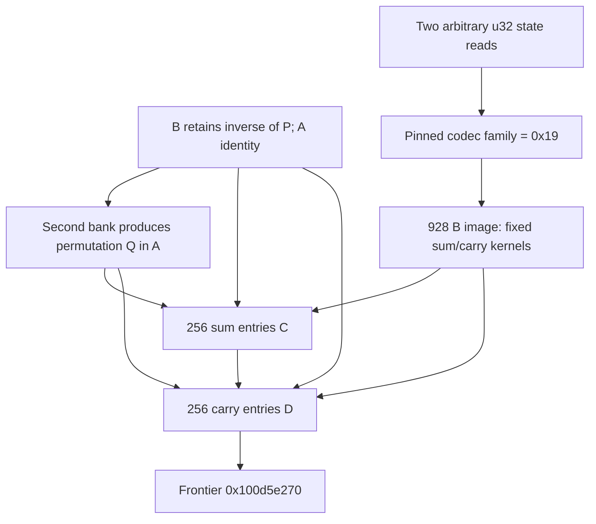

# Selected-record second permutation and encoded base-16 adder

The selected-record continuation consumes the second accumulator bank, performs another fifteen forward swaps, then builds two 256-entry scratch tables. The original image bytes establish paired sum/carry kernels for ordinary base-16 addition under one fixed label cycle. The generated tables use input codebook P composed with L and output codebook Q composed with L, where P and Q are the first and second permutations. Equality P=Q is not required for this typed adder contract and is not proved. The first table is not asserted to be an associative group law under one common alphabet. Native reachability, owners, successful caller-visible publication, complete budget history, standard cipher identity and daemon/kext pairing remain unknown. [RA1-RA8]

Evidence: [source/data/fixups](triage_evidence/daemon_mode_one_record_adder_source.json), [233 queries and source/algebra ledgers](triage_evidence/daemon_mode_one_record_adder_checks.json), [extractor](triage_evidence/recover_daemon_mode_one_record_adder.py), [validator](triage_evidence/validate_daemon_mode_one_record_adder.py), [preservation](triage_evidence/daemon_mode_one_record_adder_delivery.json), [quality gates](triage_evidence/daemon_mode_one_record_adder_quality_gates.json), [sealer](triage_evidence/seal_daemon_mode_one_record_adder.py), [publication audit](triage_evidence/verify_daemon_mode_one_record_adder_publication.py). Context: [first permutation and inverse/reset](daemon_mode_one_record_permutation_report.md), [record-byte passes](daemon_mode_one_record_passes_report.md), [record selection](daemon_mode_one_record_scan_report.md), [earlier distinct cyclic table](daemon_mode_one_inverse_tables_report.md), [earlier state-word reads](daemon_mode_one_word_rounds_report.md), [shared-root context](daemon_shared_roots_report.md), [query/controller context](daemon_query_state_report.md).

| Evidence | Verified scope |
| --- | --- |
| Original image | `fairplayd.arm64e`, SHA-256 `4ffe3ea1dbd27c5026b448ffe06e8489b02cd9064500bcc67792d4ac36ffb63e` |
| Current source | Three ranges, 461 instructions / 1844 B; all 458 nonbranch sites translate |
| Prior source | Eleven ranges / 4668 B freshly recaptured |
| Image data | Three ranges / 1440 B: two 256 B codec banks and one 928 B operation bank |
| Pointer/control provenance | Seven original pointer records, five authenticated branch bindings and two independently decoded ADRP targets |
| Accepted solver results | 227 UNSAT and six SAT; includes 126 refreshed predecessor queries, with 123 UNSAT/three SAT |
| Second shuffle | Fifteen selector abstractions, sixteen address certificates / 145 finite cases and 135 transposition cases |
| Writer addresses | Eight source remainder/binding certificates / 608 finite address cases |
| Fixed arithmetic | 512 image cases, 512 sum/carry equalities over 256 paired inputs; 4096 associativity triples for the fixed sum kernel |
| Footprint | 544 distinct scratch cells touched, 528 written; 542 stores, 2590 byte reads and 512 u32 state-word reads |
| Integrity | Six source/bias/data/family/target/native-claim alterations rejected |
| Execution | No target execution, emulation, IPC/API request, new IDA access, IDB mutation or hardware PAC check |

F is the private core frame and T=F+0xd10. All state words use u32 arithmetic unless explicitly u64; offsets and extents describe bytes. Table indices and digits are integers, not public Apple types or Mach names. For 0<=i<16 and 0<=t<256:

```text
A(i) = T + ((0xbd700 + 866*i) mod 961)
B(i) = T + ((0xaed96 + 866*i) mod 961)
C(t) = T + ((0x77086 + 866*t) mod 961)
D(t) = T + ((0x368c4 + 866*t) mod 961)
E0(i) = 0x74 XOR i
E1(i) = u8(0x74 XOR (i << 4))
```

All four banks are internally injective and pairwise disjoint: 16+16+256+256=544 cells. The 961 B extent is an address domain, not a fully initialized array or a newly identified native allocation. [RA3-RA5]

## Complete local arithmetic contract

The predecessor leaves A in identity encoding, B as the encoded inverse of first permutation P, and W9..W12 as the second accumulator bank. The new shuffle produces `u8[A(i)]=E0(Q(i))` while preserving B. For raw input labels x=t AND15 and y=t>>4, the source writers implement:

```text
u = P_inverse(x)
v = P_inverse(y)
u8[C(x+16*y)] = E0(Q(Ksum(u,v)))
u8[D(x+16*y)] = E1(Q(Kcarry(u,v)))
```

The fixed image kernels satisfy both identities for every a,b in 0..15:

```text
Ksum(L(a),L(b))   = L((a+b) mod 16)
Kcarry(L(a),L(b)) = L(floor((a+b)/16))

L = [0,e,f,5,1,d,9,6,c,b,4,2,8,3,a,7]     # hexadecimal labels
```

Consequently, defining Rin=P composed with L and Rout=Q composed with L gives:

```text
u8[C(Rin(a)+16*Rin(b))] = E0(Rout((a+b) mod16))
u8[D(Rin(a)+16*Rin(b))] = E1(Rout(floor((a+b)/16)))
```

This is an encoded base-16 adder with separate input and output alphabets. The carry is a logical digit 0 or 1 before relabeling; its stored byte is not asserted to be a raw Boolean. The sum byte lies in 0x70..0x7f. The carry byte has low nibble 4 and takes two distinct encoded values, determined by Q(0) and Q(0xe). [RA3-RA6]

If P=Q, the decoded sum table is addition modulo16 under the common relabeling P composed with L. That equality remains unproved for this current record path. Without it, the source-certified sum relation is a commutative Latin square between the stated codebooks; associativity and a group identity under one alphabet are not established. The evidence includes a nonnative algebraic counterexample: P identity and Q exchanging labels 0/1 gives `(0*0)*1=12` but `0*(0*1)=1` for the fixed decoded sum operation followed by Q. This rejects an unconditional one-alphabet group inference; it does not establish native reachability of those codebooks. [RA6,RA8]

## Second shuffle and its incoming ABI

At `0x100d09004`, the second bank in W9,W10,W11,W12 controls another fifteen swaps among A(0)..A(15). The first four selected positions use incoming W10 AND15 XOR6, 1+(W9 mod15), 2+(W11 mod14) and 3+(W12 mod13). Later positions use the actual evolving source words. Each stage i selects k in i..15; both reads precede both writes. The full swap ledger retains every read/write PC. [RA2-RA3]

The proof refreshes the complete first-permutation/inverse/reset certificates and independently binds the constants carried into this entry. A preservation census checks constants originating in the first shuffle across inverse/reset; the reset's live phase, pointer and W9..W12 are checked separately. This avoids assuming that a simplified predecessor model's unspecified registers hold the required coefficients. [RA2-RA3]

The second shuffle's stage 6 has separate read/write address calculations. Its write computes the stride through masked arithmetic rather than a direct multiply by 866. The source numerator and finite domain prove that it selects the same A(k) as the read. All sixteen address calculations are certified over 145 finite cases. Fifteen bounded selector abstractions and 135 coherent transpositions establish Q as a permutation; they do not establish uniformity, independent choices, equality with P or reachability of every permutation. [RA3,RA5-RA6]

| Outgoing field | Source-proved value |
| --- | --- |
| W14 | Zero, first sum-table argument |
| W13 | 0x45a6, private continuation selector |
| W11 | 0x6031, later carry-loop phase |
| W10 / W8 | 0xaed96, inverse-bank numerator base |
| W5 / W6 / W19 | 866 / 0xbd700 / 961 |
| W7 / W3 | 0x443215 / 0x8864298f, source remainder multipliers |
| X26 | T |
| X0 | 0x1010c4000, image page used for the state-word read |
| X1 | 0x1010a1960, original pool root |
| X2 | u64[F+0x580], an independently named word-cell pointer |

Two ADRP page targets are independently decoded from their original instruction bits. The selector 0x45a6 binds `0x100b11194`, IA diversity 0x1bad. These are static source bindings, not native authenticated transfers. [RA1-RA3,RA7]

## State-word reads and image-family selection

Each sum-table iteration reads a u32 through X2 at `0x100b111d0` and a u32 at `0x1010c4670` at `0x100b111d4`. Let these arbitrary values be Wcell and Wglobal. The source computes

```text
z = u8(((Wglobal-Wcell) XOR0xa6) * 0x0a5cd4cf)
family = z XOR Right[Left[z] XOR0x61]
```

All 256 original byte cases give family=0x19. Thus the numeric state-word values cannot change the selected operation family under the pinned, stable image-bank/root premises. Neither equality nor inter-iteration immutability of the two word values is required for that statement. Valid dereferences, actual owners and lifecycle/synchronization of the pointers remain separate. [RA3-RA4]

| Role | Original rebase slot | Source bias, u64 | Resolved image base / extent |
| --- | --- | --- | --- |
| Left codec | 0x1010a7fa0 | 0xffffffffdaeb98b6 | 0x100e99800 / 256 B |
| Right codec | 0x1010a59a8 | 0xffffffffb971d649 | 0x100f4e290 / 256 B |
| Operation | 0x1010a4f48 | 0xffffffffac155c0d | 0x100f4a640 / 928 B |

The operation slot is pool index `0x6a4+0x19=0x6bd`. Original rebase words, resolved addresses, complete data bytes and hashes are retained. Source address and expression proofs bind the finite family rule to the actual loads; the constant family is not guessed from one environment sample. [RA1,RA3-RA4]

Existing source reports identify the same `0x1010c4670` address as a shared runtime controller cell, including a u64 writer at `0x100013bf0` in the version/capability helper. This increment freshly confirms its u32 read here, so the read concerns the low word of that address under the recorded little-endian image. The older writer/lifecycle evidence is cross-report context, not new native observation. The F+0x580 pointer is not identified with that global merely because both are read together. [RA4,RA8]

## Original image kernels and byte encodings

Let q=u+16*v for inverse-decoded labels u,v in 0..15. The source forms and the exact image lookups are:

| Kernel | Original image offset | Original byte decoder |
| --- | --- | --- |
| Sum | `(45*(q XOR0x1b)+1080) mod928` | `u8(y XOR0x8e XOR(((y<<4) XOR0x10)-0x50))` |
| Carry | `(45*(q XOR0xfe)+0x32a0) mod928` | `(((y+10)>>4) AND15) XOR6` |

The source's word multiply by 0x469f followed by LSR24 supplies the quotient for the mod928 reduction. Source-shape certificates and a restricted integer theorem cover numerators 0..30000, including every actual selected numerator, and prove no u32 product overflow. All 512 image positions and decodings are separately enumerated against original bytes. The sum decoder returns a nibble at every selected sum position; the carry decoder's selected outputs are exactly 0 and 0xe. These are finite full-domain facts, not statistical samples. [RA1,RA3-RA4,RA6]

The cycle L starts at identity label0 and advances by sum-kernel generator0xe. All sixteen labels occur once. The 256 paired inputs give 512 checked sum/carry equalities, and the fixed sum kernel also passes all 4096 associativity triples. Those associativity checks concern the fixed image kernel, not the generated C table under unproved equality of P and Q. [RA6]

The source reads its final output byte from A at the decoded nibble. Sum stores that byte unchanged. Carry applies `u8(0x34 XOR(byte<<4))`; for byte E0(v), this equals E1(v). The two resulting byte layouts are retained explicitly for later consumers rather than silently decoded to ordinary integers. [RA3,RA6]

## Both 256-entry writers and continuation ABI

| Routine | Source entry / store | Exact iteration contract |
| --- | --- | --- |
| Sum writer | `0x100b11194` / `0x100b112ac` | Read B(t AND15), B(t>>4), fixed sum-kernel byte and A(decoded nibble); store the A byte at C(t) |
| Carry writer | `0x100d8b6f0` / `0x100d8b7b8` | Read the same inverse inputs, fixed carry-kernel byte and A(decoded nibble); store its high-nibble encoding at D(t) |

Sum starts W14=0, increments it once per iteration and tests 0x100. Iterations 0..254 select 0x45a6 back to sum; iteration255 selects 0xc9be ->`0x100d8b6f0`, IA 0x1bad. The sum exit supplies W16=0x3bfaedb2, W15=0 and X9=0x100f4a640, while preserving the pool/scratch coefficients and the state-word pointer. [RA2-RA4]

Carry starts W15=0 and W16=0x3bfaedb2. At argument t, W15=t and W16=u32(t+0x3bfaedb2). Its final update gives W15=t+1 and increments W16. The comparison tests 0x3bfaeeb2, yielding exactly 256 iterations. The source destination numerator cancels the encoded counter bias:

```text
u32((0x3bfaedb2+t)*866 +0x192b54a0) = 0x368c4+866*t
```

Iterations 0..254 select 0x6035 back to carry; iteration255 selects 0x6031 ->`0x100d5e270`, IA 0xde38. Its outgoing W12=0, W10=0x84e8 and X9=0x100f4a640 are source-checked. Semantics beyond that target are not assigned here. [RA3,RA7-RA8]

Each scratch address is linked to the source numerator, carried divisor/multiplier, original remainder instruction shape and complete finite index domain. The eight writer-address certificates cover 608 cases. Shift41 uses the original 0x8864298f multiplier; the short shift32 form is checked over its actual finite argument domain. Sound replacements retain original expressions and their certificates. The decoded-nibble abstraction stands for the actual finite image-kernel result; it is not an assumed desired sum/carry value. [RA3-RA4]

The source I/O and counters, original-data kernels, predecessor inverse relation, second-shuffle bijection and disjoint bank layout compose into the typed adder equations above. A single-cell-store theorem refreshed from the predecessor establishes that each destination write preserves the A/B inputs and earlier distinct destinations. Loop induction from t=0 to255 gives the completed tables. No native table construction or target request is performed. [RA2-RA6]

## Footprint, scratch epochs and external scope

| Bank | Size | Current role |
| --- | --- | --- |
| A | 16 cells | Rewritten by second shuffle; contains E0(Q(i)) |
| B | 16 cells | Read-only encoded inverse of P; retained |
| C | 256 cells | Newly initialized sum results |
| D | 256 cells | Newly initialized carry results |

The second shuffle makes thirty byte reads/stores. Sum makes six byte reads and one scratch store per iteration; carry makes four byte reads and one scratch store. Total effects are 1566 scratch byte reads, 1024 image byte reads, 542 scratch byte stores and 512 u32 state-word reads. There are 528 distinct written cells and 544 distinct touched scratch cells. The 32 A/B cells, C and D are mutually disjoint. No other scratch cell is written by these ranges. [RA3-RA5]

Seven new C/D destination cells extend beyond the earlier 963 B scratch view: F+0x10c4, +0x10c5, +0x10c9, +0x10cb, +0x10cc, +0x10cf and +0x10d0. They remain inside the new 961 B domain starting at F+0xd10. This suffix writes them without requiring invented prior byte values. Native frame mapping/extent remains a premise. The old word view, 296 B workspace, saved roots, request/cookie/NODE/COUNT/P fields and separate F+0x1210 budget cell are outside the checked store footprint. Local preservation does not establish the complete prior or later budget history. [RA5,RA7-RA8]

No call, trap, Mach send/receive operation, port creation or right transfer occurs in these three captured routines. No new incoming/outgoing port identity or emission site is established. The new architectural touch points are a shared runtime-controller read, a separate saved word-cell pointer, three original image-bank roots, P/Q input/output codebooks and two exact private arithmetic-table layouts. The result is not yet a proved caller-visible buffer or daemon/kext exchange. [RA4,RA7-RA8]



## Assumptions, falsification probes and bounded continuation

| ID | Assumption / dependent result | Stress test or falsification probe |
| --- | --- | --- |
| RA1 | Pinned image, data and original pointer records identify this variant | Rehash source, recapture all ranges, recheck seven pointer records and two ADRP decodes; reject six alterations including image-data/family/bias changes |
| RA2 | The conditional predecessor supplies A identity, inverse B, scratch root and second-bank words | Refresh all 126 predecessor queries/models; independently bind carried coefficients and reset phase/pointer/bank; earlier whole/native reachability remains unresolved |
| RA3 | Scalar ISA effects, live bindings and abstractions match source | Translate all 458 current sites, prove eleven remainder shapes, selector ranges, source argument/decoder/address/control expressions and all swap/read/store roles |
| RA4 | Original codec/operation bytes and resolved roots remain stable, with valid state reads | Recheck 1440 data bytes and all256 family cases; keep both u32 values arbitrary and owners/lifecycle separate; mutation invalidates constant-family/kernel conclusions |
| RA5 | The private frame and initialized A/B epoch are valid, coherent, nonwrapping and free of outside mutation | Check all544 cells and protected offsets, source footprints and seven new tail cells; establish native owners/extents and synchronization before native claims |
| RA6 | Finite kernels and bijection composition justify the typed arithmetic | Check all512 sum/carry equalities, encoding identities, the sixteen-label cycle and table-loop induction; retain distinct P/Q and the nonnative counterexample to unconditional associativity |
| RA7 | Original private branch/PAC and memory prerequisites hold for native execution | Verify static slots/modifiers and invariant register sets; hardware PAC, exceptions, complete guard/return and budget composition remain unexecuted/unproved |
| RA8 | Standard cipher identity, successful publication, global lifecycle and cross-layer pairing remain unknown | Follow 0x100d5e270, actual output/serializer consumers and the state-pointer producer; cross-report source-address matches do not prove native pairing |

| Impact | Next investigation | Evidence required |
| --- | --- | --- |
| High | Frontier `0x100d5e270` | Actual use of the encoded sum/carry banks, further table layouts and caller-visible stores |
| High | Relationship between P and Q | Compact state recurrences/encodings and source selector equivalence; do not import the earlier distinct path's equal-bank theorem |
| High | F+0x580 pointer producer and shared-controller lifecycle | Actual pointer/owner lineage, u32/u64 writer-read ordering and native synchronization context |
| High | Complete phase-one/return/interface composition | Earlier F460=86 control, current scratch ownership, budget history and final message/buffer pairing |
| Medium | Reuse of the two output byte formats | Prove later low/high-nibble decoding and epoch preservation, including the seven new tail cells |

Parameterized by radix n, a shuffle takes O(n) steps and each binary table O(n^2); the current radix is fixed at16 and each writer has256 iterations. Working scratch touched here is544 bytes inside a961 B domain. Source extraction/translation is O(M+L) for M captured instructions and L emitted expressions/query text; finite transposition checks are O(n^2) and the optional fixed-kernel associativity check is O(n^3). Solver complexity is separate, bounded by15000 ms per query and20 s per process. Unknown, timeout, diagnostics and unexpected results are rejected. Extents/counts use bytes; arithmetic widths and ordinary integer table counts are explicit.

QG1: Factual source, arithmetic, ABI/control and provenance claims require no normative premise.

QG2: RA1-RA8 identify assumptions, dependent claims and falsification probes.

QG3: This increment covers the complete second shuffle, both arithmetic writers, state-word/image-root touch points, output formats and continuation; the full investigation remains active.

QG4: Original bytes/data/fixups, 458 translated sites, 227 UNSAT/six SAT results, 512 arithmetic equalities and complete bank/store domains are reproducible.

QG5: Distinct input/output codebooks, conditional one-alphabet group interpretation, byte encodings, arbitrary state values, tail cells and unresolved native/return boundaries are explicit.

QG6: Fresh source/data/pointer capture,126 predecessor query/model refreshes, live source cuts, complete finite cases and six rejected alterations establish scoped provenance.

QG7: Five impact-ranked continuations retain the arithmetic/output/interface objective and unresolved state, ownership, control, budget and native boundaries.
