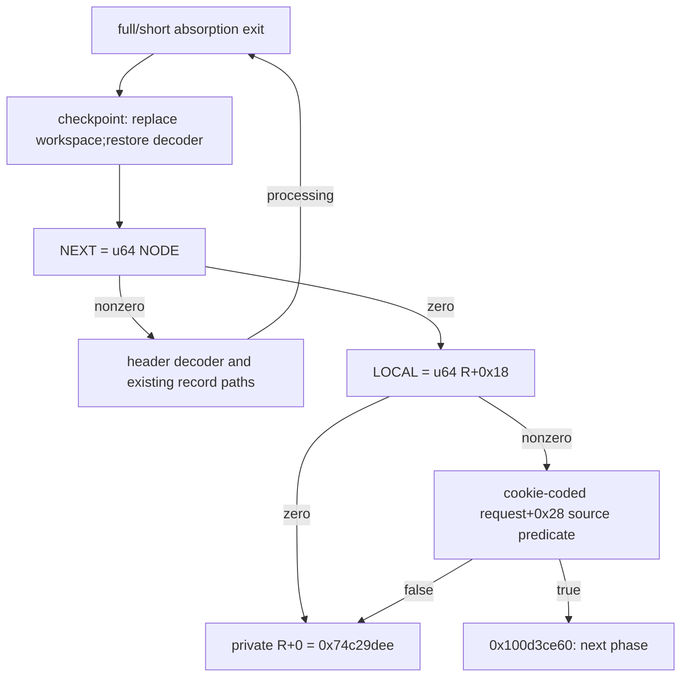

# Record checkpoint replacement, iterator resumption and LOCAL request gate

The common continuation at `0x100c74750` reads all128 cells of the two established planes, replaces the complete296-byte workspace, restores the record decoder ABI and resumes the iterator at `0x100d0741c`. Its NEXT load either returns to the header decoder or reaches the saved request's LOCAL gate. With LOCAL present, a further guard reads the cookie-coded field at request+0x28. The original wrapper's field construction is sufficient to select `0x100d3ce60`, the next unanalysed phase. These source contracts establish record-processing re-entry; the decoded workspace function, native termination/output and daemon/kext pairing remain unknown. [CP1-CP8]

Evidence: [source and authenticated records](triage_evidence/daemon_mode_one_record_checkpoint_source.json.zst), [accepted queries and source models](triage_evidence/daemon_mode_one_record_checkpoint_checks.json.zst), [extractor](triage_evidence/recover_daemon_mode_one_record_checkpoint.py), [validator](triage_evidence/validate_daemon_mode_one_record_checkpoint.py), [preservation](triage_evidence/daemon_mode_one_record_checkpoint_delivery.json), [quality gates](triage_evidence/daemon_mode_one_record_checkpoint_quality_gates.json), [sealer](triage_evidence/seal_daemon_mode_one_record_checkpoint.py), [publication audit](triage_evidence/verify_daemon_mode_one_record_checkpoint_publication.py). Context: [absorption cycle](daemon_mode_one_record_reentry_report.md), [round update](daemon_mode_one_record_rounds_report.md), [saved-word producer](daemon_mode_one_record_join_report.md), [record decoder](daemon_mode_one_record_scan_report.md), [wrapper and private request](daemon_mode_one_adapter_report.md).

| Evidence | Verified scope |
| --- | --- |
| Image | `fairplayd.arm64e`, SHA-256 `4ffe3ea1dbd27c5026b448ffe06e8489b02cd9064500bcc67792d4ac36ffb63e` |
| Current source | Four complete BRAA-terminated fragments and one two-instruction prefix;7072 instructions /28288 B;7068 nonbranch sites translated |
| Prior recapture |58 ranges /193604 B |
| Control provenance |Six original authenticated records /seven source slot-modifier bindings |
| Instruction checks |25 bitfield decodes,five paired u32 loads,one TST,one CNEG,two EXTR and four corrected comparison GPR-write reports;no SP write |
| Accepted checks |59 UNSAT /two SAT,including45 refreshed predecessor queries |
| Checkpoint effects |622 loads,including128 plane-byte reads and592 literal-frame effects;250 stores /1020 B effects /796 distinct frame bytes |
| Workspace replacement |74 distinct u32 stores /296 B;zero incoming workspace inputs |
| Integrity |Eight altered source,offset,bias-input,target,condition,pair,lineage or native-claim records rejected |

F is the private frame,T=F+0xd10,R=u64[F+0x388],NODE=u64[F+0x2b8],COOKIE=u64[F+0x2c0]. Arithmetic is modular u32/u64;offsets and extents are bytes. These addresses identify private continuations rather than independently established compiler functions. Coherent nonwrapping mappings,frame disjointness from externally rooted objects,stable roots and no outside mutation remain premises. No target execution,emulation,API/IPC request,IDA access,IDB mutation or hardware PAC test occurred. [CP1-CP4]

## Checkpoint input and workspace contract

The complete6895-instruction block at `0x100c74750` has no incoming GPR dependency beyond SP according to the source operand census. Its saved frame contains the state inputs. The model fixes TABLE,T,NODE,the established selector0x4719 and the full64-bit numeric word

```text
u64[F+0x4d8] = 0x000000007f3081c2
```

Other incoming state and control words remain symbolic;the model does not specialize COUNT or position to the first block. The saved word's producer is the earlier join. A fresh replay proves the full64-bit store,and a seven-stage preservation census checks that F+0x4d8..0x4df and saved NODE,R,COOKIE survive the intervening retained paths. This composition retains the predecessor computed-address contracts and disjointness premises. [CP2-CP4]

All128 byte-read addresses are proved against the unmodified source to equal the distinct cells

```text
T + ((866*(896+i)) mod961), 0<=i<64
T + ((866*(827+i)) mod961), 0<=i<64
```

The actual reads include99 literal frame accesses,27 accesses through a frame alias and two computed addresses. The read at `0x100c7589c` is F+0xf8f under the full64-bit saved-word premise;the read at `0x100c760d4` is F+0xe34. A candidate valuation proposes addresses;the subsequent UNSAT query establishes all128 equalities for unrestricted remaining inputs. A separate SAT control drops the saved-word premise and permits a different first computed address. That control describes an abstract component state;it establishes no native input or failure. [CP3-CP5]

The checkpoint makes245 u32 and five u64 stores,all into the private frame. Their1020 B of write effects cover796 distinct bytes,from F+0x3d0 through F+0x88f. Exactly74 u32 destinations cover F+0x768..0x88f once. No incoming workspace byte is read:every workspace read in the model is either absent or forwarded from this block's own stores. The retained expressions define the replacement but do not yet identify its decoded296-byte algorithm. [CP3-CP6]

The checkpoint preserves all bytes below F+0x3d0,the selector at F+0x6f8,TABLE at F+0x740,the two roots at F+0x750/F+0x758,the1120-byte word-grid view at F+0x8b0,the961-byte domain at T and the budget at F+0x1210. Consequently,the128 plane cells and800 established codebook cells are read/preserved rather than rewritten here. [CP3-CP4]

| Earlier role | Stores ending that role in this checkpoint |
| --- | --- |
| Low32 F+0x728:COUNT |`0x100c76348`,`0x100c76e9c` |
| F+0x748:PBUF |Low32 stores at `0x100c747f0`,`0x100c76644`,`0x100c76ecc`;upper32 retained |
| F+0x4d8:numeric word |Full64 read at `0x100c75210`,then low32 replacement at `0x100c77908` |

The old pointer/count interpretations stop at those stores. Preserved upper bytes alone do not establish that a partially overwritten value remains a valid pointer. [CP6-CP7]

## Restored decoder and iterator interface

The checkpoint supplies X0=NODE,W9=0xac0a,X26=T and IA modifier0xcd7e. Its table slot0x4719 loads the target into X8 and branches to `0x100d0741c`. It restores these decoder words:

| Register | u64 value |
| --- | --- |
| X2 |0x000000000000471b |
| X3 |0x0000000000005605 |
| X4 |0x00000000000018df |
| X7 |0x622c5d3364e575a7 |
| X19 |0x6d44f77ef42a3bc3 |
| X20 |0x1dd3a2cc9b1a2a60 |
| X21 |0x92bb08810bd51832 |
| X22 |0xfffffffffffffffe |
| X23 |0x3505b74e1c8517b5 |
| X24 |0x24675ed53babbb4e |
| X27 |0x324a764c67af2e0e |
| X28 |0xda740029fd112266 |
| X30 |0x92c5ffeb01776ecd |

The19-instruction iterator continuation is composed from the exact outgoing register and frame snapshots. At `0x100d07434`,it loads NEXT=u64[NODE+0]. It restores W5=0x4719 and W8=0x4923,preserves the decoder words above and X26,and makes no stores. Its terminal modifier is0xef9d. [CP2-CP4,CP7]

| NEXT | Slot / continuation |
| --- | --- |
| Nonzero |0xac4c -> `0x100bda488`,the established header decoder |
| Zero |0xac0a -> `0x100cbddd0`,the saved-request LOCAL gate |

The decoder's seed,four byte-codec seeds,28 codec rounds,BE32 merge,address predicate and repeat-entry contract are refreshed as selected predecessor queries. Together with the restored constants and next-block write census,these establish a processed-record return to the existing scan interface. Earlier equality-skip behavior uses the same iterator;the current result adds the processing path. Native termination requires a finite,stable,acyclic list and valid object mappings. No such native list has been observed by this increment. [CP2-CP5]

## LOCAL gate and cookie-coded request field

At `0x100cbddd4`,the gate loads LOCAL=u64[R+0x18]. LOCAL=0 selects slot0x4923 -> `0x100d7cc50`;LOCAL!=0 selects0x4928 -> `0x100c57884`. Both carry W9=0x74c29dee and modifier0xe138. The retained rejection prefix loads R and stores this raw32-bit result at R+0 at `0x100d7cc54`. The prefix ends before later guard/return machinery. It establishes neither a public error name nor successful native return. [CP3-CP5,CP7]

The143-instruction LOCAL-present continuation does not dereference LOCAL. It consumes LOCAL as an arithmetic input and creates these saved values:

```text
X26 = F+0xc80
u64[F+0x370] = F+0x1100
u64[F+0x368] = F+0x1150
u64[F+0x358] = LOCAL+0x2c238c16ca76f3a8
SEL = u32[R+0x28]             at 0x100c578b8
COOKIE = u64[F+0x2c0]         at 0x100c578bc
D = u32(SEL-low32(COOKIE))
```

The first two saved words are source-derived frame views;their spacing does not prove extents. F+0xc80 lies within the earlier word-grid view and changes epoch. The biased LOCAL word is not yet established as a native pointer,key or owner. Exactly three stores occur in this continuation,at F+0x370,F+0x368,F+0x358. [CP3-CP4,CP6-CP7]

The full source model retains the opaque32-bit function G applied after D is formed. At `0x100c57a6c`,it compares G(D) with0x5e62effc. Equality selects0x56d3 -> `0x100d3ce60`;inequality selects0x4923 -> the same raw-result prefix. This exact source predicate is proved without an inverse assumption. An exploratory all-u32 inverse query timed out and is excluded from accepted proofs. No claim that equality holds only at one D is made. [CP3,CP5-CP6]

The original48-byte private wrapper request stores

```text
u32[R+0x28] = u32(k+0x3e060fa6) at 0x1009bb44c
```

Refreshed wrapper/alignment contracts establish COOKIE=k under the stated request-alignment premise. A separate fresh source model supplies this constructor-form field and proves that it selects0x56d3. This is a sufficient path for the original wrapper with stable request contents and LOCAL!=0;it does not classify every other selector. [CP2-CP5]

The new-phase outgoing ABI includes X0=0x0000000004008640,W5=0xa9502f98,W6=0xa20cd51f,W13=0x39eba85c,W14=0x79705c69,W16=0x71b2bb0c,X26=F+0xc80 and modifier0xe138. Those numeric words are not given decoded algorithm names. `0x100d3ce60` is the next source frontier;its successful output or external effects remain unknown. [CP6-CP8]



## ISA, external context and evidence limits

Five paired loads are lowered into two ordered little-endian u32 reads per source PC. The address proof matches effects in order rather than selecting a single row by PC. Raw opcode checks bind these five pairs,25 bitfield operations and both EXTR shifts10/18. TST computes flags from a32-bit AND without a GPR destination;CNEG NE negates when that result is nonzero. Independent algebra checks the inverted CSNEG EQ alias and both EXTR concatenation identities. The alias semantics are documented in the primary [Arm armasm Reference Guide6.01,ARM DUI0802B,sections5.50,5.58 and5.145](https://documentation-service.arm.com/static/5f3fa899428f7a6b3328fd44). Full manual redistribution is unnecessary and omitted. [CP1,CP3]

Four complete blocks have one terminal authenticated branch and no internal call,branch or trap. Their interfaces are private state,linked-record reads,saved request fields and authenticated continuation pointers. They expose no new Mach send/receive,port allocation,right transfer or message-emission site. The R+0 write is a private result prefix. Matching this state transition with an IOKit/Mach wire contract still requires actual serialization and a matched peer interface. [CP1,CP4,CP7-CP8]

## Assumption register and bounded continuation

| ID | Assumption / dependent result | Stress test or falsification probe |
| --- | --- | --- |
| CP1 |Pinned image,source and pointer records identify the continuations |Recapture28288 current/193604 prior bytes;verify six pointer records,seven bindings and opcode fields;reject eight alterations |
| CP2 |Selected predecessor contracts supply the stated reaching state |Refresh45 queries;check seven-stage saved-word/root lifetime and actual restored decoder ABI;unselected historical claims remain outside this increment |
| CP3 |ISA,widths,SSA and ordered memory effects are accurate |Translate7068 sites;prove592 checkpoint frame-read and250 store addresses,all128 byte addresses,five pairs,TST/CNEG and two EXTR laws |
| CP4 |Mappings are coherent/nonwrapping,roots stable,objects disjoint and no outside writes occur |Check full byte-store ledgers,preserved ranges,distinct planes and saved-root lifetimes;native mappings/owners remain unknown |
| CP5 |Path and termination premises are respected |Test dropped-word SAT control,constructor-form sufficient edge,zero/nonzero NEXT and LOCAL partitions;finite stable acyclic list remains a termination premise |
| CP6 |Decoded function and source predicates are not overidentified |Retain all74 workspace expressions and exact G comparison;exclude timed-out inverse;no compact workspace algorithm,public status or pointer/key interpretation is established |
| CP7 |Register/frame epochs and authenticated table premises compose |Check COUNT/PBUF/F4d8 overwrite sites,full decoder constants,W5 restoration,biased LOCAL dependency and raw-result prefix;native PAC remains unproved |
| CP8 |Cross-layer exposure and next-phase effects remain unresolved |Analyze0x100d3ce60 and its consumers;establish owners/extents,serialization and matched daemon/kext ABI before asserting linkage |

| Impact | Next investigation | Required evidence |
| --- | --- | --- |
| High |New phase `0x100d3ce60` |Source consumer contracts for the replacement workspace,derived frame views and biased LOCAL word |
| High |Caller-visible output and daemon/kext interaction |Result consumers,serialization,actual owners/extents and matched external ABI |
| High |Compact296-byte checkpoint function |Independent decoded-state model and equivalence against all source expressions,with reaching input provenance |
| Medium |Exact inverse of the request-field predicate |Smaller lemmas or an independent complete32-bit proof;the excluded timeout proves nothing |
| Medium |Record-list lifecycle |Root construction,next-link producers,termination constraints and permitted mutation context |

For this fixed image,the checkpoint and gates use bounded work and private-frame space per invocation:O(1) in record length. Across N processed records,these continuations contribute O(N) work under the finite-list premise;the earlier absorption work additionally depends on record byte counts. Source extraction,SSA translation and ledger construction are linear in captured instructions/effects. SMT complexity is solver-dependent;accepted queries use a15000 ms query limit and20 s process limit. Replayed queries are identified separately;SAT controls are abstract satisfiability/counterexample checks rather than native observations.

QG1:All claims concern factual source,private ABI,control/data flow and provenance.

QG2:CP1-CP8 give assumptions,dependent results and falsification probes.

QG3:The increment covers checkpoint input/effects,workspace epoch,iterator restoration,NEXT/LOCAL edges,request-field sufficiency,external-context limits and report/publication artifacts;the continuing objective remains active.

QG4:Counts derive from source/effect ledgers;74*4=296 B,245*4+5*8=1020 B,796 distinct written bytes and128 unique plane-byte reads. Modular widths and address premises are explicit.

QG5:Old workspace,COUNT,PBUF and numeric-word epochs are distinguished;LOCAL bias retains its actual input;arbitrary selector inversion and native list/output behavior remain unknown.

QG6:All local claims trace to the pinned image,authenticated records,fresh source comparison,accepted SMT queries and preserved predecessor evidence;instruction aliases have a primary Arm reference.

QG7:Impact-ranked next steps cover the new phase,decoded checkpoint function,list lifecycle,request predicate and actual cross-layer exposure. No unrelated target probing is included.
