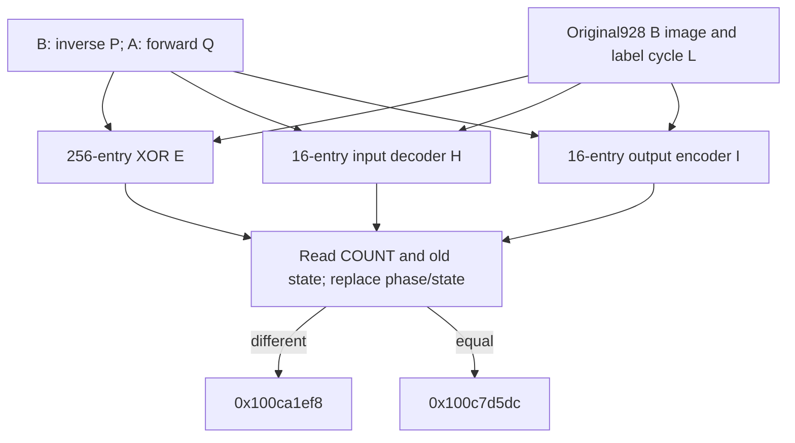

# Selected-record XOR, natural-digit codebooks and count gate

The selected-record continuation builds an encoded nibble-XOR table, a decoder for its input codebook and an encoder for its output codebook. Together with the predecessor sum/carry tables, these establish a common typed arithmetic interface: input alphabet Rin=P composed with L, output alphabet Rout=Q composed with L. Equality P=Q remains unproved. A subsequent gate compares two saved u32 fields, changes their private-frame epochs and selects one of two source-bound continuations. Native reachability, owners, successful caller output, complete budget history, standard algorithm identity and daemon/kext pairing remain unknown. [RC1-RC8]

Evidence: [source/data/fixups](triage_evidence/daemon_mode_one_record_codecs_source.json), [270 queries and algebra/source ledgers](triage_evidence/daemon_mode_one_record_codecs_checks.json), [extractor](triage_evidence/recover_daemon_mode_one_record_codecs.py), [validator](triage_evidence/validate_daemon_mode_one_record_codecs.py), [preservation](triage_evidence/daemon_mode_one_record_codecs_delivery.json), [quality gates](triage_evidence/daemon_mode_one_record_codecs_quality_gates.json), [sealer](triage_evidence/seal_daemon_mode_one_record_codecs.py), [publication audit](triage_evidence/verify_daemon_mode_one_record_codecs_publication.py). Context: [second permutation and typed adder](daemon_mode_one_record_adder_report.md), [first permutation/inverse/reset](daemon_mode_one_record_permutation_report.md), [two record-byte passes](daemon_mode_one_record_passes_report.md), [record selection](daemon_mode_one_record_scan_report.md), [earlier distinct digit-map implementation](daemon_mode_one_digit_maps_report.md).

| Evidence | Verified scope |
| --- | --- |
| Original image | `fairplayd.arm64e`, SHA-256 `4ffe3ea1dbd27c5026b448ffe06e8489b02cd9064500bcc67792d4ac36ffb63e` |
| Current source | Four ranges, 165 instructions / 660 B; all161 nonbranch sites translate |
| Prior source | Six ranges / 3668 B freshly recaptured |
| Original data | The complete928 B operation bank at `0x100f4a640` and its biased original rebase |
| Pointer/control provenance | Eight original pointer records; eight branch bindings across seven branch slots |
| Accepted solver results | 259 UNSAT / eleven SAT; includes233 predecessor queries,227 UNSAT / six SAT |
| Scratch addresses | Eight source/live-binding certificates and368 complete finite cases |
| Algebra | 288 original image cases,256 XOR identities,16 decoder and16 encoder identities;256 packing identities |
| Footprint | 288 scratch byte stores,800 scratch byte reads,288 image byte reads; two u32 frame reads/stores in the gate |
| Integrity | Six source/data/bias/target/entry/native-claim alterations rejected |
| Execution | No target execution, emulation, API/IPC request, new IDA access, IDB mutation or hardware PAC check |

F denotes the private core frame and T=F+0xd10. Source word operations are u32 unless marked u64; offsets and extents use bytes. The source proof refreshes the complete predecessor adder certificates, including their own first-permutation replay, and then binds three additional carried constants. Private branch indices are not Mach port names. [RC1-RC3,RC7]

## Complete arithmetic and codebook interface

Retain the predecessor notation:

```text
E0(j) = 0x74 XOR j
E1(j) = u8(0x74 XOR(j<<4))
L = [0,e,f,5,1,d,9,6,c,b,4,2,8,3,a,7]       # hexadecimal labels
Rin  = P composed with L
Rout = Q composed with L
```

P and Q are the first and second source-generated permutations. Before this increment, A(j)=E0(Q(j)) and B(P(j))=E0(j). The new binary table E and the two new maps H/I satisfy, for all digits a,b in0..15:

```text
u8[E(Rin(a)+16*Rin(b))] = E0(Rout(a XOR b))
u8[H(Rin(a))]          = E0(a)
u8[I(a)]               = E0(Rout(a))
```

The predecessor tables remain intact and use exactly the same coordinates:

```text
u8[C(Rin(a)+16*Rin(b))] = E0(Rout((a+b) mod16))
u8[D(Rin(a)+16*Rin(b))] = E1(Rout(floor((a+b)/16)))
```

H therefore decodes the input alphabet into ordinary digits, while I encodes ordinary digits into the output alphabet. H is not asserted to invert I: their alphabets differ unless P=Q. The generated E table has a commutative Latin-square contract between the stated alphabets; an associative XOR group under one common alphabet is not inferred. The fixed image XOR kernel itself is XOR under L. [RC2-RC6]

All256 encoding pairs satisfy `E0(s) XOR E1(c) = s OR(c<<4)`. Thus XORing corresponding stored C/D bytes would pack their Rout sum/carry labels into low/high nibbles. This is a finite algebraic consequence, not an observed C/D-combining operation in these routines. Encoded addition, carry and XOR do not by themselves identify a complete cipher or standard algorithm. [RC6,RC8]

## Seven disjoint scratch banks

Each address is T plus the stated integer remainder. Binary-table arguments t range0..255 and unary arguments j range0..15.

| Bank | Address offset | Current role / lifecycle |
| --- | --- | --- |
| A(j),16 cells | `(0xbd700+866*j) mod961` | E0(Q(j)); retained |
| B(j),16 cells | `(0xaed96+866*j) mod961` | E0(P_inverse(j)); retained |
| C(t),256 cells | `(0x77086+866*t) mod961` | Encoded sum; retained |
| D(t),256 cells | `(0x368c4+866*t) mod961` | Encoded carry; retained |
| E(t),256 cells | `(866*t) mod961` | New encoded XOR |
| H(j),16 cells | `(0x73704+866*j) mod961` | New input-codebook decoder |
| I(j),16 cells | `(0x6e272+866*j) mod961` | New output-codebook encoder |

The complete832 positions are distinct inside the961 B address domain. These four ranges touch320 distinct scratch cells: A/B plus the288 new destinations. No new writer changes A/B/C/D or a previous destination. Source iteration bounds and single-store preservation compose into complete256/16/16-entry tables under coherent valid-frame premises. The961 B domain is not asserted to be a new native allocation or a completely initialized flat array. [RC3-RC5]

Four new written cells extend beyond the earlier963 B view beginning at F+0xd00: F+0x10c3, +0x10c7, +0x10ca and +0x10ce. They lie inside the current961 B domain beginning at F+0xd10 and are written without requiring invented old byte values. The old word view,296 B workspace, saved request/cookie/NODE/COUNT/P roots, F+0x580 word-pointer cell and F+0x1210 budget cell do not overlap these scratch banks. The gate separately writes F+0x730 and F+0x738. [RC5,RC7]

## Source writers and exact original-data kernels

| Function | Source entry | Store / bound |
| --- | --- | --- |
| XOR-table writer | `0x100d5e270` | `0x100d5e308`;256 iterations |
| Input-codebook decoder | `0x100d9e050` | `0x100d9e0f4`;16 iterations |
| Output-codebook encoder | `0x100d03c9c` | `0x100d03cf0`;16 iterations |
| Count/state gate | `0x100d69d98` | Two u32 frame stores; no local loop |

The predecessor carry loop supplies W12=0, W10=0x84e8, X9=0x100f4a640 and X26=T. Its refreshed source also binds the shared scratch and image coefficients. Three additional source obligations establish W25=0x4d and W30=10 from the first shuffle, and W20=0x79 from the second shuffle. A Wn/Xn alias-aware write census checks preservation through every intervening captured inverse/reset/shuffle/adder block. These constants were symbolic in earlier table-step models and are not assumed from those symbolic fields. [RC2-RC3]

The original operation base comes from rebase slot `0x1010a4f48` plus u64 bias `0xffffffffac155c0d`. The new source uses the carried X9 directly; it introduces no new runtime-controller or word-cell read. The image-root/data stability premise remains inherited. The928 original bytes, slot word, fixup target and bias are freshly checked. [RC1,RC4]

For inverse labels u,v and q=u+16*v, the XOR writer reads B(t AND15) and B(t>>4). The raw E0 bytes combine as u32 `0x734 XOR q`. Its image argument narrows to `q XOR0x1f`, and the selected image byte Y is:

```text
pos_xor(q) = (45*(q XOR0x1f)+0x68c4) mod928
Kxor(u,v)  = u8(Image[pos_xor(q)] XOR q XOR0x4d)
```

Every decoded result is a nibble and all256 pairs satisfy `Kxor(L(a),L(b))=L(a XOR b)`. The source reads A(Kxor), stores that byte unchanged at E(t), and advances W12. Its comparison tests the old W12 against255 before the increment; W12=255 is the final store, and the exit supplies W12=256 and W11=0. [RC3-RC4,RC6]

The decoder reads byte X=E0(u) from B(j). It selects Y at

```text
pos_decode(u) = (45*(u XOR10)+0x6135) mod928
word = ((X XOR0x32)-0x74) XOR((X XOR5)-0x43) XOR((X XOR0x4d)-11)
stored_byte = u8((u32(word+0x3b) XOR Y) XOR0x77777777)
```

All sixteen original-image cases give `stored_byte=E0(L_inverse(u))`. With u=P_inverse(j), the H contract follows. Its source phase arithmetic derives `(0x84e8-0x6444) OR0x8059 = 0xa0fd` and divisor `u32(0xa0fd-0x9d3c)=961`. W11 advances0..16; W12 resets to0 each iteration, so the encoder begins at zero. [RC3-RC4,RC6]

The encoder directly reads `Y=Image[45*(j XOR10)]`, without mod928 reduction. All sixteen offsets lie inside the bank. The source decoder `Y XOR j XOR0xb1` equals L(j) in every case; it reads A(L(j)) and writes that unchanged E0 byte into I(j). Its divisor is `0xa0fd XOR0xa33c=961`. W12 advances0..16 while W13=0xa0fd remains unchanged. [RC3-RC4,RC6]

Eight scratch-address groups have independent source quotient-shape and live numerator/coefficient certificates, followed by368 finite cases covering every actual argument. The image reciprocal uses the low32-bit product by0x469f followed by LSR24. An integer theorem covers0..40000 and proves exact quotient by928 and absence of u32 product overflow; all actual selected numerators lie in that interval. Each image-position replacement and decoded-nibble abstraction retains its source expression and finite justification. [RC3-RC4]

## Count gate and private-frame epoch changes

At `0x100d69da0`, the gate reads u32[F+0x728]; at `0x100d69da4`, it reads the old u32[F+0x738]. Call them COUNT and OLD. Its exact local decision is:

| Predicate on original loaded words | Selector / original target | IA diversity |
| --- | --- | --- |
| COUNT differs from OLD | 0x8284 ->`0x100ca1ef8` | 0x9a18 |
| COUNT equals OLD | 0x828b ->`0x100c7d5dc` | 0x9a18 |

The source derives base0x8284, difference mask0x0f and W8=0x424f. It stores phase0x4923 to F+0x730 at `0x100d69dc0`, fetches the chosen branch pointer at `0x100d69ddc`, then writes0x34c96b7f to F+0x738 at `0x100d69de8`. Both comparison operands were loaded before either store. The second store cannot retroactively change the branch predicate. F+0x730 previously held the first bank's saved fourth accumulator word; downstream use must respect its new phase epoch. [RC3,RC7]

| Outgoing register | Source value, u32 |
| --- | --- |
| W0 / W1 / W2 | 0x489e39cd /0xd162ee7d /0xebe8aefd |
| W8 | 0x424f |
| W10 / W11 | 0xa4725909 /0xb26f34a3 |
| W12 / W13 | 0x1e82fbe4 /0x117805e7 |

The earlier selection report records an initial zero store to F+0x738. This gate's local theorem deliberately accepts any OLD. A complete first-arrival/re-entry lineage that reduces its predicate to COUNT=0 is not established by these four ranges. The two target bodies, their later reads/writes and eventual output remain the next control-flow frontiers. Neither target is assigned an error, success or termination meaning merely from this comparison. [RC2,RC8]

| Writer | Repetition / exit binding | IA diversity |
| --- | --- | --- |
| XOR | 0x853e repeats;0x84e8 ->decoder | 0x0bc9 |
| Decoder | 0x84e8 repeats;0xb43f ->encoder | 0x0bc9 |
| Encoder | 0xa102 repeats;0xa0fd ->gate | 0x66c0 |

The branch-table root is loaded from F+0x740. Eight edge records use seven distinct slots because selector0x84e8 is shared by XOR exit and decoder repetition. Original authenticated rebase words and source modifiers agree. This proves static selection/binding; native PAC success, mappings and traversal remain separate premises. [RC1,RC3,RC7]

## Architectural scope and comparison

There are no calls, traps, Mach messages, port creation or right transfers in the four captured ranges. No new incoming/outgoing port or emission site is established. Current touch points are private table banks, the inherited original image root, the saved branch-table root and two saved u32 state/count fields. All writes are to the scratch banks or the two identified private-frame cells; no caller-visible output buffer or serializer is proved here. [RC3-RC5,RC7-RC8]

The earlier distinct mode1 digit-map path also constructs XOR and natural-digit maps. Its report establishes one common alphabet from an equal-shuffle theorem and deliberately overwrites its old inverse bank. This selected-record path retains B and allocates I at sixteen separate scratch positions, giving832 identified cells rather than that path's816. The structural similarity is cross-report context; source locations, stride/divisor, label cycle, byte encodings and P/Q premises differ. Its equal-bank theorem cannot be transferred to this path. [RC6,RC8]



## Assumption register, falsification probes and continuation

| ID | Assumption / dependent result | Stress test or falsification probe |
| --- | --- | --- |
| RC1 | Pinned image, original data and pointer records identify this variant | Rehash source, recapture all ranges and928 data bytes, check eight pointer records and reject six alterations |
| RC2 | Conditional predecessor supplies P/Q, A/B and live constants | Refresh233 predecessor queries/models; independently prove W20/W25/W30 and check intervening register aliases; whole/native reachability remains unresolved |
| RC3 | Source SSA widths, arithmetic, memory effects and loop predicates are accurate | Translate every161 current nonbranch site; check eight source/live address groups, all368 cases, exact IO/branches and161-site coverage |
| RC4 | Original operation root/data remain stable | Recheck original slot/bias and all288 image cases; changed root/data invalidates the decoded arithmetic and codebooks |
| RC5 | Valid coherent nonwrapping private frame and initialized A/B, without outside mutation | Check all832 bank cells,320 current touched cells, protected regions and four new tail writes; establish native ownership/extent separately |
| RC6 | Finite L/inverse and bijection composition justify distinct typed alphabets | Check256 XOR,16 decoder,16 encoder and256 packing identities; retain P/Q separately and reject unconditional H=I_inverse or common-alphabet group claims |
| RC7 | Private branch/PAC and read/store prerequisites hold for native traversal | Verify eight edges,source modifiers,gate store order and register invariants; hardware PAC,exceptions,budget history and complete return remain unproved |
| RC8 | Caller publication,first-arrival gate lineage,algorithm identity and cross-layer pairing remain unknown | Trace both gate targets and later table/output/serializer consumers; compare the earlier implementation without transferring its path-specific invariants |

| Impact | Next investigation | Evidence required |
| --- | --- | --- |
| High | Unequal target `0x100ca1ef8` and its dispatch | Source-byte consumers, retained tables, new state and eventual publication |
| High | Equal target `0x100c7d5dc` | Actual body boundaries, use of outgoing seeds and frame scratch, join/return behavior |
| High | F+0x738 first-arrival and re-entry lineage | Complete store census and control composition from selection through each gate revisit |
| High | P/Q relation and later conversion boundaries | Actual use of H/I and typed binary tables; source proof required before any common-alphabet assertion |
| High | Pair recovered output with external interfaces | Owner/extents, output stores, serialization and daemon/kext message evidence |
| Medium | Compare the earlier816-cell path with this832-cell path | Path-specific state/codebook composition and verified consumer equivalence, without importing equal-bank assumptions |

For radix n, the binary writer has O(n^2) iterations, the two maps O(n) each, and the gate O(1). Here n=16, giving256+16+16=288 byte stores. The four ranges read1088 bytes dynamically plus two u32 frame values; branch-pointer reads are separately retained in the source ledgers. The832 identified scratch cells occupy a961 B address domain. Extraction/translation costs O(M+L) for M instructions and L emitted expression/query text; finite arithmetic/address checking is O(n^2). SMT complexity is solver-dependent, capped at15000 ms per query and20 s per process; unknown, timeout, diagnostics and unexpected results are rejected. No target CPU or native service is run.

QG1: Factual source, arithmetic, memory/ABI, control and provenance statements require no normative premise.

QG2: RC1-RC8 list assumptions, dependent results and falsification probes.

QG3: XOR, both codebooks, exact scratch layouts, original image linkage, gate stores/control, environmental premises and Mach-emission scope are covered for this increment. The full investigation remains active.

QG4: All161 current sites,259 UNSAT/eleven SAT results,368 scratch cases,288 image cases and complete finite arithmetic/encoding identities are reproducible with explicit widths and byte extents.

QG5: Distinct P/Q alphabets, H/I directionality, retained inverse bank, old/new frame epochs, original comparison operands and native/output unknowns remain explicit.

QG6: Fresh source/data/fixups,233 refreshed predecessor queries, source-linked abstraction certificates and six rejected alterations establish scoped provenance.

QG7: Six impact-ranked continuations retain data/control/owner/interface questions and the unresolved native daemon/kext boundary.
