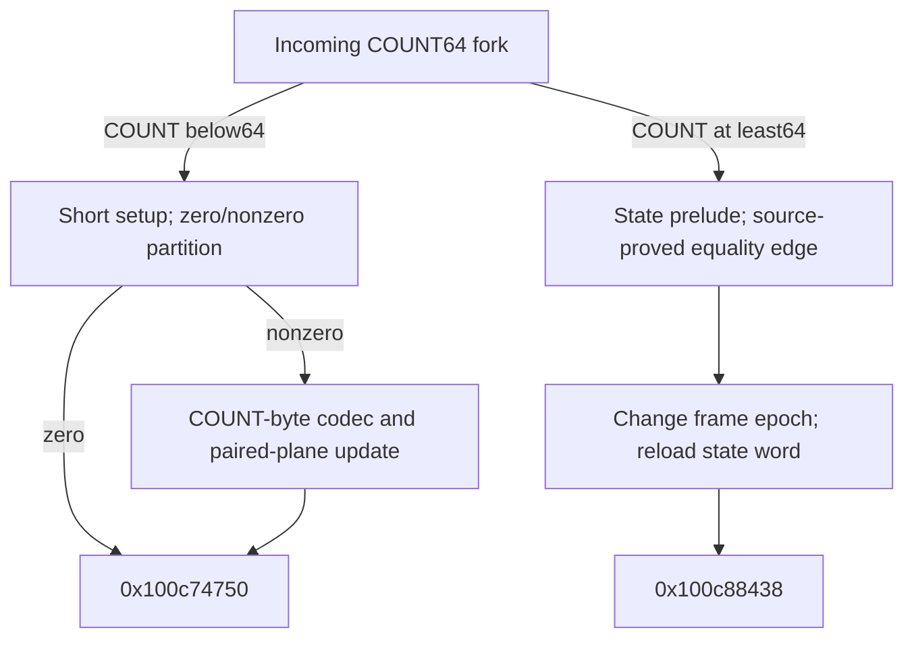

# Selected-record short-input planes and long-count handoff

The short-count successor decodes COUNT record bytes with the established address-keyed seven-round byte codec while updating two separate64-byte planes. Under coherent memory and valid source/frame ownership,the combined representation `U XOR V XOR0xe9` is exactly the decoded record prefix followed by zeros to64 B. COUNT0 bypasses the loop;COUNT1..63 perform exactly COUNT iterations. The long-count successor selects a source-proved state prelude/handoff without a new record-byte read in these ranges. Whole algorithm identity,native reachability,successful output,complete budget history and daemon/kext pairing remain unknown. [IP1-IP8]

Evidence: [source/fixups](triage_evidence/daemon_mode_one_record_input_planes_source.json.zst), [487 queries and source/codec ledgers](triage_evidence/daemon_mode_one_record_input_planes_checks.json.zst), [extractor](triage_evidence/recover_daemon_mode_one_record_input_planes.py), [validator](triage_evidence/validate_daemon_mode_one_record_input_planes.py), [preservation](triage_evidence/daemon_mode_one_record_input_planes_delivery.json), [quality gates](triage_evidence/daemon_mode_one_record_input_planes_quality_gates.json), [sealer](triage_evidence/seal_daemon_mode_one_record_input_planes.py), [publication audit](triage_evidence/verify_daemon_mode_one_record_input_planes_publication.py). Context: [incoming COUNT64 fork/fixed planes](daemon_mode_one_record_join_report.md), [preceding four record-byte passes](daemon_mode_one_record_rescan_report.md), [record selection/header codec](daemon_mode_one_record_scan_report.md), [earlier canonical word codec](daemon_constructor_lookup_report.md).

| Evidence | Verified scope |
| --- | --- |
| Original image |`fairplayd.arm64e`,SHA-256 `4ffe3ea1dbd27c5026b448ffe06e8489b02cd9064500bcc67792d4ac36ffb63e` |
| Current source |Five ranges,670 instructions /2680 B; all665 nonbranch sites translated |
| Incoming recapture |Complete7107-instruction join /28428 B freshly recaptured |
| Pointer/control provenance |Six original authenticated pointer records,eight source branch bindings |
| Accepted solver results |451 UNSAT /36 SAT,including457 predecessor queries with426 UNSAT /31 SAT |
| Byte codec |One universal source seed,seven universal round certificates,one address-byte selection certificate |
| Scratch addressing |Two source reciprocal shapes,actual numerator/coefficient bindings and128 complete finite cases |
| Short iteration |One record read,two plane reads and two plane stores; all800 arithmetic/codebook cells retained |
| Integrity |Six source/read/target/lineage/native-claim alterations rejected |
| Execution |No target execution,emulation,API/IPC request,new IDA access,IDB mutation or hardware PAC check |

F denotes the private frame and T=F+0xd10. COUNT=u32[F+0x728] and PBUF=u64[F+0x748]. All word operations use u32/u64 modular arithmetic;offsets/extents use bytes. These are conditional source/coherent-memory contracts with valid nonwrapping mappings,source/frame disjointness,stable saved roots and no outside writes. No native owner or caller-visible buffer is inferred from an address expression. [IP1-IP4]

## Incoming control fields and COUNT0 partition

The predecessor supplies W6=0x53921748,X8=0x000000007f3081c2,W4=0x39c7500a and phase0x3c0d at F+0x620. A new query over that complete original join proves F+0x620=0x3c0d,F+0x18=0xb5e1 and F+0x598=0x81112185;the values are not assumed from one model valuation. [IP2-IP3]

At `0x100c4a194`,the source stores0x4719 to F+0x6f8 at `0x100c4a1cc`,reloads PBUF into X3,and prepares the byte-codec constants. Under COUNT<64,its complete comparison circuit selects:

| COUNT | Selector / target | IA diversity |
| --- | --- | --- |
|Zero |0x3c0d ->`0x100c74750` |0xbcfd |
|Nonzero |0x782c ->`0x100c65bdc` |0xbcfd |

The nonzero setup at `0x100c65bdc` writes stride866 to F+0x730 and counter bias0x80cf7e3e to F+0x738,retains the saved word0x4719 at F+0x6f8,and selects0xa1ce ->`0x100dc10d4`,IA0xbcfd. It supplies X6=0x4923,W8=0x7f3081c2,W16=0xbdf3fb52 and divisor961 in W30. [IP3-IP4]

COUNT0 still performs the setup block's frame accesses and its one u32 store to F+0x6f8,but it makes no new record-byte read or plane write here. It bypasses the nonzero setup,so F+0x730 and F+0x738 retain their earlier phase/accumulator meanings on that route. Earlier header decoding separately read four bytes before this suffix,including for COUNT0. [IP2,IP4-IP5]

## Complete short-record loop

For 0<=i<COUNT<64,define:

```text
U(i) = T + ((0xbd700+866*i) mod961)
V(i) = T + ((0xaed96+866*i) mod961)
A(i) = u64(PBUF+i)
R(i) = u8[A(i)]
```

These U/V addresses are the predecessor's coordinate planes with bases896 and827. All128 possible plane cells are distinct;they are disjoint from the800 retained sum/carry/XOR and natural-digit-map cells. The current source proves:

| Effect | Source PC | Exact role |
| --- | --- | --- |
|Plane U read |`0x100dc1278` |Read old U(i) |
|Record-byte read |`0x100dc1290` |Read R(i) at PBUF+i |
|Plane U store |`0x100dc1360` |Write old U(i) XOR R(i) |
|Plane V read |`0x100dc14c0` |Read old V(i) |
|Plane V store |`0x100dc14cc` |Write old V(i) XOR M(A(i)) |

M is the canonical address-mask byte below. The source does not combine both planes into a plaintext buffer in this loop. The decoded representation is an algebraic/coherent-memory consequence of its separate stores. [IP3-IP6]

At iteration entry,W8=u32(0x7f3081c2+i). The source reduces its record-pointer offset exactly to i. Its two scratch numerators reduce to0xbd700+866*i and0xaed96+866*i. The original UMULL/LSR41/MSUB sequences use0x8864298f and divisor961. Two universal source-shape lemmas,live numerator/coefficient checks and64 finite cases per plane justify the replacements;all cases compute the exact integer quotient/remainder. [IP3,IP5]

W8 increments once per iteration. The full unsigned comparison circuit repeats exactly while `u32(i+1)<COUNT`;otherwise it selects0x3c0d ->`0x100c74750`. Repetition selects0xa1ce back to the same body. Both original bindings use IA0xbcfd. A strict next-index theorem gives i+1<=COUNT with no wrap. The complete source also restores every codec constant required by the next iteration,X3=PBUF,W9=u32(COUNT+0x39c7500a),W16=0xbdf3fb52 and X6=0x4923. The two saved stride/bias words are outside the bounded plane-store domain. [IP3-IP5]

## Address-keyed byte codec

For any u64 byte address A,define the following u64 function:

```text
B  = ror64(A AND0xfffffffffffffff8,8)+0x622c5d3364e5d59f
X0 = B XOR0xa7bebfcf1750d389
Y0 = B XOR0xb6dc5654307e7f72

For round j=0..6:
    Xnext = (ror64(Xj,8)+Yj) XOR Key[j]
    Ynext = rol64(Yj,3) XOR Xnext

M(A) = u8(X7 >> (8*(A AND7)))
D(i) = R(i) XOR M(A(i))
```

Only X7 is needed after the final round. The source-checked keys,in round order,are:

```text
324a764c67af2e0e  e70987b7a1f527b0  9032dc5079388982
144db9b1af6b5721  eb8e58819a88bf30  7faaf81a732f68b4
4f99108510ad96e0
```

The seed certificate is universal over A. Each round is proved against its actual original instruction slice for arbitrary incoming X/Y. Rounds4..6 use explicitly recorded key-XOR representations;two source low-byte alias equalities justify the later ROR/EXTR reconstruction. The byte-selection proof accounts for both source shifts and establishes the exact `(A AND7)*8` byte position. This is the same canonical codec as the earlier header/word readers,with newly proved source bindings here. It is not identified as a public standard cipher or API. [IP3,IP6-IP8]

The full iteration retains one mask-word abstraction only after the original final round. Its recorded meaning is X7 at PBUF+i,and its justification is the source seed,seven round contracts,byte selection,actual constant setup and constant restoration on repetition. The abstraction does not assert a desired plaintext value. [IP3,IP6]

## Paired-plane representation and zero suffix

The predecessor's fixed initialization gives U(i)=K[i] and V(i)=K[i] XOR0xe9 for all64 positions. Thus U(i) XOR V(i)=0xe9 before any short-loop write. The new source updates each processed pair to:

```text
Unew(i) = K[i] XOR R(i)
Vnew(i) = K[i] XOR0xe9 XOR M(A(i))
Unew(i) XOR Vnew(i) = D(i) XOR0xe9
```

A universal coherent-memory two-store theorem proves that update and preservation of every other cell when U(i) differs from V(i). The finite128-cell layout and the source iteration contracts compose into:

```text
U(i) XOR V(i) XOR0xe9 = D(i),  for 0<=i<COUNT
U(i) XOR V(i) XOR0xe9 = 0,     for COUNT<=i<64
```

This is an exact64-byte zero-padded decoded-prefix representation under the stated memory premises. It is not a newly published contiguous output buffer. Since COUNT<=63,the last plane byte at i=63 is always unprocessed here and the zero suffix always has at least one byte. COUNT0 leaves all64 plane pairs at their initial relation. [IP4-IP6]

For nonzero COUNT,the loop makes COUNT record-byte reads,2*COUNT plane-byte reads and2*COUNT plane-byte stores,at most126 byte stores. The current short route is a fifth ordered read of the selected COUNT-byte span after the four earlier passes;the combined record-byte count is5*COUNT,plus the earlier four header reads. Repeated addresses across those earlier passes do not establish equal byte values without a source-stability premise. [IP2,IP5-IP6]

## Long-count state prelude and next initializer

For COUNT>=64,the preceding join selects `0x100c4ff88`. The263-instruction prelude performs register-state arithmetic and one u32 store at F+0x6c8 at `0x100c50360`. It reads no record byte and writes no plane cell. Its compact complete state function remains unknown;the original source SSA and state spill are retained. [IP3-IP4,IP8]

The original final selector depends on F+0x18 and F+0x598. With the source-proved joining values0xb5e1 and0x81112185,the equality is always true and selects0xb5e5 ->`0x100c6ef60`,IA0x7ea5. The alternative slot0xb5e1 binds `0x100dc22c4`;that binding is retained as metadata but is excluded by the current joining-field premises. This is not a global claim that the alternative is unreachable in every frame epoch. [IP2-IP3,IP7]

The21-instruction handoff then selects0x6317 ->`0x100c88438`,IA0xbfe1. Its outgoing contract includes:

| Field | Exact source effect |
| --- | --- |
|F+0x18,u32 |Replaced by0x53921748 at `0x100c6ef90` |
|F+0x2cc,u32 |Written as0x0c392ed3 at `0x100c6ef84` |
|X8 |Reloaded numeric u64 0x000000007f3081c2 from F+0x4d8 |
|W1 |Reloaded newly produced u32 state from F+0x6c8 |
|W23 /W22 /W21 /W27 |0xc8 /0x5c /0x74 /0x16 |

F+0x18 therefore changes its control epoch. Its old0xb5e1 invariant cannot be reused after the handoff. The following4175-instruction initializer and the short route's6895-instruction successor at `0x100c74750` remain the next source frontiers. No semantics beyond their entries are assigned here. [IP3,IP7-IP8]

## Frame effects and external scope

The short prefix writes F+0x6f8 once. Its nonzero setup makes three further u32 stores at F+0x738,+0x6f8 and+0x730. The loop itself makes only the two bounded plane-byte stores per iteration. The zero route skips those three word stores and all loop effects. The long prelude/handoff makes three u32 stores at F+0x6c8,+0x2cc and+0x18. [IP3-IP4]

The800 arithmetic/codebook cells,the296 B workspace,saved COUNT,PBUF,branch root,scratch root and F+0x1210 budget cell are outside all new stores. F+0x730,F+0x738,F+0x6f8 and F+0x18 have explicitly different roles across the branch/setup epochs. Local budget-cell preservation does not establish complete budget accounting. [IP4,IP7]

No call,trap,Mach message,port creation or right transfer occurs in the five captured ranges. No new incoming/outgoing port or emission site is established. The current architectural touch points are the saved record pointer/count,the shared byte-codec definition,two scratch planes,private state spills and authenticated private continuations. Native ownership,successful traversal and pairing with external daemon/kext messages remain unknown. [IP4,IP7-IP8]



## Assumption register and bounded continuation

| ID | Assumption / dependent result | Stress test or falsification probe |
| --- | --- | --- |
| IP1 |Pinned source and original pointer records identify this variant |Recapture2680 current bytes and28428 predecessor bytes;check six authenticated records/eight bindings and reject six alterations |
| IP2 |Incoming COUNT64 fork,fixed planes and saved fields compose |Refresh457 predecessor queries/models and prove the three actual successor-control fields over the original join |
| IP3 |Scalar ISA effects,codec representations and source cuts are accurate |Translate all665 sites;prove the seed,seven rounds,byte selection,two reciprocal shapes,live bindings,full loop IO/control and register restoration |
| IP4 |Valid coherent nonwrapping frame/source mappings,stable roots and source/frame disjointness |Check128 plane addresses,800 retained cells and all private stores;native owners/extents and concurrent-write behavior remain unknown |
| IP5 |COUNT selects a readable bounded short prefix |Prove i+1 bounds for every i<COUNT<64 and retain five abstract COUNT domains;COUNT0 bypass and earlier four header reads remain separate |
| IP6 |Fixed initial pair relation and coherent distinct-cell updates compose by induction |Check the universal two-store theorem,128 distinct cells,unchanged suffix and address-codec equality;no direct plaintext-buffer publication is inferred |
| IP7 |Private branch/PAC and frame-epoch prerequisites hold for native traversal |Verify eight slots/modifiers and explicit phase/state replacements;hardware PAC,exceptions,full return and budget history remain unproved |
| IP8 |Whole algorithm,long-state compact form,output and daemon/kext pairing remain unknown |Trace both next bodies and actual plane consumers through ownership,publication and serialization;the64-byte threshold alone does not identify an algorithm |

| Impact | Next investigation | Evidence required |
| --- | --- | --- |
| High |Short successor `0x100c74750` |Actual decoding/combination of U/V and use of the zero suffix;state and output handoff |
| High |Long initializer `0x100c88438` |Its new plane contents,source/derived-state relationship and exact later count controls |
| High |Compact long-state arithmetic |Original-source word identities and incoming bank encodings,without attributing a standard algorithm from block size |
| High |Caller-visible output and cross-layer pairing |Owner/extents,output stores,serialization and corresponding daemon/kext interfaces |
| Medium |Later control-field epochs and64-byte boundary |Actual revisits after F+0x18/F+0x730/F+0x738 changes;COUNT64 takes the long route |

The short loop costs O(COUNT) iterations with fixed seven-round u64 work per byte and COUNT<=63. Each iteration performs three byte reads and two byte writes;the two64-byte planes reuse existing scratch cells. Source extraction/translation is linear in captured bytes/instructions. Finite address checks cover128 cases. SMT is solver-dependent,limited to15000 ms per query and20 s per process;unknown,timeout,diagnostics and unexpected results are rejected. Historical excluded unknown attempts in predecessor evidence remain excluded.

QG1: Factual source,codec,arithmetic,memory/control,ABI and provenance claims require no normative premise.

QG2: IP1-IP8 identify assumptions,dependent results and falsification probes.

QG3: Both immediate COUNT64 successors,the complete short loop,codec,plane representation,long handoff,frame epochs and Mach-emission scope are covered for this increment;the full investigation remains active.

QG4: All665 current sites,451 UNSAT/36 SAT results,nine codec certificates,128 finite address cases and exact count/store formulas are reproducible with explicit widths.

QG5: Separate plane stores versus decoded representation,COUNT0/header reads,zero/nonzero frame epochs,64-byte boundary,other long-selector epochs and native/output unknowns remain explicit.

QG6: Fresh source/fixups,457 predecessor replays,actual joining-field proofs,source-linked codec/address/control certificates and six rejected alterations establish scoped provenance.

QG7: Five impact-ranked continuations retain source/state/output/interface questions and the unresolved native daemon/kext boundary.
