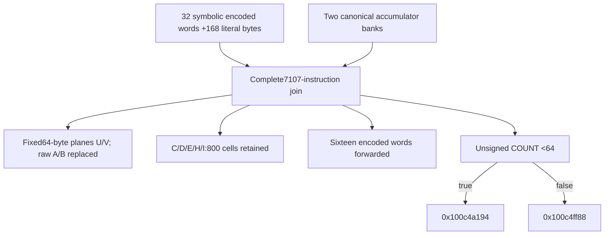

# Selected-record common join: fixed planes, workspace transfers and COUNT64 fork

Follow-up: [Selected-record short-input planes and long-count handoff](daemon_mode_one_record_input_planes_report.md) proves the COUNT0 bypass and complete COUNT1..63 byte loop,including the canonical seven-round address codec and paired-plane zero-padded64-byte representation. It also establishes the long-count selector/state handoff and explicit frame epochs. All665 sites translate;451 UNSAT/36 SAT checks pass,including457 predecessor replays. Native reachability,whole algorithm,caller output and daemon-kext pairing remain unknown.

The complete straight-line join at `0x100c7d5dc` initializes two fixed64-byte scratch planes,retains800 arithmetic/codebook cells,forwards sixteen encoded workspace words into new frame cells,and branches exactly on unsigned COUNT<64. Its128 byte stores replace all32 raw permutation/inverse cells. The earlier interpretation of those cells therefore ends here,while the sum/carry/XOR and natural-digit maps remain intact. The full state arithmetic is retained in source SSA;its compact complete recurrence,standard algorithm identity,native reachability,successful caller publication,budget history and daemon/kext pairing remain unknown. [RJ1-RJ8]

Evidence: [complete source/fixups/field decodes](triage_evidence/daemon_mode_one_record_join_source.json.zst), [457 queries and memory/data ledgers](triage_evidence/daemon_mode_one_record_join_checks.json.zst), [extractor](triage_evidence/recover_daemon_mode_one_record_join.py), [validator](triage_evidence/validate_daemon_mode_one_record_join.py), [preservation](triage_evidence/daemon_mode_one_record_join_delivery.json), [quality gates](triage_evidence/daemon_mode_one_record_join_quality_gates.json), [sealer](triage_evidence/seal_daemon_mode_one_record_join.py), [publication audit](triage_evidence/verify_daemon_mode_one_record_join_publication.py). Context: [common-join incoming banks](daemon_mode_one_record_rescan_report.md), [arithmetic/codebook banks](daemon_mode_one_record_codecs_report.md), [296 B workspace origin](daemon_mode_one_phase_handoff_report.md), [selected-record roots](daemon_mode_one_record_scan_report.md).

| Evidence | Verified scope |
| --- | --- |
| Original image | `fairplayd.arm64e`, SHA-256 `4ffe3ea1dbd27c5026b448ffe06e8489b02cd9064500bcc67792d4ac36ffb63e` |
| Complete join |`0x100c7d5dc..0x100c844e8`,7107 instructions /28428 B; all7106 nonbranch sites translated |
| Earlier recapture |18 ranges /6848 B,including the workspace producer and incoming rescan path |
| Pointer/control provenance |Two original authenticated pointer records and two branch bindings |
| Encoding checks |20 original BFI/BFXIL/UBFX field decodes; six original STP signed-offset/register decodes |
| Source memory normalization |27 literal frame aliases,four resolved indexed word reads and six paired-store lowerings |
| Accepted solver results |426 UNSAT /31 SAT; includes443 predecessor queries with417 UNSAT /26 SAT |
| Effects |390 loads /1576 B;595 logical stores /2008 B,covering1552 distinct frame bytes |
| Scratch epoch |128 fixed plane bytes;32 raw permutation cells replaced;800 arithmetic/codebook cells preserved |
| Word transfers |Sixteen source-proved encoded workspace-word copies |
| Integrity |Six source/target/pair/bitfield/lineage/native-claim alterations rejected |
| Execution |No target execution,emulation,API/IPC request,new IDA access,IDB mutation or hardware PAC check |

F denotes the private frame and T=F+0xd10. COUNT is u32[F+0x728]. u32/u64 arithmetic has the stated modular width;offsets/extents use bytes. This source theorem assumes the conditional incoming join ABI,valid coherent nonwrapping frame mappings,the pinned workspace literals,stable saved roots and no outside writes. The original workspace's32 encoded words and both incoming accumulator banks remain arbitrary symbolic inputs. [RJ1-RJ4]

## Workspace and incoming bank interfaces

The earlier workspace producer supplies296 B at F+0x768..F+0x88f:32 encoded u32 words at0x768..0x7e7,followed by168 literal bytes. The current proof freshly checks that producer's source and replays its literal-value,frame-address and unaligned-STUR certificates. The intervening selected-record/store contracts preserve this workspace. No workspace word is replaced by a guessed original unencoded value. [RJ2-RJ3]

Let WW[j]=u32[F+0x768+4*j],0<=j<32. All32 words are read. The seven register words of the incoming two-bank ABI are spilled immediately:

| Source store | Frame cell,u32 | Incoming value |
| --- | --- | --- |
|`0x100c7d5dc` |F+0x600 |First bank D,in W10 |
|`0x100c7d5e0` |F+0x608 |Second-bank word0,in W0 |
|`0x100c7d5e4` |F+0x700 |First-bank word0,in W12 |
|`0x100c7d5e8` |F+0x710 |First-bank word2,in W11 |
|`0x100c7d5ec` |F+0x708 |First-bank word1,in W13 |
|`0x100c7d5f0` |F+0x610 |Second-bank word2,in W2 |
|`0x100c7d5f4` |F+0x618 |Second-bank word1,in W1 |

The second bank's fourth word remains in F+0x738. The entry theorem accepts arbitrary canonical bank words,so it covers both the zero-count initial banks and the nonzero-count rescan results under the predecessor contract. Later stores reuse many spill/local cells;the complete byte-forwarded SSA tracks those epochs. [RJ2-RJ4]

Four apparent indexed reads resolve universally to exact workspace words:

| Source read | Original indexed root | Exact frame location / value |
| --- | --- | --- |
|`0x100c81afc` |F+0x768 |F+0x7fc,literal u32 0x677d7ae9 |
|`0x100c83748` |F+0x768 |F+0x860,literal u32 0xbc16a226 |
|`0x100c8432c` |F+0x768 |F+0x7a8,WW[16] |
|`0x100c8434c` |F+0x768 |F+0x7c0,WW[22] |

The last address has a syntactic dependency on WW[14] before simplification. Its original source expression is nevertheless proved equal to F+0x7c0 for every WW[14]. These four bindings justify forwarding actual workspace values instead of treating each read as an independent external word. Together with27 literal pointer aliases,they cover every nonliteral frame access except the terminal branch-table pointer fetch. [RJ3-RJ4]

## Two fixed64-byte planes

For 0<=j<64,the new plane addresses are:

```text
U(j) = T + ((866*(896+j)) mod961)
V(j) = T + ((866*(827+j)) mod961)
u8[U(j)] = K[j]
u8[V(j)] = K[j] XOR0xe9
```

K is a fixed64-byte sequence under the pinned168-byte literal-workspace premise. All128 values are first proposed by a SAT valuation,then accepted only by a universal original-source UNSAT check with all32 WW words,eight accumulator words,COUNT and unspecified entry registers left arbitrary. An independent declared-leaf census finds no symbolic input in any of the128 stored-byte expressions. The SAT valuation is candidate construction,not proof of native initialization or a native input witness. [RJ3-RJ6]

| Plane | SHA-256 of64 logical bytes,in increasing j order |
| --- | --- |
|U |`3eaa8d2cbbb12d2ccb478af9ef3560876164582dacd2af89ac83b91a21081b05` |
|V |`53567585403c98b46173f7b8020f3a47ff37bf21c1d71a5767eb6372662643fe` |

The complete byte sequences,all128 source store PCs and their physical frame offsets are retained in the evidence. Every one of the64 paired bytes satisfies the XOR0xe9 relation. This establishes fixed internal data and a concrete pair relation;its algorithmic or key role is unknown. [RJ5-RJ6,RJ8]

U(0)..U(15) occupy the old A permutation cells;V(0)..V(15) occupy the old B inverse-permutation cells. Both raw banks are fully replaced. The remaining96 plane cells were outside the earlier seven-bank832-cell layout. The following cells survive unchanged:

| Retained bank | Cells | Meaning inherited from the predecessor |
| --- | --- | --- |
|C |256 |Typed encoded sum |
|D |256 |Typed encoded carry |
|E |256 |Typed encoded XOR |
|H |16 |Input-codebook decoder |
|I |16 |Output-codebook encoder |

These800 cells are disjoint from U/V. Thus928 cells have established contents after the join inside the961 B domain,leaving33 outside the identified layout. Raw A/B interpretations cannot be applied after their replacement. H/I retain the explicit input/output coordinate conversions;the old P=Q uncertainty is not resolved by the replacement. The join performs no byte load from the arithmetic tables. [RJ4-RJ6]

## Sixteen encoded-word transfers

The tail forwards WW[16]..WW[31] unchanged into the following u32 cells. This is a local transfer of the encoded word representations;it does not identify a new native owner or an external output buffer. [RJ3-RJ4]

| Workspace word | Destination | Workspace word | Destination |
| --- | --- | --- | --- |
|WW[16] |F+0x5c |WW[24] |F+0x40 |
|WW[17] |F+0x6c |WW[25] |F+0x64 |
|WW[18] |F+0x60 |WW[26] |F+0x68 |
|WW[19] |F+0x78 |WW[27] |F+0x74 |
|WW[20] |F+0x70 |WW[28] |F+0x8c |
|WW[21] |F+0x90 |WW[29] |F+0x88 |
|WW[22] |F+0xb8 |WW[30] |F+0xbc |
|WW[23] |F+0xd0 |WW[31] |F+0xd8 |

The six STP instructions each produce two adjacent u32 store effects. Their original signed scaled offsets and register fields are independently decoded before lowering. Counting paired stores twice as effects yields595 logical stores from589 source store instructions;the two counts are not interchangeable. Frame forwarding is byte-based and little-endian,including the three u64 stores and paired u32 stores. [RJ1,RJ3]

## Exact COUNT64 control and outgoing ABI

Near the terminal branch,the source's computed W23 is universally0x7f3081c2. The unsigned comparison numerator reduces as follows:

```text
u32(COUNT+0x80cf7e3e+0x7f3081c2) = COUNT
selector = 0x7e1a XOR(0x58 if COUNT<64 else0)
```

The original source and authenticated pointer records establish:

| Unsigned predicate | Selector / target | IA diversity |
| --- | --- | --- |
|COUNT<64 |0x7e42 ->`0x100c4a194` |0x1c91 |
|COUNT>=64 |0x7e1a ->`0x100c4ff88` |0x1c91 |

COUNT0 therefore takes the first edge if this join is reached through the earlier zero-count route. Separate SAT checks retain COUNT0,63,64 and0xffffffff as nonempty abstract domains. Neither branch body,its later memory effects,nor a success/failure meaning is assigned here. [RJ3,RJ7-RJ8]

| Outgoing field | Source-proved value |
| --- | --- |
|X0 |The selected branch-pointer input FN |
|X17 |0x1c91 |
|X8 /X23 /u64[F+0x4d8] |0x000000007f3081c2 |
|W25 |0x58 |
|W24 |0x23 |
|W6 |0x53921748 |
|W4 |0x39c7500a |
|u32[F+0x2cc] |0x0c392ed3 |

The X8/X23/F+0x4d8 value is a zero-extended numeric word. A pointer role is not established merely because it occupies an X register or u64 cell. The remaining register expressions and declared-input dependency sets are retained in full. A dependency-set membership does not itself prove influence,and a compact complete state recurrence remains unproved. [RJ3,RJ6,RJ8]

## Complete footprint and architectural boundary

The source makes128 byte,464 u32 and three u64 store effects:128+4*464+8*3=2008 B written dynamically across1552 distinct bytes. It makes390 loads totaling1576 B. Every store is source-bound to a private frame address;389 loads are frame-forwarded and the remaining load fetches the selected authenticated branch pointer. SP is never written. [RJ1,RJ3-RJ4]

All296 workspace bytes and the saved request,NODE,cookie,COUNT,phase,second-bank fourth word,branch root,PBUF,scratch root,word-cell pointer and separate F+0x1210 budget cell are outside the write footprint. Local preservation of that budget cell does not establish the complete operation's budget history. There is no call,trap,Mach message,port creation or right transfer in the complete range;its only control transfer is the final BRAA. No new incoming/outgoing port or emission site is established. [RJ4,RJ7-RJ8]

The newly established architectural interface is an internal preparation/state block:it preserves the encoded workspace,initializes paired fixed planes,replaces exhausted raw permutation banks,forwards sixteen words and selects a64-byte count partition. External ownership,actual native execution and publication into a caller buffer or daemon/kext message remain unknown. [RJ6-RJ8]



## Assumption register and bounded continuation

| ID | Assumption / dependent result | Stress test or falsification probe |
| --- | --- | --- |
| RJ1 |Pinned image,source bytes and original pointer records identify this variant |Recapture the complete28428 B join and18 earlier ranges;decode20 bitfields/six pairs,check two authenticated records and reject six alterations |
| RJ2 |Incoming canonical banks,workspace literals and selected-path preservation compose |Refresh440 rescan queries and three workspace certificates;retain arbitrary WW/bank inputs and explicit first-arrival/native premises |
| RJ3 |Scalar ISA effects,byte forwarding and memory normalizations match source |Translate every7106 nonbranch site,prove27 aliases/four indexed addresses,all389 frame loads/all595 stores,sixteen word transfers and control/ABI |
| RJ4 |Valid coherent nonwrapping private frame and stable saved context,without outside writes |Check1552 written bytes against296 workspace bytes,800 retained table cells and protected roots/budget;native mapping/owners remain unknown |
| RJ5 |The128 fixed-byte candidates are valid beyond their proposing valuation |Require a universal original-source UNSAT check with all word/bank/count inputs arbitrary;the SAT valuation alone is not accepted as fixedness proof |
| RJ6 |Scratch epochs and finite coordinate/data relations compose |Check all128 distinct positions,64 XOR0xe9 pairs,complete A/B replacement and928-cell post-layout;raw A/B semantics end here |
| RJ7 |Original private branch/PAC and memory prerequisites hold for native traversal |Verify COUNT64 algebra,two slots/modifiers and four boundary domains;hardware PAC,exceptions and actual traversal remain unexecuted/unproved |
| RJ8 |Compact state/algorithm identity,caller publication and cross-layer pairing remain unknown |Trace both successors and actual U/V/table/word consumers through output and serialization;numeric u64 storage does not establish a pointer |

| Impact | Next investigation | Evidence required |
| --- | --- | --- |
| High |COUNT<64 successor `0x100c4a194` |Plane reads,source/index bounds,padding/state operations and later handoff |
| High |COUNT>=64 successor `0x100c4ff88` |Actual state/data effects and relationship to the short-count route |
| High |Consumers of U/V and the800 retained cells |Source-backed byte/codebook decoding and epoch-aware interpretation;fixed pair alone does not identify an algorithm |
| High |Compact state recurrences and output pairing |Original-source word identities,owner/extents,publication and serialization evidence |
| Medium |Lifetime of the sixteen encoded copies and numeric F+0x4d8 value |Actual downstream reads and conversion rules,without guessed pointer or external-buffer roles |

The join is straight-line and has fixed7107-instruction extent. Extraction,source translation and footprint enumeration take O(M+B) for M instructions and B recorded memory bytes. Memoized SSA dependency traversal takes O(V+E) graph work plus finite dependency-set unions. Runtime state here occupies existing frame/scratch cells;no native allocation is identified. SMT uses15000 ms per query and20 s per process;unknown,timeout,diagnostics and unexpected results are rejected. Historical excluded unknown attempts in predecessor evidence remain excluded.

QG1: Factual source,arithmetic,memory/control,ABI and provenance statements require no normative premise.

QG2: RJ1-RJ8 identify assumptions,dependent claims and falsification probes.

QG3: The complete join,workspace inputs,fixed planes,bank replacement,word transfers,COUNT fork,environment and Mach-emission scope are covered for this increment;the full investigation remains active.

QG4: All7106 current sites,426 UNSAT/31 SAT results,128 plane values,sixteen transfers and complete byte/effect counts are reproducible with explicit widths.

QG5: Fixed-data premises,candidate versus universal proof,raw-bank replacement,retained codebooks,numeric u64 values and native/output unknowns remain explicit.

QG6: Fresh source/fixups/field decodes,443 predecessor replays,source-bound frame proofs and six rejected alterations establish scoped provenance.

QG7: Five impact-ranked continuations retain state/data/output/interface questions and the unresolved native daemon/kext boundary.
