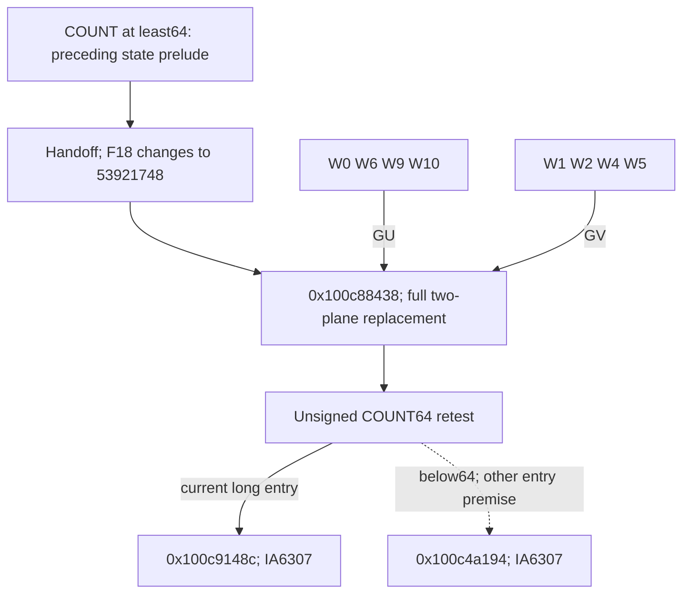

# Selected-record long-input derived planes and count retest

The long-input initializer at `0x100c88438` replaces both existing64-byte scratch planes using two separate incoming four-word register banks. It reads neither the record buffer nor old plane bytes. All128 byte-store addresses are fixed and cover those planes exactly once;the800 arithmetic/codebook cells remain unchanged. Its terminal circuit retests unsigned COUNT<64. The current COUNT>=64 entry therefore selects `0x100c9148c`,IA diversity0x6307. Compact byte formulas,whole algorithm identity,native reachability,successful output and daemon/kext pairing remain unknown. [LP1-LP8]

Evidence: [original source/fixups](triage_evidence/daemon_mode_one_record_long_planes_source.json.zst), [source SSA,23 accepted queries and complete store ledger](triage_evidence/daemon_mode_one_record_long_planes_checks.json.zst), [extractor](triage_evidence/recover_daemon_mode_one_record_long_planes.py), [validator](triage_evidence/validate_daemon_mode_one_record_long_planes.py), [preservation](triage_evidence/daemon_mode_one_record_long_planes_delivery.json), [quality gates](triage_evidence/daemon_mode_one_record_long_planes_quality_gates.json), [sealer](triage_evidence/seal_daemon_mode_one_record_long_planes.py), [publication audit](triage_evidence/verify_daemon_mode_one_record_long_planes_publication.py). Context: [preceding short/long split and handoff](daemon_mode_one_record_input_planes_report.md), [common join and original fixed planes](daemon_mode_one_record_join_report.md), [earlier record rescans](daemon_mode_one_record_rescan_report.md), [record selection](daemon_mode_one_record_scan_report.md).

| Evidence | Verified scope |
| --- | --- |
| Original image |`fairplayd.arm64e`,SHA-256 `4ffe3ea1dbd27c5026b448ffe06e8489b02cd9064500bcc67792d4ac36ffb63e` |
| Current routine |4175 instructions /16700 B,entry `0x100c88438`,terminal BRAA `0x100c8c570`;all4174 nonbranch sites translated |
| Incoming recapture |Six complete predecessor ranges /31108 B |
| Pointer provenance |Two original authenticated pointer records,two target/modifier bindings |
| Accepted queries |19 UNSAT /4 SAT;includes seven selected predecessor contracts |
| Store effects |128 distinct byte stores and three u32 stores;131 effects /140 distinct bytes |
| Read effects |Five saved-frame loads /28 B and one authenticated branch-pointer load /8 B |
| Address proof |27 literal frame aliases plus five indexed stores;four universally unconstrained internal-value overapproximations |
| Source-role checks |Four false Capstone CMP GPR-write reports corrected;14 incoming GPRs are read only through W-register views |
| Integrity |Six source/address/target/PAC/lineage/native-claim alterations rejected |
| Execution |No target execution,emulation,API/IPC request,new IDA access,IDB mutation or hardware PAC check |

F denotes the private frame and T=F+0xd10. COUNT=u32[F+0x728]. Word arithmetic is modular u32/u64;all offsets/extents are bytes. Valid coherent nonwrapping mappings,stable saved roots,source/frame ownership and no outside writes remain composition premises. Static pointer metadata does not prove successful hardware authentication or native traversal. [LP1-LP4,LP7]

## Incoming register and frame contract

The preceding join chooses the long route for unsigned COUNT>=64. The source-proved long prelude selects its equality continuation and the following handoff reaches this initializer after replacing F+0x18 with0x53921748. The initializer uses:

| Incoming value | Established role |
| --- | --- |
|W19=0x4923 |Source-proved prelude result;handoff does not write W19/X19 |
|W23=0xc8,W22=0x5c,W21=0x74,W27=0x16 |Source-proved handoff constants |
|W24=0x23 |Source-proved join result;neither long prelude nor handoff writes W24/X24 |
|W0,W6,W9,W10 |First four-word data bank,universally abstract in this component |
|W1,W2,W4,W5 |Second four-word data bank,universally abstract in this component |
|u64[F+0x750]=T |Saved scratch root |
|u64[F+0x740]=TABLE |Saved authenticated-continuation table root |
|u32[F+0x728]=COUNT |Saved length/control word |
|u32[F+0x18]=0x53921748 |Current control epoch |

The source's read-before-write census contains exactly these14 incoming W-register views. No incoming X-register data width is required by the byte functions. Earlier numeric X8=0x000000007f3081c2 is not read as an incoming argument in this routine. Its earlier presence does not identify a pointer here. [LP2-LP3]

W1 includes the immediately preceding reload of the new F+0x6c8 state word. The other bank words retain their actual upstream expressions in predecessor evidence;this component does not assume that the two banks are equal or statistically independent. Universal separation of their symbolic inputs is an overapproximation. Actual upstream relationships may imply additional byte identities that are not proved here. [LP2,LP5-LP6]

Seven selected predecessor queries are refreshed:the join's COUNT64 fork,outgoing register/constants ABI,and actual saved control fields;the long prelude's equality selector/state spill;the long handoff ABI;and both routines' complete word-store addresses. The original join additionally supplies a new W24 query. Other historical predecessor queries remain provenance and are not claimed refreshed. A broad exploratory replay stopped on an unrelated earlier byte-loop timeout;that result is excluded. [LP2,LP8]

## Complete plane replacement

For 0<=i<64,the logical addresses are unchanged from the incoming join:

```text
U(i) = T + ((866*(896+i)) mod961)
V(i) = T + ((866*(827+i)) mod961)
```

These128 addresses are distinct. Each is written exactly once by this initializer. All800 sum/carry/XOR and digit-codebook cells are disjoint from the store set. The checks artifact records every original source PC,frame offset,coordinate,index,exact source-SSA byte expression and declared input domain. [LP3-LP5]

| Logical output | Complete declared dependency upper bound |
| --- | --- |
|All64 U bytes |Incoming W0,W6,W9,W10 |
|All64 V bytes |Incoming W1,W2,W4,W5 |

The upper bounds follow by recursively traversing the full source SSA through each byte store after substituting the source-proved constants and saved roots. All variable leaves belong to the stated bank. COUNT,T,TABLE,the opposite bank and old memory contents do not occur in those value expressions. Membership in a syntactic dependency set does not prove that every listed word influences the final byte;arithmetic cancellation can remove apparent dependencies. [LP3,LP5-LP6]

Thus the routine establishes deterministic64-byte functions U=GU(W0,W6,W9,W10) and V=GV(W1,W2,W4,W5). The original instruction-to-SSA definitions specify both functions exactly;compact serialized-state,padding,hash or other standard-algorithm identities remain unknown. The64-byte extent alone does not establish any such identity. [LP5-LP6,LP8]

Unlike the short branch's partial in-place XOR updates,this routine completely replaces both planes and makes no byte load. The incoming fixed relation U XOR V=0xe9 must not be carried through these stores without a new proof over the actual upstream bank relationship. No decoded record byte or caller-visible plaintext buffer is produced by a read in this range. [LP4-LP6]

## Indexed-address cancellations

Most stores are literal SP-relative addresses or use constant SP aliases. Five stores use arithmetic indices whose syntactic dependencies initially include data-bank words:

| Store PC | Original addressing operand | Exact address |
| --- | --- | --- |
|`0x100c89214` |`[x28,x15]` |F+0xd3f |
|`0x100c89528` |`[x28,x2]` |F+0xfe3 |
|`0x100c89728` |`[x28,x13]` |F+0xec6 |
|`0x100c89844` |`[x28,w14,uxtw]` |F+0xe67 |
|`0x100c8aa88` |`[x28,x7]` |F+0xf29 |

X28 is the source reload of T at `0x100c89210`. All five equalities are accepted UNSAT certificates against the original source address expressions. The second needs no abstraction. For the other four,one internal u32 definition is replaced by an unconstrained u32 value while retaining every downstream definition. This broadens the possible internal states. UNSAT over that broader domain proves the equality for the actual internal value without proving or assuming a selected data valuation. The checks artifact retains each removed definition and replacement declaration. [LP3-LP5]

For example,the first cancellation reduces for arbitrary u32 q to:

```text
u64((q AND0x2f) XOR0x2d)
+ u64((q XOR0xb16feb42) AND0x2f) = 0x2f
T+0x2f = F+0xd3f
```

The other generalized intermediate names are tied to regenerated source SSA and widths. Address normalization changes no register definitions:the original and normalized full source SSA are checked byte-for-byte equal. A separate certificate covers all27 literal aliases;all131 resulting private store addresses and five saved-frame read addresses are checked. No candidate model valuation is accepted as an address proof. Earlier exploratory direct/monolithic address queries that returned unknown are excluded. [LP3-LP5]

## Saved fields and control retest

The only word stores occur before the plane stores:

| Store PC | Field | Exact new value |
| --- | --- | --- |
|`0x100c88438` |u32[F+0x738] |0x4923 |
|`0x100c88474` |u32[F+0x730] |0x67f0 |
|`0x100c884ac` |u32[F+0x620] |0x3c0d |

The latter two are `u32(0x4923+0x401226d9) AND0xbfedf7f3` and `u32(0x4923+0x64d9343c) AND0x9b26bead`. The complete source certificate proves these values and the outgoing branch ABI. In particular,F+0x738 replaces the earlier retained second-bank word with a phase value,and F+0x730 becomes0x67f0 rather than the short-loop stride866. These meanings are specific to the current control epoch. [LP3,LP7]

The terminal comparison circuit contains an overflow-style threshold0x7b6fca7f and saved-phase arithmetic;its complete u32 semantics reduce exactly to unsigned COUNT<64:

| Predicate | Table selector / target | IA diversity |
| --- | --- | --- |
|COUNT<64 |0xb1fc ->`0x100c4a194` |0x6307 |
|COUNT>=64 |0xb217 ->`0x100c9148c` |0x6307 |

The table-pointer load is at `0x100c8c55c`;the branch is at `0x100c8c570`. The source also establishes X10=the loaded branch pointer,X17=0x6307,X6=0x53921748 and W4=0x39c7500a. Abstract COUNT0,63,64 and0xffffffff domains are satisfiable;the actual long entry separately excludes the below64 edge. Those four SAT domains are satisfiable arithmetic premises,not evidence of native visits. [LP3,LP7]

The below64 target has the same address as the earlier short setup but uses a different table slot and IA diversity from the earlier incoming join. Those authenticated records cannot be substituted merely because their targets match. Under the present COUNT>=64 entry,the routine reaches the new `0x100c9148c` frontier. Later cross-epoch entry into the initializer remains outside this contract. [LP1-LP3,LP7-LP8]

## Memory, external control and architectural scope

The routine loads T,COUNT,F+0x18,F+0x738 and TABLE once each,then loads one branch-table pointer. Those five frame loads total28 B;the table read adds8 B. Its128 byte stores plus three u32 stores touch140 distinct bytes. There is no call,trap,byte read,record-pointer reload,Mach message,port allocation or right transfer in the captured straight-line range. No new incoming/outgoing port or emission PC is established. [LP1,LP3-LP4]

The private request/node/cookie slots,saved roots,COUNT,record pointer,296 B word workspace and F+0x1210 budget cell are disjoint from all stores. Preserving the budget cell here does not establish complete budget accounting. Native source/frame ownership,buffer extents,concurrent stability,exception behavior,successful return and external output publication remain unknown. The architectural touch points newly established are the two incoming register banks,the two complete scratch-plane replacements,three saved phase cells and authenticated private continuation. [LP4,LP7-LP8]



## Assumption register and bounded continuation

| ID | Assumption / dependent result | Stress test or falsification probe |
| --- | --- | --- |
| LP1 |Pinned image and authenticated records identify this variant |Recapture16700 current bytes and31108 incoming bytes;verify two records/bindings;reject six source/ABI alterations |
| LP2 |Actual incoming COUNT/control/constants compose through the long handoff |Refresh seven selected predecessor contracts;prove original-join W24=0x23;verify W24/W19 preservation from source write sets |
| LP3 |Scalar ISA,widths,aliases and intermediate substitutions are accurate |Translate every4174 nonbranch site;check14 W-only live-ins,27 aliases,five indexed addresses,five frame reads,131 stores,word fields and terminal ABI |
| LP4 |Valid coherent nonwrapping private mappings,stable roots and no outside writes |Check128 distinct plane cells,800 retained cells,140 written bytes and all protected frame slots;native owners/extents remain unknown |
| LP5 |Indexed-address overapproximations are universal and do not inject output values |Retain the exact four removed u32 definitions/free declarations;prove the original addresses UNSAT over broadened domains;require identical register SSA after normalization |
| LP6 |Input-bank separation is interpreted only as an upper bound |Traverse every byte-value definition;require all64 U leaves in the first bank and all64 V leaves in the second;actual influence,bank relationships and compact functions remain unknown |
| LP7 |Current COUNT>=64/frame epoch and PAC prerequisites hold for native traversal |Prove the complete u32 count partition and excluded low edge;verify slots/modifiers and changed saved fields;hardware PAC and native traversal remain unproved |
| LP8 |Compact state/algorithm,output and daemon/kext pairing remain unknown |Trace the next consumer and state serialization against original source;retain excluded timeout results separately from accepted certificates |

| Impact | Next investigation | Evidence required |
| --- | --- | --- |
| High |Long successor `0x100c9148c` |Actual plane consumption,loop/state updates and next authenticated handoff |
| High |Compact GU/GV byte functions |Original-source word/byte identities and actual upstream bank relationships;no algorithm attribution from64 B alone |
| High |Short successor `0x100c74750` |Consumer of the short decoded-prefix/zero-suffix representation and any shared downstream state path |
| High |Caller-visible output and daemon/kext linkage |Concrete ownership,publication,serialization and corresponding external interface |
| Medium |Repeated COUNT64 gate and phase slots |Other entry contexts,revisits and whether changed F730/F738/F620 values affect subsequent traversal |

The captured routine has no internal loop and performs fixed131 stores and six loads:O(1) work/space with respect to COUNT,using existing scratch storage. Extraction and translation are O(N) in source bytes/instructions. Memoized dependency traversal is O(N+E) over SSA definitions/references. The proof set has19 UNSAT and four SAT results,including seven selected predecessor replays. SMT complexity is solver-dependent;queries are limited to15000 ms and solver processes to20 s. Timeout,unknown,diagnostics,nonzero exit and unexpected results are rejected. No timeout is counted as a proof.

QG1: All claims concern factual source,ABI,width,memory/control and provenance properties.

QG2: LP1-LP8 state assumptions,dependent results and explicit falsification probes.

QG3: The complete long initializer,all read/write effects,two input-bank domains,COUNT64 retest,field epochs and Mach-emission scope are covered for this increment;the overall investigation remains active.

QG4: All4174 sites,131 stores,140 distinct bytes,36 read bytes,19 UNSAT/four SAT certificates and exact frame/address equations are reproducible with explicit widths.

QG5: Fixed original planes are distinguished from their full replacement;dependency membership from influence;current long entry from other count domains;four universal internal-value overapproximations from concrete valuations;accepted proofs from excluded timeouts.

QG6: The original image bytes,authenticated fixup records,fresh predecessor recaptures,selected incoming queries and current source SSA are primary evidence;no new dynamic or IDA observation is claimed.

QG7: The bounded continuation table ranks unresolved plane functions,consumers,external output and later frame/control epochs by impact.

Follow-up: [Selected-record long-input64-byte prefix absorption](daemon_mode_one_record_long_prefix_report.md) proves four16-byte iterations,all320 byte addresses and complete two-plane updates. U XORs raw record bytes;V XORs source-defined address-only masks. A data-dependent CSEL has no effect on its resulting V byte. The exit advances two biased counters by64 and selects0x100b8ed9c. All5034 unique sites/19194 instances translate;48 UNSAT/11 SAT checks pass,including23 predecessor queries. Canonical-mask identity,compact state/algorithm,native traversal,caller output and daemon-kext pairing remain unknown.
