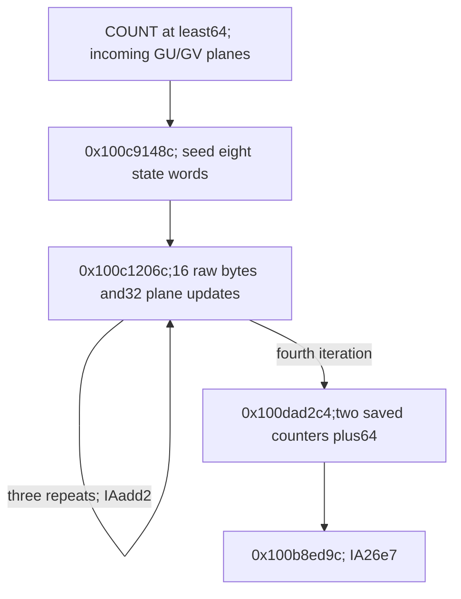

# Selected-record long-input 64-byte prefix absorption

The long-input continuation consumes exactly the first64 record bytes in four iterations of a16-byte body. Each existing U/V plane cell is read and updated exactly once. U XORs in the raw record byte;V XORs in a source-defined function of the record address alone. A data-dependent CSEL in the first-byte circuit has no effect on its resulting V byte:both arms are universally equal. The exit adds64 to two saved biased counters and selects `0x100b8ed9c`. Canonical-mask identity,compact state/algorithm,native reachability,output and daemon/kext pairing remain unknown. [PF1-PF8]

Evidence: [source/fixups](triage_evidence/daemon_mode_one_record_long_prefix_source.json.zst), [59 queries,complete source SSA and address/update ledgers](triage_evidence/daemon_mode_one_record_long_prefix_checks.json.zst), [extractor](triage_evidence/recover_daemon_mode_one_record_long_prefix.py), [validator](triage_evidence/validate_daemon_mode_one_record_long_prefix.py), [preservation](triage_evidence/daemon_mode_one_record_long_prefix_delivery.json), [quality gates](triage_evidence/daemon_mode_one_record_long_prefix_quality_gates.json), [sealer](triage_evidence/seal_daemon_mode_one_record_long_prefix.py), [publication audit](triage_evidence/verify_daemon_mode_one_record_long_prefix_publication.py). Context: [incoming long-plane replacement](daemon_mode_one_record_long_planes_report.md), [short-input codec and long handoff](daemon_mode_one_record_input_planes_report.md), [original common join](daemon_mode_one_record_join_report.md), [record selection](daemon_mode_one_record_scan_report.md).

| Evidence | Verified scope |
| --- | --- |
| Original image |`fairplayd.arm64e`,SHA-256 `4ffe3ea1dbd27c5026b448ffe06e8489b02cd9064500bcc67792d4ac36ffb63e` |
| Current source |Three ranges,5037 instructions /20148 B;all5034 unique nonbranch sites translated |
| Finite traversal |302 seed sites +4*4720 body sites +12 exit sites =19194 translated instances |
| Incoming recapture |Six complete ranges /19380 B |
| Pointer provenance |Four original authenticated records and four target/modifier bindings |
| Accepted results |48 UNSAT /11 SAT,including all23 immediately preceding queries |
| Byte addressing |All320 byte addresses certified:64 record reads,128 plane reads,128 plane stores |
| Source-role checks |Eight bitfield decodes,two EON decodes,one paired-load decode;two false CMP GPR-write reports corrected |
| State and effects |Eight state-word spills,39 constant-word spills;730 loads,433 stores /3020 read B /1684 written B /528 distinct written B |
| Integrity |Seven byte/read/target/EON/pair/lineage/native-claim alterations rejected |
| Execution |No target execution,emulation,API/IPC request,new IDA access,IDB mutation or hardware PAC check |

F denotes the private frame,T=F+0xd10,PBUF=u64[F+0x748],COUNT=u32[F+0x728]. Word arithmetic is modular u32/u64;all offsets/extents are bytes. The entry is conditional on the established COUNT>=64 route,valid coherent mappings,stable saved roots,no outside writes and a readable64 B source span disjoint from the frame. Native buffer ownership/extents remain unproved. [PF1-PF4]

## Seed and incoming state

At `0x100c9148c`,the303-instruction seed starts with source-proved W6=0x53921748 and u32[F+0x730]=0x67f0. It makes no record-byte or plane-byte access. It stores eight new u32 state expressions at:

```text
F+0x6cc  F+0x008  F+0x010  F+0x6c4
F+0x6c0  F+0x00c  F+0x6bc  F+0x6c8
```

Their complete original-source expressions are retained. A compact recurrence and the relationship between these words and the preceding GU/GV plane functions remain unknown. The seed also stores39 source-proved constant words to control/coordinate cells. All47 stores are private u32 effects;the decimal `[sp,#8]` operand is normalized to the equivalent hexadecimal offset with an explicit ledger entry. [PF2-PF3,PF7-PF8]

The seed loads F+0x730,TABLE and PBUF,plus one branch pointer. The selector is the old0x67f0,so the original pointer record selects `0x100c1206c`,IA diversity0x373d. It subsequently changes F+0x730 to0x2b22871b. Loading a pointer before that replacement is material:the new word cannot be substituted into the earlier table lookup. [PF2-PF3,PF7]

The full outgoing ABI certificate includes X12=0,W11=0,X19=0x0be7880c,W24=866,W4=0x8864298f,X30=PBUF,and the exact coordinate/codec constants required by the body. It also proves F+0x534=0x84ef and F+0x14=0x4923. These phase words have specific new meanings;F+0x738 is overwritten again within the body. [PF3,PF7]

All19 UNSAT/four SAT predecessor queries are freshly regenerated with matching semantics and source recapture. Their handoff query supplies F+0x2cc=0x0c392ed3,and the preceding initializer's complete store ledger excludes that cell. F+0x18=0x53921748 is also retained until the exit. No statistical independence or equality of the actual upstream data banks is assumed. [PF2,PF4]

## Four complete body iterations

The4721-instruction body at `0x100c1206c` has exactly one terminal authenticated branch and no internal branch/call/trap. Its two comparisons control an early data CSEL and the final repetition test. Each of four finite source models translates all4720 nonbranch instructions with independently named byte loads and coherent saved-frame forwarding. [PF1,PF3-PF5]

| Round q | Record offsets | Terminal selector / target |
| --- | --- | --- |
|0 |0..15 |0x84f9 ->`0x100c1206c` |
|1 |16..31 |0x84f9 ->`0x100c1206c` |
|2 |32..47 |0x84f9 ->`0x100c1206c` |
|3 |48..63 |0x84ef ->`0x100dad2c4` |

Both body bindings use IA diversity0xadd2. Each body adds16 to X19. Its original u64 comparison expression reduces to16*(q+1)<64 for the captured four counter states. The first three states therefore repeat and the fourth exits;there is no fifth iteration on this entry. The source models carry all outgoing registers and saved words into the next body,including the less direct X12 and coordinate representations. The branch result is not inferred merely from a convenient loop-counter name. [PF3,PF5,PF7]

F+0x730 starts at0x2b22871b and decreases by0x3620 per body;F+0x534 remains0x84ef. The body advances numerous coordinate words by0x3620,while its record-read coordinates advance by16. These updates are preserved in the full source SSA. None of the three captured ranges loads COUNT. COUNT>=64 is the incoming path premise,the body processes a fixed64 B prefix,and treatment of a longer suffix remains unknown. [PF2-PF5,PF8]

For i=16*q+j,0<=q<4,0<=j<16,the addresses are:

```text
A(i) = PBUF+i
U(i) = T+((866*(896+i)) mod961)
V(i) = T+((866*(827+i)) mod961)
```

Each iteration has16 record-byte reads,32 plane-byte reads and32 plane-byte stores. The record and U reads are not in a uniform source order for every j;the ledger identifies them by proved addresses. Every plane read precedes its corresponding store. Across four rounds,the64 record offsets and128 plane cells are covered exactly once. [PF3-PF5]

Five SAT queries propose the39 seed constants and four sets of80 byte addresses. They use abstract algebraic valuations,including zero roots,to obtain candidates;they do not model native memory mappings. Separate universal UNSAT queries prove every proposed constant/address for arbitrary roots,data words and named load bytes. Candidate valuations are not accepted as address proofs. [PF3,PF5]

## Exact U/V value contracts

For raw byte R(i)=u8[A(i)],the original source proves all16 U updates in each round:

```text
Unew(i) = Uold(i) XOR R(i)
```

The V updates satisfy:

```text
Vnew(i) = Vold(i) XOR M_i(PBUF)
```

All64 M_i are fully specified by retained source SSA and byte-output expressions. Their declared variable dependency is solely PBUF. The finite round/index and all setup constants are fixed in their definitions. Their identity with the earlier canonical address-mask codec at PBUF+i is unproved;no such substitution is made. [PF3,PF5-PF6]

The first-byte circuit contains `cmp w11,#0x74` at `0x100c1214c` and `csel x9,x10,x9,eq` at `0x100c12160`. Its predicate is u8(R(16*q) XOR Uold(16*q))==0x74. This is a source data dependency,not an internal control-flow edge. The original predicate is retained. [PF3,PF6]

The accepted value proof uses a complete source case split:

1. Replace that one CSEL predicate by constant false and constant true in two otherwise identical original SSA circuits. For arbitrary byte inputs and PBUF,their first V-store bytes are equal in each round. Four universal UNSAT certificates establish this equality.
2. Verify structurally that none of the other15 V outputs refers to that CSEL definition. The dependency traversal stops at the named definition when testing this property.
3. In the common false circuit,set its16 old V inputs to0 to construct candidate mask functions. Four universal source queries prove all16 false-circuit outputs equal their actual old V byte XOR the corresponding zero-input mask.
4. Traverse the zero-input mask definitions:each of the64 outputs has only PBUF as a declared input. The two exhaustive CSEL cases and the other15-output census compose the result back to the actual predicate.

The false arm and zero inputs are candidate-function construction,not assumptions about actual record bytes or the branch outcome. The true-arm equality proves that the apparent first-byte data dependency does not affect the stored V byte. No claim is made about every transient register or the full semantics of that CSEL outside the captured output cones. Four exploratory unsplit V-vector queries timed out and are excluded;the accepted component queries provide the stated result. [PF3,PF5-PF6]

Under coherent source/frame-disjoint memory,the pair relation is therefore:

```text
Unew(i) XOR Vnew(i)
= Uold(i) XOR Vold(i) XOR R(i) XOR M_i(PBUF)
```

A separate universal byte-algebra certificate checks the XOR composition. The full address ledger supplies cell distinctness,read-before-write order and preservation of every other plane cell before its own update. The incoming long route supplied GU/GV-derived planes,so their old pair relation is not assumed to be0xe9. This report does not establish a plaintext output or a zero-padded decoded block. [PF4-PF6,PF8]

## Frame effects and exit contract

Each body has64 private frame stores:43 u32 and21 u64 effects,340 written B over288 distinct frame bytes. Its131 frame loads comprise91 u32 and40 u64 effects. Including48 byte loads and one table-pointer load,gives180 loads /740 B per iteration. Its32 byte stores add32 B,so96 stores write372 B per iteration. Read effects are counted by width in the evidence. [PF3-PF4]

The seed writes188 B. Four bodies write1488 B. The two exit stores add8 B,total1684 B over528 distinct private bytes,including128 plane bytes. There are730 load effects reading3020 B across the complete finite traversal. Repeated source PCs are counted as separate effects;the exit LDP contributes two u32 loads but one translated source site. [PF3-PF4]

The body does not change the seed's eight state-word cells. All800 arithmetic/codebook cells,the296 B workspace,saved COUNT,PBUF,TABLE,T and the F+0x1210 budget cell remain unchanged. Frame coordinate/control slots change epochs explicitly;local budget preservation does not prove whole-operation accounting. [PF4,PF7]

The13-instruction exit at `0x100dad2c4` performs:

| Source PC | Effect |
| --- | --- |
|`0x100dad2c8` |Load u32 F+0x14 into W10 and u32 F+0x18 into W9 with one LDP |
|`0x100dad2d4` |Store u32(F+0x18 old+64)=0x53921788 |
|`0x100dad2e0` |Store u32(F+0x2cc old+64)=0x0c392f13 |
|`0x100dad2e8` |Load original selector0x8d10 ->`0x100b8ed9c` |
|`0x100dad2ec` |Reload the unchanged seed state word F+0x6cc into W11 |
|`0x100dad2f4` |BRAA to the loaded target with IA diversity0x26e7 |

W10=0x4923 gives selector0x4923+0x43ed=0x8d10. Both saved biased counters advance64 numerically;their native owner/type and complete future interpretation remain unknown. The102-instruction target is the next frontier. [PF3,PF7-PF8]

## External and architectural scope

No Mach message,port allocation,right transfer,external call or trap occurs in the three captured ranges. No new incoming/outgoing port or emission PC is established. The concrete new architectural interfaces are the64 B source prefix,two existing scratch planes,eight retained state words,coordinate/codec frame cells,two biased-counter increments and authenticated private continuations. Native ownership,successful traversal,remaining input processing,caller-visible publication and daemon/kext message pairing remain unknown. [PF1,PF4,PF7-PF8]



## Assumption register and bounded continuation

| ID | Assumption / dependent result | Stress test or falsification probe |
| --- | --- | --- |
| PF1 |Pinned image and authenticated records identify this variant |Recapture20148 current and19380 incoming bytes;verify four records/bindings;reject seven alterations |
| PF2 |Incoming COUNT>=64,constants,root bindings and biased-counter values compose |Regenerate all23 predecessor queries/semantics;check prior stores exclude F+0x2cc and retain the exact entry fields |
| PF3 |ISA,widths,frame forwarding,case models and source lowering are exact |Translate5034 unique sites/19194 instances;independently decode eight bitfields,two EONs and LDP;certify all current memory/control effects |
| PF4 |Coherent nonwrapping private mappings,readable64 B source,stable roots and source/frame disjointness |Check320 byte addresses,read-before-store order,128 distinct cells,800 retained cells and protected slots;native owner/extents/concurrent stability remain unknown |
| PF5 |Finite counter states and candidate constants/addresses cover the actual traversal |Prove each carried-source branch,three repeats/one exit,all64 source offsets and128 writes;universal checks follow every candidate query |
| PF6 |The source case split and zero-input mask derivation compose |Prove both CSEL arms equal on the first V byte,stop-at-definition exclusion for other15 outputs,false-arm XOR linearity,and PBUF-only dependencies for all64 masks |
| PF7 |Private frame epochs and PAC prerequisites permit native continuation |Verify old-selector load order,new phase words,eight retained state words,two plus64 stores and all modifiers;hardware PAC,exceptions and successful return remain unproved |
| PF8 |Canonical masks,compact state/algorithm,remaining suffix,output and cross-layer pairing remain unknown |Trace the102-instruction target,actual state consumers and later serialization/publication;do not infer an algorithm or plaintext identity from the block extent |

| Impact | Next investigation | Evidence required |
| --- | --- | --- |
| High |`0x100b8ed9c` |Its new biased-counter/count predicates,state reloads and following consumer |
| High |Canonical identity of M_i |Original-source seed/round/extraction identities against the previously proved byte codec |
| High |Eight retained state words and GU/GV relationship |Compact word functions and actual consumers,with original-source equivalence checks |
| High |Remaining record suffix and caller output |Actual bounds,processing,owner/extents,publication and daemon/kext serialization |
| Medium |CSEL cancellation pattern |Whether other first-byte gates similarly disappear at their actual observed outputs;no extrapolation from this one cone |

The captured traversal costs fixed four iterations and64 record reads:O(1) with respect to COUNT on this entry. For R rounds and N captured body instructions,translation is O(RN);retaining cumulative source/case/mask models is O(R squared*N) storage,with R=4. Dependency traversal is linear in each model graph. SMT is solver-dependent,limited to15000 ms per query and20 s per process;unknown,timeout,diagnostics,nonzero exit and unexpected results are rejected.

QG1: All claims concern factual source,ISA,ABI,memory/control,arithmetic and provenance properties.

QG2: PF1-PF8 identify assumptions,dependent results and falsification probes.

QG3: The full seed,four body iterations,all byte and frame effects,value updates,CSEL cases and exit ABI are covered for this increment;the overall cross-layer investigation remains active.

QG4: Source widths,5034 sites/19194 instances,320 byte addresses,48 UNSAT/11 SAT results and exact byte/effect totals are reproducible.

QG5: Actual CSEL predicate is distinguished from a candidate false arm;candidate valuations from universal proofs;address-only functions from canonical-codec identity;fixed prefix from the unanalysed suffix;local contracts from native behavior.

QG6: Original image bytes,authenticated fixups,fresh predecessor capture,complete source SSA and accepted solver results provide primary evidence;no new dynamic or IDA observation is claimed.

QG7: Impact-ranked continuation covers the next counter gate,mask/state equivalence,remaining suffix,publication and wider cancellation patterns.

Follow-up: [Paired-plane gather,280-slot word view and encoder handoff](daemon_mode_one_record_word_gather_report.md) proves four rounds reading all128 plane bytes and writing64 words through the227/mod280 permutation. Both saved view roots are source-derived;800 codebook cells remain unchanged while eight bytes of the former963-byte scratch are overwritten. The exit converts I(0) from E0 to E1 under the retained codebook contract and selects0x100c557e8. All1626 sites/6048 instances translate;36 UNSAT/six SAT checks pass,including17 selected predecessor/codebook queries. Compact transform,native ownership/traversal,caller output and daemon-kext pairing remain unknown.
