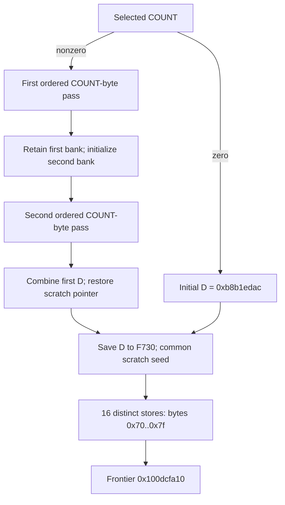

# Mode1 selected-record byte passes and sparse scratch handoff

The selected-record nonzero-COUNT route performs two ordered passes over the same COUNT bytes, retaining the first accumulator bank while building the second. Both loops continue exactly while the next unsigned byte offset is below COUNT, including across their encoded-counter wrap boundaries. Their reciprocal sequences compute `u32(Z+(Z mod257))`. The exit saves the first bank's fourth word to F+0x730 and restores the scratch pointer. The zero-COUNT route bypasses both passes and joins the same initializer, which writes sixteen fixed bytes at sixteen distinct positions in a 961 B view. These are internal state and scratch effects; native reachability, ownership, algorithm identity, successful output, complete budget history and daemon/kext pairing remain unknown. [RP1-RP8]

Evidence: [source/fixups](triage_evidence/daemon_mode_one_record_passes_source.json), [90 queries and source models](triage_evidence/daemon_mode_one_record_passes_checks.json), [extractor](triage_evidence/recover_daemon_mode_one_record_passes.py), [validator](triage_evidence/validate_daemon_mode_one_record_passes.py), [preservation](triage_evidence/daemon_mode_one_record_passes_delivery.json), [quality gates](triage_evidence/daemon_mode_one_record_passes_quality_gates.json), [sealer](triage_evidence/seal_daemon_mode_one_record_passes.py), [publication audit](triage_evidence/verify_daemon_mode_one_record_passes_publication.py). Context: [selected record and COUNT gate](daemon_mode_one_record_scan_report.md), [conditional phase/C0 entry](daemon_mode_one_phase_handoff_report.md), [earlier object-inline source passes](daemon_mode_one_source_passes_report.md), [earlier scratch permutation](daemon_mode_one_scatter_report.md), [48 B request/return ABI](daemon_mode_one_adapter_report.md).

| Evidence | Verified scope |
| --- | --- |
| Original image | `fairplayd.arm64e`, SHA-256 `4ffe3ea1dbd27c5026b448ffe06e8489b02cd9064500bcc67792d4ac36ffb63e` |
| Source | Eight ranges, 711 instructions / 2844 B; all 703 nonbranch sites translate |
| Prior source | 19 ranges / 6344 B freshly recaptured |
| Pointer provenance | Nine original pointer records; eleven authenticated branch bindings |
| Proofs | 82 UNSAT and eight SAT; 57 replayed predecessor queries contain 53 UNSAT/four SAT |
| New obligations | 29 UNSAT/four SAT; exact loop controls, source reduction, bank/frame handoff and sixteen finite store certificates |
| Controls | Five source/read-offset/branch-target/native-claim alterations rejected |
| Execution | No target execution, emulation, IPC/API request, new IDA access, IDB mutation or hardware PAC check |

F is the current private frame, R the saved request, NODE the selected record and P the saved buffer pointer at F+0x748. COUNT=u32[NODE+0x10] is saved at F+0x728. All word arithmetic below wraps modulo 2^32; address arithmetic is u64. Extents and offsets describe bytes. Source states are analytical names, without a public Apple type or algorithm designation. [RP1-RP4]

## Selected input and ordered reads

The predecessor selects a record whose decoded header differs from the request-cookie equality word. Its selected-record block saves NODE and P, reads COUNT, and supplies W1=W2=0x4923 and W16=COUNT. The current proof replays the complete predecessor source certificates and binds these actual final registers. Nonzero COUNT selects `0x100d863f4`; zero COUNT selects `0x100bf2aa0`. [RP1-RP3]

| Stage | Source byte read | Exact relative address | Loop / completion |
| --- | --- | --- | --- |
| First pass, `0x100d8ac5c` | `0x100d8ac70` | P+j | Repeat shim `0x100bf6c40` / between-pass `0x100d03b1c` |
| Second pass, `0x100dacfa8` | `0x100dacfa8` | P+j | Same block / restore `0x100b088f0` |

For COUNT!=0, each pass reads j=0..COUNT-1 in order. Together they perform exactly 2*COUNT byte reads over COUNT distinct relative byte addresses, under stable-pointer, valid-read and owner premises. This establishes COUNT's use as a byte-read bound in these routines. It does not identify its native allocation owner or prove that every u32 COUNT is supplied by the actual record producer. [RP3-RP7]

The preceding header decoder had already read four bytes through its buffer pointer. Those reads are outside this increment's 2*COUNT count and still occur before its zero/nonzero partition. COUNT=0 bypasses these two data passes; it does not establish zero total record reads. Under a stable common P, the combined selected path requires the earlier four-byte readable prefix as well as the current COUNT-byte span. [RP3,RP6]

Neither pass body nor the first repeat shim stores memory, calls a function, traps or changes SP. The between-pass block makes one private u32 phase store. Stability of native memory and scheduling is a premise, rather than inferred from the absence of local stores. [RP2,RP6]

## First pass: encoded index and four-word state

At `0x100d863f4`, the seed selects index 0x1f20 ->`0x100d8ac5c`, IA diversity 0xb919. The source-proved counter representations are:

| Boundary | Register / value |
| --- | --- |
| Body entry at offset j | W12=u32(j+0x528d39cf) |
| Body byte address | P+u64(j) |
| Body exit before repeat shim | W12=u32(j+0x07cc0324) |
| Repeat-shim exit | W12=u32(j+0x528d39d0) |
| Comparison end | W9=u32(COUNT+0x497ff60c) |
| Compared next position | u32(j+1+0x497ff60c) |

The source also tests COUNT against 0xb68009f3 and the biased position against 0x497ff60c. Its conditional combination implements the carry correction for the biased comparison. The full source predicate is exactly `u32(j+1)<COUNT`, unsigned; it is not a signed comparison or an ordinary uncorrected comparison of the biased words. [RP4-RP5]

| Predicate | Selector | Successor | IA diversity |
| --- | --- | --- | --- |
| Next offset < COUNT | 0xa927 | `0x100bf6c40` | 0x8fed |
| Otherwise | 0xa91b | `0x100d03b1c` | 0x8fed |

For j<COUNT, j+1 cannot wrap in u32 and is at most COUNT. Thus COUNT=1 exits after the first read, and COUNT=0xffffffff exits at j=0xfffffffe. A source-linked induction supplies the read bound for the entire pass. The largest-count SAT domain is mathematical evidence, without a native input or execution claim. [RP5-RP7]

The repeat shim reconstructs W1=0x4923, restores W26=0xff00ff01 and selects 0x1f20 ->the first body. These restorations matter: the body's terminal table load overwrites X1, and its counter circuit reuses W26. Neither is incorrectly treated as preserved through the body. The invariant register set and the restored coordinates are independently checked. [RP2,RP4]

The first bank uses W13,W14,W15 and an encoded fourth word in W16. Define its canonical fourth word D by `W16=u32(D+0x7ec1f1d0)` at body entry. The initial canonical bank is:

```text
(A,B,C,D) = (34695a82,1649b14e,bfa31027,b8b1edac)
```

After a body, the new canonical fourth word is `u32(W0+W16)` using those actual body-exit registers. The repeat shim re-encodes it by adding 0x7ec1f1d0. After the final body, the later handoff saves it without that bias. The seed identity `u32(0x3773df7c-0x7ec1f1d0)=0xb8b1edac` agrees with the zero-COUNT route's saved initial word. All three other bank words and the exact full next-state source expressions are retained in the evidence. The compact full mixing recurrence and its standard algorithm identity remain unknown. [RP3-RP4,RP8]

## Between-pass state and the second ordered pass

At `0x100d03b1c`, the source preserves W0,W13,W14,W15,W16 from the first pass, stores private phase 0x4923 into F+0x730 at `0x100d03b94`, reloads P into X30 and initializes a separate second bank:

```text
(W9,W10,W11,W12) = (b8b1edac,713c7a3a,1649b14e,34695a82)
```

Its selector 0x5d1a reaches `0x100dacfa8`, IA diversity 0x64a3. The read/counter coordinates are:

| Role at offset j | Value |
| --- | --- |
| Buffer | X30=P |
| Byte offset | W1=j |
| Injection coordinate | W6=u32(j+0x3e9d4b08) |
| Compared next coordinate | W7=u32(j+0xc9371e65) |
| Biased end | W4=u32(COUNT+0xc9371e64) |
| Carry threshold | W5=0x36c8e19b |

The second body's full comparison likewise reduces to `u32(j+1)<COUNT`, unsigned. It increments W1,W6,W7 by one. True selects 0x6ee2 back to the same body; false selects 0x6ed7 ->`0x100b088f0`, both IA 0x726b. The body preserves the first bank's W0,W13,W14,W15,W16 and the pointer X30. It also preserves all constants required for its own next iteration. [RP2,RP4-RP5]

The two passes are distinct computations with different source forms and bank encodings. The earlier object-inline 32 B pass report proved a shared recurrence and equal banks for that earlier source pair; that theorem is not imported here. Current evidence proves these two COUNT-byte read sequences, their exact source states and preservation, without claiming equal current banks. [RP4,RP8]

## Exact modulo257 component

The first body's sequence at 0x100d8ade8..0x100d8adf8 and the second body's sequence at 0x100dad160..0x100dad178 separately satisfy:

```text
q   = floor(u32(Z) * 0xff00ff01 / 2^40)
    = floor(u32(Z) / 257)
rem = u32(Z) - 257*q
out = u32(Z + rem)
```

The original UMULL/LSR/add/sub source shapes are proved as bit-vector expressions. Integer certificates establish the exact quotient for all u32 Z, no u64 product overflow, no u32 wrap in 257*q and 0<=rem<=256. The identity `257*0xff00ff01=2^40+1` explains the reciprocal. The operation adds the remainder to the input; the earlier source pair's XOR reduction is not substituted for it. [RP4-RP5]

These are components of the word mixing. They establish no public checksum, hash, cipher, MAC or KDF identity, nor any associated security property. The complete per-round SSA, inputs, source sites and outgoing words remain available for that subsequent identification work. [RP4,RP8]

## Common handoff, zero-COUNT path and frame epochs

The nonzero path's restore block reads phase 0x4923 from F+0x730, forms W2=0x4923, combines `W8=u32(W0+W16)` and restores X26 from the saved F+0x750 pointer, yielding F+0xd10. Its selector 0x324a reaches `0x100bf2aa0`, IA 0x4c4c. It preserves the complete second bank W9..W12 and the first bank's W13..W15. [RP3-RP4]

For zero COUNT, the predecessor enters that common block directly with W2=0x4923, W8=0xb8b1edac and X26=F+0xd10. The pointer is established by the earlier C0 seed and preserved through its decoder/selection blocks. The nonzero path must restore it because that path reused W26 for arithmetic. These are distinct source justifications for the same common-entry pointer. [RP2-RP4,RP6]

At `0x100bf2aa0`, the common block saves W8 into F+0x730, then initializes the scratch loop. The proof permits arbitrary incoming first-bank words, second-bank words and saved W8, rather than replacing them with desired constants. It proves preservation of W9..W15 and the exact store of the incoming word. [RP4]

| Cell / value | Source-proved epoch |
| --- | --- |
| F+0x728 | COUNT; retained throughout the new ranges |
| F+0x730 between passes | Private phase 0x4923 |
| F+0x730 after common seed | Canonical first-bank fourth word; 0xb8b1edac for the zero-COUNT route |
| F+0x748 | P; retained |
| F+0x750 | Saved pointer F+0xd10; retained |
| X26 before scratch loop | Restored/preserved F+0xd10 pointer, after the nonzero path's W26 arithmetic epoch |

The common seed is reached by both COUNT branches, so its address alone does not distinguish an empty record from a completed nonempty scan. F+0x730 is no longer the between-pass phase after the common store. The report does not collapse these separate epochs. [RP3-RP6]

## Sixteen sparse bytes in a 961 B view

The common seed derives W5=961, W1=0x2f1e, W3=15 and W4=0xbd700, selecting `0x100c91948` with IA 0x98c2. Let T=F+0xd10. The original UDIV/MSUB and byte circuit yield, for j=0..15:

```text
A(j) = (0xbd700 + 0x362*j) mod 961
u8[T+A(j)] = 0x74 XOR j
```

The sixteen source instances are exhaustively certified. Each certificate checks the exact store address/value, next counters, bank preservation and original branch-table slot. Numerical candidate reduction is accepted only after an UNSAT check against that instance's original source SSA. [RP4-RP5]

| j | A(j), decimal | Frame offset | Stored byte |
| --- | --- | --- | --- |
| 0 | 409 | 0xea9 | 0x74 |
| 1 | 314 | 0xe4a | 0x75 |
| 2 | 219 | 0xdeb | 0x76 |
| 3 | 124 | 0xd8c | 0x77 |
| 4 | 29 | 0xd2d | 0x70 |
| 5 | 895 | 0x108f | 0x71 |
| 6 | 800 | 0x1030 | 0x72 |
| 7 | 705 | 0xfd1 | 0x73 |
| 8 | 610 | 0xf72 | 0x7c |
| 9 | 515 | 0xf13 | 0x7d |
| 10 | 420 | 0xeb4 | 0x7e |
| 11 | 325 | 0xe55 | 0x7f |
| 12 | 230 | 0xdf6 | 0x78 |
| 13 | 135 | 0xd97 | 0x79 |
| 14 | 40 | 0xd38 | 0x7a |
| 15 | 906 | 0x109a | 0x7b |

The positions are distinct and the values comprise exactly 0x70..0x7f. The loop checks W3 before decrementing, so W3=15 produces sixteen stores. The final decrement wraps W3 to 0xffffffff after the exit selector has been selected. Rounds 0..14 select 0x2f1e back to the initializer; round 15 selects 0x2f3b ->`0x100dcfa10`, IA 0x98c2. [RP4-RP5]

The 961 B extent is an address domain, not a fully initialized array or a new recovered allocation. Only the sixteen listed cells are initialized here. All sixteen fall inside the earlier 963 B scratch region F+0xd00..0x10c2. The new view starts 16 B later; its full domain would extend 14 B beyond the old domain, but none of these sixteen stores does so. Its footprint intersects the earlier named sixteen-cell permutation at exactly F+0xd2d. Earlier scratch value/permutation theorems cannot be reused across these new writes without an epoch check. The current state of other scratch cells is not inferred from this initializer. [RP4-RP6]

The two private word stores to F+0x730 and sixteen scratch byte stores are the new ranges' only stores. They preserve the saved NODE, cookie, request pointer, COUNT, P, scratch-pointer cell, 296 B workspace and earlier word-view contents at the checked frame offsets. No write into NODE, P, C0 or R, and no successful caller-visible publication, is established by these blocks. Native owner/disjointness and nonwrapping address premises still apply. [RP4-RP6]



The diagram is a conditional local source contract. It does not resolve the earlier F460=86/phase-one reachability frontier or connect the scratch values to a native reply or driver operation. [RP2,RP8]

## Architectural scope, assumptions and continuation

The selected ranges contain no Mach send/receive operation, port creation, right transfer, call or trap. No new incoming/outgoing port identity or emission site is established. The new architectural interfaces are COUNT as a byte-read bound, two retained state banks, an encoded fourth-word handoff, a common empty/nonempty join and sixteen exact writes into a reused scratch region. Public control of these fields, native allocation provenance and serialization/interface linkage remain unknown. [RP1,RP6-RP8]

| ID | Assumption / dependent result | Stress test or falsification probe |
| --- | --- | --- |
| RP1 | Pinned image identifies this variant | Rehash image, recapture 711 instructions and 19 prior ranges, recheck original fixups; reject five altered artifacts |
| RP2 | The earlier conditional entry and selected-record path supply the saved fields | Freshly replay all 57 predecessor queries, compare their complete source models, bind the actual COUNT/phase/default-word registers; keep whole reachability unresolved |
| RP3 | Saved frame fields and source-record epochs remain continuous | Verify local register/write footprints, source reload addresses and both X26 justifications; falsify with an intervening aliasing/external writer |
| RP4 | ISA/SSA semantics and reductions match original source | Translate all 703 nonbranch sites, check raw comparison encodings, source-prove counter/control/bank/store identities and sixteen finite byte instances |
| RP5 | COUNT/offsets are unsigned u32 and arithmetic widths are respected | Prove wrap-aware predicates and no next-index wrap for j<COUNT; check COUNT=1 and maximum COUNT domain, exact quotient/remainder and final scratch-counter underflow |
| RP6 | Frame/buffer spans are valid, nonwrapping, stable and appropriately owned/disjoint | Establish native owners/extents/lifetimes/synchronization; retain the earlier four-byte header prerequisite; audit changed scratch epochs and protected cells |
| RP7 | Repeated application of the proved source rounds follows the stable local loop | Induct from offset zero through j+1<COUNT; a changed pointer/frame or omitted control predecessor invalidates the finite read-sequence claim |
| RP8 | Full recurrence/algorithm identity, successful output, return budget and cross-layer association remain unknown | Follow 0x100dcfa10 and its actual consumers, recover state semantics/publication, and pair resulting data with serialization and daemon/kext interface evidence |

| Impact | Next investigation | Evidence required |
| --- | --- | --- |
| High | Frontier `0x100dcfa10` | Exact scratch selectors, read/write pairs, accumulator consumption and later output/return stores |
| High | Full compact recurrence of these two current banks | Source-bound reductions for all remaining mixing circuits; no reuse of the earlier distinct pair's equality theorem |
| High | COUNT and P ownership from the C0 producer | Actual constructor/chain linkage, byte extent, lifetime and synchronization; the earlier +0x10 allocation-field resemblance is insufficient |
| High | Complete phase-one reachability and return composition | F460=86 control context, actual set-bit visit, budget history and wrapper continuation |
| Medium | New scratch epoch and address domain | Later access bounds and values after these sixteen writes; distinguish the old 963 B view, new 961 B view and actual initialized cells |

For N=COUNT, the local data passes take O(N) time and O(1) auxiliary state, with exactly 2N new byte reads. The fixed sixteen-store suffix takes O(1) time/storage. If M is captured instructions and L is total emitted expression/query characters, source construction is O(M+L) for the fixed number of component/finite instances; storage is O(M+L). Solver complexity is separate: 15000 ms per query and 20 s per process. Unknown, timeout, diagnostics and unexpected solver results fail verification. All extents are bytes, state widths are explicit and total read counts are ordinary integers rather than wrapping u32 products.

QG1: Source, algebra, ABI/control and provenance facts require no normative premise.

QG2: RP1-RP8 identify assumptions, dependent results and falsification probes.

QG3: This increment covers both selected-record byte passes, exact counters/reduction, bank preservation, common zero/nonzero handoff and sixteen scratch writes. The full interface investigation remains active.

QG4: Original bytes/fixups, 703 translated sites, 82 UNSAT/eight SAT checks, 2N-read induction and all sixteen store addresses/values are reproducible.

QG5: Restored registers, unsigned wrap correction, zero-COUNT header caveat, fourth-word bias, final counter underflow and scratch epochs are explicit; two-bank equality and native output are unproved.

QG6: Fresh source/pointer capture, 57 predecessor query/model replays, source-linked reduction/control certificates and five alteration controls establish scoped provenance.

QG7: Five impact-ranked continuations retain the actual state/output/interface objective and its unresolved control, ownership, value, budget and native boundaries.
