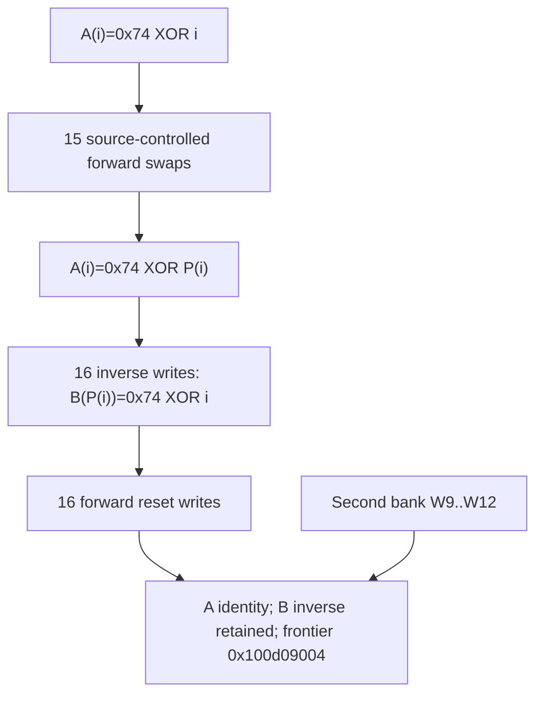

# Selected-record permutation, inverse bank and forward reset

Continuation: [Selected-record encoded base16 adder](daemon_mode_one_record_adder_report.md) establishes the second permutation, paired256-entry sum/carry tables,544 disjoint scratch cells and state-independent image-family selection. The arithmetic uses distinct input/output codebooks;P=Q and a one-alphabet group law remain unproved. All458 current sites translate;227 UNSAT and six SAT checks pass, including126 refreshed predecessor queries. Caller-visible publication and native daemon-kext pairing remain unknown. The first/second permutation equality, earlier reachability and native ownership boundaries remain open.

The selected-record continuation performs fifteen forward swaps among the sixteen initialized scratch cells, builds an encoded inverse permutation in a disjoint sixteen-cell bank, then restores the forward bank to its identity encoding. The second accumulator bank W9..W12 survives all three routines and reaches the next frontier at `0x100d09004`. The recovered structure is a forward Fisher-Yates permutation with an inverse/reset interface; distribution, reachability of all permutations, equality with any later permutation, standard algorithm identity, native ownership/reachability, successful output, complete budget history and daemon/kext pairing remain unknown. [RI1-RI8]

Evidence: [source/fixups](triage_evidence/daemon_mode_one_record_permutation_source.json), [126 queries and source/memory ledgers](triage_evidence/daemon_mode_one_record_permutation_checks.json), [extractor](triage_evidence/recover_daemon_mode_one_record_permutation.py), [validator](triage_evidence/validate_daemon_mode_one_record_permutation.py), [preservation](triage_evidence/daemon_mode_one_record_permutation_delivery.json), [quality gates](triage_evidence/daemon_mode_one_record_permutation_quality_gates.json), [sealer](triage_evidence/seal_daemon_mode_one_record_permutation.py), [publication audit](triage_evidence/verify_daemon_mode_one_record_permutation_publication.py). Context: [selected-record passes and initialization](daemon_mode_one_record_passes_report.md), [record selection and COUNT](daemon_mode_one_record_scan_report.md), [conditional phase entry](daemon_mode_one_phase_handoff_report.md), [earlier distinct scratch permutation](daemon_mode_one_scatter_report.md), [request and return ABI](daemon_mode_one_adapter_report.md).

| Evidence | Verified scope |
| --- | --- |
| Original image | `fairplayd.arm64e`, SHA-256 `4ffe3ea1dbd27c5026b448ffe06e8489b02cd9064500bcc67792d4ac36ffb63e` |
| Current source | Three ranges, 456 instructions / 1824 B; all 453 nonbranch sites translate |
| Prior source | Sixteen ranges / 5632 B freshly recaptured |
| Reconstructed predecessor | Four source blocks / 138 nonbranch sites; nineteen fresh scratch/caller obligations |
| Branch provenance | Three original pointer records; five authenticated branch bindings |
| Accepted solver results | 123 UNSAT and three SAT controls/domains |
| Excluded attempts | Two `unknown` results at 15000 ms, recorded separately and never accepted as proofs |
| Permutation proof | Fifteen selector abstractions, sixteen address certificates / 146 finite cases, fifteen swaps / 135 transposition cases |
| Inverse/reset | Sixteen source-certified iterations each; universal memory lemmas and explicit bijection induction |
| Memory effects | 46 byte reads and 62 byte stores over 32 distinct private scratch cells |
| Integrity | Five source/read-offset/target/native-claim alterations rejected |
| Execution | No target execution, emulation, IPC/API request, new IDA access, IDB mutation or hardware PAC check |

F is the current private frame and T=F+0xd10. Word arithmetic wraps modulo 2^32; addresses use u64. Extents are bytes. For i=0..15, define two address functions and an index encoding:

```text
A(i) = T + ((0xbd700 + 866*i) mod 961)
B(i) = T + ((0xaed96 + 866*i) mod 961)
E(i) = 0x74 XOR i
```

Each bank has sixteen distinct cells; the banks are disjoint. The 961 B extent is an address domain, not a claim that all 961 bytes are initialized or form a recovered allocation. All 32 actual cells lie within the earlier 963 B scratch region. [RI3-RI6]

## Entry conditions and direct predecessor reconstruction

The previous selected-record paths converge on a common seed with private phase W2=0x4923, X26=T, W7=0xc6e2f0ee, W25=0x4d, W28=0xcfa97dc6 and W30=0x41060280. The current validator independently translates both relevant callers, the common seed and the initialization loop. It proves the four carried constants on the zero-COUNT and nonzero-restore routes, the common phase/pointer coordinates, and all sixteen initial stores `u8[A(i)]=E(i)`. W9..W12 and W13..W15 remain arbitrary bank words throughout these entry obligations. [RI2-RI4]

These nineteen predecessor obligations are freshly reconstructed from source. They do not assume that common-seed defaults replace its incoming first/second bank words. They also do not close the earlier phase-one reachability or all intervening native frame epochs. The recorded caller phase, scratch root and continuity premises remain explicit. [RI2,RI5,RI8]

A broad replay of the earlier first-byte-pass counter query returned `unknown` at its 15000 ms limit. That query is excluded here. The local scratch obligations above establish the conditional entry required for this report. A separate monolithic inverse/reset array query also returned `unknown`; its accepted replacement is the source iteration contracts, finite layouts, universal store lemmas and bijection induction described below. Both excluded queries are identified by SHA-256; the array query is retained verbatim in the evidence. No timeout or `unknown` is counted as UNSAT. [RI4,RI6]

## Fifteen source-linked forward swaps

At `0x100dcfa10`, each stage i=0..14 exchanges the byte at A(i) with the byte at A(k), where i<=k<=15. Both reads precede both writes. The source ledger records all thirty byte-read and thirty byte-write PCs. The following selector expressions refer to the actual live source words at each listed stage; later words are not silently identified with entry values. [RI3-RI4]

| Stage i | Selected position k |
| --- | --- |
| 0 | (incoming W15 AND15) XOR11 |
| 1 | 1 + (u32[F+0x730] mod15) |
| 2 | 2 + (incoming W14 mod14) |
| 3 | 3 + (incoming W13 mod13) |
| 4 | 4 + (live W17 mod12) |
| 5 | 5 + (live W2 mod11) |
| 6 | 6 + (live W15 mod10) |
| 7 | 7 + (live W13 mod9) |
| 8 | 8 + (live W2 AND7) |
| 9 | 9 + (live W17 mod7) |
| 10 | 10 + (live W15 mod6) |
| 11 | 11 + (live W14 mod5) |
| 12 | 12 + ((live W3+1) AND3) |
| 13 | 13 + (live W13 mod3) |
| 14 | 15 - (live W14 AND1) |

The modulo14 implementation first halves its operand. Modulo7 uses a corrected reciprocal. Eleven source-slice quotient/remainder shapes, exact unsigned integer division/range certificates and four source mask bounds justify the selector domains. Carried multipliers/divisors are checked at the actual full-stream sites. Fresh selectors overapproximate those source outputs; their apparent independence in the certificate is not native independence or proof that all combinations occur. [RI3-RI4]

All sixteen address reductions use the original numerator and reciprocal, with 146 finite selector/address cases. Stage 5 has separate selected read/write calculations: its write numerator is 961 less than its read numerator. Both source remainders are proved to select the same A(k). The final stage folds the numerator differently and reverses the bit-to-position choice: bit zero selects 15, bit one selects 14. Neither difference is replaced by an assumed layout pattern. [RI4]

The block implements:

```text
for i in 0..14:
    k = source_selected_position(i)      # proved i <= k <= 15
    old_fixed = u8[A(i)]
    old_selected = u8[A(k)]
    u8[A(i)] = old_selected
    u8[A(k)] = old_fixed
```

Starting from the sixteen distinct encoded values, these source swaps produce a bijection P on 0..15 with `u8[A(i)]=E(P(i))`. The 135 possible individual forward transpositions all preserve the label permutation. A universal coherent-memory swap theorem covers k=i as well as distinct addresses. This proves the permutation structure; it does not prove uniform sampling, randomness, coverage of all 16! permutations or a particular cryptographic purpose. [RI4-RI6]

The outgoing selector is 0x18be ->`0x100c87cf4`, IA diversity 0xde1b. The exact inverse-entry constants include W13=0x6c46a5eb, W5=866, W6=0xbd700, W3=0xb90e920a, W4=0x8864298f, W19=961, W16=0x18be and W8=0x84c. X26=T and the second bank W9..W12 survive. [RI3-RI4,RI7]

## Encoded inverse bank

Routine `0x100c87cf4` reads u8[A(i)] at `0x100c87d08`. Its counter is W13=u32(0x6c46a5eb+i). The source's three-term byte expression has the universally proved form

```text
G(byte) = u32(zero_extend(byte XOR0x74) + 0x7fffff8c)
```

Multiplying by 866 and adding the original 0xc75fe reduces its numerator to `u32(0xaed96+866*(byte XOR0x74))`. For a forward permutation byte E(P(i)), the decoded index is P(i) in 0..15. The exact source iteration contract is therefore:

```text
byte = u8[A(i)]
u8[B(byte XOR0x74)] = E(i)               # store at 0x100c87dc8
```

The byte-code domain is supplied by the prior permutation theorem. The decoder identity itself holds for all u8 values, but a complete sixteen-entry inverse is asserted only for the valid permutation domain. The extra SAT domain control distinguishes that assumption from admitting every possible byte; it is not a native invalid-input observation. [RI4-RI6]

The routine uses the original UMULL/LSR41/MSUB address sequences. Each of its sixteen source certificates proves the exact A read, B destination for every valid encoded input byte, output byte E(i), incremented counter, preserved second bank and dispatch. Iterations 0..14 select 0x18be back to the same block; iteration 15 selects 0x18cc ->`0x100d86950`, all IA 0xde1b. The comparison is after incrementing W13 and tests 0x6c46a5fb, giving exactly sixteen iterations. [RI3-RI4]

Because P is a bijection and A/B are disjoint, inverse writes cannot change later forward reads, and no two iterations overwrite the same inverse destination. Sixteen distinct P(i) values in a sixteen-element set cover all entries. At completion:

```text
u8[B(P(i))] = E(i), i=0..15
```

This is the encoded inverse of the first selected-record permutation. It is an internal table relation, without a native output-buffer or public type claim. [RI5-RI8]

## Forward reset and coherent-memory composition

Routine `0x100d86950` starts W15=0x082d657e and executes sixteen byte stores at `0x100d86a24`. Its source arithmetic and counter checks prove `u8[A(i)]=E(i)` for i=0..15. The comparison is after incrementing W15 and tests 0x082d658e. The first fifteen iterations select 0x18cc back to reset; the last selects 0x768d ->`0x100d09004`, IA 0xde1b. The inverse bank B is retained. [RI3-RI6]

The full source model gives each load a named byte input. It deliberately does not invent frame forwarding through partially known aliases. Its source read/write identities are composed with these separately checked facts:

1. A coherent two-read/two-write exchange preserves the byte multiset, including self-swaps.
2. A single-cell store sets its destination to the supplied byte and preserves every distinct cell.
3. Stores to distinct cells commute.
4. The finite A/B layouts are individually injective and disjoint; E is a bijection on the sixteen indices.
5. The source inverse/reset iteration contracts and the forward permutation invariant permit induction over the sixteen iterations.

The completed contract is:

```text
Forward bank: u8[A(i)] = E(i)
Inverse bank: u8[B(P(i))] = E(i)
```

The evidence records the full induction and each source/finite/universal component. It does not count the excluded monolithic array query as a theorem. The 135 transposition controls also verify their label inverses; they are local finite checks, not enumeration of all possible final permutations. [RI4-RI6]

The two banks' exact relative positions are retained in the source evidence:

| Index i | A offset in T, decimal | A frame offset | B offset in T, decimal | B frame offset |
| --- | --- | --- | --- | --- |
| 0 | 409 | 0xea9 | 237 | 0xdfd |
| 1 | 314 | 0xe4a | 142 | 0xd9e |
| 2 | 219 | 0xdeb | 47 | 0xd3f |
| 3 | 124 | 0xd8c | 913 | 0x10a1 |
| 4 | 29 | 0xd2d | 818 | 0x1042 |
| 5 | 895 | 0x108f | 723 | 0xfe3 |
| 6 | 800 | 0x1030 | 628 | 0xf84 |
| 7 | 705 | 0xfd1 | 533 | 0xf25 |
| 8 | 610 | 0xf72 | 438 | 0xec6 |
| 9 | 515 | 0xf13 | 343 | 0xe67 |
| 10 | 420 | 0xeb4 | 248 | 0xe08 |
| 11 | 325 | 0xe55 | 153 | 0xda9 |
| 12 | 230 | 0xdf6 | 58 | 0xd4a |
| 13 | 135 | 0xd97 | 924 | 0x10ac |
| 14 | 40 | 0xd38 | 829 | 0x104d |
| 15 | 906 | 0x109a | 734 | 0xfee |

The source performs thirty byte reads/stores in the fifteen swaps, sixteen further byte reads/stores in inverse construction and sixteen stores in reset: 46 reads and 62 stores total. Only these 32 distinct scratch cells are written. The 296 B workspace, earlier word view, saved request/cookie/NODE/COUNT/P/scratch-pointer fields and F+0x730 are outside the checked footprint. These are conditional private-frame effects; valid owners, extents, nonwrapping addresses, coherent memory and absence of external mutation remain premises. [RI4-RI6]

## Continuation ABI and architectural scope

All three routines preserve W9..W12, X26=T and SP. The first accumulator bank is consumed by the selector/state arithmetic; the second is carried into the next stage. The original pointer record at index 0x768d binds the final target to `0x100d09004`. No equality between the first permutation and a possible subsequent permutation is assumed from the preserved bank or from structural similarity to earlier routines. [RI2-RI4,RI7-RI8]



The selected ranges contain no call, trap, Mach send/receive operation, port creation or right transfer. They establish no new incoming/outgoing port identity or emission site. The recovered touch points are private accumulator registers, a disjoint scratch-bank interface, encoded indices and exact continuation selectors. Successful caller-visible stores, message serialization, return/budget composition and native daemon/kext pairing remain unproved. [RI7-RI8]

## Assumptions, falsification probes and bounded continuation

| ID | Assumption / dependent result | Stress test or falsification probe |
| --- | --- | --- |
| RI1 | Pinned image identifies this variant | Rehash image, recapture all 456 current instructions and sixteen prior ranges, recheck original pointer records; reject five altered artifacts |
| RI2 | The conditional caller phase/root and prior stage apply | Reconstruct both callers, common seed and sixteen initial stores through nineteen source obligations; keep earlier phase-one/native reachability unresolved |
| RI3 | Scalar ISA effects, live constants and source selectors match the captured instructions | Translate all 453 current and 138 predecessor sites, correct two raw comparison roles, prove carried coefficients and all selector/address cases |
| RI4 | Component abstractions preserve original source claims | Bind eleven remainder shapes, four mask bounds, sixteen address reductions, fifteen swaps and all inverse/reset iterations; accept only exact expected solver results |
| RI5 | The initialized scratch epoch persists into these blocks | Establish valid nonwrapping frame/storage, owner/disjointness, coherent reads and absence of external mutation; a changed epoch invalidates initialized-value claims |
| RI6 | Bijection and memory induction compose the local source contracts | Verify 32 distinct A/B cells, 135 transpositions and inverses, byte-code bijection, universal alias/store lemmas and the explicit sixteen-step argument; do not infer uniformity or independent selector reachability |
| RI7 | The preserved second bank and outgoing ABI retain their meanings | Check W9..W12/X26/SP write sets and exact authenticated continuation slots; native PAC, scheduling, full state lifetime and return composition remain separate |
| RI8 | Standard algorithm identity, bank equality, successful output, budget history and daemon/kext linkage remain unknown | Follow 0x100d09004 with its live words/banks, prove actual consumers/publication and pair any resulting data with interface/serialization evidence |

| Impact | Next investigation | Evidence required |
| --- | --- | --- |
| High | Frontier `0x100d09004` | Actual use of the second bank and A/B tables, complete selectors/read-write pairs and downstream stores |
| High | Relationship between the two state banks/permutations | Compact source recurrences and encodings; structural similarity does not prove equality |
| High | Caller-visible publication and serializer linkage | Pointer/extent/lifetime provenance and actual copy/result/message boundary |
| High | Full phase-one and return path | Earlier F460=86 control context, native owner/epoch prerequisites, budget history and wrapper continuation |
| Medium | Scratch epoch composition | Track later writes/read bounds across both banks and the remaining address domain |

All loops in this increment have fixed sixteen-element domains. The conditional routine sequence has O(1) time/storage with respect to COUNT; parameterized by a bank size n, permutation/inversion/reset take O(n) steps, while the finite transposition proof checks O(n^2) cases. Let M be captured source instructions and L emitted expression/query characters; the fixed set of source/component models uses O(M+L) construction time/storage. SMT complexity is separate, bounded by 15000 ms per query and 20 s per process. Unknown, timeout, diagnostics or unexpected results fail acceptance. Offsets are hexadecimal, table positions are decimal and extents are bytes.

QG1: Factual source, algebra, ABI and provenance analysis requires no normative premise.

QG2: RI1-RI8 identify dependent results and falsification probes.

QG3: This increment covers the complete first selected-record permutation, inverse construction, forward reset, preserved bank and architectural/Mach scope. The full investigation remains active.

QG4: Source/fixups, 123 UNSAT/three SAT results, nineteen reconstructed predecessor obligations, 146 address cases, 135 transpositions and all source read/write sites are reproducible.

QG5: Self-alias, biased numerator equivalence, reversed last-bit selection, valid inverse-byte domain, coherent memory, fixed loop counts and both excluded unknown results are explicit.

QG6: Fresh byte/pointer capture, independent predecessor reconstruction, source-bound iteration/component certificates, finite layouts and universal memory lemmas support the stated induction; five alterations are rejected.

QG7: Five impact-ranked followups retain the real state/output/interface objective and unresolved value, control, ownership, budget and native boundaries.
