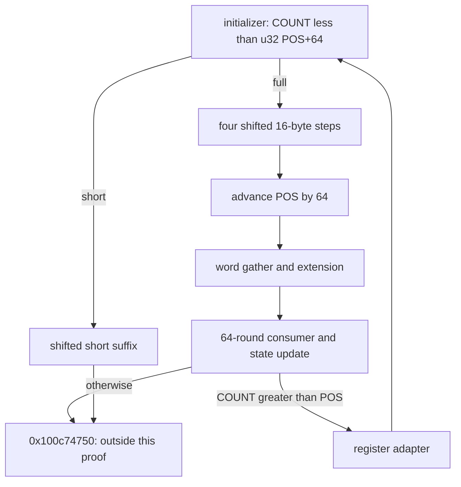

# Position-aware record re-entry and bounded absorption cycle

The initializer at `0x100c88438` tests unsigned `COUNT < u32(POS+64)`. With POS<=COUNT and POS<=0xffffffbf, this partitions the remaining bytes at64. Both following paths read the advanced buffer position: the short loop reads `PBUF+POS+IDX`; the full path reads64 bytes starting at `PBUF+POS`. The full exit advances two biased progress fields by64 and enters the published gather/extension/round stages. Their preserved progress and suffix guard close a conditional control/address cycle. For the established long entry and64<=COUNT<=0xffffffc0, these absorption sites cover offsets0..COUNT-1 once: floor(COUNT/64) full blocks and COUNT mod64 short bytes. This does not establish decoded state, native traversal, finalizer behavior or daemon/kext pairing. [RE1-RE8]

Evidence: [source and pointer records](triage_evidence/daemon_mode_one_record_reentry_source.json.zst), [103 accepted queries and complete ledgers](triage_evidence/daemon_mode_one_record_reentry_checks.json.zst), [extractor](triage_evidence/recover_daemon_mode_one_record_reentry.py), [validator](triage_evidence/validate_daemon_mode_one_record_reentry.py), [preservation](triage_evidence/daemon_mode_one_record_reentry_delivery.json), [quality gates](triage_evidence/daemon_mode_one_record_reentry_quality_gates.json), [sealer](triage_evidence/seal_daemon_mode_one_record_reentry.py), [publication audit](triage_evidence/verify_daemon_mode_one_record_reentry_publication.py). Context: [round update and adapter](daemon_mode_one_record_rounds_report.md), [initializer first entry](daemon_mode_one_record_long_planes_report.md), [first full-prefix proof](daemon_mode_one_record_long_prefix_report.md), [short-loop codec](daemon_mode_one_record_input_planes_report.md), [gather](daemon_mode_one_record_word_gather_report.md), [word extension](daemon_mode_one_record_word_extension_report.md).

| Evidence | Verified scope |
| --- | --- |
| Image | `fairplayd.arm64e`,SHA-256 `4ffe3ea1dbd27c5026b448ffe06e8489b02cd9064500bcc67792d4ac36ffb63e` |
| Current source | Seven complete BRAA-terminated fragments,9598 instructions /38392 B;9591 nonbranch sites translated |
| Prior recapture |20 ranges /117792 B |
| Control provenance |Nine original authenticated records /eleven source slot/modifier bindings |
| Instruction checks |Eight bitfield decodes,two64-bit EON decodes,one paired u32 load and14 corrected CMP GPR-write reports;no SP write |
| Accepted checks |97 UNSAT /six SAT,including45 selected predecessor queries |
| Initializer addresses |27 literal frame aliases and five indexed stores;four universal intermediate overapproximations |
| Full path |Four16-byte bodies,all320 original byte addresses;19194 nonbranch instances including seed/exit,23368 including initializer |
| Integrity |Eight source/address/step/target/PAC/pair/lineage/native-claim alterations rejected |

F is the private frame,T=F+0xd10,PBUF=u64[F+0x748],COUNT=u32[F+0x728]. POS is a decoded u32 progress coordinate,not a native owner or newly identified pointer. Its two incoming representations are:

```text
u32[F+0x018] = u32(POS+0x53921748)
u32[F+0x2cc] = u32(POS+0x0c392ed3)
```

Arithmetic is modular u32/u64;offsets/extents are bytes. Valid coherent nonwrapping frame/buffer mappings,source/frame disjointness,stable saved roots and no outside writes remain premises. No target execution,emulation,API/IPC request,IDA access,IDB mutation or hardware PAC test occurred. The seven entries are private continuations,not seven newly established compiler functions or wire-level APIs. [RE1-RE4]

## Initializer predicate and register epochs

The actual source proves the modular predicate for every u32 COUNT and POS. The equivalent `COUNT-POS<64` statement needs POS<=COUNT and nonwrapping POS+64. The two bindings use IA diversity0x6307:

| Source predicate | Selector / target |
| --- | --- |
| COUNT<u32(POS+64) |0xb1fc -> `0x100c4a194` |
| Otherwise |0xb217 -> `0x100c9148c` |

The update/adapter re-entry supplies the same constant register ABI as the first entry: W19=0x4923,W23=0xc8,W22=0x5c,W21=0x74,W27=0x16,W24=0x23. The initializer replaces both64-byte planes with128 distinct byte stores. It makes no old-plane or record-byte read. Each byte's declared-dependency upper bound is confined to one of the four-word banks W0/W6/W9/W10 and W1/W2/W4/W5. COUNT and POS are absent from these byte-value dependency sets;dependency membership alone does not prove influence. Compact plane functions remain unknown. [RE2-RE4,RE6]

W6 changes roles across the boundary. It is a data-bank word at initializer entry,then becomes u32(POS+0x53921748) at return. W19 also becomes that position representation. W4 returns0x39c7500a and X8 returns the numeric word0x7f3081c2. The initializer sets F+0x620=0x3c0d,F+0x730=0x67f0 and low32 F+0x738=0x4923. These are source-proved epoch-specific values;X8 is not established as a pointer by its numeric value. [RE3,RE7]

Branch-pointer inputs have independent symbolic names across stages. Named reads are recorded as supplied component inputs;they are not presented as immutable original-image data. The original slot bindings independently identify the intended continuations under the stated runtime table/PAC premises. [RE1,RE3,RE7]

## Shifted short-suffix contract

Set R=COUNT-POS under POS<=COUNT. On the short path,R<64. The entry `0x100c4a194` selects the common finalizer at R=0 and the loop seed at R>0. The positive re-entry guard COUNT>POS excludes the zero case in the repeating cycle;the generic zero component remains explicitly checked. [RE3,RE5]

The seed retains a local index starting at zero. It stores stride866 at F+0x730 and the position-bearing low word

```text
u32[F+0x738] = u32(POS+0x80cf7e3e)
```

The first-entry constant0x80cf7e3e is therefore the POS=0 specialization. W9 holds u32(R+0x39c7500a),and the loop at `0x100dc10d4` has this complete iteration contract for0<=IDX<R<64:

```text
A = PBUF+zero_extend32(POS+IDX)
U = T+((866*(896+IDX)) mod961)
V = T+((866*(827+IDX)) mod961)
Unew = Uold XOR raw_record_byte[A]
Vnew = Vold XOR canonical_address_mask_byte[A]
next IDX = IDX+1
repeat iff next IDX<R
```

The canonical byte mask uses the already source-proved seed,seven keyed ARX rounds and final address-byte selection. This increment replays all nine universal codec queries,binds the actual shifted A,proves the live constants and checks restoration after the body. Two replayed reciprocal-shape queries plus128 finite cases bind both local plane addresses. The full271-instruction body is translated with three justified cuts:two exact local-plane remainders and the proved canonical mask-word interface. The cut ledger preserves original expressions and prerequisites. [RE2-RE4]

The loop reads R record bytes,reads2*R plane bytes and makes2*R plane-byte stores. It stops at `0x100c74750`;R<=63 means plane index63 is untouched by these stores. Separate source/index queries prove POS+IDX does not wrap and remains below COUNT. A SAT control refutes the unshifted PBUF+IDX hypothesis at a nonzero position. The progress words themselves do not advance by R on this path;their later interpretation belongs to the finalizer. [RE3-RE5,RE7]

## Shifted full-block contract

For R>=64,the initializer selects `0x100c9148c`. The seed's eight saved data words retain their full original-source expressions. Of the other39 saved control/coordinate words,24 remain fixed and15 equal POS plus their first-entry constant. W11 returns POS;X12 remains zero and X19 starts the local0x0be7880c counter. The earlier39-constant result is valid at POS=0;it is not a position-independent contract. [RE3,RE7]

| Frame offset | Source-proved u32 value |
| --- | --- |
|0x530 |POS+0x9d0ea4d9 |
|0x52c |POS+0x68c2c810 |
|0x520 |POS+0xd1dfb7c0 |
|0x51c |POS+0x11be265e |
|0x518 |POS+0xd8e46fe1 |
|0x514 |POS+0xbb3dcd98 |
|0x510 |POS+0xf1fd2793 |
|0x50c |POS+0x3bef0208 |
|0x508 |POS+0x46b2688b |
|0x504 |POS+0x45d3713f |
|0x4f8 |POS+0x4066f388 |
|0x4f4 |POS+0xb2c91335 |
|0x4f0 |POS+0x6a9cef91 |
|0x4ec |POS+0xacd43f8c |
|0x4e8 |POS+0x24a0f99f |

Four complete models of `0x100c1206c` certify the following addresses for i=16*q+j,q=0..3,j=0..15:

```text
A(i) = PBUF+zero_extend32(POS+i)
U(i) = T+((866*(896+i)) mod961)
V(i) = T+((866*(827+i)) mod961)
```

All64 record offsets and128 plane cells are visited once. Every plane read precedes its corresponding store. Source equations prove Unew[i]=Uold[i] XOR raw_record[POS+i]. Four case-split CSEL equalities and four vector-linearity queries prove Vnew[i]=Vold[i] XOR M(PBUF,POS,i),where M is the retained source-defined address/position function. Its declared leaves are PBUF and POS. Equality with the canonical short-loop mask is still unproved. [RE3-RE6]

The terminal counter still has exactly four steps:the first three select0x84f9 back to the body;the fourth selects0x84ef -> `0x100dad2c4`. Local X19 increases by16 per body. The exit uses one paired u32 load at F+0x14/F+0x18,then stores

```text
u32[F+0x018] = u32(POS+64+0x53921748)
u32[F+0x2cc] = u32(POS+64+0x0c392ed3)
```

It reloads the saved state word into W11,returns W10=0x4923 and selects0x8d10 -> `0x100b8ed9c`,IA diversity0x26e7. The pair's two semantic reads share one source PC and are verified in their effect order. [RE3,RE5,RE7]

## Closed control/address cycle

The45 refreshed predecessor queries cover selected entry/control/store contracts for the gather,extension,64-round stage and codec. The current preservation census separately checks both progress words,COUNT,saved roots,workspace and budget across the three retained stages. Computed word-store domains retain their replayed private-grid address contracts;this is not a replay of every historical data-value theorem. All800 C/D/E/H/I cells remain unchanged. [RE2-RE4]

The round update's raw predicate `COUNT > u32(BIAS+0xac6de8b8)` becomes COUNT>POS when BIAS=u32(POS+0x53921748). After a full-prefix exit,POS denotes the newly advanced position. The positive edge restores the initializer's constant register ABI through the adapter;the other edge reaches `0x100c74750`. [RE2-RE3,RE5]



For the established long entry,POS initially equals zero. Under64<=COUNT<=0xffffffc0,the source steps and integer/bit-vector induction establish:

```text
Q = floor(COUNT/64)
R = COUNT mod64
Q full intervals: [64*k,64*k+63], 0<=k<Q
one optional short interval: [64*Q,64*Q+R-1], when R>0
```

The interval proofs establish disjointness and coverage of0..COUNT-1. The full step advances POS by64 without wrap and stays within COUNT. A positive suffix guard at aligned POS in this COUNT domain guarantees the initializer's POS+64 threshold does not wrap. Exact multiples stop before an unnecessary initializer re-entry;a positive remainder takes the short path. No value recurrence is unrolled through Q blocks. [RE3-RE5]

This counts reads only at the proved full/short absorption sites. Earlier selection/pass rereads and any later finalizer reads are excluded. The result is conditional composition of the retained stage contracts and mapping/state premises,not native delivery,successful completion or a whole decoded algorithm. The short path's raw progress words remain at the final full-block position rather than advancing by R. [RE4-RE8]

## Plane lifetime on positive re-entry

The preceding state update writes128 plane bytes. Its adapter makes no plane-byte read or store. The initializer reads no old plane byte and overwrites exactly the same128 destinations before short/full absorption reads them. A fresh destination-set comparison proves this local overwrite-before-read property. The state passed into the initializer is carried in the two register banks,not read back from those old plane bytes. [RE2-RE4,RE6]

The alternative edge into `0x100c74750` does not perform this initializer overwrite. Consequently,the preceding update's plane bytes have route-dependent lifetimes. The local property does not prove equality of the two plane representations,global dead-store eliminability or absence of native observers. Comparing the update's register/plane encodings with the initializer remains a separate mathematical task. [RE4,RE6-RE8]

## Modular boundary and external context

The raw initializer compares COUNT with u32(POS+64),not universally with the nonwrapping mathematical position+64. An aligned-position SAT control satisfying COUNT>POS demonstrates a difference from a remaining-length predicate when the threshold wraps. The bounded cycle claim therefore stops at COUNT=0xffffffc0. Entire-u32-length conformance is unproved. Upstream normalized-count limits,buffer extent and native acceptance of the abstract boundary case remain unknown;no native failure or externally deliverable input is established. [RE3-RE5,RE8]

All seven fragments have a terminal authenticated branch and no other call,branch or trap. Their byte reads are the shifted record and local planes;their stores are private frame effects. They establish no new Mach send/receive,port allocation,right transfer,incoming/outgoing port or message-emission site. Authenticated continuation pointers and numeric phase words are internal control interfaces,not Mach rights. Caller-visible output,finalizer behavior and daemon/kext linkage remain open. [RE1,RE4,RE7-RE8]

## Assumption register and bounded continuation

| ID | Assumption / dependent result | Stress test or falsification probe |
| --- | --- | --- |
| RE1 |Pinned image and source variants identify the continuations |Recapture38392 current/117792 prior bytes;nine pointer records,eleven bindings and opcode checks;reject eight altered records |
| RE2 |First-entry and repeated entry states compose |Refresh45 selected predecessor queries;verify actual position/register ABI and the three-stage progress/root preservation census |
| RE3 |ISA,SSA,widths and component proofs are accurate |Translate9591 sites;check27 aliases/five indexed stores,four universal intermediate overapproximations,independent pointer symbols,three justified short cuts and all320 full-path byte addresses |
| RE4 |Mappings are coherent/nonwrapping,record and frame are disjoint,roots stable and no outside writes occur |Check unique128-cell planes,read-before-write order,all frame effects and retained800 cells;native owners/extents remain unknown |
| RE5 |Unsigned position/count induction uses the stated domain |Prove the exact modular predicate,explicit no-wrap corollary,strict short progress,64-byte full progress,interval partition/disjointness and aligned wraparound SAT control |
| RE6 |Data representations are interpreted within proved scope |Retain raw seed/state expressions,two-bank dependency bounds and source V masks;do not infer decoded state,full V canonical identity or plane-encoding equality |
| RE7 |Frame/register epochs and PAC premises permit composition |Check24 fixed/15 position seed words,W6 role changes,position-bearing F738,paired-load effects and all continuation metadata;native authentication/arrival remain unproved |
| RE8 |Caller limits,finalizer,whole algorithm and cross-layer output remain incomplete |Establish upstream COUNT/buffer restrictions,analyze0x100c74750,and trace actual serialization/native consumers and matched external ABI |

| Impact | Next investigation | Required evidence |
| --- | --- | --- |
| High |`0x100c74750` on exact-block and short-suffix entries |Complete source,epoch-specific live inputs and actual state/output consumers |
| High |Caller COUNT and buffer limits |Normalized length provenance,container bounds and reachability of the abstract modular boundary |
| High |Caller-visible output and daemon/kext pairing |Actual owner/extents,serialization and matched external contract |
| Medium |Register/plane encoding equivalence |Compose the update's outgoing banks with the initializer functions;compare with the overwritten128-byte representation |
| Medium |Full V-mask identity |Compare the retained source address/position functions with the independently proved short canonical mask |

The source algorithm has O(COUNT) absorption work and fixed private-frame space under the proved cycle domain. Short-body work is O(R),R<64;each full absorption has four16-byte bodies followed by the retained gather/extension/64-round contracts. Source translation and finite ledgers are linear in captured instruction/byte cases;SMT runtime is solver-dependent,limited to15000 ms per query and20 s per process. Validation distinguishes accepted results from exploratory SAT hypotheses and harness failures;no failed hypothesis is counted as proof.

QG1:Claims concern factual source,private ABI,byte/control mathematics and provenance.

QG2:RE1-RE8 state premises,dependent results and falsification probes.

QG3:Parameterized initializer,shifted short/full absorption,progress,retained cycle preservation and local plane lifetime are covered;the broader goal remains active.

QG4:97 UNSAT/six SAT results,45 selected replays,all320 full-path byte addresses,128 short address cases and exact widths/counts are reproducible.

QG5:The first-entry constant specialization is separated from24 fixed/15 position words;local indices from global positions;modular thresholds from mathematical remainder;byte coverage from state/algorithm identity;local overwrite from native noninterference.

QG6:Original bytes/fixups,fresh prior recapture,original-source solver queries and retained dependency/store ledgers support the stated scope;no native or new IDA result is claimed.

QG7:Continuation priorities cover the finalizer,upstream size constraints,external publication,representation equivalence and canonical-mask comparison.


## Checkpoint, iterator and LOCAL request-field follow-up

The former common finalizer frontier is now established as a workspace replacement/checkpoint and iterator restore. It reads128 plane cells,replaces296 workspace bytes,restores decoder state and loads NEXT through the existing iterator. This establishes private record-processing re-entry;decoded checkpoint semantics and native completion remain unknown. See the [source-pinned checkpoint and request-gate report](daemon_mode_one_record_checkpoint_report.md) for59 UNSAT/two SAT checks,45 predecessor replays and scoped assumptions.
