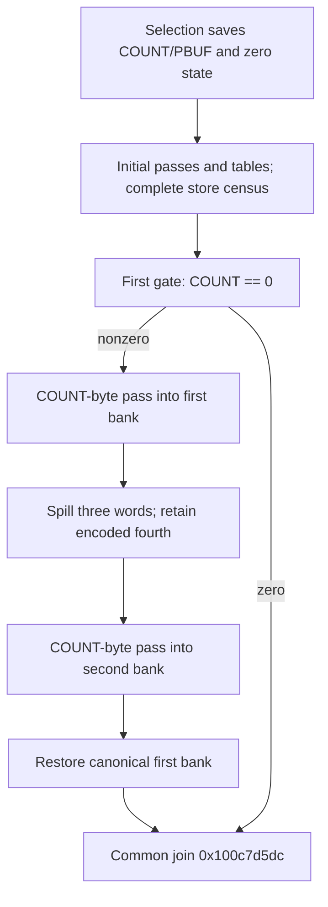

# Selected-record post-table rescans, first-arrival lineage and common join

The post-table gate takes its equal edge exactly for COUNT=0 on the first arrival from record selection. A complete source-store census closes the earlier uncertainty about its old F+0x738 value. Nonzero COUNT takes two further ordered passes over the saved record buffer, preserving the832 arithmetic-table cells and retaining two four-word accumulator banks. Zero and nonzero routes converge at `0x100c7d5dc`; the zero route supplies the same canonical initial banks. Native reachability, ownership, compact recurrence equivalence, successful caller output, complete budget history and daemon/kext pairing remain unknown. [RR1-RR8]

Evidence: [source/fixups/recaptures](triage_evidence/daemon_mode_one_record_rescan_source.json), [440 queries and source/lineage ledgers](triage_evidence/daemon_mode_one_record_rescan_checks.json), [extractor](triage_evidence/recover_daemon_mode_one_record_rescan.py), [validator](triage_evidence/validate_daemon_mode_one_record_rescan.py), [preservation](triage_evidence/daemon_mode_one_record_rescan_delivery.json), [quality gates](triage_evidence/daemon_mode_one_record_rescan_quality_gates.json), [sealer](triage_evidence/seal_daemon_mode_one_record_rescan.py), [publication audit](triage_evidence/verify_daemon_mode_one_record_rescan_publication.py). Context: [XOR/codebooks and gate](daemon_mode_one_record_codecs_report.md), [adder](daemon_mode_one_record_adder_report.md), [first permutation](daemon_mode_one_record_permutation_report.md), [initial two record-byte passes](daemon_mode_one_record_passes_report.md), [selection/header scan](daemon_mode_one_record_scan_report.md).

| Evidence | Verified scope |
| --- | --- |
| Original image | `fairplayd.arm64e`, SHA-256 `4ffe3ea1dbd27c5026b448ffe06e8489b02cd9064500bcc67792d4ac36ffb63e` |
| Current capture | Seven ranges,823 instructions /3292 B; all816 nonbranch sites translated |
| New suffix | Five ranges,739 instructions /2956 B; the capture also includes selection and the incoming gate |
| Earlier source |26 ranges /9960 B freshly recaptured |
| Pointer/control provenance | Eight original authenticated pointer records; eleven branch bindings |
| Accepted solver results |414 UNSAT /26 SAT, including360 predecessor queries with341 UNSAT /19 SAT |
| First-arrival census |17 source ranges,70 distinct store PCs,115 enumerated model-store instances and57 bounded-store certificates |
| New byte effects |Two COUNT-byte passes; no arithmetic-table reads or writes |
| State effects |First bank retained across the second pass; exact canonical fourth-word conversion and common join |
| Integrity |Six source/read/target/seed/lineage/native-claim alterations rejected |
| Execution |No target execution,emulation,API/IPC request,new IDA access,IDB mutation or hardware PAC check |

F denotes the private frame. COUNT is the selected record's saved u32 field at F+0x728; PBUF is its saved u64 buffer pointer at F+0x748. Word arithmetic is modulo2^32 unless marked u64 or ordinary integer. All extents/offsets use bytes. The claims are conditional on the selected-record path,valid coherent nonwrapping frame/buffer mappings,stable saved fields/branch root and absence of outside writes. First-arrival lineage does not establish behavior of every later re-entry. [RR1-RR3,RR7]

## First-arrival gate predicate is closed

Selection at `0x100bf2d24` saves PBUF and NODE,reads u32[NODE+0x10] as COUNT,stores COUNT at F+0x728 and stores zero at F+0x738. The zero-state store is `0x100bf2d54`. The original branch then separates zero and nonzero COUNT into the already reported initial-pass/table-construction paths. [RR2]

The new audit covers every store between that selection and the first arrival at `0x100d69d98`: the initial record passes,initializer,first shuffle/inverse/reset,second shuffle,adder,XOR and both digit maps. It checks actual store-PC coverage against the original disassembly,not just a search for direct `[sp,#0x738]` stores. [RR2-RR3]

Each of57 source models receives a fresh bounded-store certificate. Their115 store instances cover all70 distinct original store PCs across17 ranges,including indirect aliases in both shuffles. Every u32 store is at F+0x730; every byte store lies in F+[0xd10,0x10d0]. These regions are disjoint from F+0x728,F+0x738 and saved roots at F+0x740..0x757. Original source bytes and parent source/address-cut certificates are refreshed. Therefore the initialized zero and saved COUNT/PBUF survive this conditional path. [RR2-RR4]

At first arrival,the gate consequently implements:

| COUNT | Selector / original target | Role established here |
| --- | --- | --- |
| Zero |0x828b ->`0x100c7d5dc` |Bypass both post-table rescans; supply initial canonical banks |
| Nonzero |0x8284 ->`0x100ca1ef8` |Initialize and perform both rescans |

Both bindings use IA diversity0x9a18. Before transfer,the gate writes phase0x4923 at F+0x730 and state0x34c96b7f at F+0x738. The branch uses the old loaded words,as established in the predecessor report. A later revisit may encounter an accumulator word at F+0x738; the first-arrival COUNT=0 interpretation is not extended to that epoch. [RR2-RR3,RR7-RR8]

## Two additional COUNT-byte walks

`0x100ca1ef8` loads PBUF into X5 at `0x100ca1fc0`,sets the first byte offset to zero,initializes a four-word bank and writes phase0x2414dbd9 to F+0x730 at `0x100ca1f64`. Its original selector0x424f reaches the first body. [RR3-RR4]

| Pass | Byte-read PC / exact address | Offset and counter state at body entry |
| --- | --- | --- |
| First |`0x100d75de0`: u8[PBUF+j] |W10=j;W12=u32(j+0x3d5c657c);W13=u32(j+0x95ccb056) |
| Second |`0x100c193b8`: u8[PBUF+j] |W8=j;W11=u32(j+0x40b82431);W12=u32(j+0xf44a7c5c) |

For both bodies,the full source predicate is exactly `u32(j+1)<COUNT`,unsigned,under `j<COUNT`. Each listed counter increments by one. For nonzero COUNT,the initial j=0 and the strict next-index theorem establish exactly COUNT iterations,with offsets0..COUNT-1. Since j<COUNT<=0xffffffff,j<=0xfffffffe and j+1 does not wrap. [RR3-RR5]

The source handles the encoded counters' wrap boundaries through compound comparisons. The first body compares COUNT with0x6a334faa; the second compares it with0x0bb583a4. The accepted theorem uses the complete compound predicates rather than replacing either one by a signed comparison. Seven SAT checks retain zero,one,both sides of each encoded wrap boundary and the largest COUNT as nonempty abstract domains. They are not native input executions. [RR3,RR5]

| Source edge | Repetition / exit | IA diversity |
| --- | --- | --- |
| First body |0x424f repeats `0x100d75de0`;0x4289 ->`0x100c2acd8` |0x3220 |
| Between passes |0x54a6 ->`0x100c193ac` |0x3daf |
| Second body |0x54a6 repeats `0x100c193ac`;0x54b9 ->`0x100cde734` |0x3daf |
| Restore |0x828b ->`0x100c7d5dc` |0x9a18 |

The between-pass block reloads COUNT,sets the second offset to zero and reinitializes its own bank. Both passes read the same source addresses in the same order. Their byte inputs remain independent symbolic values: repeated addresses do not prove equal bytes without an additional source-stability premise. No successful native read or native buffer extent is inferred. [RR3-RR5]

The new suffix adds exactly2*COUNT byte reads,or at most8589934590 byte-read operations for the largest u32 COUNT. Together with the earlier two record passes,this conditional path makes4*COUNT record-byte reads before the common join. The earlier header decoder separately reads four bytes even when COUNT=0. These are ordinary integer operation counts,not u32 counters or four distinct source buffers. [RR2,RR5]

## Canonical accumulator banks and the common ABI

The first pass uses physical W19,W7,W6,W16. Define its fourth canonical word D by:

```text
D = u32(W16+0xcb349f7a)
W16 = u32(D-0xcb349f7a)
```

Its canonical initial bank,in that order,is:

`[0x1e82fbe4,0x117805e7,0xb26f34a3,0xa4725909]`.

At the first body's exit,the original suffix establishes `W16=u32(W15+0x7d902fc1)`. Therefore `D=u32(W15+0x48c4cf3b)`. The between-pass block preserves W15 and spills the other three words:

| Source store | Frame cell | Retained value |
| --- | --- | --- |
|`0x100c2acd8` |F+0x700,u32 |First-pass W19 |
|`0x100c2acdc` |F+0x708,u32 |First-pass W7 |
|`0x100c2ace0` |F+0x710,u32 |First-pass W6 |

It also sets F+0x738 to0x34c96b7f at `0x100c2ad34`,restores phase0x4923 at F+0x730 at `0x100c2ad84`,and supplies the second bank:

`[W0,W1,W2,u32[F+0x738]] = [0x489e39cd,0xd162ee7d,0xebe8aefd,0x34c96b7f]`.

The second body updates its three register words and stores the fourth at F+0x738 at `0x100c19724`. It preserves W15 and the first bank's three spill cells. Its source has no W15 operand and no read of those spill cells. Source alias-aware write sets and explicit store-address certificates check preservation. [RR3-RR6]

The restore at `0x100cde734` reloads the first three spilled words and derives its canonical fourth word. The common join receives:

| Bank / order | Nonzero-count result | Zero-count route |
| --- | --- | --- |
|First:W12,W13,W11,W10 |Final first-pass W19,W7,W6,D |Canonical first initial bank |
|Second:W0,W1,W2,u32[F+0x738] |Final second-pass bank |Second initial bank |

The zero route's gate register values equal these initial banks after the fourth-word conversion. Thus the common ABI consistently represents empty and nonempty rescans without inventing a read from a nonexistent last iteration. The common join's large body and its later use of both banks are not assigned semantics here. [RR3,RR6,RR8]

## State data flow and arithmetic boundary

A dependency walk over the complete source SSA shows that every first-pass output word has declared leaves only among its input byte B0,index j and four incoming state words S0..S3. Every second-pass output word has leaves only among B1,j and its own T0..T3. No first-bank word,arithmetic-table byte,runtime-controller word or unspecified entry register remains a leaf of the second state update. This establishes scoped source-level separation of the two per-byte state updates;membership in a dependency set does not prove that each listed input influences the result. [RR3,RR6]

Both bodies contain an unsigned reciprocal component with multiplier0xff00ff01 and right shift40. Original source slices at `0x100d75f24` and `0x100c19438` prove the exact remainder expression:

```text
q = floor(u64(Z)*0xff00ff01 /2^40)
r = u32(Z-257*q) = Z mod257, for all u32 Z
```

An integer theorem also excludes product and quotient-product overflow at the stated widths. The surrounding arithmetic adds this remainder to its own accumulator expression. A compact canonical recurrence,an equality between the two update functions or final banks,and standard algorithm identity remain unknown. Exact state updates are retained in source SSA. [RR3,RR5-RR6,RR8]

## Memory epochs, environmental context and external scope

The new five-block suffix writes only u32 cells F+0x700,+0x708,+0x710,+0x730 and+0x738. For nonzero COUNT it performs COUNT+6 u32 stores;the incoming gate adds two stores. The first loop has no stores. The second loop writes F+0x738 once per byte. The source ledgers distinguish these word stores from the earlier scratch byte stores. [RR4-RR6]

F+0x730 changes from gate phase0x4923 to first-loop phase0x2414dbd9 and back to0x4923 between passes. F+0x738 changes from the gate's fixed seed to the second accumulator's fourth word. The832 table cells at F+[0xd10,0x10d0],saved COUNT/PBUF/branch/scratch roots,request/cookie/NODE fields,F+0x580 word pointer and F+0x1210 budget cell are outside the new write footprint. Valid native owners,frame/source disjointness,stable saved roots and complete budget history remain separate premises. [RR4,RR7]

There are no calls,traps,Mach messages,port creation or right transfers in the seven ranges. No new incoming/outgoing Mach port or emission site is established. The source architectural touch points are saved record fields,two byte streams,private state spills,the branch-table root and a common internal join. Neither a caller-visible output nor serialization into a daemon/kext message is proved. [RR3-RR4,RR7-RR8]



## Assumption register and bounded continuation

| ID | Assumption / dependent result | Stress test or falsification probe |
| --- | --- | --- |
| RR1 |Pinned original image and source/fixup records identify this variant |Rehash image,recapture seven current and26 earlier ranges,check eight pointers and reject six alterations |
| RR2 |Selected-record path and refreshed parent contracts compose to first arrival |Replay360 accepted predecessor queries/models,cover every one of70 store PCs and check protected-cell disjointness;later re-entry remains separate |
| RR3 |SSA widths,source IO,counter encodings and branch predicates match instructions |Translate all816 current sites,prove full unsigned predicates,phase/bank conversions,store addresses and outgoing ABI |
| RR4 |Valid coherent nonwrapping private frame and stable saved roots,without outside writes |Check57 lineage models/115 store instances and every new store;establish actual owner/extent and source/frame disjointness separately |
| RR5 |Counted readable source span and coherent loop execution |Prove j+1 bounds for all j<COUNT,retain seven abstract boundary domains and distinguish repeated addresses from equal byte values |
| RR6 |Bank epochs,source SSA dependency closures and canonical D representation compose |Check zero-route seeds,three spills,W15 preservation,second state-store/restore and declared input leaves;compact recurrence/final-bank equality remains unproved |
| RR7 |Original branch/PAC and memory prerequisites hold for native traversal |Check eleven static edges/modifiers and local preserved fields;hardware PAC,exceptions,complete return and budget history remain unknown |
| RR8 |Common-join semantics,successful output and cross-layer pairing remain unknown |Trace `0x100c7d5dc`,actual table/state consumers,output ownership and serializers;first-arrival results cannot be applied to arbitrary revisits |

| Impact | Next investigation | Evidence required |
| --- | --- | --- |
| High |Common join `0x100c7d5dc` |Actual body boundaries,state/table uses,stores and subsequent control |
| High |Compact recurrences and relationship between both banks |Source-proved word expressions and canonical encodings;do not infer equality from repeated addresses |
| High |Output and cross-layer pairing |Buffer owner/extent,publication,serialization and matching daemon/kext interfaces |
| High |Later F+0x738 gate revisits |Actual incoming accumulator epoch and complete re-entry control lineage |
| Medium |Total source/budget behavior |Four COUNT-byte walks plus header and downstream reads,complete frame/budget history |

Each rescan takes O(COUNT) source steps with O(1) additional state;the existing832 table cells remain intact. Source extraction is linear in captured bytes. Dependency analysis memoizes the SSA DAG in O(V+E) graph work plus finite dependency-set unions. SMT runtime is solver-dependent,limited to15000 ms per query and20 s per process. Unknown,timeout,diagnostics and unexpected results are rejected. Historical excluded unknown attempts in the first-permutation evidence remain excluded;only accepted predecessor queries are refreshed here.

QG1: Factual source,data/control-flow,arithmetic,ABI and provenance claims require no normative premise.

QG2: RR1-RR8 identify assumptions,dependent results and falsification probes.

QG3: First-arrival lineage,both rescans,bank ABI,frame epochs,environmental premises and Mach-emission scope are covered for this increment;the full investigation remains active.

QG4: All816 current sites,414 UNSAT/26 SAT results,57 lineage models and exact byte/word counts are reproducible with explicit widths.

QG5: First arrival versus revisit,COUNT0 versus header reads,canonical versus encoded D,independent bytes,dependency versus influence and native/output unknowns remain explicit.

QG6: Fresh source/fixups,360 predecessor replays,complete70-PC store coverage,source-linked state/branch proofs and six rejected alterations establish scoped provenance.

QG7: Five impact-ranked continuations preserve the state/output/interface objective and unresolved native daemon/kext boundary.
