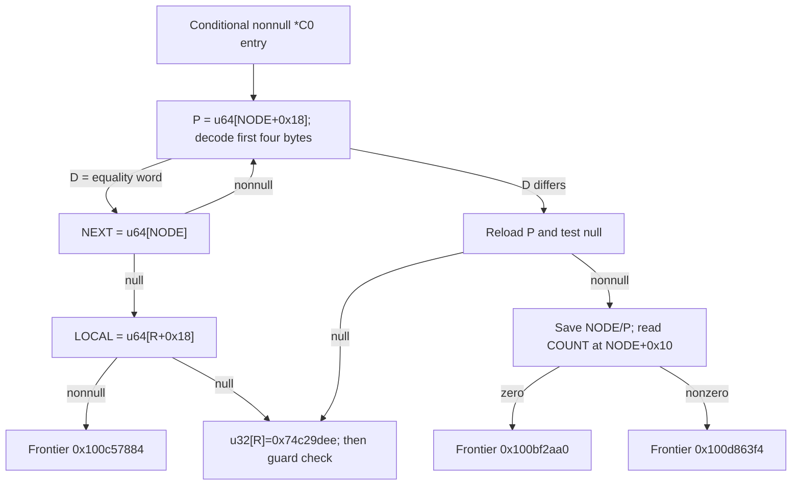

# Mode1 C0 record scan, address-keyed header and selected-record ABI

Continuation: [Selected-record byte passes and scratch handoff](daemon_mode_one_record_passes_report.md) proves two ordered COUNT-byte passes, unsigned loop controls, exact modulo257 reduction, retained accumulator banks, the encoded fourth-word handoff and sixteen sparse bytes in a961 B scratch view. All703 nonbranch sites translate;82 UNSAT and eight SAT results pass, including57 predecessor replays. Native owners, whole reachability, algorithm identity, successful output, budget history and daemon-kext pairing remain unknown. The earlier conditional-entry and C0 ownership boundaries remain open.

The conditional nonnull C0-pointee route scans a linked record chain. At `0x100bda488`, it reads a buffer pointer from record offset +0x18 and decodes its first four bytes with the established address-keyed word codec. The aligned wrapper request makes the decoded equality word exactly `0x5c241ab2`. Equality advances through the record's +0 link; inequality selects the current record for further processing. A null next link joins the existing LOCAL fallback. Selection saves the record, buffer and +0x10 u32 field, then separates zero from nonzero values. Native reachability, record ownership, subsequent payload semantics, successful output, complete budget history and daemon/kext pairing remain unknown. [RS1-RS8]

Evidence: [source/fixups](triage_evidence/daemon_mode_one_record_scan_source.json), [57 queries and source models](triage_evidence/daemon_mode_one_record_scan_checks.json), [extractor](triage_evidence/recover_daemon_mode_one_record_scan.py), [validator](triage_evidence/validate_daemon_mode_one_record_scan.py), [preservation](triage_evidence/daemon_mode_one_record_scan_delivery.json), [quality gates](triage_evidence/daemon_mode_one_record_scan_quality_gates.json), [sealer](triage_evidence/seal_daemon_mode_one_record_scan.py), [publication audit](triage_evidence/verify_daemon_mode_one_record_scan_publication.py). Context: [phase/C0 predecessor](daemon_mode_one_phase_handoff_report.md), [48 B request/cookie ABI](daemon_mode_one_adapter_report.md), [earlier record constructor and word decoder](daemon_constructor_lookup_report.md), [existing scalar word consumer](daemon_existing_scalar_reader_report.md).

| Evidence | Verified scope |
| --- | --- |
| Original image | `fairplayd.arm64e`, SHA-256 `4ffe3ea1dbd27c5026b448ffe06e8489b02cd9064500bcc67792d4ac36ffb63e` |
| Source | Eight ranges, 697 instructions / 2788 B; all 691 distinct nonbranch sites translate |
| Prior source | 22 ranges / 6204 B freshly recaptured |
| Pointer provenance | Ten original pointer records; eleven authenticated branch bindings |
| Proofs | 53 UNSAT and four SAT; includes six predecessor UNSAT queries |
| Codec | Four source seed lemmas and 28 source round lemmas; universal BE32 merge and normalization |
| Controls | Five altered source/offset/target/native-claim artifacts rejected |
| Execution | Static source/SMT only; no target execution, emulation, IPC/API request, new IDA access, IDB mutation or hardware PAC check |

## Entry and recovered record fields

F denotes the current private frame, R the saved 48 B request and NODE the nonnull value loaded from C0. The earlier source establishes R+8=C0, C0=u64[OBJ], R+0x18=LOCAL and F+0x388=R. C0 is a cell pointer; NODE is its independently loaded value. The entry at `0x100a76520` receives W9=0xf518 from the conditional workspace suffix and preserves X0=NODE. Its original selector 0xac4c reaches the decoder with IA diversity 0xef9d. This report does not close the earlier unresolved reachability of that workspace suffix. [RS1-RS3]

| Record offset | Source site | Recovered use |
| --- | --- | --- |
| +0 | `0x100d07434` | u64 next link, read only after header equality |
| +0x10 | `0x100bf2d2c` | u32 field saved and tested for zero after selection |
| +0x18 | `0x100bda490` | u64 buffer P, then four byte reads through P |
| +0x18 | `0x100c4da90` | Buffer reload and null test after header inequality |

These offsets agree structurally with the earlier constructor's 32 B node, whose +0x10 field held an allocation extent and +0x18 held a record buffer. Establishing that the current C0 chain contains those same constructed objects remains an ownership/type-identity obligation. Consequently the current +0x10 field is named COUNT in the proof and treated as a u32 field; this report does not assert a payload-length unit or a public record type. [RS3,RS6]

The seed saves X26=F+0xd10 at F+0x750 and establishes W2=0x471b, W3=0x5605, W4=0x18df and W5=0x4719, together with the 64-bit codec constants. The decoder's first two instructions then derive W9=0xac0a, and its seed setup derives W8=0x5ff8. Both exact live values are source-checked at the outgoing boundary. All stores in this seed are private-frame stores. [RS2-RS4]

## Address-keyed BE32 header codec

For byte j in 0..3, let A=P+j. Arithmetic in this paragraph is modulo 2^64. ROR and ROL are rotations of a 64-bit word, and ~7 is the 64-bit mask `0xfffffffffffffff8`.

```text
B = ROR64(A & ~7, 8) + 0x622c5d3364e5d59f
U = B XOR 0xa7bebfcf1750d389
V = B XOR 0xb6dc5654307e7f72
for K in the seven keys below:
    T = (ROR64(U, 8) + V) XOR K
    U = T
    V = ROL64(V, 3) XOR T
mask_byte(A) = (U >> (8 * (A & 7))) & 0xff
decoded_byte[j] = u8[P+j] XOR mask_byte(P+j)
D = BE32(decoded_byte[0], decoded_byte[1], decoded_byte[2], decoded_byte[3])
```

| Round | Key |
| --- | --- |
| 1 | 0x324a764c67af2e0e |
| 2 | 0xe70987b7a1f527b0 |
| 3 | 0x9032dc5079388982 |
| 4 | 0x144db9b1af6b5721 |
| 5 | 0xeb8e58819a88bf30 |
| 6 | 0x7faaf81a732f68b4 |
| 7 | 0x4f99108510ad96e0 |

Four seed lemmas and seven round lemmas per byte are checked against this decoder's original instructions. Each component obtains its carried constants from the original source prefix, including constants materialized during earlier bytes. The round obligations abstract the actual state operands and any carried rotate. Four explicit cuts record the resulting mask words at 0x100bda654, 0x100bda820, 0x100bdaa04 and 0x100bdac0c; each cut is justified by that byte's seed/round chain. The fourth source word differs by XOR `0x5353535353535353`, which the merge proof explicitly compensates. No candidate expression is accepted from numerical samples. [RS2-RS4]

The exact byte-read sites are 0x100bda498, 0x100bda670, 0x100bda840 and 0x100bdac18. Their source addresses are proved P, P+1, P+2 and P+3. The merged register at `0x100bdac4c` is `D XOR0x8ec35f08`. A separate universal source proof reduces the subsequent three-term u32 expression to

```text
G(X) = u32((X XOR0x8ec35f08) + 0x74c239af)
G(D XOR0x8ec35f08) = u32(D + 0x74c239af)
```

The result is therefore independent of the obfuscated merge representation. It remains dependent on the buffer address through the byte masks. Relocating encoded bytes without an appropriate codec transformation is not established to preserve D. This is an address-dependent storage contract; no cryptographic authentication property is inferred. [RS4,RS6]

## Request-cookie predicate and exact branch directions

The decoder reloads R from F+0x388, reads Q=u32[R+0x20] at `0x100bdaca4`, and reloads the saved u64 cookie from F+0x2c0. The original core store at `0x100cf0384` is recaptured and source-checked. Only the cookie's low 32 bits participate here. The final comparison is

```text
u32(D + 0x74c239af + low32(COOKIE) - Q) == 0xff4220a0
             equivalently
D == u32(Q - low32(COOKIE) + 0x8a7fe6f1)
```

The wrapper supplies `Q=u32(cookie+0xd1a433c1)`. The independently replayed request/core theorem identifies this wrapper cookie with low32(COOKIE) under the explicit 4 B request-alignment premise; ordinary 16 B stack alignment implies that premise. Consequently the equality word is `u32(0xd1a433c1+0x8a7fe6f1)=0x5c241ab2`. Without that premise, use the general Q/COOKIE predicate above. [RS3-RS5]

| Decoder condition | Index / original slot | Target | IA diversity |
| --- | --- | --- | --- |
| Equality | 0x4719 / 0x10105d7b8 | `0x100d0741c` | 0xcd7e |
| Inequality | 0x4724 / 0x10105d810 | `0x100c4da80` | 0xcd7e |

Thus the scan skips the equality word and selects a differing word. It is not an ordinary search that stops on equality. The four SAT checks include two nonempty abstract header domains, a source-bound counterexample to advancing on inequality, and a nonempty zero-COUNT domain. They are mathematical witnesses, without native input or execution claims. [RS4-RS7]

## Next-link loop and LOCAL fallback

At `0x100d0741c`, the source derives W5=0x4719 and W8=0x4923 from the decoder-proved W9=0xac0a, then loads X0=u64[NODE] at `0x100d07434`. Nonnull NEXT selects 0xac4c ->`0x100bda488`; null NEXT selects 0xac0a ->`0x100cbddd0`. Both original branch bindings use IA diversity 0xef9d. [RS2,RS4,RS7]

The scan and advance blocks preserve the seed constants in registers 2,3,4,7,19,20,21,22,23,24,27,28,30. W5 is explicitly restored by the advance block. The source write sets check register-number aliases, rather than treating Wn and Xn as independent storage. A second decoder entry is also source-translated with X0=NEXT and the actual restored W5; it reproduces the same header predicate. There are no stores in the decoder or advance block. These facts establish the inductive local scan contract under stable request/frame/record reads. [RS2-RS4,RS7]

After a null next link, the shared LOCAL gate reads u64[R+0x18] at `0x100cbddd4`. LOCAL nonnull selects 0x4928 ->`0x100c57884`; LOCAL null selects 0x4923 ->`0x100d7cc50`, both IA 0xe138. The latter writes raw u32 value `0x74c29dee` to R at `0x100d7cc54`, before its guard check. This also agrees with the previously established null-*C0 path. Successful return still requires the recorded guard, continuation, budget and native PAC prerequisites; the raw value is not assigned a fabricated public error name. [RS3,RS5-RS8]

For a finite stable acyclic chain of n readable records, this local scan selects the first header whose D differs from the equality word, or reaches the LOCAL gate after n equality records. Its work is O(n), including four seven-round mask computations per visited record; auxiliary scan storage is O(1). A cycle containing only equality records need not terminate. Source inspection does not establish native acyclicity, lifetime or synchronization. [RS6-RS7]

## Selected buffer and u32-field gates

On header inequality, `0x100c4da80` reloads P=u64[NODE+0x18] at `0x100c4da90`, then checks P against zero. Nonnull P selects 0x5ff8 ->`0x100bf2d24`; null P selects 0x6012 ->`0x100d7cc50`, both IA 0x8041. It supplies W10=0x4cc6, W11=0x4f and W9=0x74c29dee. [RS4-RS6]

The four header bytes were already read through the earlier P before this null test. This late test is not a proved precondition check for those reads. Under a stable-buffer premise, the reload denotes the same P; concurrent mutation or invalid reads fall outside this source contract. No native fault or externally triggerable condition is asserted. [RS6]

The selected-record block makes four private-frame stores:

| Source store | Frame cell | Value / extent |
| --- | --- | --- |
| `0x100bf2d24` | F+0x748 | P, u64 / 8 B |
| `0x100bf2d28` | F+0x2b8 | NODE, u64 / 8 B |
| `0x100bf2d54` | F+0x738 | Zero, u32 / 4 B |
| `0x100bf2dd4` | F+0x728 | COUNT=u32[NODE+0x10], u32 / 4 B |

Their 24 B footprint has distinct addresses. It preserves saved R at F+0x388, saved cookie at F+0x2c0, the 296 B workspace at F+0x768..0x88f and the new F+0x750 pointer. W1 and W2 both become 0x4923. The COUNT partition is exact for all u32 values:

| COUNT | Index / original slot | Frontier target | IA diversity |
| --- | --- | --- | --- |
| Nonzero | 0x4cc6 / 0x101060520 | `0x100d863f4` | 0xf2b9 |
| Zero | 0x4cd6 / 0x1010605a0 | `0x100bf2aa0` | 0xf2b9 |

The zero-field path is a distinct processing frontier; this increment does not assign it a success/failure or empty-payload meaning. Both frontier bodies remain to be analyzed with these live registers and saved cells. No caller-visible successful store or write into NODE/P/C0 is established by the selected blocks. The separate raw result store targets R. [RS4-RS8]



On the nonnull NEXT edge, NODE becomes NEXT before re-entering H. The diagram describes this conditional local contract, without asserting a native path from an incoming message or an edge from either frontier to a completed output.

## Architectural and external-control scope

The selected ranges contain no calls, traps, Mach send/receive operations, port creation or right transfers. They establish no new incoming/outgoing Mach-port identity or message-emission site. The recovered interfaces are an address-keyed record header, a request/cookie discriminator, a next-link scan, a LOCAL fallback and a selected-record frame ABI. The public origin and influence of these particular record fields require source/ownership linkage beyond their pointer offsets. [RS1,RS6-RS8]

The immediate cross-layer opportunity is to connect the selected record's buffer/COUNT consumers to later copy, serialization and result publication. That would distinguish internal obfuscation storage from bytes actually exchanged with FairPlayIOKit. Matching this codec or these offsets alone does not establish such an exchange. The earlier phase report's F460=86 reachability frontier also remains relevant: this increment expands the conditional suffix without resolving the complete preceding pass. [RS7-RS8]

## Assumption register and falsification probes

| ID | Assumption / dependent result | Stress test or falsification probe |
| --- | --- | --- |
| RS1 | Pinned thin image identifies this source variant | Rehash original image, recapture 697 instructions and 22 prior ranges, recheck original pointer records; reject altered bytes/offsets/targets/native claim |
| RS2 | The conditional predecessor supplies W9=0xf518, X0=NODE and the saved frame fields | Replay predecessor C0 dispatch/seed/request-save obligations against freshly recaptured source; do not infer whole-operation reachability |
| RS3 | R and COOKIE preserve their established wrapper/core relationship | Replay request-field, aligned-cookie and stack-alignment theorems; recapture/prove the actual F2c0 store; use general predicate when alignment is absent |
| RS4 | Scalar ISA semantics, private-frame forwarding and component cuts match source | Translate every captured nonbranch site; prove four seeds, 28 rounds, merge, normalization, selector formulas, repeat entry and private-store addresses |
| RS5 | Request result destination and LOCAL ownership remain valid | Prove R-relative addresses and raw store; falsify owner interpretation with an aliasing/epoch change; guard/native return and budget composition remain separate |
| RS6 | Frame/record/buffer reads are valid, nonwrapping and stable with appropriate owner/disjointness premises | Establish actual owners, extents, lifetimes and synchronization; test source write footprints for overlap; do not treat the late P test as earlier read validation |
| RS7 | A finite stable acyclic chain permits the first-differing-record/termination statement | Induct on the proved advance edge; a repeated equality-only node falsifies unconditional termination; native chain production remains unknown |
| RS8 | Public type, COUNT unit, payload/output semantics and daemon/kext association remain unknown | Follow both COUNT frontiers and LOCAL frontier; prove actual publication, serializer/buffer owners and an interface pairing before assigning those meanings |

## Bounded continuation and quality gates

| Impact | Next investigation | Evidence required |
| --- | --- | --- |
| High | Nonzero COUNT frontier `0x100d863f4` | Live ABI under W1=0x4923, actual COUNT consumer, saved P/NODE use and final buffer/result stores |
| High | Zero COUNT frontier `0x100bf2aa0` and LOCAL frontier `0x100c57884` | Distinct branch semantics, owner/extent assumptions and caller-visible join |
| High | C0 chain producer and native record identity | Producer/consumer provenance for +0/+0x10/+0x18, synchronization/lifetime and any external control route |
| High | Complete re-entry reachability and return composition | Earlier F460=86 context, later phase-one visit, complete budget history and actual wrapper continuation |
| Medium | Address-dependent record portability | Source evidence for any relocation/re-encoding path; codec similarity alone is insufficient |

The extractor/source translator operates on finite instruction ranges. Let N be captured instructions and L the total serialized expression/query characters. Replaying source prefixes for the fixed 32 codec components takes O(N^2+L) construction time and O(N^2+L) retained evidence storage in the generalization where the number of components grows with N; a single prefix is O(N). Runtime scan complexity is separately O(n) time/O(1) auxiliary storage under RS6-RS7. Solver complexity is separate, with 15000 ms per query and 20 s per process; timeout, unknown, diagnostics or unexpected results fail verification. Arithmetic widths are explicit, offsets are hexadecimal and all extents are bytes.

QG1: Factual source, algebra, ABI/control and provenance analysis requires no normative premise.

QG2: RS1-RS8 identify dependent results, assumptions and falsification probes.

QG3: This increment covers the nonnull C0 scan, word codec, request-cookie predicate, exact next/LOCAL/payload/COUNT branches and architectural/Mach scope. The continuing interface investigation remains active.

QG4: Original bytes/fixups, 691 translated sites, 53 UNSAT/four SAT results, four seed/28 round lemmas, predicate arithmetic and the 24 B selected-record store footprint are reproducible.

QG5: Equality skips records; inequality selects. Alignment, late buffer validation, conditional reachability, native ownership, termination and successful output boundaries are explicit.

QG6: Fresh source and pointer recapture, six predecessor query replays, original-source component/selector checks and five alteration controls establish the stated provenance.

QG7: Five impact-ranked continuations retain the record/output/interface objective, including unresolved control, ownership, budget and native boundaries.
