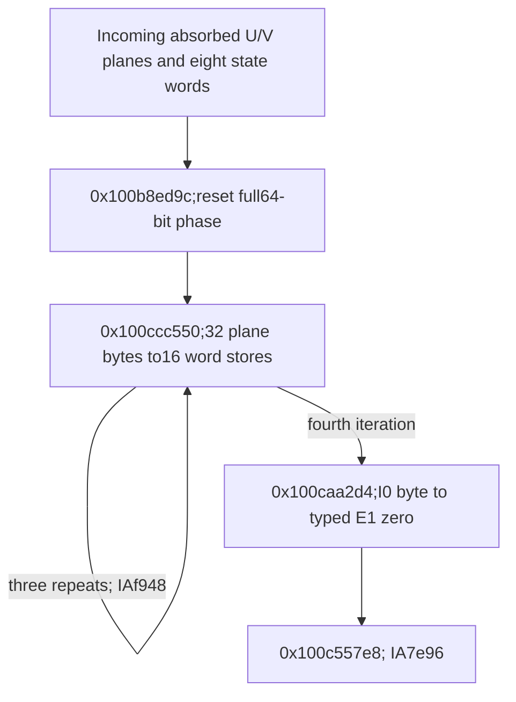

# Paired-plane gather, 280-slot word view and encoder handoff

The post-prefix continuation gathers all128 U/V plane bytes in four iterations and writes64 distinct u32 words into a private280-slot view. Its word permutation is227 modulo280,with stream bases0,71,211 and143. The source planes and800 arithmetic/codebook cells remain unchanged. The exit reads the retained I(0) encoder byte and converts its E0 representation into E1 before selecting `0x100c557e8`. Compact state/word functions,native ownership/traversal,successful output and daemon/kext pairing remain unknown. [WG1-WG8]

Evidence: [source/fixups/root producers](triage_evidence/daemon_mode_one_record_word_gather_source.json.zst), [42 queries,source SSA and complete ledgers](triage_evidence/daemon_mode_one_record_word_gather_checks.json.zst), [extractor](triage_evidence/recover_daemon_mode_one_record_word_gather.py), [validator](triage_evidence/validate_daemon_mode_one_record_word_gather.py), [preservation](triage_evidence/daemon_mode_one_record_word_gather_delivery.json), [quality gates](triage_evidence/daemon_mode_one_record_word_gather_quality_gates.json), [sealer](triage_evidence/seal_daemon_mode_one_record_word_gather.py), [publication audit](triage_evidence/verify_daemon_mode_one_record_word_gather_publication.py). Context: [preceding64-byte absorption](daemon_mode_one_record_long_prefix_report.md), [typed XOR/digit codebooks](daemon_mode_one_record_codecs_report.md), [record-scan root producer](daemon_mode_one_record_scan_report.md), [earlier273-slot word view](daemon_mode_one_plane_consumer_report.md).

| Evidence | Verified scope |
| --- | --- |
| Original image |`fairplayd.arm64e`,SHA-256 `4ffe3ea1dbd27c5026b448ffe06e8489b02cd9064500bcc67792d4ac36ffb63e` |
| Captured source |Five ranges,1629 instructions /6516 B,including two independent root-producer slices |
| Translation |1626 unique nonbranch sites;6035 current traversal instances plus13 producer-slice instances =6048 |
| Incoming recapture |43 historical ranges /81208 B freshly matched to the image |
| Pointer provenance |Four original authenticated records/four target-modifier bindings |
| Accepted results |36 UNSAT /6 SAT;17 selected predecessor/codebook queries refreshed |
| Main memory interface |128 unique plane-byte reads and64 distinct word stores /256 B;all192 addresses certified |
| Exact current effects |471 loads /2589 B,282 stores /1768 B,580 distinct written bytes |
| Root/write census |Ten historical artifacts,1058 normalized frame-store instances and831 literal source stores;counts include repeated model instances |
| ISA checks |Twelve bitfield decodes,one paired-u32 load decode,one false CMP GPR-write report corrected |
| Integrity |Seven source/store/root/pair/target/lineage/native-claim alterations rejected |
| Execution |No target execution,emulation,API/IPC request,new IDA access,IDB mutation or hardware PAC check |

F is the private frame,T=F+0xd10 and WORD=F+0x8b0. All offsets/extents are bytes;u32/u64 arithmetic is modular. Valid coherent nonwrapping mappings,stable roots,no outside writes and the selected incoming control path are composition premises. The private views are not identified as caller-owned allocations or published buffers. [WG1-WG4]

## Root producers and preservation boundary

The biased view is a concrete frame address,not an unknown external pointer. The original record-scan seed computes:

```text
0x100a76530: X10=F+0x890
0x100a76534: X26=X10+0x480=F+0xd10
0x100a76548: X8=X10+0xbda62=F+0xbe2f2
0x100a7654c: u64[F+0x560]=X8
```

A fresh source certificate covers the complete eight-instruction producer slice and its store address. The new body reloads that saved value at `0x100ccc600`;its bias cancels in the established plane-read addresses. The first such byte read is at `0x100ccc614`. Treating F+0x560 as an unrelated input would obscure the actual private-plane access. [WG2-WG3]

A separate five-instruction source slice at `0x100d5dfd4` proves u64[F+0x758]=F+0x8b0. The same old producer also writes the earlier scratch-root interpretation at F+0x738;that interpretation is not imported into this epoch. The current seed explicitly clears the full u64 F+0x738. The two producer slices are provenance checks,not additional operations claimed to execute again within the present traversal. [WG2-WG3,WG7]

The root census checks normalized frame-write ledgers and literal SP-relative stores across ten captured record stages. Only the original record-scan producer writes F+0x560 in that sequence;no other captured literal/normalized frame write intersects either root cell. Historical computed byte stores retain their previously certified scratch-bank domains. All43 historical source ranges are freshly recaptured,but not every historical solver query is refreshed. This establishes a conditional selected-source lineage,not a native full-path lifetime or ownership proof. [WG2,WG4,WG8]

Fifteen incoming prefix queries are refreshed:its seed's complete private accesses,all four byte-address sets,all four private-frame access sets,all four counter/branch contracts,and both exit contracts. The current eight state words and plane-byte values are otherwise universally abstract. Two output-encoder writer/control queries are also refreshed for the exit's typed interpretation. The preceding absorption's address-mask equivalence is not needed to prove this gather's footprint. [WG2,WG5-WG6]

## Seed, state interface and width change

The102-instruction seed at `0x100b8ed9c` enters with W10=0x4923 and W11 equal to the retained state word at F+0x6cc. It reloads state words from F+0xc,F+0x10,F+0x6bc and F+0x8,retaining the other saved state words. The full eight-word entry domain is:

```text
u32 F+0x6cc, F+0x008, F+0x010, F+0x6c4,
    F+0x6c0, F+0x00c, F+0x6bc, F+0x6c8
```

The seed resaves W11 at F+0x6cc. Its other21 stores have source-proved constant values. Together it makes22 private stores: six u32 and16 u64 effects /152 B. The original LDP at `0x100b8ef04` loads W27/W24 from F+0xc/F+0x10. The decimal `[sp,#8]` load is explicitly normalized to F+0x8. [WG3,WG5]

Two stores change the counter epoch:

| PC | Exact effect |
| --- | --- |
|`0x100b8eda0` |u64[F+0x738]=0,clearing both halves |
|`0x100b8eda4` |u32[F+0x730]=0 |

The full-width first store matters:the preceding prefix used a u32 F+0x738 phase value. Carrying only that low-word interpretation into the following u64 loads would leave an unjustified upper half. Current F+0x738 is a numeric coordinate phase,not the earlier saved scratch pointer. [WG3,WG7]

The source derives F+0x5f4=0x8951,F+0x5e8=0x3f10 and F+0x5f0=961. It prepares W16=227,W2=961 and reciprocal0x22190a63a12a5b1b in X26,plus the complete coordinate/state ABI retained in the model. The old incoming W10 gives selector0x4923+0x26e=0x4b91,so the seed selects `0x100ccc550`,IA diversity0x2ee7. [WG3,WG5,WG7]

## Four rounds and all plane reads

The1475-instruction body at `0x100ccc550` has32 byte reads,16 computed u32 output stores and48 private frame stores. It has no record-buffer,image-byte or arithmetic/codebook-byte read. Its only control transfer is the terminal authenticated private branch. [WG1,WG3-WG5]

At round q=0..3,F+0x730 is4*q. The body increments it by4 before testing whether it is below16. Thus rounds0..2 select0x8999 back to the same body;round3 selects0x8951 ->`0x100caa2d4`. Both bindings use IA diversity0xf948. The u64 phase F+0x738 advances by0x3620=16*866 each round. Complete carried-source models certify each counter/branch state. [WG3,WG5,WG7]

For i=16*q+j,0<=j<16,the inputs are the established planes:

```text
U(i)=T+((866*(896+i)) mod961)
V(i)=T+((866*(827+i)) mod961)
```

Each round reads its16 U and16 V cells once. Source order is not simply U/V pairs in ascending index. For example,the first four U reads use indices1,0,2,3;another V quartet uses9,10,8,11. The full32-entry order,PC,address and logical coordinate are recorded per round. Across four rounds,all128 plane bytes are read exactly once and none is written. [WG3-WG5]

Candidate SAT valuations propose the four sets of48 byte/word addresses. Four separate universal UNSAT certificates prove every address for arbitrary state words and named byte loads. Candidates with a zero frame root are algebraic proposals,not native-memory observations. All private frame accesses and complete counter/branch effects receive separate source certificates. [WG3,WG5]

## Word layout, state flow and storage reuse

For stream base b in the source order[0,71,211,143] and k=0..3 in round q,the logical label is b+4*q+k. Its u32 destination is:

```text
WORD+4*((227*(b+4*q+k)) mod280)
```

The multiplier227 permutes all280 indices;an exhaustive finite check verifies all280 slots are distinct. Current writes cover16 logical words per stream,64 words total /256 B,without overlap. Their actual frame extent is F+0x8b0 through F+0xd0b inclusive. These are sparse stores:the1120 B view is not initialized completely. The complete labels,slots,PCs,source word expressions and declared dependency upper bounds are retained. Dependency membership is not a proof that every listed input influences an output. [WG3-WG5]

The current parameters differ from the earlier word view's47/273 permutation and stream bases0,67,135,204. A shared F+0x758 root does not establish a shared layout or transform. No old scheduling equation or compact recurrence is substituted into this280-slot view. [WG2,WG5,WG8]

The last28 B of the current view extend beyond the earlier1092 B view. Two current words write F+0xd00..0xd03 and F+0xd08..0xd0b,overwriting eight bytes of the earlier963-byte scratch domain starting at F+0xd00. This does not touch the current scratch domain starting at F+0xd10. All128 current plane cells and all800 current arithmetic/codebook cells remain unchanged. Preservation claims from the earlier epoch must not be carried across this storage reuse. [WG4,WG7]

The word values mix the gathered plane bytes with the eight incoming state words. The full source SSA records every output and saved-state transformation over the four rounds;the dependency ledger covers all64 word values and five saved state cells per round. Compact equations,algorithm identity and any plaintext interpretation remain unknown. These stores establish a private word-gather/scatter interface,not caller-visible output or daemon/kext serialization. [WG3-WG5,WG8]

## Exit and typed zero encoding

The39-instruction exit at `0x100caa2d4` performs one extra byte read at `0x100caa310`,from F+0xeed. This is T+0x1dd,physical cell I(0) in the retained16-entry output encoder. It is outside the planes and inside the preserved800-cell bank set. [WG3-WG4,WG6]

For arbitrary byte B=u8[F+0xeed],the complete original exit source proves:

```text
u32[F+0x6bc]=0x00000734 XOR(u32(B)<<4)
```

The prior codebook contract supplies B=E0(Rout(0)),where E0(n)=0x74 XOR n and Rout(0) is a codebook nibble. The separate universal u4 theorem gives:

```text
0x734 XOR((0x74 XOR n)<<4)
=0x74 XOR(n<<4)
=E1(n), for every four-bit n
```

Therefore,under that retained codebook contract,the exit replaces F+0x6bc with E1(Rout(0)),a high-nibble representation of the output codebook's natural zero entry. Rout(0) is not assumed to be0. Input/output codebooks remain distinct;P=Q is not inferred. The unconditional byte formula and the conditional typed corollary are separately certified. [WG3,WG6]

The exit also proves W16=0,W2=0xea0f,W3=280,X21=WORD,and reloads state from F+0x6c4,F+0x6c0,F+0x6c8 and F+0x6cc. F+0x5e8=0x3f10 selects `0x100c557e8`,IA diversity0x7e96. That1479-instruction target is the next frontier;no behavior beyond its incoming ABI is assigned here. [WG3,WG7-WG8]

## Complete effects and external scope

Each body has48 private frame stores:12 u32 and36 u64 effects /336 B. Its16 word stores add64 B,for64 total stores /400 B per iteration. Its81 frame loads comprise15 u32 and66 u64 effects /588 B;32 plane bytes and one8 B branch-pointer read produce114 load effects /628 B per body. [WG3-WG4]

The seed reads32 B and writes152 B. Four bodies read2512 B and write1600 B. The exit reads45 B,including the I(0) byte,and writes16 B. Thus the current traversal has471 loads /2589 B and282 stores /1768 B over580 distinct private bytes. The two independent producer slices are excluded from these traversal-effect totals. [WG3-WG4]

The saved view roots at F+0x560,F+0x750 and F+0x758,TABLE,F+0x728 COUNT,PBUF,the296 B workspace and F+0x1210 budget cell are outside current writes. Local budget preservation does not establish whole-operation accounting. The current raw record span is not reread here. [WG4,WG7]

There is no Mach message,port allocation,right transfer,external call or trap in the current captured traversal. No new incoming/outgoing port or emission PC is established. Newly resolved touch points are the biased plane view,private word view,128 plane inputs,64 encoded word outputs,state/counter epochs and typed encoder-zero handoff. Native owners/extents,successful traversal/return,publication and daemon/kext pairing remain unknown. [WG1,WG4,WG7-WG8]



## Assumption register and bounded continuation

| ID | Assumption / dependent result | Stress test or falsification probe |
| --- | --- | --- |
| WG1 |Pinned image and authenticated records identify this variant |Recapture6516 current and81208 historical bytes;verify four records/bindings;reject seven alterations |
| WG2 |Source producers and captured root lineage compose on the selected path |Prove both producers;check1058 normalized frame-store instances and831 literal stores across ten artifacts;retain older computed-byte bounds without claiming all historical queries refreshed |
| WG3 |ISA,widths,frame forwarding and source case models are exact |Translate1626 sites/6048 instances;decode twelve bitfields and LDP;certify all current byte/word/frame addresses,constants,counters and exit effects |
| WG4 |Coherent nonwrapping private views,stable roots and no outside writes |Check128 distinct reads,64 disjoint words,800 retained cells,protected roots/workspace/budget and exact eight-byte old-scratch overwrite;native owners/extents remain unknown |
| WG5 |Four source counter states and candidate addresses cover the traversal |Prove three repeats/one exit,all192 input/output addresses,complete carried state and all64 word labels;check the280-slot permutation separately |
| WG6 |The preserved I(0) byte has its established E0(Rout(0)) interpretation |Refresh encoder writer/control queries;prove the raw byte formula independently and E0-to-E1 theorem for every u4 nibble;do not assume Rout(0)=0 or P=Q |
| WG7 |Current frame epochs and PAC prerequisites permit native continuation |Check full-u64 F738 reset,index/phase widths,saved-state reloads,slot/modifier bindings and old/new domain aliases;hardware PAC,exceptions and actual arrival remain unproved |
| WG8 |Compact transform,whole native path,output and daemon/kext pairing remain unknown |Trace the next word consumer,its actual grid accesses and eventual serialization/publication;do not substitute older273-slot semantics |

| Impact | Next investigation | Evidence required |
| --- | --- | --- |
| High |`0x100c557e8` |Actual use/extension of the64 populated words,counter bounds and following handoff |
| High |Compact word/state transform |Original-source identities for packing/mixing and the eight-state interface,with input/output codebook domains kept distinct |
| High |Caller-visible output and cross-layer binding |Native owner/extents,output stores,serialization and corresponding daemon/kext interface |
| Medium |Storage-epoch aliasing |Further word-grid/scratch reuse and high-half clearing at saved u64 counters |
| Medium |Canonical masks from the preceding absorption |Source-round equivalence independently of this gather's arbitrary-byte input contract |

The current traversal performs fixed four rounds:O(1) work in COUNT with128 plane-byte reads and64 word stores. For R rounds and N body instructions,translation is O(RN);retained cumulative models use O(R squared*N) storage,with R=4. Dependency traversal is linear in each source graph. The finite permutation check covers280 indices. SMT is solver-dependent,limited to15000 ms per query and20 s per process;unknown,timeout,diagnostics,nonzero exit and unexpected results are rejected.

QG1: All claims concern factual source,ISA,ABI,memory/control,arithmetic,typing and provenance properties.

QG2: WG1-WG8 state assumptions,dependent results and falsification probes.

QG3: Both root producers,the full seed,four gather/scatter iterations,word layout,frame epochs,typed exit and Mach-emission scope are covered for this increment;the overall investigation remains active.

QG4: Explicit widths,1626 sites/6048 instances,192 certified addresses,36 UNSAT/six SAT results,280 permutation cases and exact byte/effect totals are reproducible.

QG5: Historical root provenance is separated from native lifetime;280-slot layout from273-slot history;current961-byte preservation from the eight-byte overwrite of older963-byte scratch;arbitrary byte formula from the conditional typed zero interpretation.

QG6: Original image bytes,authenticated fixups,fresh historical recaptures,current source SSA and accepted solver results provide primary evidence;no new dynamic or IDA observation is claimed.

QG7: Impact-ranked continuation covers the next word consumer,compact state semantics,publication,storage aliases and preceding mask equivalence.
