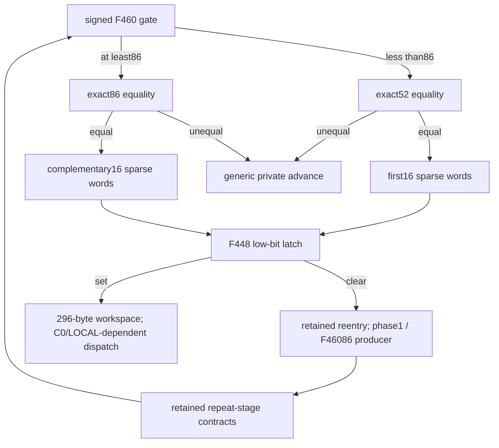

# Mode1 second-phase bank completion and set-bit workspace handoff

The previously unanalysed branch at `0x100dc9674` recognizes internal word F460=86 and selects a complementary 16-word repack at `0x100b74ff4`. Its destinations are disjoint from the earlier 16-word repack; together they cover the complete 32-word sparse bank. The new repack supplies the existing phase latch's exact ABI. With the retained set low bit, that latch selects the 296-byte workspace and C0/LOCAL-dependent request continuation. The selected recorded footprints preserve the eight-byte budget cell, but this does not prove whole-core budget history, zero wrapper delta, native return or daemon-kext transport. [SH1-SH8]

Evidence: [original source and locator inventory](triage_evidence/daemon_mode_one_second_phase_handoff_source.json.zst), [proofs, word equations and lifetime ledgers](triage_evidence/daemon_mode_one_second_phase_handoff_checks.json.zst), [extractor](triage_evidence/recover_daemon_mode_one_second_phase_handoff.py), [validator](triage_evidence/validate_daemon_mode_one_second_phase_handoff.py), [preservation](triage_evidence/daemon_mode_one_second_phase_handoff_delivery.json), [quality gates](triage_evidence/daemon_mode_one_second_phase_handoff_quality_gates.json), [sealer](triage_evidence/seal_daemon_mode_one_second_phase_handoff.py), [publication audit](triage_evidence/verify_daemon_mode_one_second_phase_handoff_publication.py). Context: [first phase and conditional workspace](daemon_mode_one_phase_handoff_report.md), [64-round update and signed gate](daemon_mode_one_word_rounds_report.md), [combiner interfaces](daemon_mode_one_bank_combine_report.md), [budget and stack-delta boundary](daemon_mode_one_adapter_report.md), [caller output verification](daemon_mode_one_output_verification_report.md).

| Evidence | Verified scope |
| --- | --- |
| Image | fairplayd.arm64e, SHA-256 `4ffe3ea1dbd27c5026b448ffe06e8489b02cd9064500bcc67792d4ac36ffb63e` |
| Current source | Eight complete BRAA-terminated ranges; 569 instructions / 2276 B; all 561 nonbranch sites translated |
| Control provenance | 14 source/slot/modifier bindings and 13 original code/data pointer records |
| Prior recapture | 232 range instances / 519616 B |
| ISA checks | Five independent opcode/immediate checks; four comparison GPR-write reports corrected |
| Accepted checks | 35 UNSAT / two abstract SAT; 14 predecessor propositions replayed |
| Bank completion | Two disjoint sets of 16 u32 destinations; 32 words / 128 B of sparse bank data |
| Workspace | All 32 encoded words and 168 literal bytes rechecked from the new reaching ABI; 312 distinct written frame bytes including two saved roots |
| Lifetime | Seven current/retained selected footprint components checked |
| Locator census | 45 pinned artifacts; 183 distinct ranges; 111274 instruction sites; 3781 candidate store sites |
| Integrity | Eight altered source, destination, mask, target, shift, coverage, lineage and native claims rejected |

F denotes protected-core SP, called K in the bit-vector model. Offsets and constants are hexadecimal; storage extents use bytes. Scalar arithmetic is modular u32/u64. F460 is an internal word, not an established public mode, byte extent or port. Stable mapped nonwrapping roots, retained selected-stage address contracts and required frame/image/source owner separation remain premises. Native arrival and the complete execution of the preceding repeat path are not inferred from a destination address. No target execution/emulation, API/IPC request, new IDA access, IDB edit or hardware PAC test occurred. [SH1-SH4,SH7-SH8]

## Budget audit exposed a missing control edge

The investigation began at the unresolved processing-path budget word, `[F+0x1210,F+0x1218)`. An original-byte locator inventory of 45 existing mode1 source artifacts found 111274 distinct instruction sites, spanning core, adapter and outer-caller frames. It also retains 12 SP-write sites and five call sites. These counts are properties of the captured artifact union, not proof that every relevant control path or write has been captured. Equal SP offsets across those frames are not a shared owner. Candidate store instructions include paired effects and aliased stores whose destinations require separate reasoning. [SH1-SH3,SH8]

The inventory highlighted a represented dispatch target with no analyzed body: slot 0x2ac4 -> `0x100dc9674`. The older round report proved the first F460=52 visit, while the earlier phase report separately proved that reentry stores F460=86. Reusing only the 52-valued successor would omit the next branch. No absence-of-literal-SP-store scan is used as evidence that aliased budget writes are absent. [SH2-SH3,SH8]

The new report establishes that bridge and its frame effects. Whole-core budget preservation remains a separate requirement; native canary/return conditions and wrapper delta zero remain unproved. The earlier adapter algebra still states that the returned delta is determined by the low budget difference. It must not be replaced with zero solely because these captured blocks preserve the budget interval. [SH2-SH3,SH7-SH8]

## Exact 52/86 partition and complementary repack

With F730=0x2ac4, the round gate at `0x100cad378` supplies W0=0x2ac4, W14=0x32ff, W9=u32(-0x32a9), W27=F460 and W4=0x528cdb78. Its first comparison is signed: F460<86 selects the original equality bridge; every other signed value selects the new bridge. Both caller snapshots are bound to the actual source, including the otherwise easy-to-miss W9 input. [SH2-SH4]

| Gate path | Equality accepted | Accepted slot / target | Every other word |
| --- | --- | --- | --- |
| Signed F460<86 ->0x100cec684 | 52 | 0x56a0 / 0x100db4af0 | 0x32ff / 0x100c8df0c |
| Signed F460>=86 ->0x100dc9674 | 86 | 0x3305 / 0x100b74ff4 | 0x32ff / 0x100c8df0c |

Thus the combined equality admission is exactly F460=52 or F460=86 for all u32 patterns, including signed-negative values. Both equality bridges use IA diversity 0xd237. The second bridge also supplies W8=0x30fa, W28=0xd4 and W15=u32[F750]. F750 is the current numeric epoch written by the round update; its earlier counter or pointer interpretation is not imported. [SH2-SH4,SH6]

The 63-instruction second repack makes exactly 16 u32 stores. Its complete source-certified values are:

| Destination | Value at second-repack entry |
| --- | --- |
| F40c | F444 + incoming W7 + 0xe2b587fa |
| F418 | F508 + incoming W6 + 0xb6b1549e |
| F3bc | F514 + 0x0e2ee34a |
| F41c | F51c + 0x5055dd69 |
| F3d8 | F50c + 0x3a1ed165 |
| F400 | F52c |
| F3c4 | F558 |
| F3e8 | F548 |
| F428 | F540 |
| F404 | F534 |
| F3d4 | F520 |
| F3ec | F550 |
| F3c8 | F510 |
| F420 | F538 |
| F3b4 | F518 |
| F3f8 | F530 |

All table expressions are u32; Fxxx denotes the current u32 field. Incoming W6 is bound by the round gate's load from F720. The source for F3d8 appears as a variable shift, mask and XOR sum. The recovered selector makes the shift count 1, and an independent all-u32 lemma proves:

```text
((x <<1) AND 0x743da2ca) + (x XOR0x3a1ed165)
    = x +0x3a1ed165                    modulo2^32
```

The register-LSL encoding and its architectural count mask are independently checked. The constant mask equals twice 0x3a1ed165 modulo 2^32, giving the ordinary carry identity behind the apparent mixer. No sampled field value is used to accept this simplification. [SH1,SH4-SH5]

The earlier repack writes the other 16 destinations. Their union is:

```text
{F+0x3b0+4*j : 0<=j<33, j!=29}
```

The omitted word is F+0x424..F+0x427. The envelope `[F+0x3b0,F+0x434)` is 132 B; its actual bank data are 32*4=128 B. The two sets are disjoint and the new block preserves every earlier-half byte. Retained repeat-stage footprints additionally preserve that first half, under their stated destination and ownership contracts. The two halves were written at different phase epochs; their values are not equated merely because several formulas share a shape. [SH2-SH3,SH5-SH7]

## Phase-one handoff and complete workspace recheck

The second repack derives W14=0x6284 and loads slot 0x30fa -> `0x100c4c834`, IA diversity 0x4076. The shared phase latch tests only bit0 of F448:

| F448 low bit | Slot / target |
| --- | --- |
| 0 | 0x6284 / 0x100bdba34, the existing reentry combiner |
| 1 | 0x8aaf / 0x100d9d804, the workspace |

Both arms supply W12=0x7a8c, W4=0x528cdb78, W20=0x4cdb, W22=0xad732488 and W27=86. A fresh source composition proves the whole round-gate ->86 equality ->second repack ->workspace selection when F460=86 and F448's low bit is set. A retained abstract SAT control uses F448=2: the word is nonzero but its low bit is clear, so it selects reentry. Testing the whole word for nonzero would change this source contract. [SH2-SH4,SH6-SH7]

The previous reentry proof establishes F448=1 and the shared-spill producer at `0x100bf3390` establishes F460=86. Seven footprint components now check preservation of the earlier 16 words, phase/request/budget cells and the relevant saved-word epoch through the retained repeat-stage contracts. Only that known F460 producer is permitted to replace F460. This is a bounded source composition using those contracts; it does not supply a native observation or prove all preceding interprocedural execution. [SH2-SH3,SH7-SH8]

The workspace is instantiated directly from the new phase ABI. Fresh original-source comparisons recheck all 32 per-word encodings against the reaching sparse-bank values and all 168 literal bytes:

| Workspace region | Content | Extent |
| --- | --- | --- |
| F+0x768..F+0x7e7 | 32 bijectively encoded u32 bank words | 128 B |
| F+0x7e8..F+0x88f | Literal bytes | 168 B |
| F+0x568 and F+0x588 | Two separate saved u64 codebook roots | 16 B |

The codec is the retained `u32(multiplier*(word XOR mask)+bias)` representation, with its source-specific constants and odd multipliers. All 32 inputs are precisely the sparse bank above; the F424 hole is not read as a bank word. The workspace block has 65 frame-store effects covering 312 distinct bytes. Its unaligned STUR at `0x100d9db74` is independently checked against original address F+0x834. The two saved roots resolve to 0x101031ea0 and 0x100fc4130. [SH1-SH5,SH7]

The workspace then reads COLLECTION=u64[REQUEST+8], followed by HEAD=u64[COLLECTION]. This is a pointee test, not a prior NULL check on COLLECTION: valid readable roots are required before the HEAD comparison. HEAD!=0 selects slot 0x7a8c -> `0x100a76520`; HEAD==0 selects 0x7acf -> `0x100cbddd0`, the earlier LOCAL gate. The outgoing interface includes X0=HEAD, W8=0x4923 and W9=0xf518. The request-derived pointers are not Mach port names or independently established public object types. [SH2-SH4,SH6-SH8]



## Generic advance and bounded budget facts

The shared unequal continuation `0x100c8df0c` is now also translated. With its source-proved W8=0x30fa, its four u32 stores are:

```text
F508 := F508 + incoming W15
F560 := F560 + incoming W7
F504 := F504 +64
F464 := F464 +64
```

Let N be incoming u32[F464]. The original CMN/carry/zero predicate selects slot 0x3146 -> `0x100c9d2b8` exactly when `N==0 OR N>=0xffffff80` under unsigned comparison; otherwise it selects 0x30fa -> the shared phase latch. The source also supplies W14=0x6284. This is a complete modular field/control contract. The physical meaning and units of N/F504, and whether other native epochs reach these generic unequal paths, remain unknown; +64 is not assigned an unproved byte-count meaning. [SH3-SH6,SH8]

All eight currently translated blocks have no SP write, call or intermediate conditional branch: each ends in one BRAA. Their stores, and the selected retained footprint components, avoid `[F+0x1210,F+0x1218)`. A general u64 address lemma proves that frame offsets below 0x1210 cannot equal any of those eight budget-byte addresses. This supports the stated bounded preservation result. It does not cover every possible control path, arbitrary aliased external stores, unknown owners or an unrepresented callee. The 45-artifact locator inventory cannot discharge those obligations. [SH1-SH3,SH7-SH8]

No direct Mach send/receive, right transfer, port allocation, IOKit invocation or port-emission site is present in these new source ranges. The architectural interfaces are saved phase words, sparse-bank fields, codebook roots, request-derived pointers and authenticated internal continuations. Whole-core normal return, external serialization and matched daemon-kext exchange remain unknown. [SH1-SH3,SH8]

## Assumption register and falsification probes

| ID | Assumption / dependent result | Stress test or falsification probe |
| --- | --- | --- |
| SH1 | Pinned image, original instruction encodings and pointer records match the analyzed build. | Rehash the image; recapture 2276 current bytes and 519616 prior range-instance bytes; independently check opcodes/modifiers and reject altered records. |
| SH2 | Retained producer, repeat-stage and request/root contracts reach the stated source boundaries. | Replay 14 selected predecessor propositions; match actual W0/W9/W14/W27 inputs, F46086 producer and phase/root ABI. An intervening epoch change invalidates composition. |
| SH3 | Mapped nonwrapping roots, coherent frame memory and required owner separation hold. | Audit aliases, external writes and source extents; a store aliasing a protected bank/phase/request/budget byte invalidates native applicability. |
| SH4 | ARM widths, signed comparisons, flags, register shifts and unscaled addressing are modeled correctly. | Check the raw register-LSL count mask, logical immediates and unscaled access; distinguish signed F460 partition and CMN carry/zero semantics. |
| SH5 | Word banks retain their individual values and phase epochs. | Verify disjoint 16-word sets, all new equations, the universal hidden-addition identity, preservation of the first half and all 32 current workspace encodings; do not equate different phase states. |
| SH6 | Control tests use their exact field interpretation. | Check every u32 F460 pattern, both low-bit latch arms, the F448=2 SAT control, numeric F750 epoch and overflow-aware generic advance. |
| SH7 | The retained destination/ABI contracts apply to the repeated visit and their stated footprint scope. | Inspect seven lifetime components and the sole permitted F460 producer; revalidate reaching registers/owners before treating these component contracts as a continuous execution proof. |
| SH8 | Locator/partial-budget evidence is not whole-program coverage or native proof. | Reject invented coverage/native claims; enumerate unresolved paths, aliased writes, return guards and transport consumers before promoting the whole-core delta/return/linkage claims. |

## Bounded continuation

| Impact | Next evidence | Question resolved |
| --- | --- | --- |
| High | Complete core control closure and store-destination coverage, including alternative epochs and escaped roots | Whether every ordinarily returning selected processing path preserves the adapter budget, rather than only these footprints. |
| High | Source-to-source reaching ABI checks across all retained repeat stages | Whether remaining component assumptions can be replaced by a continuous source path from the first invocation through both bank phases. |
| High | Ownership and serialization consumers beyond the established request/LOCAL and option-parser interfaces | Whether the result participates in an XPC reply or matched IOKit/kext exchange. |
| Medium | Generic advance field producers and later epochs | Actual meaning of F464/F504, the modular +64 step and unequal-path reachability. |
| Medium | Independent compact recurrence for the complete 32-word candidate producer | Algorithm identity beyond recovered representations and verified components. |

## Scoped quality gates

- QG1: Source, representation, control-flow and coverage statements require no normative conclusion.
- QG2: SH1-SH8 identify assumptions, dependent claims and falsification probes.
- QG3: The increment covers the missing86 bridge, complementary repack, sparse-bank geometry, phase-one workspace ABI, complete workspace recheck, request touch points, generic advance and bounded budget/transport limits. The broad objective remains active.
- QG4: 16*4=64 B per repack; 32*4=128 B bank data within a132 B envelope; 128+168=296 B workspace data, plus16 B roots=312 distinct written bytes. Scalar +64 operations retain unknown physical units. Extraction/census/modeling is O(input bytes+instruction/effect records); fixed blocks are O(1) in external record length. QF_BV worst-case cost is exponential; solver/process limits are 45000 ms / 50 s.
- QG5: Signed/equality gates, low-bit versus nonzero tests, first/second bank epochs, aliased versus literal stores, captured-union versus whole-program coverage, and bounded versus whole-core budget preservation are explicit.
- QG6: Original bytes/fixups, 232 recaptures, five instruction checks, 35 UNSAT results, two abstract SAT results, 14 predecessor replays and eight rejected alterations provide scoped provenance. Solver errors, nonzero exits, stderr, unknowns and timeouts are rejected.
- QG7: Impact-ranked continuation targets actual remaining control, ABI, owner, budget, algorithm and serialization gaps without assigning native or cross-layer completion.

The larger captured-core audit now catalogues3754 stores and proves a conditional budget-preservation/zero-delta law with exact controller and return-state equations. It distinguishes3307 raw SP decodes from236 retained frame-offset and174 computed-site premises. IDA code compatibility is verified;whole-file identity,logical control closure and native return remain unproved. [Captured stores and conditional budget law](daemon_mode_one_budget_store_audit_report.md).
