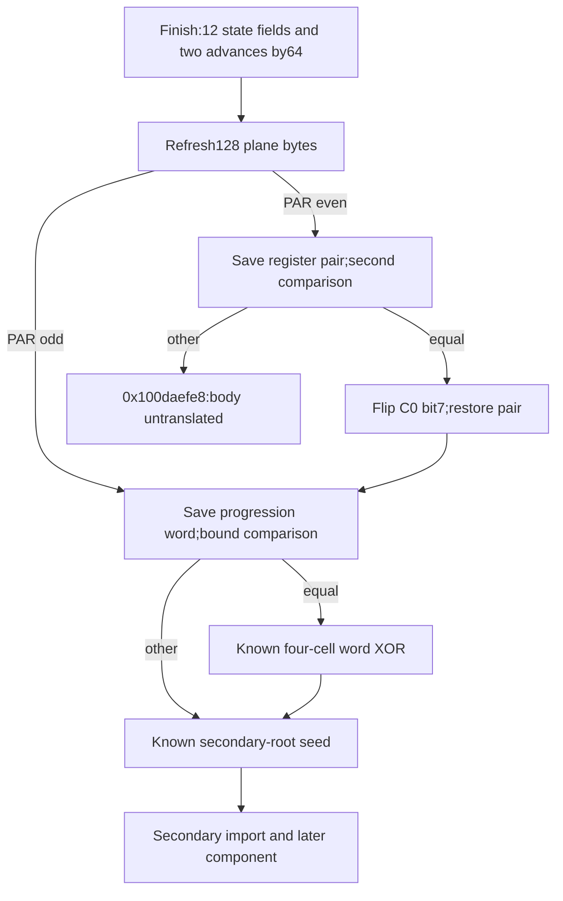

# Secondary state commit, modular progression and parity-dependent reentry

The 172-instruction exit at `0x100c583b0` writes the remaining twelve saved state fields after the preceding four-field update. It computes two source-bound advances by 64 modulo 2^32, then enters the known 128-byte plane refresh under a generalized state ABI. The refresh's parity gates either return toward the secondary schedule or reach a conditional byte mutation. Under the newly recovered even-gate equality, that mutation flips exactly `C(0) = F+0x8b0`, preserving the 800 arithmetic/codec cells. The native meanings of the progression words, whole algorithm, termination, output and daemon/kext pairing remain unknown. [RE1-RE8]

Evidence: [original source and authenticated edges](triage_evidence/daemon_mode_one_secondary_reentry_source.json.zst), [proofs and state/effect ledgers](triage_evidence/daemon_mode_one_secondary_reentry_checks.json.zst), [extractor](triage_evidence/recover_daemon_mode_one_secondary_reentry.py), [validator](triage_evidence/validate_daemon_mode_one_secondary_reentry.py), [preservation](triage_evidence/daemon_mode_one_secondary_reentry_delivery.json), [quality gates](triage_evidence/daemon_mode_one_secondary_reentry_quality_gates.json), [sealer](triage_evidence/seal_daemon_mode_one_secondary_reentry.py), [publication audit](triage_evidence/verify_daemon_mode_one_secondary_reentry_publication.py). Context: [incoming 64-round component and update](daemon_mode_one_secondary_rounds_report.md), [earlier word XOR and plane refresh](daemon_mode_one_word_xor_plane_refresh_report.md), [initial parity adapters and unrestricted mutation](daemon_mode_one_parity_state_adapters_report.md), [secondary import](daemon_mode_one_secondary_word_import_report.md), [interface ABI](interface_abi_report.md).

| Evidence | Verified scope |
| --- | --- |
| Original image | fairplayd.arm64e, SHA-256 `4ffe3ea1dbd27c5026b448ffe06e8489b02cd9064500bcc67792d4ac36ffb63e` |
| Current source | Five ranges, 2,423 instructions / 9,692 B; 2,418 nonbranch source sites translated |
| Prior recapture | Fourteen ranges / 81,496 B; nine selected predecessor queries replayed |
| Accepted queries | 28 UNSAT and three abstract SAT |
| Control provenance | Eight source/slot/modifier bindings; seven unique authenticated pointer records |
| Encoding checks | One UBFIZ and one UMULL; two corrected Capstone comparison GPR-write reports |
| State commit | Sixteen private u32 fields written once across the chained update and finish: 64 B of field storage |
| Refresh | All 128 plane-byte destinations, two proved value cuts and four proved computed-store normalizations |
| Guarded mutation | Exact original numerator zero, two proved byte-access normalizations, XOR 0x80 and register-pair restoration |
| Integrity | Seven altered source, edge, modifier, ISA, lineage and native claims rejected |

F denotes the private frame. Offsets and extents are bytes; scalar arithmetic is modular u32/u64. A numerical increment by 64 does not establish a native byte count. Named computed loads are independent component inputs; literal private-frame forwarding uses exact little-endian byte cells. Valid coherent nonwrapping mappings, stable roots and absence of outside mutation remain premises. UNSAT results cover the coherent-memory subset; abstract SAT witnesses can omit native correlations. There was no target execution/emulation, target API/IPC request, new IDA access, IDB change or hardware pointer-authentication check. [RE1-RE4,RE8]

## Exact twelve-field finish and complete private state commit

The finish range is `0x100c583b0..0x100c58660`. A fresh translation of the actual incoming gate proves W12=0x34d0. With C=u32[F37c], A=u32[F4a8], BASE=u32[F4ac] and VIEW=u64[F380], the complete finish proves the following u32 stores. Values on the right refer to finish entry; Rj denotes incoming Wj. [RE1-RE4]

| Destination | Exact stored value modulo 2^32 |
| --- | --- |
| F4e8 | R21 |
| F4ec | old F4ec + R4 + 0x8ede8a84 |
| F4e4 | old F4e4 + F748 + 0x8a43bb97 |
| F4d4 | old F4d4 + F6e0 + 0xe4640623 |
| F4f4 | old F4f4 + R1 + 0xb04e19a8 |
| F4f0 | old F4f0 + F6c8 + 0x9e2d27b0 |
| F4c4 | R24 + 0x30afe1d7 |
| F4b8 | R28 + 0x7ac330f3 |
| F4cc | R0 + 0x64568826 |
| F4d0 | F700 + 0xdc0fe53c |
| F4c8 | R6 + 0xb334fa38 |
| F4d8 | F6cc + 0xd3144844 |
| F4a8 | A + 0x40 |

The preceding update writes 504, 508, 50c and 510. Fresh source composition of that 1,597-site update, its 39-site flag-zero gate, and this 171-site finish verifies that the sixteen saved fields are each written once. Their exact chronological SSA values are retained. The selected composition requires FLAG bit0=0 and the preceding biased unsigned gate to select the finish. Arrival on that native path remains unproved. These are noncontiguous private state fields; no output-buffer or digest representation is assigned. [RE2-RE4,RE8]

The central obfuscated expression has the universal source identity:

```text
W19 = u32(C+0x40)
u32[F+0x4a8] = u32(A+0x40)
W19-u32[F+0x4a8] = C-A              mod2^32
```

This holds for every u32 C and A. Its proof uses the original instruction expression, without a sampled constant replacement. A fixed W19=0x4a62f57c proposal is false even when incoming C=0x4a62f57c: the source returns 0x4a62f5bc. The accepted model therefore retains a changing progression word. No natural-number monotonicity or bounded outer iteration count follows across u32 wraparound. [RE3-RE5]

The outgoing refresh ABI is:

```text
X6=TABLE; X21=F+0x8b0
W13=0x4923; W7=0xb4; W20=0xd6
W27=0x2dd9b66a; W10=0xc4a2eed2; W12=0x34d0
W19=u32(C+64); W22=BASE; X0=VIEW
W1=u32(incoming W5+0xa2b7b62e)
W25=u32(incoming W20+0x041f9635)
W2=u32(incoming W3+0xac0023c3)
slot0x34d0 ->0x100c62f48; IA diversity0x63f8
```

X0 is restored from its saved phase-specific representation. This finish does not dereference it. W20's incoming data role and its outgoing constant0xd6 are separate epochs. [RE2-RE4]

## Generalized plane refresh with matching saved and cached roots

The 2,171-instruction body at `0x100c62f48..0x100c65134` was previously proved under fixed W19=0x4a62f57c. The current caller supplies C+64. A fresh universal model generalizes that input to arbitrary u32 PSTATE while retaining the actual fixed control/root ABI. It also binds incoming W22=AWORD and u32[F4ac]=AWORD, as supplied by the finish. [RE2-RE4]

The cached X6 and saved u64[F740] both denote TABLE. A retained negative control leaves F740 unconstrained and admits a different subsequent dispatch base, despite the cached register being correct. Both roots are explicit in the accepted composition. Their equality is a source-path premise supported by the caller and protected frame footprint; it is not inferred from a reused register name. [RE2-RE4,RE7]

Two replayed arbitrary-input source-slice lemmas justify the existing value cuts at0x100c63f58 and0x100c64488. Fresh original-address proofs then establish the four computed byte destinations at0x100c63f7c,0x100c6448c,0x100c64630 and0x100c648cc. A second coherent model normalizes only those proved stores and rechecks their original addresses and every frame effect. [RE3-RE4]

With the established primary coordinates:

```text
C(j)=F+0x8b0+((799*j)mod962)
```

all128 byte stores are exactly C(0..63) and C(593..656), with no duplicate destination. The two additional u32 stores are F720 and F728. All800 arithmetic/codec cells, the completed secondary grid, saved state fields, roots and workspace remain unwritten by refresh. Current numeric-table validity after the separate earlier mutation remains unknown. [RE3-RE4,RE6]

The generalized outgoing contract includes:

```text
W2=PSTATE
W10=u32(PSTATE+AWORD)
W16=BWORD=u32[F4a4]
W8=0x4d20; W13=0x4923
W4=799; W23=0xb3; W7=0x883fddf1
W20=0xd6; X21=F+0x8b0

PAR=u32[F4b4]
PAR bit0=1:slot0x1e31 ->0x100c55454
PAR bit0=0:slot0x1e11 ->0x100d77384
IA diversity0xe346
```

The byte values remain exact source expressions with broad component inputs. This increment establishes their destinations and reentry ABI, rather than assigning a decoded message representation. [RE3-RE6]

## Odd gate: saved progression word and return toward the schedule

The 20-instruction gate at `0x100c55454..0x100c554a4` first saves PSTATE to F37c. Let BOUND=u32[F4b0]. Its exact all-u32 predicate is:

```text
BOUND = u32(PSTATE+AWORD+0x1e971aa1)
    equal:slot0x662c ->0x100ce305c
    other:slot0x4d20 ->0x100c03f6c
IA diversity0x1aad
```

Both arms retain the known private word/seed controls, including W8=0x4d20, W9=0x4923, W4=799, W23=0xb3, W7=0x883fddf1, W20=0xd6 and X21=F+8b0. The equal arm reaches the previously proved four-cell word XOR; that operation rejoins the direct arm at the secondary-root seed. Selected original word-XOR and full seed ABI certificates are replayed. The saved F720/F728 words and F750 secondary root supply the seed's established import interface. [RE1-RE4,RE6]

Thus the known private source path returns toward secondary import, expansion and the64-round consumer. With the actual finish interface PSTATE=C+64, the odd gate saves the advanced word back to F37c. Together with F4a8's advance, this supplies a conditional source-level progression cycle. The complete decoded recurrence, native traversal frequency and termination remain unknown. [RE2-RE6,RE8]

## Even gate: correlated equality and exact first-plane-byte mutation

The29-instruction gate at `0x100d77384..0x100d773f8` compares BWORD=u32[F4a4] with the generalized progression/base sum:

```text
BWORD = u32(PSTATE+AWORD+0xd61193e0)
    equal:slot0xc94e ->0x100c2ab70
    other:slot0xc96f ->0x100daefe8
IA diversity0x24d9
```

It preserves incoming refresh-output X28 in X14 and incoming W24 in F6f8. Its outgoing W12=0x1e31 and W13=0xa05a are source-proved constants. The unequal31-instruction continuation is retained by hash and census; its semantics remain untranslated here. [RE1-RE4,RE6,RE8]

The equal arm enters the31-instruction byte-toggle body at `0x100c2ab70..0x100c2abec`. The earlier report's broad independent-word analysis allowed every cell in the962-byte domain. This new entry has an additional proved correlation. Under the even equality:

```text
Delta = u32(BWORD-u32(PSTATE+AWORD)) = 0xd61193e0
N = u32(799*u32(Delta+0x94b008bb)+0xcdb8383b) = 0
```

Original-source queries prove the actual pre-division numerator is zero and both computed byte addresses equal F+8b0. No sampled address or approximate reciprocal is used to establish this result. The final source operations are:

```text
u8[F+0x8b0] = refreshed u8[F+0x8b0] XOR0x80
W24 = saved incoming refresh-output W24
X28 = saved incoming refresh-output X28
W2=PSTATE; W10=u32(PSTATE+AWORD)
W8=0x4d20; W16=BWORD
slot0x1e31 ->0x100c55454; IA diversity0xe346
```

A coherent model applies only the two newly proved byte-address normalizations, forwards the exact byte just written by refresh, and verifies the XOR value and register-pair restoration. The byte store targets C(0), a plane cell disjoint from all800 arithmetic/codec cells. This proves the bound for this correlated entry. The earlier initial adapter's independently controlled mutation retains its broader unresolved cell classification. No native padding, byte-count or hash-algorithm identity is inferred. [RE3-RE7]



## Effects and architectural boundary

| Body | Nonbranch sites | Loads | Stores | Read bytes | Store-effect bytes | Distinct bytes written |
| --- | ---: | ---: | ---: | ---: | ---: | ---: |
| Finish |171|17|13|84|52|52|
| Refresh |2170|5|130|24|136|136|
| Odd gate |19|3|1|20|4|4|
| Even gate |28|2|1|16|4|4|
| Guarded toggle |30|6|1|29|1|1|

The source union is196 distinct written bytes. The conditional path through all five bodies performs33 loads reading173 B and146 stores with197 B of store effects; the toggle rewrites one refreshed plane byte. These are source-effect counts, not measured native traffic. The separately chained preceding update/gate establish state provenance and are excluded from this five-body table. [RE3-RE4]

The five bodies preserve saved LOCAL/request/view slots, TABLE, image-bank/cell roots, secondary-grid roots, the completed word grid, all296 workspace bytes and all800 arithmetic/codec cells. No direct API call, Mach send/receive, port allocation or right transfer appears in these ranges; all control transfers are the recorded private BRAA edges. No new Mach-port emission site is established. The touch points are private scalar commit fields, modular progression words, two byte planes, the cached/saved table root, a saved register pair and authenticated continuation records. Native ownership, externally supplied controls, serialization and matched daemon/kext transport remain unknown. [RE1-RE4,RE6,RE8]

## Assumption register and falsification probes

| ID | Assumption / dependent result | Stress test or falsification probe |
| --- | --- | --- |
| RE1 | Pinned image and pointer records identify this variant; all source claims | Rehash the image, recapture9,692 current and81,496 prior bytes, verify seven pointer records/eight bindings and reject seven alterations |
| RE2 | Actual caller controls, saved roots and component interfaces compose; state commit and reentry | Replay nine selected queries; freshly prove gate W12, finish ABI, saved/cached TABLE equality premises, and chained sixteen-field writes |
| RE3 | Literal byte forwarding and original-address normalization are valid; memory effects and preservation | Prove all literal effects, four refresh and two guarded toggle original addresses, exact128 destinations,196-byte union and protected sets; retain nonwrapping/no-outside-write premises |
| RE4 | ISA widths, flags and source translation are accurate; all semantic certificates | Translate2,418 current sites; check UBFIZ/UMULL encodings, correct two comparison-role reports, and reject solver errors, unknowns, unexpected output and timeouts |
| RE5 | Progression words are raw modular representations; advancement and cycle interpretation | Prove C+64, A+64, invariant difference and odd-gate save; leave natural count, native units, reachability and termination unknown |
| RE6 | Correlated gate inputs and preserved slots reach the specified successors; guarded first-byte proof | Bind W22 to F4ac, BWORD to F4a4 and both TABLE representations; prove all-u32 gate predicates, source numerator zero, XOR0x80 and register-pair restoration under the even equality |
| RE7 | Broad component inputs overapproximate native correlations; negative controls | Retain SAT for the obsolete fixed W19, missing saved TABLE premise and nonempty selected component domain; do not infer native counterexamples |
| RE8 | Native output, whole algorithm and daemon/kext pairing remain unknown | Translate0x100daefe8 and the separate9,241-instruction continuation; follow completed state through actual ownership, serialization and matched transport |

## Bounded continuation

- High impact: translate0x100daefe8's31-instruction unequal continuation and follow its first actual memory consumer. Determine whether the changing progression words are decoded byte counts or another phase representation. [RE5-RE6,RE8]
- High impact: decode the separate9,241-instruction continuation at0x100d183e8. Establish final result ownership/publication and compare its state writes with this reentry path. [RE2,RE8]
- High impact: carry the new correlated guard backward to F4a4/F4ac/F4b0 producers. It resolves this even-entry mutation to C(0); the initial mutation's native selected cell and table validity remain unresolved. [RE3,RE6]
- High impact: connect any result to a concrete send/serialization path and matching kext receive/consume contract. Current local state stores establish no paired exchange. [RE8]
- Medium impact: establish bounds and native interpretations for the two modular progressions before claiming a finite outer loop or standard padding protocol. [RE5-RE8]

## Scoped quality gates

QG1: Source, mathematical and interface claims require no normative premise.
QG2: RE1-RE8 identify dependent claims and falsification probes.
QG3: This increment covers complete private state commit, generalized refresh, both parity gates, a correlated byte mutation and the established schedule bridge. The full interface objective remains active.
QG4: Byte units, u8/u32/u64 widths, modular overflow, source instances and distinct write sets are explicit. Extraction/audit cost O(source bytes+retained evidence bytes); fixed destination census costs O(128) time/space. SMT worst-case cost remains exponential in Boolean variables, with45,000 ms solver and50 s process limits per new query.
QG5: The obsolete fixed-state premise, missing saved TABLE binding, phase-specific register roles, conditional byte bound and earlier unrestricted mutation are separated.
QG6: Original executable/fixup bytes, fresh source composition and exact retained queries provide provenance. No new live IDA or native observation is claimed.
QG7: High/medium impact continuation opportunities and native interpretation limits are explicit.

The31-instruction unequal continuation now leads to two proved copy loops and a general post-copy marker. Initial even saved fields/root contracts specialize them to32 bytes per view and marker C(32);application to a later native flag/progression epoch remains unproved. [Even-context private-view import](daemon_mode_one_even_view_import_report.md).
