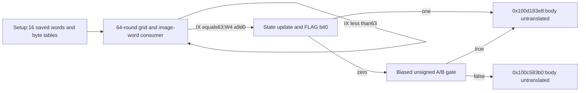

# Secondary64-round word consumer,selector provenance and state-update interface

The continuation at `0x100c2c25c` initializes a64-round component at `0x100b18194`. Each round reads one word from each of two completed secondary streams and two words from a192-word image bank. A source-bound two-table selector yields0xb6 for every possible input byte. The caller's outgoing W4 determines the subsequent state-update branch;retaining this value is necessary to identify the correct continuations. The complete round arithmetic,whole algorithm,native output and daemon/kext pairing remain unknown. [SR1-SR8]

Evidence: [original source,banks,fixups and producer sites](triage_evidence/daemon_mode_one_secondary_rounds_source.json.zst), [proofs and chronological effect ledgers](triage_evidence/daemon_mode_one_secondary_rounds_checks.json.zst), [extractor](triage_evidence/recover_daemon_mode_one_secondary_rounds.py), [validator](triage_evidence/validate_daemon_mode_one_secondary_rounds.py), [preservation](triage_evidence/daemon_mode_one_secondary_rounds_delivery.json), [quality gates](triage_evidence/daemon_mode_one_secondary_rounds_quality_gates.json), [sealer](triage_evidence/seal_daemon_mode_one_secondary_rounds.py), [publication audit](triage_evidence/verify_daemon_mode_one_secondary_rounds_publication.py). Context: [incoming word expansion](daemon_mode_one_secondary_word_extension_report.md), [secondary import](daemon_mode_one_secondary_word_import_report.md), [parity adapters and common setup](daemon_mode_one_parity_state_adapters_report.md), [saved image-bank roots](daemon_mode_one_inverse_tables_report.md), [interface ABI](interface_abi_report.md).

| Evidence | Verified scope |
| --- | --- |
| Pinned original image | fairplayd.arm64e,SHA-256 `4ffe3ea1dbd27c5026b448ffe06e8489b02cd9064500bcc67792d4ac36ffb63e` |
| Current source | Four ranges;16746 instructions /66984 B;16742 nonbranch source sites translated |
| Conditional selected traversal | 298352 nonbranch instances:setup,64 rounds,update and flag-zero gate |
| Original data | Two256-byte banks and one768-byte bank;1280 B total |
| Control | Seven source/target bindings;six unique control pointers and one coded-bank rebase |
| Provenance | 21 predecessor ranges /24268 B recaptured;32 scalar producer rows for two parity cases |
| Accepted queries | 29 UNSAT /three abstract SAT;12 selected predecessor queries replayed |
| Independent encoding checks | 606 UMULL,19 UDIV,314 bitfields,three EXTR,two ADRP;seven Capstone comparison-role corrections |
| Integrity controls | Seven altered source,edge,bank,pointer,producer,ISA and native claims rejected |

F is the private frame. Offsets and extents are bytes;word arithmetic is modular u32 unless explicitly u64. The models overapproximate native inputs:computed memory loads are independent named values,including potentially equal-address reads. UNSAT covers the coherent-memory subset;SAT witnesses may violate omitted memory correlations. Literal frame forwarding uses exact byte cells. Stable nonwrapping mappings,saved roots,immutable image data and absence of outside writes remain premises. No target execution/emulation,IPC/API request,new IDA access,IDB change or hardware pointer-authentication check occurred. [SR1-SR4,SR8]

## Setup and previously unidentified scalar producers

The complete setup block is `0x100c2c25c..0x100c36890`:10637 instructions,including one terminal BRAA. Its483 computed byte loads and direct byte load at F+a36 are modeled as arbitraryu8 values. It performs no secondary-grid word read. All172 stores are literal SP-relative u32 stores. Sixteen UDIV denominators are universally962 under the caller-bound input registers. Bounds and bank membership for all483 computed byte addresses remain unproved here. [SR1-SR4]

A fresh query against the actual preceding extension model at IX47 establishes W6=799,W16=962 and X21=F+8b0. The post-import source model establishes F530=a9d0,and the extension's literal store set preserves that field. Other setup live-ins are unrestricted u64 registers read through their W views. The setup proves:

```text
u32[F+748] = 0
u32[F+738] = 0x43c8             // 72*241
u32[F+6e0] = 63
u32[F+51c] = 0xbfee13c6
W28 = 0x28ef15ed
u32[F+700] = incoming u32[F+510]
high32(X3) = high32(X11) = high32(X15) = 0
slot = 0xa9d0;target = 0x100b18194;IA diversity = 0x4bdb
```

The final X21 is a data value;the primary root persists in saved F758. Registers must be assigned roles at their actual source epochs. In particular,the zero-input valuation values F520=88dd8ab5 and F52c=c90e62e0 are not universal component constants:both proposals have retained SAT counterexamples. The round model leaves these fields arbitraryu32. These counterexamples do not prove native variation. [SR2-SR4,SR7]

The earlier prefix report left F4e4's producer unknown. Sixteen saved u32 input fields have explicit last-store sites within the earlier parity adapter and common setup:

| Field | Odd adapter/common-setup last store | Even adapter/common-setup last store |
| --- | --- | --- |
| 0x4b8 | 0x100d75004 | 0x100d75004 |
| 0x4c4 | 0x100d74fd4 | 0x100d74fd4 |
| 0x4c8 | 0x100d75068 | 0x100d75068 |
| 0x4cc | 0x100d74e98 | 0x100d74e98 |
| 0x4d0 | 0x100c23518 | 0x100be1274 |
| 0x4d4 | 0x100d74fb0 | 0x100d74fb0 |
| 0x4d8 | 0x100c23500 | 0x100be107c |
| 0x4e4 | 0x100c23080 | 0x100be0ef8 |
| 0x4e8 | 0x100d74e84 | 0x100d74e84 |
| 0x4ec | 0x100d74f00 | 0x100d74f00 |
| 0x4f0 | 0x100d74fa0 | 0x100d74fa0 |
| 0x4f4 | 0x100c23498 | 0x100be0fac |
| 0x504 | 0x100d750cc | 0x100d750cc |
| 0x508 | 0x100d74fc4 | 0x100d74fc4 |
| 0x50c | 0x100c233c4 | 0x100be10c0 |
| 0x510 | 0x100c233dc | 0x100be1098 |

Ten stores belong to common setup and six to the parity-specific adapter. Every listed instruction is freshly checked against original bytes;the retained ledger includes its exact SSA value. These are definitions within the specified source paths. Their arrival at the present setup depends on continuity through earlier components and their computed-write disjointness contracts. Native ownership,field names,cryptographic representation and digest-state interpretation remain unknown. [SR1-SR3,SR8]

## Environmental selector and immutable word-bank interface

The round's saved roots agree with earlier producer certificates:

```text
u64[F+578] = Left  = 0x100e99a00       // 256 original bytes
u64[F+570] = Right = 0x100f4e390       // 256 original bytes
u64[F+580] = CELL0                    // native owner/address unknown
```

The image-bank pointer producers and frame publications are replayed,and their original source ranges are recaptured. Present setup/round/update/gate stores preserve these fields. Continuity across the earlier intervening path remains an explicit premise. The round performs two environment-sensitive reads:

| Source PC | Exact read |
| --- | --- |
| 0x100b18d9c | C=u32[CELL0] |
| 0x100b18da4 | G=u32[0x1010c4670] |

A source-bound certificate proves the subsequent byte addresses and full32-bit selector:

```text
z = u8(((G-C) XOR0xa6)*0x0a5cd4cf)
0x100b18dd4:read Left[z]
0x100b18de4:read Right[Left[z] XOR0x54]
0x100b19024:W9 = z XOR Right[Left[z] XOR0x54]
```

Independent exhaustive evaluation of the two retained original banks gives0xb6 for all256 values of z. A separate universal u8 SMT query proves the same composition. This identifies an environment-dependent input circuit whose final bank selector is constant under the specified original bank bytes. It does not identify C,G or CELL0 as a clock,counter,security state or native API result. [SR1-SR4,SR6]

Only after those two source/data certificates does the round model substitute W9=0xb6 at0x100b19024. This is the sole source-value cut. The original source then proves its pool read at0x100b19034 selects:

```text
pool index: 0x819+0xb6 = 0x8cf
pool slot:  0x1010a5fd8
raw rebase target: 0x159cf98f7
u64 bias: 0xffffffffa7323e09
resolved bank: ROM = 0x10101d700
bank domain: 192 u32 words /768 B
```

The original pointer record,fixup,bank bytes and hashes are retained. The ROM domain is the proved coordinate domain of these accesses;no native allocation owner is inferred. Original image data are treated as immutable for this composition. [SR1-SR4,SR6]

## Exact64-round word geometry and control

For IX0..63,the entry interface is:

```text
W28 = 0x28ef15ed+IX
u32[F+748] = 241*IX
u32[F+738] = 0x43c8+241*IX
u32[F+6e0] = 63-IX
u32[F+530] = 0xa9d0
u32[F+51c] = 0xbfee13c6
```

X3,X11 and X15 are the three GPRs read at full64-bit width before being overwritten. Their high halves are proved zero at setup exit and round exit;remaining first reads use W views. Unspecified frame data and low register values remain arbitrary. The source proves these four u32 reads for every IX<64 and all remaining component inputs:

```text
D(j)=F+0xc80+4*((241*j)mod286)

0x100b1913c: D(IX+72)
0x100b19160: D(IX)
0x100b19044: ROM+4*((83*((IX XOR0x0a)+67))mod192)
0x100b19174: ROM+4*((83*(IX XOR0x2a))mod192)
```

The ROM expressions are universally equivalent coordinates within IX<64;they need not match the original instruction syntax. The coverage ledger verifies that all128 grid words belong to the parent's initialized streams0 and72,and all128 image words are distinct across both read sites. The other128 populated grid words and64 remaining ROM words are outside these four reads. No write targets either domain in the four captured blocks. The image word values are retained without an unproved decoded meaning. [SR3-SR6]

The closing state replaces IX by IX+1 in W28,F748 and F738,and writes u32(62-IX) to F6e0. IX0..62 selects slot a9d0 back to the round;IX63 selects a9df to0x100c52828. The final stored countdown is0xffffffff. Saved roots,TABLE,F530 and F51c are protected by the literal-store footprint,and the loop returns the zero high halves required for the next iteration. Thus the component executes64 iterations under its entry/mapping premises. The exact word-grid reads and control do not establish the complete word arithmetic or a standard compression algorithm. [SR2-SR6]

## State-update caller binding and convergent continuation

The1598-instruction update at `0x100c52828..0x100c54120` consumes W4=0xa9d0 from the actual round exit. With FLAG=u32[F4f8],it proves:

```text
u32[F+6e8] = 0xaa1c
u32[F+738] = 0xb55a
u32[F+6c0] = 0x66f1
W2 = FLAG AND1

FLAG bit0=0:slot aa1c ->0x100b50474
FLAG bit0=1:slot aa31 ->0x100d183e8
IA diversity:0x97d1
```

An exploratory model that left incoming W4 unbound selected unrelated slots0x4c/0x61. Those targets are not used in the accepted model or report. The actual caller value is proved,not chosen from the desired target. Earlier initializer/adapter certificates establish a zero flag within their own stated paths;present blocks preserve F4f8. The present report retains the all-u32 FLAG split without claiming native arrival on either branch. [SR2-SR5,SR7]

The update directly writes four of the16 saved state fields:504,508,50c and510. Its complete19-store chronology is retained;other arithmetic outputs remain in work registers/fields. These stores do not prove that all16 fields have completed an update or that a caller-visible digest has been emitted. [SR3-SR5,SR8]

The40-instruction flag-zero gate at `0x100b50474..0x100b50514` takes A=u32[F4a8] and B=u32[F4b0]. Its exact predicate,including u32 wraparound,is:

```text
P = u32(A+0xad3f0bc9) >unsigned u32(B+0x4444fb6c)
u32[F+738] = 0xb55a
P=false:slot66f1 ->0x100c583b0
P=true: slot6703 ->0x100d183e8
IA diversity:0xbf61
```

The original source compares differently biased A/B values around threshold0xd1f59aba and combines their comparison flags. A universal source query proves the rotated unsigned form above across the entireu32 domain. A/B's native meanings remain unknown. The true branch converges with the update's flag-one branch at0x100d183e8. The two outgoing bodies are pinned by hash and census only:172 instructions /688 B at0x100c583b0,and9241 instructions /36964 B at0x100d183e8. Their full semantics remain untranslated. [SR1,SR4-SR5,SR8]



## Effects,architectural touch points and external boundary

| Component | Nonbranch sites | Loads | Stores | Read bytes | Store-effect bytes | Distinct frame bytes written |
| --- | ---: | ---: | ---: | ---: | ---: | ---: |
| Setup | 10636 | 668 | 172 | 1228 | 688 | 536 |
| One round | 4470 | 271 | 112 | 696 | 448 | 276 |
| Update | 1597 | 34 | 19 | 144 | 76 | 72 |
| Flag-zero gate | 39 | 5 | 1 | 28 | 4 | 4 |

A conditional setup/64-round/update/gate traversal has18051 load instances,7360 store instances,45944 read bytes and29440 store-effect bytes. Repeated stores are counted repeatedly;these are source effects rather than measured traffic. Round byte reads comprise138 computed byte sites plus the two image-bank selector sites. The138 computed byte addresses are not universally bounded or bank-classified here. The table arithmetic and current post-mutation numeric-table validity remain unresolved. [SR3-SR6]

All stores in the four blocks are literal SP-relative u32 stores. The primary byte domain,secondary grid,TABLE,saved roots,F4f8 and F530 remain protected. F51c is initialized by setup and preserved thereafter. There are no port allocations,message sends/receives,right transfers,LOCAL dereferences or new Mach port-emission sites in these ranges. Architectural touch points are saved scalar state,the secondary grid,image byte/word banks,CELL0,a fixed image word,and authenticated continuation records. Source-visible environmental reads do not establish external actor control. Native root ownership,extent,aliasing,authorization,output serialization and matched daemon/kext transport remain unknown. [SR1-SR3,SR6,SR8]

## Assumption register and falsification probes

| ID | Assumption / dependent result | Stress test or falsification probe |
| --- | --- | --- |
| SR1 | Pinned bytes/data/fixups identify the investigated variant;all source claims | Rehash original image,recapture66984 current and24268 prior bytes,verify1280 bank bytes/seven pointer records and reject seven alterations |
| SR2 | Saved roots and caller controls compose along the recorded path;setup/round/update entry ABI | Replay12 selected predecessor queries;freshly prove final parent W6/W16/root,post-import F530,setup counters/high halves and outgoing update W4;earlier computed-write continuity remains a premise |
| SR3 | Nonwrapping coherent mappings,no outside writes and stable roots;memory effects/coverage | Check every literal frame effect,protected byte sets and128 initialized grid reads;native ownership/mapping and483/138 computed byte bounds remain unknown |
| SR4 | ISA widths,flags and translation are accurate;all SMT equalities | Translate16742 current sites;independently check944 selected encodings,correct seven comparison-role reports and reject malformed/errored/unknown/timed-out solver outputs |
| SR5 | IX0..63 and stored counter epochs compose;64-round traversal and exit | Prove repeat/exit selection,returned counters,0xffffffff final countdown,zero high halves and stable protected controls;enumerate64 coverage rows |
| SR6 | Original image-bank bytes are immutable;constant selector and ROM coordinates | Bind original controller reads/addresses,check all256 bank compositions,prove the universal u8 equation,then apply only the proved W9 cut and prove original pool/grid/ROM addresses |
| SR7 | Broad component inputs overapproximate native correlations;negative controls | Retain SAT refutations for the two sampled constants and a nonempty abstract domain;do not infer native counterexamples or use an unbound W4 model |
| SR8 | Native arrival,algorithm,field meaning,output,ports and daemon/kext pairing remain unknown | Translate the two bounded continuation bodies,establish remaining arithmetic/representations,then follow actual result ownership and serialization to a matched external interface |

## Bounded continuation

- High impact: translate0x100c583b0's172-instruction exit and0x100d183e8's9241-instruction continuation. Determine which saved fields/results are committed and whether another grid/table epoch starts. [SR5,SR8]
- High impact: recover the actual scalar and byte-table representations before assigning a standard compression algorithm. The128 grid reads,192-word ROM and64 rounds establish structure;current decoded arithmetic remains unknown. [SR3-SR4,SR6]
- High impact: trace CELL0,the fixed global word and F4a8/F4b0 producers through ownership and caller control. Their native meanings and external controllability are unknown. [SR2-SR3,SR8]
- High impact: connect any recovered result to a concrete serialization/send path and corresponding kext receive/consume contract. No new Mach endpoint or paired exchange is established here. [SR8]
- Medium impact: prove483 setup and138 round computed byte bounds,current post-mutation table validity,and full intervening reaching definitions. These are explicit premises/gaps rather than completed coverage. [SR2-SR3,SR6]

## Scoped quality gates

QG1: Technical source,mathematical and interface claims require no normative premise.
QG2: SR1-SR8 identify dependent claims and falsification probes.
QG3: This increment covers setup,producer sites,64-round word/control interfaces,update and gate. The broader interface goal remains active.
QG4: u8/u32/u64 widths,byte units,modular overflow and source-instance versus distinct-byte counts are explicit. Extraction/census costs O(instruction bytes+retained evidence bytes);coverage costs O(64) time/space;finite selector verification costs O(256) time/space. SMT worst-case cost remains exponential in Boolean variables with45000 ms solver/50 s process limits per query.
QG5: Zero-valued constant proposals,unbound W4 targets,independent-read coherence,high-half register epochs and final countdown underflow are separated from accepted claims.
QG6: Pinned original image bytes,data,fixups,source models and exact solver queries supply provenance. No new live IDA or native validation is claimed.
QG7: The continuation list identifies high/medium impact opportunities within explicit source/native boundaries.

The172-instruction finish is now translated and completes the16-field private update. Its changed W19 ABI reaches a generalized refresh and parity reentry;the even correlated mutation is proved to flip C(0). The separate9241-instruction continuation remains unresolved. [Secondary state commit and reentry](daemon_mode_one_secondary_reentry_report.md).
