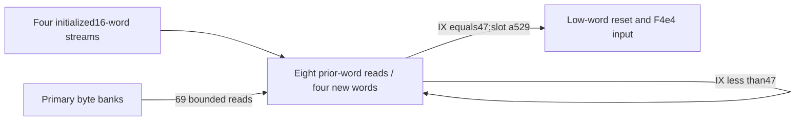

# Secondary word expansion, exact sigma components and state-parametric recurrence

The2245-instruction continuation at `0x100c503c8` extends four16-word streams to64 words each in exactly48 iterations. It reads384 prior words and writes192 new words. All69 primary-byte reads per iteration are bounded to the962-byte primary domain;40 sites additionally have proved arithmetic/codec-bank membership. Four universal source identities establish the SHA-224/SHA-256 small-sigma functions in explicit XOR representations. One stream has an exact additive word dependence with a component-state bias. The remaining stream representations,complete decoded schedule,whole algorithm,native output and daemon/kext pairing remain unknown. [SX1-SX8]

Evidence: [source,fixups and standard provenance](triage_evidence/daemon_mode_one_secondary_word_extension_source.json.zst), [proofs and state/coverage ledgers](triage_evidence/daemon_mode_one_secondary_word_extension_checks.json.zst), [extractor](triage_evidence/recover_daemon_mode_one_secondary_word_extension.py), [validator](triage_evidence/validate_daemon_mode_one_secondary_word_extension.py), [preservation](triage_evidence/daemon_mode_one_secondary_word_extension_delivery.json), [quality gates](triage_evidence/daemon_mode_one_secondary_word_extension_quality_gates.json), [sealer](triage_evidence/seal_daemon_mode_one_secondary_word_extension.py), [publication audit](triage_evidence/verify_daemon_mode_one_secondary_word_extension_publication.py), [retained NIST primary PDF](triage_evidence/daemon_mode_one_record_word_extension_fips180-4.pdf). Context: [incoming secondary import](daemon_mode_one_secondary_word_import_report.md), [distinct280-slot record schedule](daemon_mode_one_record_word_extension_report.md), [numeric table suite](daemon_mode_one_nibble_operation_suite_report.md), [earlier conditional mutation](daemon_mode_one_parity_state_adapters_report.md), [interface ABI](interface_abi_report.md).

| Evidence | Verified scope |
| --- | --- |
| Pinned image | `fairplayd.arm64e`,SHA-256 `4ffe3ea1dbd27c5026b448ffe06e8489b02cd9064500bcc67792d4ac36ffb63e` |
| Current source | Two ranges;2252 instructions /9008 B;2251 nonbranch sites,including a seven-instruction exit prefix |
| Selected traversal | 48*2244+7=107719 nonbranch instances;source models,not native execution |
| Prior recapture | Four ranges /12088 B;14 selected predecessor queries |
| Dispatch | Two authenticated records/bindings;IA diversity0x5b22 |
| Accepted results | 36 UNSAT /six abstract SAT |
| ISA checks | 74 UMULL,39 bitfield,two register-LSR,one UDIV,EON,TST and CNEG encodings;two comparison-role corrections |
| Access/role proof | Eight word reads,four word writes,69 bounded byte reads;40 classified byte sites |
| Value proof | Four exact sigma identities;one state-parametric additive word dependence |
| Integrity | Eight altered source/edge/ISA/reference/native claims rejected |

F is the private frame. Offsets/extents are bytes;scalar operations are modular u32/u64 and byte inputs are u8. Coherent nonwrapping mappings,stable roots and absence of outside writes remain premises. There was no target execution/emulation,target IPC/API request,new IDA access,IDB mutation or hardware PAC check. The earlier IDA snapshot remains in the parent artifacts and is not refreshed or expanded here. [SX1-SX4,SX8]

## Inherited controls and exact48-step loop

Ten direct parent certificates and four sigma certificates from the distinct record schedule are replayed. A fresh query against the actual parent post-import SSA,with QUAD=3,establishes the complete initial control register set and saved roots. At IX=0,the relevant registers are:

```text
W1=e525982b W2=7293 W3=11e W4=5f521b8d
W12=0 W14=f1 W15=879 W20=df2 W22=d6a4 W23=2f W24=d4c2
X21=F+8b0 X27=F+c80
u32[F+6a8]=286; u32[F+6bc]=0x1ef1
u64[F+750]=F+c80; u64[F+758]=F+8b0
```

Register constants above are hexadecimal;the explicit286 is decimal. Other GPRs remain unrestricted u64 inputs. Word loads are eight independent u32 component inputs;lookup loads are69 independent u8 values. F6b0,F738 and F730 are unrestricted u32 component state. No native table-value alphabet or unproved inter-register relation is inserted. Named byte loads remain independent even when computed addresses could coincide:the model omits same-address equalities and table-function correlations. UNSAT results cover the coherent-memory subset;SAT counterexamples can violate those omitted relations and do not establish native counterexamples. [SX2-SX4,SX6]

For IX in0..47,the source saves incoming W12=241*IX at F748 and incoming W23=47-IX at F710. Its closing state is:

```text
W4  = 0x5f521b8d + (IX+1)
W12 = 241*(IX+1)
W15 = 0x879  +241*(IX+1)
W20 = 0xdf2  +241*(IX+1)
W22 = 0xd6a4 +241*(IX+1)
W24 = 0xd4c2 +241*(IX+1)
W23 = u32(46-IX)
```

W1,W2,W3,W14 and both roots retain their entry constants. The comparison uses the incoming countdown before decrement:IX0..46 selects slot0x1ef1 back to `0x100c503c8`;IX47 selects slot0xa529 to `0x100c2c25c`. W23 then equals0xffffffff. This underflow is an exit-state value and does not add a49th iteration. The frame/store disjointness proof preserves the control premises for induction. Native arrival at this component remains unproved. [SX2-SX5,SX8]

## Word geometry and initialized coverage

Retain the incoming coordinates:

```text
C(j)=F+0x8b0+((799*j)mod962)
D(j)=F+0xc80+4*((241*j)mod286)
```

With t=IX+16,the source word accesses are:

| Source site | Read label | Stream-relative role |
| --- | --- | --- |
| 0x100c5044c | IX+143 | S142[t-15] |
| 0x100c50460 | IX+213 | S212[t-15] |
| 0x100c504b0 | IX+156 | S142[t-2] |
| 0x100c504e8 | IX+226 | S212[t-2] |
| 0x100c50d20 | IX+72 | S72[t-16] |
| 0x100c50d64 | IX+81 | S72[t-7] |
| 0x100c50e48 | IX+0 | S0[t-16] |
| 0x100c50e64 | IX+9 | S0[t-7] |

S_b[k] denotes u32[D(b+k)]. Store labels,in source order,are IX+[88,16,158,228],i.e. S72[t],S0[t],S142[t] and S212[t]. Original-source queries prove all12 computed word addresses for every IX<48 and unrestricted remaining component inputs. [SX2-SX5]

The48-case chronology starts with the parent's64 initialized words. Every read names an already initialized label;each iteration adds four distinct words and preserves earlier ones. The final set is {b+j:b in[0,72,142,212],0<=j<64}:256 words /1024 B. The192 new stores write768 distinct bytes and leave30 coordinate slots unclaimed. The286-slot coordinate domain does not prove a native allocation extent or that unclaimed slots are unused. [SX3-SX5,SX8]

The highest new written byte is F+0x10f7. The coordinate domain ends at F+0x10f8 exclusive,eight bytes below the previously derived F+0x1100 view root. The962-byte primary domain and saved F1100/F1150 view roots remain unwritten. No native view extent is inferred from those roots. [SX3-SX5]



## Exact small-sigma components and one additive stream

The retained [NIST FIPS180-4,August2015](https://nvlpubs.nist.gov/nistpubs/FIPS/NIST.FIPS.180-4.pdf),section4.1.2,equations4.6-4.7,defines these shared SHA-224/SHA-256 functions:

```text
sigma0(x)=ROR32(x,7) XOR ROR32(x,18) XOR SHR32(x,3)
sigma1(x)=ROR32(x,17) XOR ROR32(x,19) XOR SHR32(x,10)
```

Let WORD0..WORD7 be the arbitrary u32 values loaded at the eight sites above,in source order. Four separate original-source certificates prove:

| PC,after instruction | Exact register identity |
| --- | --- |
| 0x100c50528 | W22=sigma0(WORD0 XOR0xdde224a2) XOR0x093330d9 |
| 0x100c5055c | W12=sigma1(WORD2 XOR0x415e95aa) XOR0x6080035f |
| 0x100c50594 | W4=sigma0(WORD1) XOR0xa88ddd29 |
| 0x100c505ac | W1=sigma1(WORD3) XOR0x63524e89 |

These are universal equalities with explicit input/output representations,not identification from rotation constants. They establish the mathematical components only. The retained833315 B primary PDF has SHA-256 `0455b406d89648d20cbde375561e19c245b9815e894164c2670772e3d54deb82`,DOI `10.6028/NIST.FIPS.180-4`. [SX1,SX4,SX7]

An additional dual-translation certificate establishes the first word store's complete additive data dependence:

```text
S72[t] = sigma0(S212[t-15]) + sigma1(S212[t-2])
       + S72[t-16] + S72[t-7] + Theta                 mod2^32
```

Theta is precisely defined as the first original store value in a second source translation in which the eight named word inputs are zero,while the other component inputs remain identical. Its source expression and specialization model are retained. A syntactic dependency bound leaves only incoming low32(Z25),low32(Z5) and STATEA=u32[F+0x738];Theta is independent of all eight word inputs and IX. This definition is a source-level specialization,not a target execution or native zero-input fixture. [SX2,SX4,SX6]

Theta has not been proved constant,linear or zero. The analogous additive proposal for S0 has a SAT counterexample within IX<48. Sampled constant-XOR proposals for the parent's four-pair groups S0/S142 and S72/S212 are also refuted in the broad component model at QUAD=0. Those group results do not classify every individual pair or refute stronger relations under a more complete actual-entry ABI. In particular,the equation above couples S72 and S212 and must not be presented as a closed standard recurrence on one identified plaintext stream. [SX6-SX8]

The separate280-slot record schedule has the same eight-read/four-write/69-byte-read structure and exact small-sigma components. Its four sigma queries are replayed and both source variants are recaptured from the same pinned image. The current286-slot coordinates,roots,counters,masks and state contracts differ. This supports a schedule-component family classification without equating their storage or native calling contexts. [SX1-SX2,SX7]

## All69 byte bounds;40 proved bank roles

The original source uses two quotient shapes. Typed DAG aliases propose numerator references;one query against the unmodified source proves all69 original addresses equal F+0x8b0 plus the corresponding source remainder. Independent source and integer certificates then establish:

```text
40 sites:
  0<=N<=759849
  floor(N*0x441fef /2^32)=floor(N/962)

29 sites:
  0<=N<=4294967295
  floor(floor(N/2)*0x883fddf1 /2^40)=floor(N/962)
```

The u64 products and u32 MSUB operands fit;the remainder is0..961. Any following low16 extraction preserves it. These theorems compose all69 byte-read bounds without a lookup-byte codomain assumption. Endpoint attainment and native mapping are not claimed. There are3312 such reads over48 iterations. No source-value cut or computed-address normalization was inserted. [SX3-SX4]

At the40 short-form sites,additional source proofs establish N=799*j and the following coordinate ranges:

| Bank role | Label interval | Proved read sites |
| --- | --- | ---: |
| SUM | 72..327 | 11 |
| CARRY | 677..932 | 3 |
| XOR | 333..588 | 3 |
| ENC | 936..951 | 15 |
| DEC | 659..674 | 8 |

Thus these40 addresses belong to the installed800-cell arithmetic/codec subset. A sampled fixed-family assignment for the other29 addresses is false within IX<48 under the broad component state;the artifact marks those roles as proposals rather than facts. That refutation does not establish that a read leaves the union of initialized banks. Membership for all69 remains unproved. [SX3-SX4,SX6]

Bank membership is also distinct from current byte validity. The earlier conditional mutation can target the primary domain in its unconstrained component model. The present loop preserves the bytes it receives;it does not prove that all numeric-table contracts remain valid after that mutation. No decoded whole-word arithmetic is inferred merely from the historical bank names. [SX3,SX6-SX8]

## Frame epochs and exit interface

Per iteration,169 loads read729 B and27 stores write108 B as source effects. The loads comprise69 byte reads,eight word reads,91 private-frame reads and one branch pointer. The stores comprise four new u32 grid words and23 private u32 frame stores. The latter cover76 distinct bytes. The complete chronological ledger preserves repeated F738,F730,F6f0 and F6e8 epochs. [SX3-SX5]

| Scope | Loads | Stores | Bytes read | Store-effect bytes | Distinct bytes written |
| --- | ---: | ---: | ---: | ---: | ---: |
| 48 iterations | 8112 | 1296 | 34992 | 5184 | 844 |
| Exit prefix | 1 | 1 | 4 | 4 | 4 |
| Loop plus prefix | 8113 | 1297 | 34996 | 5188 | 844 |

Register roles are specific to source PCs. The control values are saved before their registers become data temporaries:

| Entry register | Saved field | Restore site | Closing update |
| --- | --- | --- | --- |
| W24 | F700 | 0x100c51dc4 | +241 |
| W15 | F708 | 0x100c526b0 | +241 |
| W23 | F710 | 0x100c51d98 | -1 |
| W22 | F718 | 0x100c52094 | +241 |
| W20 | F720 | 0x100c51db8 | +241 |
| W4 | F728 | 0x100c5233c | +1 |
| W12 | F748 | 0x100c5269c | +241 |

For example,W27 becomes a rotated word at0x100c504dc and X27 regains the secondary root from F750 at0x100c51d10. X21 is also a work register before its F758 reload at0x100c51e40. Entry/exit root contracts must not be assigned to every intervening use of those register names. W23's CNEG role and restored countdown are separate epochs. [SX2-SX5]

The844-byte union is768 newly written grid bytes plus76 frame bytes. The prefix's F748 write overlaps the loop's frame union. The primary domain,initial64 grid words,saved request/context words,TABLE,both saved roots,the296-byte workspace and derived view roots remain unwritten. These are static component effects,not measured native events. [SX3-SX5,SX8]

At `0x100c2c25c`,the captured seven-instruction prefix:

```text
u32[F+0x748] = 0
CTX4E4 = u32[F+0x4e4]
W3 = u32(CTX4E4 + incoming W7 + 0xaeff9d92)
W8 = W3 SHR28
```

Only low32 bits of F748 are cleared. The producer,owner and meaning of CTX4E4 remain unknown here. The containing exit block has10637 instructions;its remaining10630 instructions are outside this increment. The prefix does not publish a caller-visible result. [SX3-SX6,SX8]

Neither captured range dereferences LOCAL,sends/receives a Mach message,allocates a port or transfers a right. No new port-emission site is established. The concrete touch points are the primary byte banks,secondary word grid,scalar frame epochs,authenticated continuation and newly consumed F4e4 field. Native ownership,serialization and matched daemon/kext exchange remain unresolved. [SX2-SX3,SX8]

## Assumption register and falsification probes

| ID | Assumption / dependent result | Stress test or falsification probe |
| --- | --- | --- |
| SX1 | Pinned source and retained primary standard identify the variants;all source/component claims | Rehash image/PDF,recapture9008 current and12088 prior bytes,verify both fixups and reject eight alterations |
| SX2 | Actual parent controls and saved roots compose;initial loop arrival interface | Replay ten direct parent/four analogous sigma queries;prove the actual parent IX0 controls and roots rather than assigning unexplained constants |
| SX3 | Stable coherent nonwrapping mappings and no outside writes;memory effects and lifetime | Check all word/frame addresses,48-step initialized-word chronology,69 byte bounds and protected write sets;native extents/owners remain unknown |
| SX4 | ISA widths,flags and source SSA are accurate;all semantic certificates | Check EON,TST,CNEG,UMULL,UDIV,bitfields and register-shift encodings;translate2251 sites;prove source remainder shapes and integer width lemmas |
| SX5 | IX0..47 and the loop's stored/returned epochs compose;finite traversal | Prove progression,pre-decrement zero test,47 repeats/one exit and outgoing0xffffffff;check F748/F710/F738/F730 ledgers separately |
| SX6 | Broad component inputs overapproximate actual closed-path value relations;bias/bank/negative-control interpretation | Retain exact Theta specialization and word theorem;refute the second-stream,fixed-bank and sampled pair proposals within their stated domains;do not infer native counterexamples or absent stronger entry correlations |
| SX7 | Four sigma identities and dependency positions establish mathematical components only;function-family classification | Use the pinned primary equations;separate coupled-stream state bias from a decoded standard schedule,and distinguish the286-slot variant from the280-slot source |
| SX8 | Native arrival,mapping,PAC,output,ports and daemon/kext pairing remain unknown | Follow F4e4 and the10630-instruction remainder through ownership/serialization and a matched external interface;source effects alone do not supply those observations |

## Bounded continuation

- High impact: strengthen the actual seed/import value ABI and loop-carried scalar relations,especially F738,W25 and W5. Determine whether Theta vanishes or has a decoded interpretation,and whether S72/S212 carry equivalent words under a proved representation. [SX2,SX6-SX7]
- High impact: continue `0x100c2c25c` beyond the prefix,recover the F4e4 producer and consumers of the completed256-word grid,and follow actual result/serialization paths. The current component does not identify a digest or public output. [SX3,SX7-SX8]
- High impact: establish native owner/extents and a matched daemon/kext buffer or message contract before linking these private stores to an external facility. [SX3,SX8]
- Medium impact: classify the remaining29 byte sites under sufficient actual-entry/value premises and resolve current numeric-table validity after the earlier conditional mutation. [SX4,SX6]

## Scoped quality gates

QG1: Technical source,mathematical and interface claims require no normative premise.
QG2: SX1-SX8 identify assumptions,dependent conclusions and falsification probes.
QG3: Routine role,48-step control,word/byte/frame flow,source family,external touch points and next scalar interface are covered;full goal completion is not asserted.
QG4: u8/u32/u64 widths,byte effects,integer quotient/overflow lemmas and chronology are reproducible. Initialized-word checking is O(48*(8+4)) expected set operations with O(256) word labels. Typed DAG/source-reference extraction uses O(T+V+E) expected work and space over T parsed expression tokens,V interned nodes and E edges;SAT/SMT solving has no polynomial-time guarantee.
QG5: Unknown numeric table values/29 bank roles,state bias,stream representations,native arrival and remaining exit body remain explicit. Strict checks reject solver errors/unknown/timeouts;initial unsupported-EON,declaration-order and candidate-fit attempts are excluded as certificates.
QG6: Pinned bytes,original authenticated records,recaptured predecessors,strict solver queries and the hashed primary PDF provide provenance. Prior IDA/cache context supplies no new semantic claim.
QG7: Ranked follow-ups address closed-path correlations,next-block data/ownership flow,remaining table roles and cross-layer pairing. Gates apply to this increment;the continuing investigation remains active.
