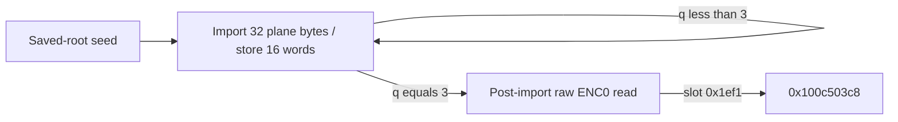

# Secondary word import and post-import control handoff

The seed successor at `0x100d524a8` imports both primary 64-byte planes into four scattered 16-word streams rooted at F+0xc80. Four iterations read all 128 plane cells once and write 64 distinct u32 words. The addresses, cursor progression and exit are independent of the loaded byte values and of all other unrestricted entry registers. The following block reads the raw cell previously assigned to ENC[0] and selects `0x100c503c8`. Word-value transforms and whole-algorithm identity remain unknown. [SI1-SI8]

Evidence: [source and authenticated edges](triage_evidence/daemon_mode_one_secondary_word_import_source.json.zst), [proofs and state ledgers](triage_evidence/daemon_mode_one_secondary_word_import_checks.json.zst), [extractor](triage_evidence/recover_daemon_mode_one_secondary_word_import.py), [validator](triage_evidence/validate_daemon_mode_one_secondary_word_import.py), [preservation](triage_evidence/daemon_mode_one_secondary_word_import_delivery.json), [quality gates](triage_evidence/daemon_mode_one_secondary_word_import_quality_gates.json), [sealer](triage_evidence/seal_daemon_mode_one_secondary_word_import.py), [publication audit](triage_evidence/verify_daemon_mode_one_secondary_word_import_publication.py). Context: [word XOR, refresh and seed](daemon_mode_one_word_xor_plane_refresh_report.md), [parity and mutation](daemon_mode_one_parity_state_adapters_report.md), [saved-root producer](daemon_mode_one_workspace_passes_report.md), [numeric table suite](daemon_mode_one_nibble_operation_suite_report.md), [interface ABI](interface_abi_report.md).

| Evidence | Verified scope |
| --- | --- |
| Pinned image | `fairplayd.arm64e`; SHA-256 `4ffe3ea1dbd27c5026b448ffe06e8489b02cd9064500bcc67792d4ac36ffb63e` |
| Source | Two complete BRAA-terminated ranges; 1,536 instructions / 6,144 B; 1,534 nonbranch sites translated |
| Prior source | Ten ranges / 14,512 B recaptured; two fresh literal W7-producer instructions |
| Dispatch | Three authenticated records / three slot-modifier bindings |
| ISA checks | Two UDIV, 30 UMULL and 18 bitfield encodings; two comparison-role corrections; zero SP writes |
| Accepted solver results | 23 UNSAT / three abstract SAT, including 16 selected parent queries |
| Import | Four induction cases; 32 arbitrary u8 inputs per case; 128 distinct plane bytes read, 64 distinct u32 words written |
| Modeling | No additional initial frame inputs, source-value cuts or computed-address normalizations |
| Post-import | Four loads, six u32 stores; fixed slot 0x1ef1 / diversity 0x5b22 |
| IDA context | Read-only metadata/recall; three 32-byte matches; full code/container identity unverified |
| Integrity | Eight source, edge, ISA, lineage, IDB-identity and native-claim alterations rejected |

F denotes the private frame and TABLE the inherited authenticated-dispatch table. All offsets and extents are bytes. Scalar arithmetic is modular u32/u64; byte inputs are u8. Claims use coherent nonwrapping mappings, stable saved roots and the inherited control interface. No native target execution/emulation, target IPC/API request, IDB mutation or hardware PAC check was requested. Read-only IDA context was consulted as described below. [SI1-SI4,SI7-SI8]

## Entry contract and finite control flow

The earlier seed supplies W3=0, W15=0, W4=799, W14=241, W16=962, X21=F+0x8b0 and X27=F+0xc80. The saved frame constants are u32[F+0x6cc]=0x1f61, u32[F+0x6c4]=0x8b7a81df and u32[F+0x6c8]=962. Saved roots F750/F758 and TABLE at F740 remain intact. All 15 direct immediate-parent certificates and the saved-root producer are replayed, including the seed contract. The recursively inherited query set is not replayed in full. [SI2-SI4]

W7=0x883fddf1 comes from the actual toggle's literal MOV/MOVK at `0x100c2abac`/`0x100c2abb0`, or from the proved refresh path. The comparison, word update and seed preserve W7. Recovering this constant does not classify the toggle's data-dependent destination or establish native phase reachability. Other entry GPRs are unrestricted u64 values; the proof does not constrain R0, R19 or R30 to sampled candidate values. [SI3-SI4]

For q in {0,1,2,3}:

```text
entry: W15=16*q;     W3=4*q
exit:  W15=16*(q+1); W3=4*(q+1)
q<3:   slot 0x1f73 -> 0x100d524a8
q=3:   slot 0x1f61 -> 0x100d85430
import BRAA diversity: 0xcf0c
```

The terminal comparison tests the saved incoming word cursor against 12 with unsigned LO. Each case proves the original 32 byte addresses, 16 word addresses, root/control invariants and selected table address. A separate universal query proves all literal-frame effect addresses, the first UDIV denominator (=962) and the terminal modifier. The second denominator is independently proved equal962 by a five-instruction source-preserving slice with arbitrary W1:W22=W1&962,then (W22 XOR962)+W22=962;the intervening source preserves W1/W22. No value cut modifies the full import SSA. Frame and array write sets preserve the loop-entry premises. Induction therefore yields exactly four iterations from the seed under the component assumptions. It does not prove native arrival at the seed. [SI1-SI4,SI7]



## Exact input and output geometry

```text
C(j) = F+0x8b0+((799*j)mod962)
D(j) = F+0xc80+4*((241*j)mod286)
```

The source-order read labels at q=0 are:

```text
0,1,2,3,593,594,595,596,5,6,7,598,599,597,600,4,
8,9,10,11,13,12,605,606,607,14,608,15,602,601,604,603
```

Add 16*q to each label for iteration q. The complete read set is C(0..63) union C(593..656), with each cell read once. No arithmetic/codec cell is read by the import loop. Its source has no data-word reads from the secondary grid. [SI1-SI5]

The source-order word-store labels at q=0 are:

```text
142,212,72,0,143,213,144,73,1,145,215,75,3,214,74,2
```

Add 4*q to each label. The complete destination set is D(b+j), with b in {0,72,142,212} and 0<=j<16. The coordinate multiplier 241 is coprime to 286; its inverse is 197. These 64 slots occupy 256 distinct bytes, ending at F+0x10c7. The model leaves 222 coordinate slots unclaimed by this loop. The 286-slot coordinate domain does not establish a native allocation extent. The primary 962-byte domain ends at F+0xc72 exclusive, leaving a 14-byte gap before F+0xc80. [SI1-SI2,SI5]

The 16 computed word stores are retained with exact source expressions and four-case address certificates. The checks artifact also contains iterative syntactic input-dependency upper bounds. Those bounds do not establish actual influence, byte order, plain packing, equivalence among streams, or a cryptographic primitive. A structural analyst label is `ImportTwoPlanesToFourScatteredWordStreams`; no original symbol name is recovered. [SI5-SI7]

## Frame epochs, data flow and external touch points

Each iteration has 89 loads and 37 stores: 32 byte reads, 56 private-frame reads, one authenticated-target read, 16 computed u32 stores and 21 literal-frame stores. The frame stores comprise 16 u32 and five u64 effects, writing 104 B into 76 distinct frame bytes. Repeated epochs include F738, F720, F728, F708 and F710; the full chronological ledger is retained. Byte-forwarding carries every literal-frame write into subsequent reads. [SI1-SI5]

| Scope | Loads | Stores | Bytes read | Store-effect bytes | Distinct bytes written |
| --- | ---: | ---: | ---: | ---: | ---: |
| One import iteration | 89 | 37 | 416 | 168 | 140 |
| Four import iterations | 356 | 148 | 1,664 | 672 | 332 |
| Post-import block | 4 | 6 | 21 | 24 | 24 |
| Four imports plus post-import | 360 | 154 | 1,685 | 696 | 348 |

The four-step union is 256 secondary-array bytes plus 76 frame bytes. Post-import adds 16 previously unwritten bytes; its F738/F730 effects overlap the existing frame union. These are static component effect counts, not observed native events. [SI1-SI5]

The writes preserve both primary planes, all 800 arithmetic/codec cells, the 296-byte workspace at F+0x768, saved request/context words and frame views, TABLE and both saved roots. This preserves the bytes present on entry; it does not restore table validity after the earlier conditional mutation. No LOCAL pointee is dereferenced here. No Mach port name/right is received or emitted in either range, and no public request structure is parsed. The outgoing architectural interface is the private register/frame state plus the authenticated dispatch-table target. Daemon/kext pairing and native ownership remain unknown. [SI2-SI7]

## Post-import handoff

The 65-instruction block at `0x100d85430` reads one byte at `0x100d85444` from F+0xa36=C(936), the earlier ENC[0] cell. Treat this as arbitrary raw u8 b. Its exact u32 transform is:

```text
tau(b) = u32(b - ((b<<1)&0xb0))
phi(b) = u32((tau(b)<<4)+0x4546e580) XOR0xb6c257ca
u32[F+0x6b0] = phi(b)
```

The separate lemma b<16 gives phi(b)=(b<<4) XOR0xf384b24a. Native satisfaction of b<16 is unproved because the earlier mutation can reach the primary domain in the unconstrained component model. [SI4-SI5]

| Store site | Destination | Proved value |
| --- | --- | --- |
| 0x100d85440 | F+0x738 | u32(incoming W13+0xbf6c09d3) |
| 0x100d85488 | F+0x6b0 | phi(raw ENC0) |
| 0x100d854e4 | F+0x6bc | 0x1ef1 |
| 0x100d854fc | F+0x530 | 0xa9d0 |
| 0x100d85508 | F+0x6a8 | 286 |
| 0x100d8551c | F+0x730 | incoming W26, low32 |

The proved outgoing constants are W1=e525982b, W2=7293, W3=11e, W4=5f521b8d, W12=0, W15=879, W20=df2, W22=d6a4, W23=2f and W24=d4c2, all hexadecimal. X21/X27 retain their roots. X11 and X30 receive incoming X24; X26 receives incoming X28; X7 receives incoming X30. The table load at `0x100d854b8` selects slot 0x1ef1, whose authenticated record targets `0x100c503c8` with diversity 0x5b22. That target's body is outside this increment. [SI1-SI5,SI7]

An exploratory proposal F738=16 has a SAT counterexample and is rejected. Its exact incoming-W13 expression is retained. An initial prototype compared root values without F after confusing JSON string register keys with integers; that comparison was corrected before the accepted four unrestricted-data proofs. Neither prototype result supplies a target semantic claim. An initial attempt to replay all 54 parent queries stopped on a recursively inherited coherent-install address query returning unknown at its 15,000 ms limit. Combined full-source geometry/denominator, geometry/literal-frame and split case2 diagnostics also returned unknown at15,000 ms and are excluded;accepted new queries have a45,000 ms solver limit and50,000 ms process limit with explicit simplify/bit-blast/sat tactics;the accepted geometry and frame/control queries are split;the accepted proof uses the independent preserving divisor slice. That failed replay is excluded; the accepted selection contains all 15 direct parent queries and the saved-root producer. [SI5-SI7]

## Read-only IDA and knowledge-store observations

The selected ARM64e database reported SHA-256 `4c91eccb3c7e2dd39360986544afbf29f5a32dc638c760173cc1676b965be5a7`, image base 0x100000000, ARM/64-bit and file type `Fat Mach-O file, 2. ARM64e-pauth0`. The reference artifact is the pinned thin image above. The granularity differs; full fat-container/slice equivalence is unknown. The recorded input path was unavailable on the analyst filesystem; availability on the IDA peer was not established. [SI8]

Completed IDA reads matched 32 B at each of 0x100d524a8, 0x100ce305c and 0x100b0c100 against the pinned reference. These 96 B corroborate those locations only. A full 5,884-byte request timed out at the MCP observation layer after 300 s; backend completion is unknown and no complete result was accepted. A subsequent read-only file probe failed because a matching authenticated bridge worker was unavailable. No source premise depends on either failed request. [SI1,SI8]

Knowledge statistics reported nine facts; an unfiltered recall returned seven with truncated=false. Queries for padding, SHA and mode at the import address returned zero. The returned records included ARM64e protocol notes (IDs 6-9) and architecture-mismatched x86-looking notes (IDs 2-4). Verification labels and architectural scope do not establish the current inner-loop semantics. No cached semantic claim was imported, and the difference between nine stored and seven returned prevents an exhaustive-absence claim. The source artifact records the observation snapshot; replay rechecks pinned-file spot bytes, not a live IDA session. Automatic disassembly model diagnostics are excluded as semantic proof. [SI8]

## Assumption register and falsification probes

| ID | Assumption / dependent results | Stress test or falsification probe |
| --- | --- | --- |
| SI1 | Pinned image and source-decoder semantics; all static claims | Rehash input, recapture bytes, validate UDIV/UMULL/bitfield encodings and instruction coverage; reject altered source |
| SI2 | Stable coherent nonwrapping private mappings; geometry and preservation | Check complete access footprints and saved roots against a matched mapping; reject overlap or wrapping |
| SI3 | Inherited seed/control ABI; four-step arrival and termination | Replay parent certificates, recapture W7 literals and preservation, prove all four outgoing control cases; native arrival remains unknown |
| SI4 | No intervening mutation; byte/frame lifetime claims | Check exact store sets and frame epochs; correlate the earlier toggle with native state before asserting codec validity |
| SI5 | Arbitrary u8 plane/ENC0 inputs and unrestricted other GPRs; local contracts | Four universal geometry cases, full raw-u8 post equation, conditional u4 lemma; retain SAT rejection of F738=16 |
| SI6 | Structural word import does not identify numeric transforms or algorithm | Decode exact stored-word expressions and downstream consumers; seek independent equivalence before naming a primitive |
| SI7 | Source/solver evidence is component evidence; native interfaces unknown | Reject unknown/timeouts/errors as certificates; check native mapping, ownership and daemon/kext pairing separately |
| SI8 | IDA/cache snapshot is bounded historical observation | Recheck matched database/container/slice and full bytes when available; distinguish architecture, verified status and recall completeness |

## Bounded follow-up opportunities

- High impact: translate `0x100c503c8`, locate the first secondary-word reads and establish the four stream value transforms. This tests whether the recovered coordinate grid carries encoded words, expanded state or another representation. [SI5-SI6]
- High impact: correlate the earlier toggle destination with the actual incoming state, then determine whether C(936) and the 800 numeric-table cells remain valid at this epoch. The raw-u8 proof remains valid regardless. [SI4-SI5]
- Medium impact: establish matched image identity and native mapping/ownership before connecting the F+0xc80 grid or later output to a Mach descriptor, IOKit buffer or kext-side contract. The present ranges introduce no port-emission site. [SI2,SI7-SI8]

## Scoped quality gates

QG1: Technical source/interface analysis only; no normative premise is required.
QG2: SI1-SI8 register assumptions, dependent conclusions and falsification probes.
QG3: Routines, control, input/output geometry, frame epochs, external touch points and IDA/cache limits are covered; whole-operation completion is not asserted.
QG4: Widths and byte units are explicit; four-case address/control certificates and effect-count unions are reproducible. Dependency census is iterative over SSA definitions, with time O(T+E*L) and space O(V*L), where T is expression-token count, E dependency edges, V definitions and L distinct input symbols.
QG5: Opaque word values, conditional nibble validity, rejected F738 proposal, prototype comparison error, uncertain native arrival and failed full-IDB reads remain explicit.
QG6: Pinned executable bytes, original authenticated records, recaptured predecessors, strict solver results and bounded MCP observations supply provenance; no unverified memory semantics are adopted.
QG7: Impact-ranked follow-ups address downstream value semantics, mutation epochs and cross-layer mapping. All gates apply to this increment; the continuing interface investigation remains active.

## Secondary word extension follow-up

The previously untranslated target0x100c503c8 is a48-step extension of the four16-word streams to64 words each. It adds all69 byte bounds,40 bank roles,exact sigma components and a state-parametric additive dependence;the exit selects0x100c2c25c and reads F4e4. Full decoded recurrence and native pairing remain unknown. See [secondary word extension](daemon_mode_one_secondary_word_extension_report.md).
