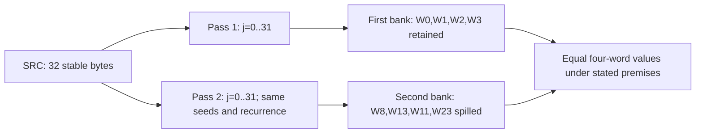

# Mode-1 source passes: identical four-word recurrences and state handoff

The protected core's selected nonnull32 B source path reads the same32 source bytes twice. Both passes start from the same four u32 words and reduce to the same compact recurrence. Each pass reads offsets0..31 in order,with no loop stores,calls or SP updates. Consequently,their final four-word banks are equal under stable-source and valid-owner premises. The first bank remains in registers;the second is spilled to four frame cells. No public output or cryptographic algorithm identity is established. [MP1-MP10]

This advances the [mode-1 adapter report](daemon_mode_one_adapter_report.md) beyond its processing frontier. The source is the object-inline address OBJ+0x18 read from private request+0x10. The count is u32[OBJ+0x58],whose selected predicate is32 B. It is not identified with the first-key span staged at the outer frame's0x58a0/0xf7c. Later consumers of the paired banks,the request key/collection/local-output roles,budget history and native daemon-kext exchange remain unknown. [MP2-MP10]

Evidence: [original source,register writes and pointers](triage_evidence/daemon_mode_one_source_passes_source.json), [26 UNSAT queries,two algebraic round certificates and induction argument](triage_evidence/daemon_mode_one_source_passes_checks.json), [extractor](triage_evidence/recover_daemon_mode_one_source_passes.py), [validator and exact word-normal-form algorithm](triage_evidence/validate_daemon_mode_one_source_passes.py), [preservation](triage_evidence/daemon_mode_one_source_passes_delivery.json), [scoped gates](triage_evidence/daemon_mode_one_source_passes_quality_gates.json), [publication audit](triage_evidence/verify_daemon_mode_one_source_passes_publication.py). Parent interfaces: [48 B request and stack epochs](daemon_mode_one_adapter_report.md), [first-key data/control](daemon_outer_first_key_report.md), [outer object/local32](daemon_reader_outer_lifecycle_report.md).

| Evidence | Verified scope |
| --- | --- |
| Original daemon | `/Users/___/Downloads/zut/fairplayd.arm64e`;SHA-256 `4ffe3ea1dbd27c5026b448ffe06e8489b02cd9064500bcc67792d4ac36ffb63e` |
| Source |6 ranges,419 instructions,1676 B;zero SP writes;zero store instructions in either loop |
| Translation |All413 nonbranch sites;460 translated instances,438 SSA definitions |
| Metadata |Eight original pointer records;nine selected branch/modifier matches |
| Recapture |11 prior ranges,2648 B matched to original bytes |
| SMT |26 UNSAT queries,including exact unsigned-reduction integer lemmas;one separate SAT nonempty-domain check |
| Algebra |Two round certificates,eight output-word equalities,exact structural DAG comparison;four altered recurrence candidates fail certificate matching |
| Integrity |Six altered-source/ledger controls rejected |
| Execution |No target/native execution,new CPU emulation,IPC/API request,IDA access,IDB edit or memory-folder update |

VAs are unslid. Offsets/selectors/constants are hexadecimal;extents use B. F is protected-core SP,called K in this increment's SMT;F is the parent report's J and differs from its wrapper SP K. SRC is the selected32 B source. All recurrence state arithmetic is modulo2^32. Bytes are unsigned;the remainder modulo257 is an ordinary integer remainder in0..256,promoted to u32 before XOR. Frame u32 stores are little-endian. Analytical state names are not public Apple types or recovered algorithm names.

## Selected control and state banks [MP2-MP7]

| Stage | Exact interface |
| --- | --- |
|Core branch entry0x100d5dfc8 |Private mode0x4923 and the selected size comparison value0x16f293e0;SRC in X25 is forwarded to X30 |
|Entry local views |F+0x8b0 saved at F+0x758;F+0xd00 saved at F+0x738 |
|First seed0x100d77734 |Four initial words in W0,W1,W2,W3;table0x2e5e ->first loop |
|First loop0x100b035ac |One source byte per round;table0xbd2a repeats,0xbd5a ends |
|Between-pass0x100d64e2c |Retain W0..W3 and X30;initialize second bank W8,W13,W11,W23 to the same four initial words;selected table0x303e |
|Second loop0x100d9f0f4 |Same source-byte order and recurrence;table0x303e repeats,0x306c ends |
|Handoff0x100d5e37c |Spill second bank and SRC,retain first bank,select table0x3d26 for the next frontier |

The four initial words are:

```text
(a,b,c,d) = (49fe8fbf,6bae77d6,c2864be0,14267dee)
```

The between-pass comparison's alternate conditional is false under the verified saved phase value. Only its actual0x303e selection is counted as a recovered edge;the report does not treat every syntactic arithmetic candidate as a feasible authenticated transfer. The NULL/other-size paths are outside this selected32 B pass theorem. [MP2,MP3,MP6]



These are two16 B state values,not a proved contiguous32 B caller output. The source/register-write census and complete translated bodies establish that the second pass and handoff do not overwrite the first bank. [MP3-MP8]

## Ordered input and exact finite bounds [MP3-MP7]

The first source load is LDRB at0x100b035b4. Encoded index W13 starts at0x7436a775;adding W4=0x8bc9588b gives source offset0. Each round increments W13. The remaining comparison state is end0xf9bdc98a,pivot0xf9bdc96a and current0xf9bdc96b+j. The complete source predicate repeats exactly for j<31 and exits for j=31. [MP2,MP7]

The second source load is LDRB at0x100d9f110. W26 starts at0x3bb4f453;adding0xc44b0bad likewise gives offset0. Its end/pivot values are0xb275bb7a/0xb275bb5a;the compared current is0xb275bb5b+j. Its complete predicate also repeats exactly for j<31 and exits at31. All bounds are proved for the selected0<=j<32 domain,with exact u32 wrapping in encoded counters. [MP2,MP7]

There are64 source-byte reads over32 distinct relative addresses. Neither loop writes memory or changes SP,and neither has a call or an intermediate conditional branch before its terminal BRAA. The between-pass body also preserves SRC. This establishes the source function's read sequence;it does not establish native scheduling,concurrent immutability,mapping or lifetime. [MP3-MP6]

## Compact shared recurrence [MP4,MP7,MP8]

Let x=SRC[j] as an unsigned byte. The following recurrence describes both pass bodies. Every arithmetic assignment wraps to u32;rol32 denotes rotation within32 bits. The temporary names are analytical,not original register variables.

```text
z  = (x+j)*5b9896c1 -b +761e1051
t  = ((z XOR(z mod257)) -a -c) XOR9abad348
u  = t XOR d
a1 = a+u
c1 = c-u
v  = (rol32(u,3) -a1 +c1) XOR t
b1 = v+1b392e51
h  = rol32(b1,1) XOR a1 XOR b1
s  = v+t -(c1+b1) +h
w  = s+0b1139f2
r  = v+t+1b392e51+w
n  = w XOR a1 XOR b1
B  = ((n+rol32(w,2)) XOR r XOR w XOR(c1+b1)) +17debfe5
(a,b,c,d) = (B+n, B, B XOR w XOR(c1+b1), B+r)
```

The passes use different physical registers and different masked expressions,but their source byte injection reduces to the same z. Their remaining state updates reduce to the same recurrence through independently checked source identities. These equations do not assign a standard hash,cipher,MAC,KDF or security property. [MP7-MP10]

## Why the reciprocal sequence is modulo257 [MP7]

For an arbitrary unsigned u32 z,the source UMULL/LSR sequence computes:

```text
q = floor(z *0xff00ff01 /2^40)
  = floor(z /257)
rem = z -(q +(q <<8))
    = z -257*q = z mod257.
```

The identity `257*0xff00ff01 =2^40+1` and z<2^32 bound the reciprocal error. Exact integer certificates establish the quotient equality for every u32 z,no u64 product overflow,and q<=16,711,935. Both q<<8 and q+(q<<8) stay within u32,so the source word arithmetic matches the ordinary integer remainder. Consequently rem is in0..256;it is not merely the low byte of z. Both loop implementations have their own source quotient/remainder expressions checked against this theorem. [MP7]

No native input,packet or target execution is generated. The separate SAT check only establishes a nonempty abstract byte/index/remainder domain. [MP9,MP10]

The loop-invariant register sets are checked against the retained instruction effects. Capstone 5.0.7 reports comparison input operands as GPR writes at ten CMP aliases in these spans. The extractor retains those reported roles and checks the raw SUBS encoding with Rd31/S1/sub1 before removing the spurious GPR writes. Architectural flags remain writes. The existing SSA comparison models do not modify compared GPRs. This correction is bounded to those ten original instructions;it is not a broad claim about unrelated decoder output. [MP1,MP3,MP7]

## Source-proof composition and equality of the two banks [MP6-MP10]

The source uses different masked identities in the two loops. Ten small source-slice certificates justify the rotation,addition/XOR and masking simplifications. Each cut in the complete round model is computed from a snapshot of the actual live source registers at that slice's start;it does not substitute a desired canonical output or assume the final equality. Byte injection and reduction are separately proved before the remaining state recurrence is compared. [MP7]

The remaining exact u32 expressions are reduced with a small deterministic algebra verifier. It canonicalizes addition/subtraction/scalar multiplication in the u32 ring,XOR parity and32-bit rotations,using structural DAG interning. Its two round certificates compare all four source output words against the compact recurrence and obtain eight exact structural equalities. Equality is sufficient for equivalence;failure to obtain equal normal forms is not claimed to prove arbitrary functions unequal. Width checks reject unsupported reachable operations,including64-bit rotations,and all reachable source-word casts are explicit. [MP7]

The SMT queries and algebra certificates have different scopes. The SMT components establish the source cuts,byte/counter interfaces and quotient/remainder facts. Algebraic normalization establishes the complete post-reduction word relation after those cuts. Uncut or broadly combined solver queries that returned unknown at15000 ms are excluded from accepted evidence. No timed-out query is counted as UNSAT. [MP7,MP10]

The finite-pass argument is:

1. Both banks start with the same four u32 constants.
2. Both loops read SRC[j] at exactly j=0..31.
3. Both source bodies implement the same deterministic next-state function for arbitrary incoming four-word state,byte and index.
4. No loop store/call or between-pass source write occurs;stable-source/owner assumptions supply equal byte values between passes.
5. Induction over the32 indices gives equal final four-word banks. The second loop and handoff preserve the first bank's registers.

This is a compositional induction argument anchored to two source-proved rounds and their loop controls. It is not a native trace,an unrolled runtime test or evidence of a particular anti-tamper intention. The duplicated computation is established;its later use and intended purpose remain unknown. [MP3-MP10]

Four altered candidate recurrences change the final additive,rotation,output-word order or injection constant. They fail source-normal-form certificate matching. Six additional source/ledger alterations are rejected by fresh original-source comparison. These checks distinguish proof/integrity rejection from target behavior. [MP7,MP10]

## Exact handoff and budget preservation within this region [MP3-MP9]

| State / interface | Handoff location |
| --- | --- |
|First bank a,b,c,d |W0,W1,W2,W3,retained throughout second pass/handoff |
|Second bank a |u32[F+0x748],written at0x100d5e388 |
|Second bank b |u32[F+0x720],written at0x100d5e37c |
|Second bank c |u32[F+0x728],written at0x100d5e380 |
|Second bank d |u32[F+0x730],written at0x100d5e384 |
|SRC |u64[F+0x458],written at0x100d5e38c |
|Local scratch address |F+0xd00 reloaded through F+0x738 into X11 |
|Next selected continuation |Original table0x3d26,IA0x5ccd |

The four second-bank stores are separate4 B cells,not a proved packed16 B output structure. F+0x748 is reused across epochs:before the passes it contains phase value0x5cffd950;after the handoff it contains the second bank's a word. Reusing that offset does not preserve its old meaning. No write through LOCAL or any Mach/XPC output cell is established in these six ranges. [MP3,MP8,MP9]

The source write ledger contains12 store sites with72 B of summed write extents and68 distinct frame bytes;the seed/handoff reuse of F+0x748 accounts for the overlap. Every write uses a fixed offset from unchanged F. From the parent core-frame contract,the budget word is at BP=F+0x1210. A source-linked arbitrary-byte query checks every retained store byte against all eight budget bytes and proves no overlap. Thus the budget is unchanged by the retained two-pass region under the parent owner/frame and no-concurrent-writer premises. The next handoff target's effects are outside that theorem;normal-path delta/return completion remains unproved. [MP3-MP6,MP8-MP10]

The new fragments contain no API/IPC call or Mach emission. Their only transfers are the retained private BRAA edges. This supplies additional local computation and frame interfaces without establishing native daemon-kext interaction. [MP9,MP10]

## Complexity and evidence bounds

For the selected source path,each of two passes performs32 rounds;state storage is four u32 words per bank,with O(1) working storage. A generalized recurrence would take O(n) time for n bytes,but arbitrary-n source admission is not proved here. The source theorem concerns32 B only. No bound is assigned to the later handoff consumer,external scheduling or whole protected operation. [MP2-MP8]

Extraction and SSA translation are linear in retained bytes/instructions plus recaptured bytes. The bounded word-normal-form algorithm has worst-case O(N^2 log N) time and O(N^2) space for N reachable word-expression nodes;it keeps nonconstant products opaque and does not perform unrestricted polynomial expansion. SMT solving is not assigned a linear bound. Neither algorithm executes target instructions or performs host FairPlay calls.

## Assumption register and falsification probes

| ID | Assumption / dependent results | Stress test or falsification probe |
| --- | --- | --- |
| MP1 |Original thin-image identity;all source claims |Hash original and recapture every range/pointer;reject any byte or ledger mismatch |
| MP2 |Selected nonnull LEN32/private-mode4923 entry and actual phases |Use parent decoder/size certificates,derive seed/counter values and verify selected pointer/modifier slots;other-size/NULL control is outside this pass theorem |
| MP3 |Correct fixed core frame F and source/register owner epoch |Check source SP writes are zero,frame slots and preserved bank/register sets;do not substitute the parent's wrapper SP for F |
| MP4 |Live readable32 B SRC and stable bytes across both passes |Establish object initialization,lifetime and mutation/locking context;read-only source code alone does not rule out concurrent writers |
| MP5 |Source object/frame/budget owners satisfy the parent nonaliasing premise |Validate OBJ+0x18 owner and BP=F+0x1210 relation;fixed-offset budget nonoverlap does not prove all native memory mappings |
| MP6 |Ordinary logical authenticated transfers and original table/bank roots |Match all eight pointers/nine selected modifiers;hardware PAC acceptance,exceptions and native scheduling remain unknown |
| MP7 |Exact u32/u64 semantics and supported normalization domain |26 SMT certificates,live-register cut snapshots,two exact algebra certificates and four candidate-recurrence rejection checks;unsupported reachable operations or solver errors/unknowns reject acceptance |
| MP8 |The two source recurrences and32-index controls compose with stable input |Induction uses equal seeds/same indexed bytes;retain first-bank liveness and separate second-bank spill;no public output identity is inferred |
| MP9 |Later consumer,LOCAL/key/collection roles and complete budget history remain unknown |Trace original table0x3d26 and downstream stores/returns;equal state banks alone do not identify a standard primitive or purpose |
| MP10 |Static certificates differ from historical guest/native evidence |Original trace and prior reports remain preserved;no new execution,port identity,transport success or daemon-kext pairing is supplied |

## Bounded next investigations

| Impact | Follow-up | Discriminating evidence |
| --- | --- | --- |
|High |Follow table0x3d26 after the paired-bank handoff |Determine whether banks are compared,combined,used as a decoder seed or published;intent is currently unknown |
|High |Continue budget/result writes to the protected epilogue |Extend the new preserved-budget interval into a complete normal-path delta/continuation join |
|High |Trace OBJ+0x18 initialization and its count field |Establish actual byte origins and stable ownership rather than inferring a relation to the first-key span |
|Medium |Recover deeper C0/request-key/LOCAL consumers |Connect this computation to selected record data and caller-visible effects without assigning an ABI from the32 B size alone |
|Medium |Compare compact recurrence with primary algorithm descriptions if later evidence supplies a match |A standard-name assignment requires exact operations/constants/input/output conventions;none is claimed here |
|Low |Reuse exact word normalization on remaining masked arithmetic |Keep live-source cut premises,word widths and unsupported-operation rejection explicit |

QG1: No normative judgment is required;the work is a source and data/control analysis.

QG2: MP1-MP10 state assumptions,dependent results and falsification probes.

QG3: The increment covers both source passes,the shared compact recurrence,exact reduction257,finite controls,bank preservation/spills and local budget nonoverlap. Respective reports and the investigation index are updated;the full cross-layer objective remains active.

QG4: Byte extents,word widths,rotation conventions,integer/BV correspondence,frame epochs and bounded complexity are explicit and reproducible.

QG5: Stable-source premises bound bank equality;state values differ from packed/public output;F+0x748 has two meanings across epochs;budget preservation ends at the next consumer;normalizer equality is sufficient but not a completeness claim.

QG6:6 ranges/419 instructions,413 modeled sites,460 instances,438 SSA definitions,eight original pointers/nine selected matches and11 recaptures ground the result.26 queries return UNSAT;one SAT domain check is separate. Two exact algebra certificates establish eight word equalities;four altered candidates fail certificate matching and six integrity alterations are rejected. Unknown/time-out queries are excluded.

QG7: Scope expansion is bounded by the impact-ranked consumer,budget,source-owner and semantic-role questions. No standard algorithm identity,native execution,new Mach emission or full-goal completion is claimed.
