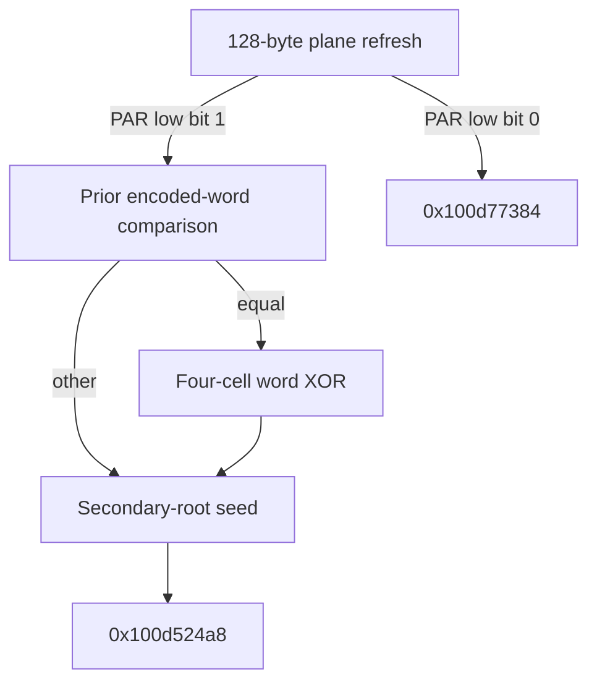

# Conditional word XOR, plane refresh and secondary-root entry

The201-instruction comparison-equal path reduces to a32-bit XOR on four plane0 cells: `W_after=W_before XOR u32((S16+0x8cca81ed)<<3)`. Its control rejoins the comparison-other path at a29-instruction seed continuation. The alternate2171-instruction route refreshes both64-byte planes and selects a parity-specific comparison entry. The seed consumes the previously saved F+0x750 root,restores X27=F+0xc80 and materializes divisor962. These private contracts do not establish whole-algorithm identity,native output or daemon/kext pairing. [WR1-WR8]

Evidence: [source and authenticated edges](triage_evidence/daemon_mode_one_word_xor_plane_refresh_source.json.zst), [proofs and state ledgers](triage_evidence/daemon_mode_one_word_xor_plane_refresh_checks.json.zst), [extractor](triage_evidence/recover_daemon_mode_one_word_xor_plane_refresh.py), [validator](triage_evidence/validate_daemon_mode_one_word_xor_plane_refresh.py), [preservation](triage_evidence/daemon_mode_one_word_xor_plane_refresh_delivery.json), [quality gates](triage_evidence/daemon_mode_one_word_xor_plane_refresh_quality_gates.json), [sealer](triage_evidence/seal_daemon_mode_one_word_xor_plane_refresh.py), [publication audit](triage_evidence/verify_daemon_mode_one_word_xor_plane_refresh_publication.py). Context: [parity-state interfaces](daemon_mode_one_parity_state_adapters_report.md), [F750 producer and prior workspace passes](daemon_mode_one_workspace_passes_report.md), [state-plane installation](daemon_mode_one_workspace_state_install_report.md), [arithmetic/codec suite](daemon_mode_one_nibble_operation_suite_report.md), [interface ABI](interface_abi_report.md).

| Evidence | Verified scope |
| --- | --- |
| Image | `fairplayd.arm64e`,SHA-256 `4ffe3ea1dbd27c5026b448ffe06e8489b02cd9064500bcc67792d4ac36ffb63e` |
| Current source | Three complete BRAA-terminated ranges;2,401 instructions /9,604 B;2,398 nonbranch sites translated |
| Prior source | Ten recaptured ranges /7,832 B;217 fresh setup/skip nonbranch sites |
| Dispatch provenance | Four authenticated records /four source slot-modifier bindings |
| ISA checks | Two bitfield encodings,two register-LSR encodings;zero SP writes |
| Accepted results |48 UNSAT /six abstract SAT;39 predecessor queries replayed |
| Address composition | Two arbitrary-input source-slice lemmas,two exact value cuts,four normalized refresh stores and one normalized byte read |
| Word operation | Four byte reads/writes;universal32-bit XOR-mask equation and shift counts0/24 |
| Refresh |128 distinct byte destinations,two u32 scalar stores;two specified samples differ in127 byte cells |
| Entry | One saved secondary-root load;F+0x6c8=962;known next-entry registers and target |
| Integrity | Eight source/control/bitfield/shift/lineage/SP/native alterations rejected |

F denotes the private frame. All offsets/extents are bytes;code addresses refer to the pinned image. Arithmetic is modular u32/u64 unless explicitly stated. Valid coherent nonwrapping mappings,stable saved roots and no outside mutation remain premises. The phase-selected scalar/register contracts are inherited component interfaces rather than public APIs or demonstrated native iterations. No target execution/emulation,target API/IPC request,IDA access,IDB mutation or hardware PAC test occurred. [WR1-WR4,WR7]

Retain the private coordinate:

```text
C(j) = F+0x8b0+((799*j)mod962)
plane0 = C(0..63)
plane1 = C(593..656)
```



## Four-cell word operation

The preceding comparison's equal edge selects `0x100ce305c`. Its required inputs include W8=0x4d20,W20=0xd6,W23=0xb3,X21=F+0x8b0 and arbitrary u32 S16 in W16. The routine reads and writes

| Numerical byte role | Coordinate | Frame offset |
| --- | --- | --- |
| B0,bits0..7 |C(63) |F+0x9e9 |
| B1,bits8..15 |C(62) |F+0xa8c |
| B2,bits16..23 |C(61) |F+0xb2f |
| B3,bits24..31 |C(60) |F+0xbd2 |

The fourth load at `0x100ce3334` uses a computed X21-relative address. The complete original source proves that it equals F+0xbd2 for every S16 and arbitrary input bytes. A second model normalizes that read to the actual private cell and proves coherent byte forwarding. The four cells are spatially separate;W below is their numerical packing,not a contiguous native u32 memory load. [WR2-WR4]

```text
W = B0+2^8*B1+2^16*B2+2^24*B3
M = u32((S16+0x8cca81ed)<<3)
W_after = W XOR M
```

The source's large carry/bit-mask expression produces an intermediate T with `T XOR0xe61505d8=M`. Its two register-dependent logical shifts have exact counts0 and24. The apparently distinct byte conversions and constants cancel to the byte slices of that same M;all four store values are proved universally for arbitrary u8 B0..B3. No guessed cipher or address-mask decoder replaces the original value computation. [WR3,WR4]

For a fixed S16,this word transformation is involutive and preserves W's low three bits. The component permits2^29 masks,each with eight u32 scalar preimages,because multiplication by8 modulo2^32 discards three high bits. Actual source-state correlations may restrict S16. These algebraic properties establish neither native input entropy nor a control-flow cycle with the same scalar restored. [WR4,WR5]

The routine writes no scalar frame slot. At BRAA `0x100ce337c`,modifier0x1aad,it selects slot0x4d20 -> `0x100c03f6c`,the same seed entry selected by the preceding comparison's other edge. W9=0x4923 supplies the seed's control input. Thus this branch conditionally updates one represented word before the paths merge. [WR2-WR4]

## Full two-plane refresh

The alternate setup-flag1 route selects `0x100c62f48`. Fresh translation of the predecessor's setup+skip fragments supplies W13=0x4923,W19=0x4a62f57c,W27=0x2dd9b66a,W20=0xd6,W7=0xb4,X6=TABLE and X21=F+0x8b0. The flag1 edge and caller constants are checked together. Later native reachability of that edge remains unproved. Other scalar inputs and the frame words at F+0x728,F+0x6f8,F+0x4b4,F+0x4a4 are independent component inputs. [WR2,WR3,WR5]

The2,171-instruction refresh loads no bytes. It writes128 distinct bytes,of which124 destinations are literal SP offsets. Four computed destinations require these exact addresses:

| Store site | Destination | Proof |
| --- | --- | --- |
| `0x100c63f7c` |F+0xa04 | Arbitrary-input masked-complement slice,offset0x154 |
| `0x100c6448c` |F+0x903 | Arbitrary-input masked-complement slice,offset0x53 |
| `0x100c64630` |F+0x9a4 | Complete source address proof |
| `0x100c648cc` |F+0xa09 | Complete source address proof |

The first exact address follows from the original slice at `0x100c63f38`..`0x100c63f58`,for arbitrary u32 x:

```text
((x+0xe5) AND0x154)+((0x11a-x) AND0x154) = 0x154
```

The two masked values complement one another in the selected low bits because0xe5+0x11a=0x1ff. Their actual64-bit sum is0x154. The second original slice,starting at `0x100c64428` and ending at `0x100c64488`,proves

```text
u32(((x+0x147b2eb5) AND0x134272d9)
    +((0x0b84d14a-x) AND0x134272d9)+0xecbd8d7a) = 0x53
```

Here the two biases sum to0x1fffffff;the masked sum plus the final bias wraps as the original u32 operation. Both slice lemmas quantify over an unrestricted32-bit x. Their actual live input expressions are recorded before the corresponding instruction ranges. Only the proved results are substituted at their original source sites. The complete four-address query then succeeds,and a separate coherent model normalizes all four stores and rechecks the original expressions and every frame effect address. These are two explicit proved value cuts,not a claim that the unsplit original query passed. [WR3,WR4]

The unsplit full refresh address query and the first/second individual full-source queries returned `unknown` at15,000 ms and are excluded from accepted certificates. An initial repeat of a historical certificate also failed strict expected-output matching;its cause is unknown and that attempt supplied no accepted certificate. The subsequent full replay reproduced all39 historical results. Only passing queries/results are in the published proof ledger. [WR3]

All128 byte destinations are exactly C(0..63) and C(593..656). The source additionally stores u32 state at F+0x720 (`0x100c64e5c`) and F+0x728 (`0x100c65090`). There are no other store effects in this continuation. Two fully specified abstract component valuations differ in127 destination byte values. The remaining cell's equal values in those two samples do not prove it constant. No statistical independence,decoded recurrence or native sample reachability is inferred. [WR3-WR5]

## Refresh handoff and table-lifetime limit

The saved private word PAR at F+0x4b4 selects

```text
PAR low bit0 -> slot0x1e11 -> 0x100d77384
PAR low bit1 -> slot0x1e31 -> 0x100c55454
```

BRAA at `0x100c65130` uses modifier0xe346. The odd target is the preceding report's encoded-word comparison. The full outgoing refresh contract establishes W8=0x4d20,W13=0x4923,W2=0x4a62f57c,W10=u32(0x4a62f57c+A),W16=word32(F+0x4a4),W4=799,W23=0xb3,W7=0x883fddf1,W20=0xd6 and X21=F+0x8b0,where A is incoming W22. These are the control/value bindings required by that comparison and the word path. PAR's identity as a native iteration count remains unknown. The even target's body is not translated in this increment. [WR2-WR5]

Neither this refresh nor the four-byte word operation writes any of the800 SUM/CARRY/XOR/numeric-codec cells. Their current write sets are confined to the128 plane cells and the stated scalar slots. This preserves whatever arithmetic-cell state exists on entry;it does not establish that the earlier data-dependent bit7 update left every arithmetic/codec value intact. That producer-correlation question remains open. [WR4,WR5]

## Padding hypothesis,not algorithm identification

The64-byte plane,the preceding conditional bit7 update and this word at coordinates60..63 form a padding-shaped pattern. The2015 [FIPS180-4 publication](https://nvlpubs.nist.gov/nistpubs/FIPS/NIST.FIPS.180-4.pdf),DOI10.6028/NIST.FIPS.180-4,Secs.3.1,5.1.1 and5.2.1 defines512-bit blocks,a one-bit marker,zero fill and a64-bit bit-length suffix for SHA-1/SHA-224/SHA-256,using big-endian words.

If `Nbytes=u32(S16+0x8cca81ed)`,the proved mask is `u32(8*Nbytes)`. Its byte roles agree with the low32-bit word of a big-endian length suffix when coordinate order is interpreted as message-byte order. That interpretation is an explicit hypothesis: Nbytes must be established as a byte count,the earlier mutation must address the intended marker position,the plane representation must support that marker interpretation,and zero-fill/high32-bit length handling must be corroborated. Those facts remain unknown. This pattern neither selects one algorithm nor proves a conforming padding implementation. [WR5,WR8]

## Secondary-root entry

The29-instruction merged continuation at `0x100c03f6c` reads the saved root at F+0x750 into X27 at `0x100c03fd0`. The earlier producer at `0x100b0c100` established F+0x750=F+0xc80;its root-epoch certificate is replayed,and preservation through the intervening selected stages remains the inherited context. This is the first consumption after the previously reported unconsumed-root frontier. Native owner and accessible extent remain unknown. [WR1,WR2,WR4,WR6]

The seed materializes these frame words:

```text
F+0x6cc : u32 0x1f61
F+0x6c4 : u32 0x8b7a81df
F+0x6c8 : u32 962
```

Its known outgoing registers are X27=F+0xc80,X21=F+0x8b0,W0=0xac9f729d,W3=0,W15=0,W4=799,W14=0xf1,W16=962,W19=word32(F+0x728),W30=word32(F+0x720). W7 is inherited rather than assigned a new constant by this seed. At BRAA `0x100c03fdc`,modifier0xcf0c,slot0x1f73 selects `0x100d524a8`. The newly loaded root and exact divisor are an internal continuation interface;the next routine's transformation remains unproved here. [WR2-WR4,WR6]

The roots differ by0xc80-0x8b0=976 B. The secondary root starts14 B after the half-open962-byte primary domain ends. That geometry identifies separate starting locations;it establishes no extent or disjointness for the complete secondary view. X0 is overwritten with a numeric state word in the seed,while the earlier phase-specific X0 value saved at F+0x380 is preserved. [WR4,WR6]

Across these three source ranges there are16 loads /76 B and137 stores /152 B:132 u8 stores and five u32 stores. Their static destination union is148 B;the word operation's four cells are a subset of the refresh planes. These are source-effect totals across the selected ranges,not a native execution-frequency measurement. All296 workspace bytes and the saved LOCAL/request/root slots are preserved. No LOCAL pointee is dereferenced. Zero Mach-port emissions occur in these ranges;their control transfers are the four recorded private BRAA bindings. [WR2-WR7]

## Assumption register and bounded continuation

| Assumption | Dependent result | Stress test or falsification probe |
| --- | --- | --- |
| WR1 | Pinned image and selected-path lineage identify this build | Rehash image;recapture source/fixup bytes and ten prior ranges;reject source/lineage alterations |
| WR2 | Recorded comparison/caller/root contracts compose at these entries | Replay39 prior queries;translate217 caller sites;prove flag1 caller control,target and constants;keep native reachability conditional |
| WR3 | Source SSA,bitfield/register-shift and local lemmas match machine operations | Cover2,398 new sites;decode relevant encodings;prove arbitrary-input slices with actual bindings;reject unknown/errors/mismatched results |
| WR4 | Valid coherent nonwrapping mappings and stable private memory | Prove all read/store addresses,byte forwarding,148-byte union and preserved sets;retain inherited saved-root premise |
| WR5 | Free component words/bytes overapproximate the actual correlated state | Prove word XOR for every scalar/byte input;retain two explicit refresh valuations;do not infer native distributions or previous-table validity |
| WR6 | Roots,registers and saved slots have phase-specific roles | Track F750's producer/load,X27's value,X0's numeric replacement and preserved F380;leave secondary-view extent/owner unknown |
| WR7 | Authenticated records support static targets,not native PAC success or IPC | Compare four original slot/modifier records;reject changed targets,SP writes and invented execution claims |
| WR8 | This is a bounded increment of the continuing cross-layer investigation | Keep the next dual-root body,even comparison,producer correlations,whole algorithm,native ownership/output and daemon/kext linkage open |

High impact: test the padding hypothesis by proving the biased scalar's byte-count identity,marker coordinate,coordinate/message order,zero-fill and complete length suffix;test the final-block branch around the56-byte boundary only after establishing that message-byte model. High impact: follow `0x100d524a8` with the primary/secondary roots and exact divisor962;establish its table reads,word stores and loop interface. High impact: recover the earlier coordinate-word correlations needed to carry numeric table contracts past the bit7 update. Medium impact: follow `0x100d77384` and compare its precise incoming state with the established odd comparison. Medium impact: decode the refresh's scalar recurrence and the actual relationship between the two refreshed planes. Low impact: use the proved word-mask equation to simplify later symbolic models while retaining the scalar's entry definition. [WR5-WR8]

Capture/hash work is O(B+I+D) for image bytes B,instructions I and dependency bytes D. Fixed source fragments translate in O(I) steps. The compact word transformation uses a fixed number of u32 operations/four byte cells;SMT solving has no claimed linear runtime bound. Byte counts,root differences and modular equations above use exact integer values.

QG1: No normative judgment is required. QG2: WR1-WR8 enumerate premises,dependent claims and falsification probes. QG3: Routine roles,compact value semantics,control/data flow,root interfaces,environment and IPC limits are covered for this increment;the complete objective remains active. QG4: Scalar widths,mask shifts,byte totals,source counts and root geometry are mechanically checked. QG5: Proved cuts,native-entry limits,sample properties,current write-set preservation and earlier arithmetic-table uncertainty are explicit. QG6: Claims are pinned to executable/fixup bytes,fresh source/caller translations and accepted certificates. QG7: Impact-ranked continuation opportunities and unresolved boundaries are bounded above. Gates apply to this increment;native success and the complete cross-layer objective remain unproved.

## Secondary word import follow-up

The previously untranslated seed target0x100d524a8 now has a four-iteration import contract:128 plane bytes read once,64 scattered u32 words written,and exact post-import slot1ef1 to0x100c503c8. Numeric word transforms remain unknown. See [secondary word import and post-import handoff](daemon_mode_one_secondary_word_import_report.md).
