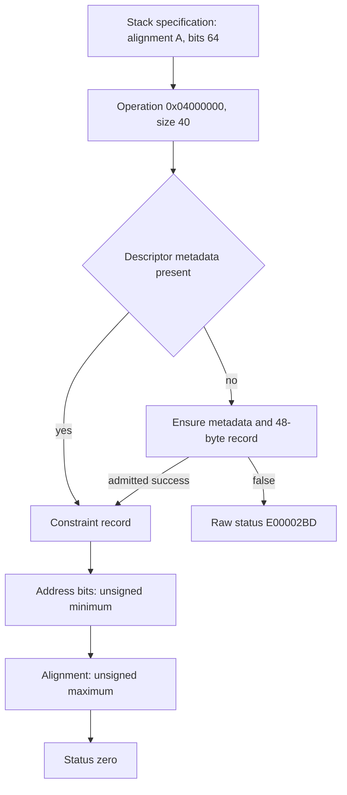

# DMA mapping specification: constraint updates and lazy metadata construction

The constructor's operation `0x04000000` passes a 40-byte specification containing its full64 alignment, a null device pointer, zero options, address-bit value 64 and zero reserved fields. Original `IOGeneralMemoryDescriptor::dmaCommandOperation` selects a metadata update: the stored alignment becomes the unsigned maximum of its previous value and the request; the stored address-bit limit becomes the unsigned minimum. The fixed operation/size has a conservative 61-instruction graph with one lazy-helper call boundary and no other calls. Its eight store instructions comprise six private-frame saves and two possible constraint updates. [DM1-DM6]

The 117-instruction unnamed helper at `0xfffffe000c536f94` ensures and initializes a 48-byte metadata record beneath descriptor +0x90, using a second unnamed creator at `0xfffffe000c537394`. Source recovers their reserve, capacity, append and initialization interfaces. Their lower heap, metaclass, readiness and reference effects remain contracts. This closes the direct fast-path effects of the intermediate DMA operation identified by the preceding constructor report; it does not prove complete constructor noninterference or native mapping. [DM3-DM8]

Evidence: [original source, graph and SDK context](triage_evidence/dma_map_constraints_source.json.zst), [source equations and certificates](triage_evidence/dma_map_constraints_checks.json.zst), [extractor](triage_evidence/recover_dma_map_constraints.py), [validator](triage_evidence/validate_dma_map_constraints.py), [preservation audit](triage_evidence/dma_map_constraints_delivery.json), [quality gates](triage_evidence/dma_map_constraints_quality_gates.json), [sealer](triage_evidence/seal_dma_map_constraints.py), [publication audit](triage_evidence/verify_dma_map_constraints_publication.py). Context: [buffer construction](buffer_construction_flow_report.md), [factory/getter/cleanup](kext_buffer_report.md), [inner staging/write frontier](inner_write_frontier_report.md), [hardware-AES handoff](kext_aes_handoff_report.md), [interface index](interface_abi_report.md).



The graph admits ordinary returning helper calls and valid memory/root epochs. No target instructions, emulator, allocator, descriptor method, mapper, hardware operation, IPC or IDB mutation execute. An installed-SDK probe performs syntax-only compilation. Source files suffice; no new IDA access is used. [DM1-DM8]

## Provenance and exact coverage

| Evidence | Verified scope |
| --- | --- |
| Normalized kext SHA-256 | `2ec5e76ffc0a1873d284cbc50846b63f3576df2e5af98738df81faae33954a2c` |
| Kernel collection SHA-256 | `d5f0b4d49520744ebcd777a66be7ff69225a8ef2879773340854eab0b1370afe` |
| Complete captured bodies | 4 functions, 1221 instructions, 4884 B |
| Component equations | 33 fragments, 127 distinct instructions, 508 B |
| Selected method graph | 61 instruction sites, 65 edges, one helper frontier, eight store instructions, one return |
| Graph selection | Three branch overrides, each tied to a fresh original-source certificate |
| Accepted checks | 44 UNSAT, no SAT controls; one predecessor proposition replayed; six altered-evidence rejection checks |
| SDK layout/status corroboration | Syntax-only arm64e compilation exit 0; primary header hashes and excerpts retained |

The complete DMA-operation and buffer-initializer bodies match the preceding source capture. Original descriptor vptr +0x150, slot `0xfffffe0007f85ed0`, binds exact `IOGeneralMemoryDescriptor::dmaCommandOperation(unsigned int,void *,unsigned int) const` at `0xfffffe000c5365e8`, with original authenticated format-8 chain membership and diversity 0xa8a7. Live class identity and authentication remain premises. The SDK version is recorded with its header/compiler hashes; its terminology is corroboration, separate from the original instruction-derived offsets and behavior. [DM1-DM2,DM5]

## Exact 40-byte constructor specification

Let S be the constructor's current frame base and Q=S+0x28. Source `MOVI V0.2D,0; STP Q0,Q0,[SP+0x30]` writes 32 zero bytes at Q+[8,40). A full64 alignment store supplies Q+[0,8). Under the preceding physical-mask-zero proof, the bit-selection branch chooses literal 64, stored at Q+0x14. The fresh byte-store join proves all 40 bytes, including the vector lanes and the later byte overwrite. [DM2-DM5]

| Q offset / width | Original source value | Installed `IODMAMapSpecification` field |
| --- | --- | --- |
| +0x00 / 8 B | Requested alignment A | `alignment` |
| +0x08 / 8 B | 0 | `device` |
| +0x10 / 4 B | 0 | `options` |
| +0x14 / 1 B | 64 | `numAddressBits` |
| +0x15 / 3 B | 0 | `resvA` |
| +0x18 / 16 B | 0 | `resvB` |

The compile-only probe checks size 40, every listed offset and relevant member widths. The constructor call at `0xfffffe000c5250e8` has X0=descriptor B, W1=0x04000000, X2=Q and W3=40. A is the previously recovered runtime alignment argument; this increment does not assign its actual runtime value or native acceptability. The request is a mapping specification, with field names corroborated by the installed primary header; the public header does not assign a symbolic name to this numeric operation. [DM1-DM2,DM5,DM8]

## Selected control graph and status channels

Original selector arithmetic computes `(operation-0x01000000)>>24`, yielding 3 for this operation. The original signed-greater branch at `0xfffffe000c536628` and equality branch at `0xfffffe000c536684` therefore select case 3. The unsigned size branch at `0xfffffe000c536710` admits the exact 40-byte request. These are the three graph overrides; every remaining reachable condition admits both edges. The resulting graph is acyclic when the sole helper call is represented by an ordinary-return frontier. Acyclicity does not prove that a native callee returns or that a fault cannot occur. [DM2,DM4-DM6]

| Source boundary | Established contract |
| --- | --- |
| Size below 40, case entry | Raw W19=0xe00002e7 reaches the return suffix; the installed SDK names this value `kIOReturnUnderrun` |
| Metadata load `0xfffffe000c536714` | Read u64[B+0x90]; nonnull proceeds to its +0x10 data pointer |
| Metadata absent | Call helper `0xfffffe000c536f94` with X0=B, X1=48 B, W2=1, at `0xfffffe000c5368dc` |
| Helper low32 result zero | Raw W19=0xe00002bd; installed SDK name `kIOReturnNoMemory` |
| Helper result nonzero | Reload B+0x90; nonnull reenters the constraint block |
| Reloaded metadata null after nonzero helper result | Original conservative graph selects status zero without the constraint block; actual reachability requires a separate helper/epoch argument |
| Fast constraint completion | W19=0 |
| Return site `0xfffffe000c536f10` | X0 receives the zero-extended W19 status on these paths |

The selected fixed-size graph excludes the short-size outcome; that outcome comes from the separate original case-entry guard. The helper result, reloaded metadata pointer, method status and constructor's subsequent success test are distinct channels. No naturally reached nonzero-result/null-metadata state is asserted. [DM3-DM6,DM8]

## Exact constraint merge

Let M=u64[B+0x90] and D=u64[M+0x10]. For a valid current D and disjoint, stable specification Q:

```text
new_bits8     = unsigned_min(old_u8[D+0x2c], u8[Q+0x14])
new_alignment = unsigned_max(old_u64[D+8], u64[Q])
```

The bit-limit comparison at `0xfffffe000c536728` skips its byte store when the request is greater than or equal to the existing limit. Otherwise `0xfffffe000c536730` writes one byte at D+0x2c. The alignment comparison at `0xfffffe000c53673c` skips when the request is less than or equal to the existing value. Otherwise `0xfffffe000c536748` writes the full64 requested value at D+8. No arithmetic addition or truncation is used in these updates. [DM2-DM5]

The updates never decrease alignment or increase the address-bit limit. Sequential repeated application is idempotent. Two specifications commute under the same record/request epochs: their resulting alignment is the maximum of all three alignment values, and their resulting bit limit the minimum of all three byte values. This is an algebraic composition property, not a concurrency or serialization guarantee. The fixed FairPlay bit request 64 preserves any preexisting limit <=64. [DM3-DM6]

Under disjointness of the 48-byte D record and 232-byte descriptor B, the two explicit metadata stores exclude B+0x50 length, B+0x60 range pointer, B+0xb8 backing pointer, B+0xc0 capacity and byte B+0xe0. The six remaining selected-method stores save registers in its private 160-byte frame. This establishes direct fast-path field noninterference under the declared frame/object extents. Effects of the lazy helper and its lower calls remain separately bounded. [DM3-DM4,DM6-DM7]

## Recovered roles of the unnamed helpers

| Original address | Source-established role | Boundary |
| --- | --- | --- |
| `0xfffffe000c536f94`, 117 instructions | Ensure descriptor metadata, reset its used length and initialize a 48-byte constraint record. X0 is descriptor, X1 requested reserve bytes, X2 mapper/context selector. | No exact matching symbol; heap, creator, release, resize and readiness calls retain explicit contracts. |
| `0xfffffe000c537394`, 58 instructions | Obtain a metadata object through a runtime metaclass, ensure its reserved data buffer, reset used bytes to zero, and return object or null on the captured failure path. | Exact class identity and live metaclass vptr remain unknown. The source metaclass instance is at `0xfffffe000cb53030`; its initialized runtime vptr is not an original chained-pointer binding. |

The helper reads descriptor B+0x90 as metadata owner M. Accessed owner fields are data pointer M+0x10, used bytes M+0x18 and reserved capacity M+0x20, each 64 bits. These accesses require at least 40 B of valid owner storage; they do not establish an actual allocation size or complete class layout. The helper has 18 syntactic stores and six calls; its creator has seven stores and four calls, including private-frame and lower-boundary effects. [DM1,DM3-DM4,DM6-DM7]

For the source reserve of 48 B, the helper's upper32 size guard passes. With existing data, `48-1 < capacity` selects reuse exactly when capacity>=48. Other captured branches retire/reset the old data view or request new storage. The raw data allocation boundary `0xfffffe000bcfe5b8` receives selector `0xfffffe0007f94f99`, requested reserve bytes, flags 0x31004 and X3=0. The code checks its returned pointer before publishing the reserve capacity. The exact lower function symbol and native allocation/retirement effects are not assigned here. [DM2-DM5,DM7]

If owner metadata is absent, the helper forwards the requested reserve to the creator, later publishes its result at B+0x90 and tests it for null. The creator uses runtime metaclass virtual +0xa8 and the same raw data-allocation request; on the admitted successful branch, it returns M with data pointer, reserve capacity and used=0. The helper resets used bytes and calculates the 48-byte record length with a checked addition. A valid fresh data buffer with capacity 48 and used 0 fits this first record without the resize boundary. [DM2-DM4,DM7]

The retained resize path at `0xfffffe000c5370d0` receives the same heap selector, old data pointer, old capacity, new used+48 size, flags 0x31004 and X5=0. Source records its successful publication to owner data/capacity/used fields; the lower operation, failures and complete helper paths remain unproved. This increment does not replace any lower call by an empty summary. [DM3-DM4,DM6-DM7]

Selector X2=1 chooses the original `IOMapper::gSystem` snapshot for the record's first qword, with readiness helper `0xfffffe000c52bb84` and reload when the source's low-bit test requests it. Other selector values are carried as the first-qword context. Actual mapper readiness, object identity, synchronization and lifetime remain unknown. [DM2-DM4,DM7]

## Partial metadata initialization and FairPlay specialization

The helper's final source writes initialize the current record as follows:

| D offset / extent | Source publication |
| --- | --- |
| +0x00..+0x07 | Full64 mapper/context value |
| +0x08..+0x17 | 16 zero bytes |
| +0x18..+0x1f | No direct initialization in this suffix |
| +0x20..+0x27 | Eight zero bytes |
| +0x28..+0x2b | Four zero bytes |
| +0x2c | Address-bit limit 64 |
| +0x2d | Old byte AND 0xfc; clear low two bits, preserve upper six |
| +0x2e..+0x2f | No direct initialization in this suffix |

The exact byte-store join covers all 48 positions. It identifies 38 touched bytes: 37 fully defined independently of old record contents, plus one partially preserved state byte. Ten whole bytes are unwritten by this suffix. Underlying allocation zeroing, previous record contents and the meaning of those unwritten fields remain separate questions; no native uninitialized-use claim follows. [DM3-DM5,DM7-DM8]

For the constructor's alignment A and 64-bit address request, a valid freshly initialized record therefore finishes with alignment A and address-bit limit 64. An existing lower bit limit is preserved rather than widened. This source specialization and the fast-path noninterference theorem reduce the earlier DMA-operation uncertainty. They leave lower allocation/reference effects, lazy-path aliasing, actual backing capacity, constructor completeness and native preparation balance unproved. No new incoming/outgoing Mach right or emission site is established. [DM3-DM8]

## Assumption register

| ID | Assumption and dependent results | Stress test or falsification probe |
| --- | --- | --- |
| DM1 | Pinned kext/KC, original compiler bounds and authenticated slot identify this build. | Rehash images; compare two shared complete bodies to the preceding capture; verify the original slot's chain membership, target, diversity and exact symbol. |
| DM2 | Literal operation 0x04000000, size 40, constructor alignment/mask cuts and stated register/field epochs reach each component. | Prove three original branch overrides, all supplied-read addresses and all 40 request bytes; replay the physical-mask-zero/alignment proposition. Preserve other conditions as conservative edges. |
| DM3 | Specification, descriptor, private frames, owner and 48-byte data record have valid/disjoint extents and stable contents over each merge. | Check min/max widths, exact store offsets, byte joins and disjointness against five protected descriptor fields. Reestablish aliases after each helper boundary. |
| DM4 | Calls return ordinarily and preserve their declared ABI; native memory accesses and authentication succeed where needed. | Retain heap, metaclass, retirement, resize and mapper-readiness frontiers. An acyclic caller graph does not prove a native return, successful allocation or lower noninterference. |
| DM5 | A64 widths, unsigned conditions, vector-zero lowering, little-endian stores and source SSA are correct. | Retain 127 source sites, 44 UNSAT certificates, all 40/48 byte positions and six altered-evidence rejection checks. Reject errors, stderr, timeout and unknown. |
| DM6 | The closed method graph is restricted to the selected operation/size and ordinary-return frontier. | Rebuild its 61 nodes/65 edges, check acyclicity, the one call, eight stores and one return. Full helper, other operations and native exceptional control remain separate. |
| DM7 | Allocation reserve, record initialization, mapper context and owner lifetimes require independent lower contracts. | Trace 18 helper/seven creator stores, reserve/used/capacity publications, ten unwritten bytes, partial state preservation and runtime metaclass identity. No native capacity or zeroing is supplied. |
| DM8 | Installed SDK labels, mathematical composition and static paths are distinct from native observations. | Keep SDK/header hashes and syntax-only outcome separate from the original private layout; keep all target/API/IPC/IDB and native-transfer flags false. |

## Bounded continuation

| Impact | Next evidence | Question resolved |
| --- | --- | --- |
| High | Close the metadata helper's heap, resize, creator and reference effects under actual owner epochs | Full lazy-path noninterference with buffer construction |
| High | Recover allocation/cache zeroing and users of the ten unwritten bytes/state bits | Actual initialization and ownership requirements of the private constraint record |
| High | Join construction, two initialization preparation sites, provider prepare/complete and descriptor free | Native lifetime accounting and cleanup/unwind prerequisites |
| High | Bound CCC7848 copy ranges and actual backing against private header/frame objects | Remaining interference obligations for the exact zero-delta condition |
| Medium | Identify the runtime metaclass behind instance `0xfffffe000cb53030` and its allocation extent | Concrete private metadata class and construction provenance |
| Medium | Use the max/min composition laws across later specification callers | Compact data-flow recovery under explicitly stable record epochs |
| Medium | Follow mapper/readiness consumers and original downstream DMA operations | How these constraints affect mapping and the deeper accelerator interface |

## Scoped quality gates

- QG1: Factual source, layout, graph, ABI and proof-boundary claims require no normative conclusion.
- QG2: DM1-DM8 identify assumptions, dependent results and falsification probes.
- QG3: Request packing, exact field merge, selected graph/statuses, helper/creator roles, reserve/length/resize interfaces, partial initialization and protected-field implications are covered. The overall interface goal remains active.
- QG4: 1221*4=4884 B; 127*4=508 B selected source. Specification size 40 B; private record 48 B; 38 touched+10 unwritten=48 B. Of touched bytes, 37 are fully source-defined and one preserves six old bits. Offsets, counts and unsigned widths are explicit. Extraction/census and graph analysis take O(B+I+N+V+E) time/space for consumed bytes B, instructions I, symbol entries N and graph V/E; retained equation/byte-join work is bounded by listed stores and fields. General SMT/compiler complexity is separate; query limits are 45000 ms/50 s.
- QG5: Public SDK request layout/private record layout, minimum accessed/actual allocated extent, direct/lower-call effects, source status/native outcome, touched/fully defined bytes, algebraic commutativity/concurrent serialization and fixed-operation/all-operation coverage remain distinct.
- QG6: Original hashes, compiler envelopes, raw code/chain words, exact method/global symbols, SDK layout/status probe, 44 accepted UNSAT certificates, predecessor replay and six freshness alterations provide scoped provenance.
- QG7: Continuation targets exact allocator, metadata-class, initialization, lifetime, staging-bound and downstream-mapper obligations without treating constraint updates as native mapping or successful hardware transfer.

The allocator for the identified 40-byte owner explicitly zeros its data pointer, capacity and used fields, establishing the fresh creator branch under stable fields. The separate 48-byte backing request does not establish zeroing for bytes left open by the record initializer. See [mixed-data owner lifecycle](mixed_data_lifecycle_report.md).
