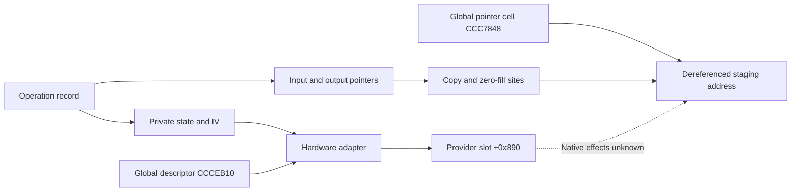

# Inner write frontier, copy/fill roles and hardware-buffer interface

The 1015-instruction inner routine at `0xfffffe000a687ee0` has 40 direct store instructions and 15 calls. This increment resolves all 14 nominal indirect call selections: ten calls reach `_kernel_memcpy`, two reach a local fill primitive, one reaches `_initKernelAESHW`, and one reaches `_performHWAESOnGlobalBuffer`. The remaining direct call binds to the kernel stack-canary failure routine. Thirty-six stores address the routine's private frame; the four others update two controller globals, restore the private header, and publish a 32-bit record status. Full header preservation and actual zero stack deltas remain unknown. [IW1-IW8]

The data-flow join is more specific than the routine names: a reused frame cell receives the address of global `0xfffffe000ccc7848`, then later copy/fill calls dereference that global. The retained cold-initialization evidence publishes an output of descriptor virtual slot +0x308 there. The hardware adapter separately passes the same global descriptor as both provider buffer arguments, truncating the requested count to 32 bits. This establishes a conditional software interface between the local staging operations and the accelerator route; native mapping, ownership, serialization and provider effects remain unproved. [IW2-IW4,IW7]

Evidence: [original source and complete inventories](triage_evidence/inner_write_frontier_source.json.zst), [source equations and certificates](triage_evidence/inner_write_frontier_checks.json.zst), [extractor](triage_evidence/recover_inner_write_frontier.py), [validator](triage_evidence/validate_inner_write_frontier.py), [preservation audit](triage_evidence/inner_write_frontier_delivery.json), [quality gates](triage_evidence/inner_write_frontier_quality_gates.json), [sealer](triage_evidence/seal_inner_write_frontier.py), [publication audit](triage_evidence/verify_inner_write_frontier_publication.py). Context: [private stack-delta ABI](core_stack_delta_abi_report.md), [context/task flow](context_descriptor_task_flow_report.md), [cold initialization](kext_cold_init_report.md), [hardware-AES handoff](kext_aes_handoff_report.md), [interface index](interface_abi_report.md).

This is static source, pointer-chain, control-graph and SMT analysis. No target instructions, emulator, FairPlay request, accelerator operation, IPC, IDB mutation or memory update execute. The associated files and retained captures suffice; no new IDA access is needed. [IW1,IW8]

## Source and verification boundaries

| Evidence | Coverage |
| --- | --- |
| Normalized kext SHA-256 | `2ec5e76ffc0a1873d284cbc50846b63f3576df2e5af98738df81faae33954a2c` |
| Kernel collection SHA-256 | `d5f0b4d49520744ebcd777a66be7ff69225a8ef2879773340854eab0b1370afe` |
| Complete captured bodies | Five compiler-bounded functions and two exact import stubs; 1255 instructions, 5020 B |
| Selected source equations | 23 fragments; 274 distinct instructions, 1096 B; 275 translated instruction instances |
| Dispatch evidence | Ten original byte arrays; 14 call selections and one global-root selection; 3840 exhaustive byte-input cases; 15 fresh source cuts |
| Fill analysis | Three loop-free symbolic branch trees, 24 terminal paths; separate count/loop/zero-pattern certificates |
| Accepted checks | 49 UNSAT, no SAT claims, two retained source propositions replayed, six altered-evidence rejection checks |
| Branch-sharing census | All 9230 aligned words of the kext's file-backed `__DATA_CONST`; 69 original chained entries share the eight jump diversities, including 47 targets outside the inner routine |

The complete inner and initializer bodies match the preceding source capture exactly. Full capture is distinct from complete semantic recovery. Nominal call targets below require their stated table and register/frame roots; they do not establish every reaching path, live PAC outcome or native receiver. The branch census describes original pointer entries, not observed or feasible edges. [IW1-IW3,IW6]

## All call sites and their local arguments

Here R is the operation record, P is its parameter pointer, S is the inner routine's fixed-frame SP, and `FP=S+0x1b0`. `F[o]` denotes u64 at S+o. Initial source loads read P=u64[R], input=u64[R+0x10], output=u64[R+0x20], plus a u32 field at R+0x18. These are separate roots, with validity and subsequent frame publications treated explicitly. [IW2-IW3]

| Call site | Resolved nominal callee | Destination or principal arguments |
| --- | --- | --- |
| `0xfffffe000a6881dc` | `_initKernelAESHW`, `0xfffffe000a508030` | Initializer; prior source audit rules out reading the incoming X1 before overwrite or early return |
| `0xfffffe000a68826c` | Fill primitive, `0xfffffe000a687d64` | X0=S+0x98, X1=0, X2=168 B |
| `0xfffffe000a688360` | `_kernel_memcpy`, `0xfffffe000a508cf4` | S+0x98 <- P+2, 16 B |
| `0xfffffe000a6883c0` | Same copy adapter | S+0xc0 <- P+0x39, 32 B |
| `0xfffffe000a688450` | Same copy adapter | S+0x98 <- P+2, 16 B, conditional on the local state-view root |
| `0xfffffe000a688510` | Same copy adapter | S+0xc0 <- P+0x39, 32 B |
| `0xfffffe000a68858c` | Same copy adapter | FP-0x70=S+0x140 <- P+0x12, 16 B |
| `0xfffffe000a688608` | Same copy adapter | X0=F[0x78], X1=F[0x68]; X2 is inherited at this local cut and remains unconstrained |
| `0xfffffe000a6887cc` | Fill primitive | X0=u64[F[0x80]], X1=0, X2=4096 B |
| `0xfffffe000a6889cc` | Copy adapter | X0=F[0x78]+X19, X1=F[0x68]+X19; X2=X22 after a 32-bit count calculation |
| `0xfffffe000a688ae4` | Copy adapter | X0=u64[F[0x80]]+zeroextend(W21); X1=F[0x68]+zeroextend(W11); X2=X19 |
| `0xfffffe000a688bc0` | `_performHWAESOnGlobalBuffer`, `0xfffffe000a508484` | X0=S+0x94 state, X1=S+0x140 IV, X2=X21, W3=u8[P] |
| `0xfffffe000a688ccc` | Copy adapter | X0=S+0x140, X1=X9+X8 at the selected local cut, X2=16 B |
| `0xfffffe000a688e80` | Copy adapter | X0=F[0x78]+zeroextend(W24); X1=u64[F[0x80]]+zeroextend(W21); X2=zeroextend(W8) from before the selector |
| `0xfffffe000a688eb8` | Import stub -> `___stack_chk_fail`, `0xfffffe000c629694` | Direct call reached by the captured canary mismatch branch; ordinary return is not assumed |

The ten copy selections all choose table index 0xf28. The two fill selections choose 0xeea; hardware initialization chooses 0xec5+0x7b=0xf40, and the hardware adapter chooses 0xf19+0x2d=0xf46. Original chained targets and authentication metadata bind these selections. Independent selector values may differ between visits; the byte-bank equalities hold universally. Saved bank roots and table epochs remain required. [IW1-IW2]

The two-instruction copy adapter branches to import stub `0xfffffe000a69f334`, whose original slot `0xfffffe000847c4c8` selects `0xfffffe000c647f10`. Both `_memcpy` and `_memmove` are exact kernel symbols at that address. The footprint `[dst,dst+n)` is retained as the external copy contract; this increment does not recover that kernel implementation or assert live copy behavior. The canary stub similarly binds through original slot `0xfffffe000847c478`. [IW1,IW4]

## Reused scratch cell and accelerator staging

At `0xfffffe000a688118`, a 32-bit control calculation is stored to S+0x80. At `0xfffffe000a688748`, a later full 64-bit publication stores `0xfffffe000ccc7848` to the same cell. These are the only two literal direct stores overlapping S+[0x80,0x88) in the captured body. The source proof binds the second publication through original pool slot `0xfffffe0008472700`, index 0x100, decoded pointer minus four. Treating the cell as one invariant type would conflate two phases. [IW2-IW3,IW7]

Under the later reaching publication, the 4096 B zero-fill destination and the later staging-copy destinations/sources dereference global CCC7848. In particular, the final copy's source is derived from this dereferenced cell, not directly from F[0x68]. The retained cold-initialization source records a descriptor virtual +0x308 output stored at CCC7848. Its exact method identity and output representation remain unknown; the new join establishes the address and dereference route without promoting it to native mapping or capacity proof. The observed 4096 B local fill count does not itself establish a 4096 B destination allocation. [IW2-IW4,IW7]

The complete 44-instruction hardware adapter loads provider global `0xfffffe000ccceb08` and descriptor global `0xfffffe000ccceb10`, then calls provider vtable slot +0x890. For incoming `(state,IV,count,mode)`, the source arguments at that call are:

| Provider argument | Source value |
| --- | --- |
| X0 | Provider global |
| X1, X2 | Same descriptor global |
| X3 | zeroextend(low32(count)) |
| X4 | Original IV pointer |
| W5 | mode XOR 1 |
| X6 | Original state pointer |
| X7 | 0 |
| Stack arguments | Three 64-bit zero words |

The state record begins at S+0x94; the private 168 B fill begins four bytes later. The IV occupies S+[0x140,0x150). These ranges fit below the header. Provider method effects, descriptor-to-staging correspondence, asynchronous activity and concurrent users remain separate obligations. An authenticated nominal slot does not identify the live receiver. [IW3-IW4,IW7]

## Fill primitive and direct-store footprints

The 90-instruction leaf at `0xfffffe000a687d64` has no calls and 22 syntactic store sites. Its only destination is the incoming X0, advanced by one or eight bytes at post-indexed stores; the final byte store has no writeback. Both selected callers set W1=0. The qword pattern is `zeroextend(W1)*0x0101010101010101`, hence zero for these callers. A general canonical `memset` return-value contract is not assigned: X0 is advanced by the body. [IW4-IW5]

For count N and destination d, the source alignment prefix has `p=min(N,(-d)&7)`. With `M=N-p`, the qword count is `q=M>>3`, the tail count is `r=M&7`, and a positive q enters a Duff-style loop with `c=(q+7)>>3` iterations. Its first pass writes `q mod 8` words, or eight when that residue is zero; each remaining pass writes eight. Three symbolic source branch trees prove the prefix, first-pass and tail counts for all residues 0..7. The arithmetic certificates prove p<=N, p<=7, positive loop count for q>0, exact qword count, and `p+8q+r=N`. Thus, on ordinary completion with valid nonwrapping destination memory, the zero-fill writes exactly `[d,d+N)`. No target execution is used. [IW4-IW5]

| Direct store class | Instructions | Header relationship |
| --- | --- | --- |
| Private frame | 36 | Every literal extent is contained in S+[0,0x1c0), excluding header H=S+0x1c0 under the admitted frame epoch |
| Controller globals | 2 | Stores at `0xfffffe000a687fe8` and `0xfffffe000a687fec`; retained source proof binds destinations to CCC7740 and CCC32f8 |
| Header restoration | 1 | `0xfffffe000a687ff8`, u64[H] += 0x100; restores the adapter's captured word before dispatch |
| Record status | 1 | `0xfffffe000a6887e4`, u32[X0+8]=W23; the recorded predecessor reloads X0 from S+0x28 |

There are only four explicit SP/FP write sites: reserve 0x1c0 B, establish FP=S+0x1b0, restore FP in the normal epilogue, and release 0x1c0 B immediately before RETAB. Calls must preserve the admitted frame, and control flow must reach these sites in the stated order. A syntactic census does not prove those premises. The original-record save and status-predecessor reload are source-proved locally; all reaching predecessors of the status block remain unresolved. [IW3,IW6]

Seven call destinations have bounded private-frame extents: one 168 B zero-fill and six 16/32 B copies. Their extents exclude H's low two bytes under the copy/fill contracts. Four other copies and one 4096 B fill use external or dereferenced destinations; their complete range/disjointness obligations remain open. The two accelerator-route calls require their own global/provider effect contracts. This reduces the write frontier without proving actual D=0. [IW3-IW4,IW7]

## Why authentication diversity does not close the graph

The inner body has 22 BRAA sites using eight literal diversities. Scanning the entire original file-backed kext `__DATA_CONST` yields:

| Diversity | Inner jump sites | Matching chained entries | Entries targeting outside this inner routine |
| --- | --- | --- | --- |
| 0x0678 | 5 | 12 | 7 |
| 0x9903 | 5 | 6 | 5 |
| 0xde10 | 1 | 8 | 6 |
| 0xc68a | 2 | 9 | 7 |
| 0x24d2 | 3 | 10 | 6 |
| 0x4bb5 | 3 | 10 | 6 |
| 0xf274 | 1 | 8 | 6 |
| 0x1927 | 2 | 6 | 4 |
| Total | 22 | 69 | 47 |

All 69 entries also have key selector 0 and address diversity disabled in the original format-8 chained word. Thus even matching those metadata fields does not uniquely delimit this routine. This is a source-level ambiguity result; it is not evidence that any external entry is reachable, that authentication can be bypassed, or that a native edge leaves the routine. Exact selected indices and their reaching state are still necessary. [IW1-IW2,IW6]

The preceding adapter theorem remains: `D=16*low16(final_header32-captured_word32)`. Entry restoration plus preservation of the header's low two bytes would imply D=0. This increment establishes many direct and callee footprints, but leaves external ranges, provider effects, global/frame aliases and all reaching dispatch states unresolved. No new incoming/outgoing Mach right or emission site is established; these addresses denote private records, globals, frames and provider interfaces. [IW3-IW4,IW6-IW8]

## Assumption register

| ID | Assumption and dependent results | Stress test or falsification probe |
| --- | --- | --- |
| IW1 | The pinned kext/KC and original pointer chains define the analyzed build. | Rehash both inputs, compare complete bodies to original bytes and retained captures, check import symbols and chain membership. Native build pairing remains unknown. |
| IW2 | Original banks, table/pool roots and saved root epochs apply at each selected local cut. | Exhaust 3840 byte cases, prove 15 fresh source cuts with load-address bounds, retain source initial-root premises. Independent controller values are allowed; full reaching paths are not supplied. |
| IW3 | H, S, FP, records and globals have valid, disjoint extents; frame publications reach their consumers. | Check every direct store extent, all four SP/FP writes, the two S+0x80 writers and status reload. Reject reentry, altered frame epochs or overlapping external destinations before composing preservation. |
| IW4 | Memory accesses and calls complete ordinarily; the external copy footprint and provider ABI premises apply. | Separate source-proved fill bounds from the imported copy contract. Retain four external-copy ranges, external fill capacity, faults, live receiver and lower-provider effects as unknown. |
| IW5 | A64 widths, byte order, post-indexing, loop tests and source SSA are represented correctly. | Retain 274 distinct translated sites, 24 symbolic branch paths, count/zero-pattern certificates, 49 UNSAT results and six freshness alterations. Reject solver errors, stderr, timeout and unknown. |
| IW6 | A complete reaching-state and control-flow argument is still required. | Audit all 22 BRAA sites; retain 69 original matching metadata entries, including 47 external targets. Do not substitute diversity or a compiler envelope for exact selected-edge proofs. |
| IW7 | Descriptor publication, CCC7848 dereferences and shared hardware buffers retain compatible lifetimes and epochs. | Join the later 64-bit scratch publication to consumers; distinguish the earlier 32-bit phase. Establish capacity, mapping representation, ownership and serialization independently. |
| IW8 | Static certificates and conditional contracts are distinct from native observations and complete transactions. | Keep target/API/IPC/IDB flags false; retain actual zero deltas, full header preservation and native frame/transaction identity as unknown. |

## Bounded continuation

| Impact | Next evidence | Question resolved |
| --- | --- | --- |
| High | Recover exact selected indices and reaching state for the 22 jumps | Whether every admitted normal path preserves the frame and cannot repeat header restoration |
| High | Join the CCC7848 publication to descriptor +0x308, allocation extent and users | Actual staging representation, capacity, lifetime and shared-buffer serialization |
| High | Bound the four external copy spans and the 4096 B fill against H and record/global objects | Remaining ordinary-write interference obligations for zero D |
| High | Recover provider +0x890 effects and matched native provider/build | Whether software staging, descriptor contents and accelerator effects compose |
| Medium | Establish status-block predecessors and consumers of R+8 | The complete business-status ABI, independently of the incidental return register and delta cell |
| Medium | Resolve root/frame epochs at the alternate private state view | Applicability of the local S+0x98 destination contract on every reaching path |

## Scoped quality gates

- QG1: Factual source, interface, width and proof-boundary claims require no normative conclusion.
- QG2: IW1-IW8 identify assumptions, dependent results and falsification probes.
- QG3: All 40 direct stores, all 15 calls, fill role, staging/global join, hardware ABI, branch-sharing boundary and Mach-interface implications are covered. Full interaction analysis remains active.
- QG4: 1255*4=5020 B; 274*4=1096 B distinct selected code; 275 translated instances include one overlap. Fifteen selections*256=3840 cases. Frame size is 0x1c0=448 B; private fill 168 B, external fill 4096 B; all extents are half-open byte intervals. Source scanning and fixed branch-tree enumeration take O(B+I+256R+W+V+E) time and retained space for consumed bytes B, instructions I, rules R, scanned words W and graph V/E. General SMT complexity is separate; limits are 45000 ms/50 s per query.
- QG5: Local roots versus reaching paths, metadata matches versus feasible edges, zero-fill versus copy contracts, two scratch-cell phases, source count64 versus provider count32, and local footprints versus native effects remain distinct.
- QG6: Original hashes, compiler/stub boundaries, raw instruction/pointer words, exact import symbols, 49 accepted UNSAT certificates, two replayed propositions, complete censuses and six freshness alterations provide scoped provenance.
- QG7: Continuation targets precise remaining branch, external-range, global-lifetime, status and provider obligations; no complete zero-delta or native-transaction result is claimed.
