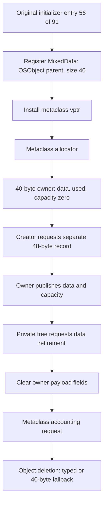

# _IOMemoryDescriptorMixedData: owner construction and two-level retirement

The metadata owner at descriptor +0x90 now has a source-established nominal class: `_IOMemoryDescriptorMixedData`, derived from `OSObject`, with a 40-byte instance-size argument. Original startup metadata, the class-name literal, an allocation-site string, the metaclass allocator, instance vtable and `getMetaClass()` leaf agree. The owner stores the external data pointer, used bytes and capacity at +0x10/+0x18/+0x20. Its allocator explicitly zeros all three fields; their initial zero state does not require a lower allocation-zeroing premise. [ML1-ML5]

This identifies the 40-byte owner used by the preceding 48-byte DMA-constraint record analysis. The fresh owner selects the creator's new-data branch and a separate 48-byte allocation request. Its private `free` interface requests data retirement using the stored pointer/capacity, clears those fields, requests metaclass accounting and tail-dispatches to object deletion. Actual allocation, reference-count transitions, backing-record zeroing and native lifetime balance remain unproved. [ML3-ML8]

Evidence: [original source, strings, slots and scans](triage_evidence/mixed_data_lifecycle_source.json.zst), [source equations and certificates](triage_evidence/mixed_data_lifecycle_checks.json.zst), [extractor](triage_evidence/recover_mixed_data_lifecycle.py), [validator](triage_evidence/validate_mixed_data_lifecycle.py), [preservation audit](triage_evidence/mixed_data_lifecycle_delivery.json), [quality gates](triage_evidence/mixed_data_lifecycle_quality_gates.json), [sealer](triage_evidence/seal_mixed_data_lifecycle.py), [publication audit](triage_evidence/verify_mixed_data_lifecycle_publication.py). Context: [DMA constraints](dma_map_constraints_report.md), [buffer construction](buffer_construction_flow_report.md), [factory/getter/cleanup](kext_buffer_report.md), [inner staging/write frontier](inner_write_frontier_report.md), [interface index](interface_abi_report.md).

The diagram is a conditional source construction/retirement chain. No target instructions, emulator, allocator, reference operation, startup function, IPC or IDB mutation execute. Pointer signing and atomic additions are represented by symbolic operand relations; native keys, authentication, atomic scheduling and ownership are not evaluated. The original files suffice; no new IDA access is used. [ML1-ML8]

## Primary source and verification scope

| Evidence | Coverage |
| --- | --- |
| Normalized kext SHA-256 | `2ec5e76ffc0a1873d284cbc50846b63f3576df2e5af98738df81faae33954a2c` |
| Kernel collection SHA-256 | `d5f0b4d49520744ebcd777a66be7ff69225a8ef2879773340854eab0b1370afe` |
| Complete captured functions | 11 bodies, 529 instructions, 2116 B |
| Component equations | 34 fragments, 144 distinct instructions, 576 B |
| Original pointer evidence | Nine vtable slots; all 91 entries of the relevant initializer section; one matching initializer entry |
| Address-materialization scan | 2540432 aligned kernel text words; 328 ADRP candidates for the page; four adjacent ADRP/ADD materializers of the exact metaclass address |
| Accepted checks | 43 UNSAT, no SAT controls; two predecessor propositions replayed; six altered-evidence rejection checks |
| Explicit symbolic operations | Two PACDA sites and four atomic-add relations; no native authentication or atomic effect supplied |

The complete creator and metadata-helper bodies match the preceding DMA source artifact. The address scan covers its stated adjacent-instruction pattern, not all aliases or xrefs. Primary method identities come from exact symbols where available and from original class/vtable/body correspondence otherwise. Native receiver identity is a separate requirement. [ML1-ML2,ML5-ML6]

## Class identity and startup correspondence

The 92-instruction initializer group at `0xfffffe000c539e34` contains the MixedData registration call at `0xfffffe000c539f78`:

| Argument / publication | Original source |
| --- | --- |
| X0, metaclass receiver | `0xfffffe000cb53030` |
| X1, class-name string | `0xfffffe00070de463`: `_IOMemoryDescriptorMixedData\0`, 29 B |
| X2, superclass metaclass | `0xfffffe000cb5bfc0`, exact `OSObject::gMetaClass` |
| W3, instance size | 0x28=40 B |
| Direct target | `0xfffffe000c441ec0`, exact `OSMetaClass::OSMetaClass(char const *,OSMetaClass const *,unsigned int)` |
| Subsequent nominal metaclass vptr | `0xfffffe0007f43590`, signed and stored through the returned receiver |

The base constructor's original component stores the instance-size u32 at metaclass +0x20, zero at +0x24, superclass pointer at +0x10 and name pointer at +0x18. Its ordinary return transfers the saved receiver into X0. These source components bind the subsequent metaclass-vptr publication to the same global receiver, under the declared callee and field epochs. They do not prove successful native registration or auxiliary allocation. [ML2-ML4]

The original kernel Mach-O section header identifies `__DATA_CONST,__mod_init_func`, range `0xfffffe0007f95b50..0xfffffe0007f95e28`, type 9. All 91 original format-8 chain entries are retained. Entry index 56, slot `0xfffffe0007f95d10`, points to this initializer group. This is startup registration provenance; actual invocation and initialization order are unknown. [ML1-ML2,ML6,ML8]

Four exact adjacent materializers independently place `0xfffffe000cb53030` in source registers: creator `0xfffffe000c5373a8`, `getMetaClass` leaf `0xfffffe000c539888`, allocator accounting prefix `0xfffffe000c539994`, and registration prefix `0xfffffe000c539f5c`. The inherited-looking dynamic metaclass call in the formerly unnamed creator now has a nominal original target. No live pointer read is required to identify this source chain. [ML1-ML2]

## Owner allocator, vtables and initial fields

| Nominal interface | Original slot | Target / provenance |
| --- | --- | --- |
| Metaclass +0xa8 | `0xfffffe0007f43638` | `0xfffffe000c539908`, 44-instruction owner allocator |
| Instance +0x00 | `0xfffffe0007f43440` | `0xfffffe000c5398f8`, four-instruction first-word invalidator |
| Instance +0x08 | `0xfffffe0007f43448` | `0xfffffe000c539894`, 25-instruction deleting-destructor interface |
| Instance +0x18 | `0xfffffe0007f43458` | `0xfffffe000c445230`, exact `OSObject::getRetainCount() const` |
| Instance +0x28 | `0xfffffe0007f43468` | `0xfffffe000c4451d0`, exact `OSObject::release() const` |
| Instance +0x38 | `0xfffffe0007f43478` | `0xfffffe000c539884`, four-instruction `getMetaClass` role |
| Instance +0xb0 | `0xfffffe0007f434f0` | `0xfffffe000c5397f0`, 37-instruction private `free` role |

The nominal instance vptr is `0xfffffe0007f43440`. Original `OSObject` control slots bind +8 to exact `OSObject::~OSObject()` deleting-destructor symbol and +0xb0 to exact `OSObject::free()`, corroborating the private override roles. These nine authenticated format-8 entries have verified chain membership. The private method targets lack exact matching names in the consumed symbol table; the role labels follow the original hierarchy, slot correspondence and bodies. [ML1-ML2,ML6]

On the admitted allocator continuation, the original source explicitly publishes:

| Owner B offset | Width | Value |
| --- | --- | --- |
| +0 | 8 B | Symbolically signed instance vptr; unsigned source value `0xfffffe0007f43440` |
| +8 | 4 B | Reference word 1 |
| +0x0c..+0x0f | 4 B | Unwritten by this construction suffix |
| +0x10 | 8 B | Data pointer 0 |
| +0x18 | 8 B | Used bytes 0 |
| +0x20 | 8 B | Capacity 0 |

The exact 40-byte store join proves 36 source-defined bytes and four untouched padding bytes, including all 24 payload bytes at +0x10..+0x27. Pointer signing remains symbolic; no valid native PAC result is asserted. The inherited `getRetainCount()` leaf uses `LDRH W0,[X0+8]`, so it reads only the low 16 bits of the initialized 32-bit word and zero-extends them. The construction value specializes that source getter to 1 under a matching field epoch. Upper-word meanings and actual reference transitions remain unproved. [ML3-ML5,ML7]

## Typed allocation and fresh backing request

The 64-byte typed-allocation descriptor at `0xfffffe0007e56498` has original flags `0x61` at +0x28 and size 40 at +0x2c. Original chained fixups at +0x10 and +0x20 resolve to the site string `site._IOMemoryDescriptorMixedData` and the literal `12122`. No semantics are assigned to the latter. Both owner allocation and deletion test whether the unsigned size masked with `0x00fffff8` is at least 40. The on-disk descriptor selects the typed branch. [ML1-ML4]

| Source branch | Allocation operands |
| --- | --- |
| Typed, `0xfffffe000c539948..0xfffffe000c539954` | X0 = typed descriptor, W1 = 4, direct call to `_kalloc_type_impl` |
| Fallback, `0xfffffe000c539928..0xfffffe000c539940` | X0 = `0xfffffe0007f36938`, W1 = 40, W2 = `0x41004`, X3 = 0, direct call to `0xfffffe000bcfe5b8` |

The creator resolves metaclass slot +0xa8, checks the returned owner B for nonnull, and loads B+0x10. The allocator explicitly writes zero there, which joins to the fresh branch at `0xfffffe000c537408` under stable fields. Its separate call to `0xfffffe000bcfe5b8` passes X0 = `0xfffffe0007f94f99`, X1 = 48, W2 = `0x31004`, and X3 = 0. With a nonnull data pointer, the creator stores that pointer at B+0x10, capacity 48 at B+0x20, and used bytes 0 at B+0x18 before returning B. The two raw calls pass different heap-selector operands. [ML3-ML5]

Two predecessor queries replay: the published 48-byte capacity avoids the first resize, and the initial constraint update specializes to the request alignment for zero existing entries. The owner stores establish owner zeroing independently of the lower allocator. They do not establish the allocation extent or contents of the separate backing record: the prior record initializer still leaves 10 bytes wholly unwritten and one byte partially preserved. [ML5,ML7-ML8]

## Retirement and accounting

The private free implementation at `0xfffffe000c5397f0` passes the backing pointer from B+0x10 and capacity from B+0x20 to `0xfffffe000bcfec48`, with X0 = `0xfffffe0007f94f99`. This source path has no preceding null check on the backing argument. After ordinary return it clears all three owner payload fields, requests the metaclass through instance slot +0x38, and, if nonnull, calls `OSMetaClass::instanceDestructed()`. It then restores its private frame and tails through instance slot +8 with B as the receiver. The nominal target is `0xfffffe000c539894`; the source tail modifier replaces the high 16 bits of the slot address with `0x56b7`. [ML3-ML5]

The nominal deleting implementation stores the all-ones 64-bit word at B+0 and applies the same typed-descriptor size criterion as allocation. The fallback sends X0 = `0xfffffe0007f36938`, X1 = B, W2 = 40 to `0xfffffe000bcfec48`. The typed path sends the descriptor in X0 and B in X1 to `0xfffffe000bcffaac`, whose exact symbol is unknown. Instance slot +0 independently reaches the four-instruction first-word invalidator; that body performs no backing retirement. These are source operand pairings along the stated route. Actual frees, allocator contracts, and the reachability of this route from every release caller remain unknown. [ML3-ML5,ML7-ML8]

| State | Source operations | Established boundary |
| --- | --- | --- |
| Owner reference word at B+8 | 32-bit initialization to 1; inherited 16-bit load | Low-half getter; upper-half meanings and transition rules unknown |
| Metaclass instance count at +0x24 | 32-bit atomic add +1; atomic add -1 in `instanceDestructed` | Increment propagates to the parent on old count 0; decrement propagates on old count 1 and nonnull parent |
| `_debug_ivars_size` | 64-bit atomic add +40 on owner construction; -40 on deleting path | Operand cancellation modulo 2^64 under pairing; no claim of native balance |

The four modeled atomic sites retain width, old-value dependence and modulo arithmetic. Paired cancellation does not prove that both sites execute, share an epoch, or account for all other updates. The selected source correspondence identifies no Mach send, receive or right emission; lower calls remain outside that claim. [ML5,ML7-ML8]

## Assumption register

| ID | Assumption and dependent results | Falsification probe |
| --- | --- | --- |
| ML1 | Source identity uses the hashed original kernel collection and selected binary image. | Re-extract from an independent copy; compare hashes, instruction bytes, section bounds and chained-fixup membership. |
| ML2 | The class literal, initializer, metaclass and typed descriptor belong to the same source build. | Check original initializer index 56 and format-8 pointers against section and segment mappings; reject mismatched names or size words. |
| ML3 | Nominal dispatch uses the recovered vtables, receiver and source epoch. | Compare actual vptr, authenticated slot and epoch in independently obtained evidence; a substituted class or slot invalidates the join. |
| ML4 | The modeled callees return normally with the stated ABI preservation, and owner, backing and global storage are disjoint where modeled. | Inspect each lower callee or supply a counterexample to register preservation, nonaliasing, or normal return. |
| ML5 | Source equations use 64-bit addresses, little-endian byte fields, declared register widths and old-value atomic relations; pointer signing is opaque. | Replay source fragments and solver assertions with an independent decoder and check width, order, branch and load bindings. |
| ML6 | The metaclass census covers strict adjacent ADRP/ADD materializers in original kernel text, and the startup array gives source membership. | Repeat the aligned scan; search separately for nonadjacent/indirect forms and consult independent startup evidence for invocation order. |
| ML7 | A fresh nonnull owner keeps the explicit zeros until the creator reads its data field; the getter is evaluated in the same field epoch. | Identify an intervening write or owner substitution on an admitted path. |
| ML8 | Native allocation capacity, backing zeroing, reference balance, authentication and full transaction behavior are unproved. | Establish lower contracts or obtain independent observational evidence before upgrading those claims. |

## Follow-up priorities

- **High:** Resolve lower raw allocation and retirement contracts, including backing zeroing and the meaning of size/flags, to bound the 10 untouched record bytes and partially preserved byte.
- **High:** Trace the tagged release and last-reference paths into private free, separating object reference transitions, instance counts and debug byte accounting.
- **Medium:** Correlate the initialization record with independent startup evidence and resolve prepare/complete ownership, including the open scratch extents and inner stack-delta controls.
- **Low:** Expand the class-reference census beyond adjacent materializers to bounded nonadjacent and indirect forms.

## Scoped quality gates

- **QG1:** The report makes technical source and proof claims.
- **QG2:** ML1-ML8 state assumptions and falsification probes.
- **QG3:** Class identity, allocation, initialization, creator join, retirement, accounting, and Mach scope are covered; remaining boundaries are explicit.
- **QG4:** The capture contains 529 four-byte instructions (2,116 B); 144 translated sites correspond to 576 B. The 40-byte owner and 48-byte backing request are distinct. The aligned census is linear in original text words, plus extraction and fixup traversal; the solver has a 45 s internal timeout and 50 s process bound per query.
- **QG5:** The 32-bit reference word, 16-bit getter, 32-bit class count and 64-bit debug total remain distinct. Owner initialization does not imply backing initialization.
- **QG6:** Original byte spans, strings, symbols, fixup membership, 43 UNSAT results and six rejected alterations are replayable through the linked artifacts.
- **QG7:** Follow-up priorities identify the source boundaries most likely to change the lifecycle and ownership claims.

The subsequent backing study establishes a conditional zero source for the ten untouched record bytes and six preserved bits. The source result requires a sufficient live zone extent and storage stability. [MixedData backing allocation](mixed_data_backing_report.md).
