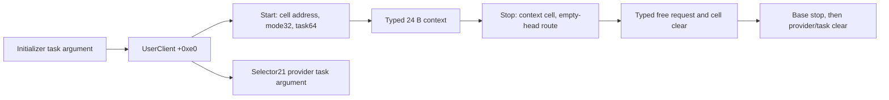

# UserClient task identity and typed context lifecycle

The task forwarded by selector21 originates in the FairPlay UserClient initializer's task argument. Start passes that task and a 32-bit mode through `Trped0719ab` into `_lapsl183ah`, which conditionally creates a typed 24 B `site.IOUCCtx` record. Stop passes the saved context cell through `LasdMdn12cas` into `_kratpzs81h`; the empty-list route requests typed free and clears the cell. Start overwrites the context helper's returned status with success1. These source contracts identify two obfuscated provider roles and their task/data channels; they do not establish balanced task references, populated-list cleanup, native allocation outcomes or a successful daemon-kext transaction. [UC1-UC8]

Evidence: [original source and bindings](triage_evidence/userclient_context_lifecycle_source.json.zst), [source equations and checks](triage_evidence/userclient_context_lifecycle_checks.json.zst), [extractor](triage_evidence/recover_userclient_context_lifecycle.py), [validator](triage_evidence/validate_userclient_context_lifecycle.py), [preservation](triage_evidence/userclient_context_lifecycle_delivery.json), [quality gates](triage_evidence/userclient_context_lifecycle_quality_gates.json), [sealer](triage_evidence/seal_userclient_context_lifecycle.py), [publication audit](triage_evidence/verify_userclient_context_lifecycle_publication.py). Context: [selector21 provider/core ABI](versioned_request_abi_report.md), [connection export and close](iokit_connection_lifecycle_report.md), [IOKit open contracts](kernel_iokit_open_report.md), [interface ABI index](interface_abi_report.md), [getter values](kext_query_getter_values_report.md).

Arrows describe source-compatible local flows under the assumptions below. No recovered target instructions, emulator, FairPlay request, port operation or IDB mutation execute in this increment. Read-only IDA confirms three function bounds; one recalled, explicitly unverified global port-import note supplies no semantic premise. [UC1,UC8]

## Original-byte coverage

| Evidence | Verified scope |
| --- | --- |
| Normalized kext SHA-256 |`2ec5e76ffc0a1873d284cbc50846b63f3576df2e5af98738df81faae33954a2c`|
| Kernel collection SHA-256 |`d5f0b4d49520744ebcd777a66be7ff69225a8ef2879773340854eab0b1370afe`|
| Kext UUID |`227f9df7-645d-39b8-b74a-685303d16b4b`|
| Complete captured kext functions |9 functions,1299 instructions,5196 B; normalized code equals original collection code|
| Complete captured kernel functions |3 functions,31 instructions: allocation adapter,free adapter,base clientDied|
| Current selected equations |24 fragments plus the cast-return store and allocation-adapter setup;366 distinct source instructions,1117 instruction instances across composed models|
| Original tables |8 arrays,10 bank selections,2560 exhaustive byte-input cases,8 pool pointers,11 branch pointers,10 lifecycle bindings|
| Accepted checks |40 UNSAT certificates including2 predecessor replays;2 abstract SAT controls;7 altered-evidence rejection checks|

Full function capture is not full semantic recovery. In particular,the 878-instruction `_kratpzs81h` body is captured,while the new proof follows its entry,cell check,head check and empty-head cleanup. Its populated-list route remains open. The separate16 B cast stub resolves original slot0xfffffe000847c418 to exact `OSMetaClassBase::safeMetaCast` at0xfffffe000c442080;slot0xfffffe000846b8b0 names the FairPlay gMetaClass pointer. Pointer records retain original chained words and authentication diversity;successful hardware authentication remains an assumption. [UC1-UC4]

## Task and UserClient fields

| Field | Producer / consumer | Source meaning |
| --- | --- | --- |
|`+0xd8`,u64|Initializer pair store `0xfffffe000a5042e0`;start store `0xfffffe000a504394`;stop pair store `0xfffffe000a50444c`|Initially0;then safeMetaCast result for provider;then0 after base stop returns|
|`+0xe0`,u64|Initializer pair store `0xfffffe000a5042e0`;start load `0xfffffe000a5043a0`;selector21 load;stop pair clear|Raw initializer task pointer,forwarded without a user Mach-name conversion at these sites|
|`+0xe8`,u64|Start zero at `0xfffffe000a504344`;context helper publishes through its address;stop helper consumes same address|Saved context pointer cell|
|`+0xf0`,u32|Initializer entitlement paths;start normalization and load `0xfffffe000a50439c`|Client mode;start preserves1 and sets every other incoming value to0|
|`+0xf4`,u8|Initializer success `0xfffffe000a5042e8`;clientDied `0xfffffe000a5044a8`|0 on initializer success;1 before delegating clientDied|

The preceding open report recovers the entitlement true-singleton checks and nonnull-task/base-initializer guards. This increment freshly proves the selected base-call argument forwarding and successful task publication. The mode field is the UserClient's initializer/start classification;it is not equated with the daemon's working values1/2/5/6 or selector21 packet scalar0. [UC2-UC3,UC6]

An exact eight-byte little-endian store/load certificate joins the initializer's task store to selector21's u64 task load under unchanged-field/lifetime premises. The two downstream certificates are replayed:the wrapper passes task in provider X1,and `qtQQt` removes `this` and passes task in core X0. A separate abstract SAT control admits task values with nonzero upper32 bits;the source type is therefore not a zero-extended u32 Mach-port name. This establishes width and local provenance,not a native task identity or ownership balance. [UC3,UC5-UC7]

## Start,mode and provider adapter

Start first zeros context cell `+0xe8`,normalizes mode,and calls exact `IOService::start` through the inherited table. It proceeds to safeMetaCast only when the base result is nonzero. The cast result is stored at `+0xd8`;a null result returns0. On the nonnull continuation,the call at `0xfffffe000a5043c8` has: [UC2-UC4]

| Channel | Value |
| --- | --- |
|X0|Provider object from the cast|
|X1|Address `UserClient+0xe8`,not the current contents of that cell|
|W2|u32 mode from `UserClient+0xf0`|
|X3|u64 task from `UserClient+0xe0`|
|Default provider slot|`0xfffffe000846c2e0`,vptr+0xa10 ->`0xfffffe000a505184`,IA diversity0x0173|

`Trped0719ab` consists of three moves and a tail branch after BTI. It drops `this` and calls `_lapsl183ah` at `0xfffffe000a5b62e0` with `(cell,mode,task)` in X0,X1,X2. The supplied C prints `_lapsl183ah` as `void lapsl183ah(__int64 a1)` and separates its jump fragments. The complete compiler-bounded source recovers the additional arguments,record stores and raw status return. [UC1-UC4]

After the provider helper ordinarily returns,start executes `MOV W0,#1` at `0xfffffe000a5043cc`. It does not test or propagate that helper's result. An abstract null-allocation control is compatible with this source-level success return under the selected base/cast/return premises. It does not establish that the allocator can return null under its supplied flags,or that a native open reached this case. [UC4,UC8]

## Typed context construction

Fresh bank proofs resolve `_lapsl183ah`'s sole indirect call at `0xfffffe000a5b64ec` to exact `_IOMallocTypeImpl` at `0xfffffe000c4ba154`,IA diversity0xd0c8. X0 is descriptor `0xfffffe000847b860`. Its original flags/size words are0x64/24;its string is `site.IOUCCtx`,with signature text `121`. The allocation adapter reads flags at+0x28 and supplies W1=0x8004 before tail-calling the lower allocator. No runtime interpretation of allocation success/failure is imported. [UC1-UC4]

| Constructor condition | Source path and raw u32 result |
| --- | --- |
|Cell address=0|Entry branch index0x4cf -> ordinary epilogue;result0xffff5bd9|
|Cell address!=0,allocation result=0|Entry index0x4d4;post-allocation index0xcaa -> epilogue;result0xffff5bd4;no context-publication store on this arm|
|Cell address!=0,allocation result!=0|Post-allocation index0xca2 -> publication fragment `0xfffffe000a5b651c`;result0|

For the success arm,let A be the allocator result and C the cell address:

| Address | Store | Source site |
| --- | --- | --- |
|A+0..7|u64 zero;empty list head|`0xfffffe000a5b6524`|
|A+8..11|Incoming mode as u32|`0xfffffe000a5b6528`|
|A+12..15|No constructor store;allocator-provided bytes remain unconstrained|Between the neighboring field stores|
|A+16..23|Incoming task as u64|`0xfffffe000a5b652c`|
|C+0..7|A as u64|`0xfffffe000a5b6530`|

An exact ordered byte-store/select proof verifies all24 object bytes and all8 cell bytes with arbitrary old bytes,mode and task,under explicit object/cell disjointness. It proves the empty-head join and preserves the four padding bytes. It does not infer that padding was zeroed. The constructor forwards the task by storing it;its resolved allocation call receives the descriptor. No balanced retain/release claim follows. [UC3-UC5]

## Stop,empty-head cleanup and death

Stop loads provider from `+0xd8` and passes `&UserClient[+0xe8]` at call `0xfffffe000a504424`. Default slot `0xfffffe000846c2e8`,vptr+0xa18,targets `LasdMdn12cas` at `0xfffffe000a505178`,IA diversity0x7e4c. That three-instruction adapter including BTI removes `this` and tail-branches to `_kratpzs81h` at `0xfffffe000a626648`. [UC1-UC4]

| Cleanup state | Source decision |
| --- | --- |
|Cell address=0|Index0xaab -> epilogue,raw status0xffff5bd9|
|Cell address!=0,cell contents=0|Index0x59e -> epilogue,raw status0|
|Cell contains context A,head u64[A]=0|Index0x980 -> typed context-free path `0xfffffe000a626838`|
|Cell contains context A,head u64[A]!=0|Index0x9a4 -> `0xfffffe000a6269e4`;populated-list frontier,not a proved cleanup|

On the empty-head route,the call at `0xfffffe000a6268c4` resolves to `_IOFreeTypeImpl` at `0xfffffe000c4ba368`,IA diversity0x4d6a,with X0=descriptor `0xfffffe000847c260` and X1=A. The allocation and free descriptors have identical normalized64 B contents,including `site.IOUCCtx` and size24. Their addresses and original chained words remain distinct. The free adapter tail-calls the lower free routine;actual retirement is not observed. After an ordinary return,source `0xfffffe000a6268d0` clears the original cell,sets raw status0 and selects the checked-canary epilogue. Applying this route to a just-created context requires that no intervening writer changed its head. [UC2-UC5]

Stop does not use the helper return as its base-stop argument or result. It calls exact `IOService::stop`,then clears provider/task together at `0xfffffe000a50444c`,preserving the base return register. There is no native reference-balance conclusion. `clientDied` separately sets `+0xf4` and delegates to `IOUserClient::clientDied`;the captured base body has its own `+0x98/+0x99` atomic gate and virtual close path. That gate is not folded into the new context proof. Close remains the previously recovered terminate(options0)/ignored-result contract. [UC3-UC7]

The context pointer,task pointer,provider object,IOKit connection name and Mach kernel port remain different architectural objects. No new Mach-port emission is established. These method call sites are kernel C++/internal allocator interfaces;transitive external effects and complete port-right retirement remain outside the increment. [UC6-UC8]

## Assumption register

| ID | Assumption and dependent results | Stress test or falsification probe |
| --- | --- | --- |
| UC1 |Pinned original kext/KC define the build;normalized pointer metadata corresponds to the original chains.|Rehash both binaries;compare9 complete code bodies,3 kernel functions,8 pool pointers,11 branch records,10 bindings and descriptor pointer chains. IDA metadata is not live byte attestation.|
| UC2 |Selected provider/inherited vtables and original pool/bank tables retain their declared epochs;default-slot meanings depend on this.|Exhaust2560 bank inputs and prove10 fresh reductions with read-address bounds;recover actual subclass/override and native PAC acceptance separately.|
| UC3 |UserClient,context,cell and controller/global regions are valid,appropriately disjoint and stable over the stated visits.|Retain separate pointer/field widths;prove byte stores/loads;track intervening writers and callback concurrency. The empty-head join fails if a writer adds list nodes.|
| UC4 |Selected calls return ordinarily and preserve ABI callee-saved registers/SP and unrelated private cells.|Prove argument/result channels from the surrounding original instructions;separate allocation/free/base-return events and canary/PAC conditions. No native outcome is supplied.|
| UC5 |Byte memory follows little-endian stores;the allocated object and saved cell do not overlap.|The28-store byte expansion verifies every object/cell byte with arbitrary old data;separate task-store/load proof checks8 bytes. Padding stays old,not implicitly zero.|
| UC6 |Mode,task,context,provider,wire scalars and Mach names retain their distinct meanings.|Trace mode normalization,task64 forwarding and field offsets;abstract SAT retains nonzero upper task bits. Do not equate this mode with daemon working-mode values.|
| UC7 |Earlier open/selector21/close contracts remain conditional downstream context.|Pin their source/check hashes and replay the two immediate provider/core forwarding certificates. Framework task references,populated-list teardown and native routing remain unknown.|
| UC8 |Abstract control values,IDA annotations and source requests are not native observations.|Keep both SAT controls abstract;exclude the unverified recalled note;retain execution/IPC/IDB flags as false. Seven altered-evidence checks must be rejected.|

## Bounded continuation

| Impact | Next evidence | Question resolved |
| --- | --- | --- |
| High |Follow the populated-list frontier and its node producers/consumers|Context ownership beyond the empty-head case and full teardown order.|
| High |Trace framework task reference acquisition,UserClient destruction and task exit|Whether task lifetime spans every context and selector21 use.|
| High |Establish actual connection class,provider override and build correspondence|Whether these static contracts describe a native fairplayd-kext transaction.|
| High |Trace consumers of the context mode/task fields and compare with direct selector21 task use|Whether those facilities share state or merely carry the same task value.|
| Medium |Recover callback serialization and head/cell writers|Which source-local creation/cleanup joins survive concurrent lifecycle events.|
| Medium |Close the daemon frame/buffer and working-mode serialization joins from the preceding report|Which constructed bytes actually reach selector21.|

## Scoped quality gates

- QG1:This report makes factual source,ABI,width,status and ownership-boundary claims;no normative conclusion is required.
- QG2:UC1-UC8 name assumptions,dependent results and falsification probes.
- QG3:Task publication/forwarding,start/stop adapters,typed context layout,raw statuses,empty-head cleanup and caller result separation are covered. Populated-list cleanup,task-reference balance and the full interaction goal remain active.
- QG4:1299*4=5196 B;24 B context contains8+4+4+8 B;20 object bytes and8 separate cell bytes receive explicit stores. Proof coverage is366 distinct instructions/1117 composed instances. Capture/table analysis uses O(B+I+256R) time/space for image bytes B,captured instructions I and bank rules R;SSA/query storage also scales with retained model instances. SMT limits are45000 ms/50 s per query;general solver complexity is separate.
- QG5:Different object fields,raw64/u32 channels,mode versus wire values,helper/base/start results,normalized versus original descriptor words,and source requests versus native retirement remain distinct.
- QG6:Original hashes,compiler boundaries,raw code/pointer words,descriptor/string bytes,source SSA,40 UNSAT certificates,2 abstract SAT controls and7 freshness alterations supply scoped provenance. The unverified recalled note supplies none.
- QG7:The continuation identifies the remaining populated-list,task-reference,concurrency,native-pairing and daemon-buffer questions without treating this local lifecycle contract as a completed exchange.

## Context to descriptor task flow

The typed context now has a bounded core-consumer census and conditional task-field joins to two descriptor record protocols. The per-client context and module-global descriptor cells remain distinct. Populated-list teardown,frame epochs,task-reference balance and actual mappings remain unresolved. [Evidence and exact boundaries](context_descriptor_task_flow_report.md).
