# Capability-controlled preparation and selector21 provider ABI

Subsequent kernel-core evidence: the [selector-21 core-entry report](versioned_core_entry_report.md) establishes the original workspace/record contract and initial admission of modes 2/5 with marker 0xb4d3a486. It distinguishes core count copyback, provider status and UserClient structure fields. Successful processing, native admission and daemon/kext pairing remain unknown.

Subsequent source-join evidence: the [post-block dispatch report](daemon_postblock_dispatch_report.md) connects declared zero-object-word paths to the pending selector-21 call. It establishes API buffer F+0x6a8 versus construction view F+0x600, working-mode serialization, generated/count fields and the processed block at API+0x20. The 552 B views retain 44/60 defined bytes and explicit unspecified origins. Native admission, execution and pairing remain unknown; earlier fixtures and counts below retain their original scope.

Subsequent frame-definition evidence: the [frame-word report](daemon_frame_word_report.md) recovers a conditional producer at0x100530748 and a table-resolved less-than route to reader0x10063735c. Twenty A64 controls and ten UNSAT obligations validate that route. It is absent from the four retained partial ingress paths, which remain stopped with unknown F+0x560. Neither a native defect nor a completed IOKit join is established.

Subsequent source-caller evidence: the [versioned-ingress report](daemon_versioned_ingress_report.md) composes record producer0x10084c9b8 with adapter0x1004ac814 and this root. Its numeric count tag is0x73113b31, distinct from the declared count16 fixtures below; phase0x6cf4 produces operation0x871a. Twelve cases return through the adapter and caller encoded-zero selection; four stop on an unspecified frame word. Native upstream admission and the full IOKit join remain unknown. Earlier fixture results retain their original scope.

Subsequent enclosing-root evidence: the [versioned-root report](daemon_versioned_root_report.md) derives FP=F+0x970, inner record=F+0x8d8 and offset16 B from the original prologue/setup. Ten allocation-success paths compose the constructor with capability routes and pair retirement, within16 total cases and32 independent A64 replays. These paths return before the IOKit call; native caller admission, complete552 B definitions and the API-buffer join remain unknown. The earlier constructor-only fixtures and counts below retain their original scope.

Subsequent constructor evidence: the [byte-emitter/frame-return report](daemon_versioned_header_report.md) resolves the private call in six declared selector21 constructor frames. Exact key agreement is R&5==0; the4 B request uses control0xb399, all six checked temporary lifetimes return delta0, and the next source block stores BE32(bytes) XOR0x8b3dc651. This refines the helper/frame frontier while retaining unknown native parent reachability, the full API-buffer join and daemon/kext pairing.

Two source consumers read the daemon's encoded capability field and test bit3. The second prepares a declared552 B buffer,conditionally writes a16 B prefix,and uses decoded bits5/6 to select further preparation. A separate source-bound call passes selector21 with552 B input and the same user input/output pointer. The original kext selector21 wrapper forwards eleven provider arguments,including a mutable count pointer,and its adapter forwards ten arguments into `_UeFdbi`. The wrapper copies the provider-mutated count on success;the supplied C's fixed512 output statement is too strong. Same-frame lifetime,buffer identity,working-mode-to-wire-word mapping,complete extended preparation and native routing remain unproved. [VA1-VA8]

Evidence: [source,census,pointers and C comparison](triage_evidence/versioned_request_abi_source.json.zst), [source models and proofs](triage_evidence/versioned_request_abi_checks.json.zst), [extractor](triage_evidence/recover_versioned_request_abi.py), [validator](triage_evidence/validate_versioned_request_abi.py), [preservation](triage_evidence/versioned_request_abi_delivery.json), [quality gates](triage_evidence/versioned_request_abi_quality_gates.json), [sealer](triage_evidence/seal_versioned_request_abi.py), [publication audit](triage_evidence/verify_versioned_request_abi_publication.py). Context: [pinned getter values](kext_query_getter_values_report.md), [earlier state-pointer candidates](daemon_iokit_objects_report.md), [IOKit caller census](daemon_iokit_census_report.md), [structure-call transport](iokit_structure_arguments_report.md), [interface ABI index](interface_abi_report.md).

```mermaid
flowchart LR
  C[Encoded capability cache] --> G[Source bit gates and private preparation]
  G -. Unproved buffer and frame joins .-> A[Daemon selector21 API call]
  A --> D[Fixed552 B dispatch contract]
  D --> U[UserClient pointer and count guards]
  U --> P[Eleven provider arguments]
  P --> K[Ten core arguments]
  K --> R[Provider status and mutable count]
  R --> O[Embedded result and outer status0]
```



The API/descriptor arrow is static ABI compatibility,not an observed transaction. No recovered code,emulator,IOKit/FairPlay request or native send executes in this increment. Read-only IDA metadata and two prior pointer annotations guided the source windows;targeted knowledge recall found no matching facts. A later read-only SQL call ended with a connection failure. No IDB mutation or current live byte-identity claim is made. [VA1,VA8]

## Original-source coverage

| Evidence | Verified scope |
| --- | --- |
| Daemon SHA-256 |`4ffe3ea1dbd27c5026b448ffe06e8489b02cd9064500bcc67792d4ac36ffb63e`|
| Normalized kext SHA-256 |`2ec5e76ffc0a1873d284cbc50846b63f3576df2e5af98738df81faae33954a2c`|
| Kernel collection SHA-256 |`d5f0b4d49520744ebcd777a66be7ff69225a8ef2879773340854eab0b1370afe`|
| Daemon captures |18 range instances,1005 instruction instances,4020 B;some selected subranges overlap|
| Kext original/normalized comparison |Two complete functions,60 instructions,240 B|
| Current source equations |370 nonbranch instruction instances|
| Original arrays/pointers |Eight256-byte arrays,1024 bank-input cases,six source-proved literal-pool roots,ten branch pointers,one48 B selector record|
| Accepted checks |42 UNSAT,three abstract SAT,eight rejected freshness alterations|

A whole-text syntactic census scans3712490 aligned words. It finds368 unsigned-immediate64-bit loads from SP+0x80 or SP+0x668:312 and56,respectively. A bounded direct-register-use scan before clobber/branch finds two following field+0x14 loads. It does not cover every encoded root,alias,computed load,control path or other frame. Absence from this pattern is not absence of a capability consumer. [VA1-VA2]

## Capability roots and bit gates

Original source at `0x100290410` conditionally publishes state pointer `0x1010b6380` to its frame+0x668;source at `0x100634b70` publishes it to another frame+0x80. Fresh models prove the first under pool-base/low8(selector)=0x43 premises,and the second over arbitrary u32 selector values with the original bank roots. These are separate frame domains;complete reaching definitions and lifetime are still required. [VA2-VA3]

| Consumer | Exact field read | Source slot choice under declared table/control roots |
| --- | --- | --- |
|First gate `0x1003763cc`|`0x1003763d4`:u32[state+0x14],after loading frame+0x668|Bit3 clear:index0x8af5 ->`0x1002693d8`;set:index0x8b06 ->`0x1004692c8`,initial counter16|
|Second gate `0x100552fa0`|`0x100552fa4`:u32[state+0x14],after loading frame+0x80|With W25=0xbc56,clear:index0xbc56 ->`0x1004d0e98`;set:index0xbc5a ->`0x10047a6b8`|

Let C be decoded capabilities and E=C XOR0xc49697f0 the stored word. E.bit3=C.bit3;E.bit5 and E.bit6 are the inverses of the corresponding C bits. Direct tests of E therefore need bit-specific interpretation. The source working-mode rules under the second gate's W21=0x871a contract are: [VA2-VA4]

| Source route | Local working value / next preparation |
| --- | --- |
|C.bit3=0|If C.bit1=0,value1;otherwise value6 if C.bit6=1,else2|
|C.bit3=1,C.bit5=1|Post-prefix branch enters extended setup at`0x100487be4`,carrying working value5|
|C.bit3=1,C.bit5=0|Write the fixed16 B field below;then value6 if C.bit6=1,else2|

The working values are not yet proved equal to selector21's first input scalar. The extended setup is captured but its complete computation is not proved. Bits7/8 remain uninterpreted here. For the preceding getter outcomes,C=0 selects the clear-bit3 local route,C=8 selects prefix/fixed-field preparation with working value2,and C=0x1f8 selects prefix/extended preparation carrying5. These are conditional source roles,not recovered application-level feature names. [VA3-VA4,VA7]

## Buffer preparation and the frame-delta boundary

For the second constructor,let F be its current SP,O the incoming offset,and B=F+0x5f0+O. Source at `0x100552dac` publishes B,B+16 and B+32 into frame+0x3f8/+0x480/+0x488 and initializes the u64 capacity cell at frame+0x3f0 to552. Its local phase computes W25=0xbc56 from W21=0x871a. O's owner,extent and reaching value remain unknown. [VA3-VA4]

The private call at `0x100552ef8` resolves through original slot0x10109fe90 to`0x100add594`,IA diversity0x22a0. It passes X0=FP-0x98 and X1=&F+0x5e0. After return,the source reads the u64 cell at F+0x5e0 and adds it to SP. For returned delta D,the subsequent state-pointer read is from F+D+0x80. It is the old F+0x80 address iff D=0,modulo2^64. A nonzero-delta SAT control preserves this distinction. The callee's full semantics and D=0 are not established here;old saved cells cannot be silently carried across that boundary. [VA3-VA4]

For the selected second bit3-set path,the source initializes j=15 and repeats while j>0,with j decreasing by1. All16 destination byte offsets0..15 are written once. Under the declared source/root domains,the per-iteration effect is:

```text
B[j] = K16[j] XOR A[j] XOR SB[j+3] XOR SC[j+1]
       XOR low8(31*j) XOR0xdf
j =15,14,...,0
K16 =0e fb 9f 5d 0f 19 6f 03 47 15 db c1 63 00 78 bb
```

K16 comes from original image address0x100f5bfb4. A,SB and SC are source component roots,not assigned native types or owners. Two original post-indexed loads decrement their pointers;fresh recurrence proofs bind the next iteration. The formula describes the bytes actually read at each iteration. Equating them with immutable entry arrays needs the stated alias/noninterference conditions. This proof applies to the second loop;the first gate's similar loop still has unresolved source/control roots and final-target conditions. [VA3-VA5]

When the later decoded bit5 test selects the fixed-field path,source at`0x10056d8b0` writes exactly B+16..B+31:

```text
4c 7c 35 4d be b6 71 d4 a7 80 ab 38 b9 65 b8 db
```

No cryptographic algorithm,key role or immutable ownership is assigned to either16 B constant. The field's subsequent serialization and the B-to-API-buffer identity remain open. [VA4,VA7]

## Daemon selector21 call site

Under the canonical root/epoch premises,original byte-bank arithmetic resolves slot0x1010a0640 to IOKit `_IOConnectCallStructMethod`. The source at `0x100478a04` uses IA diversity0x7a6c. Its formal arguments are proved independently of the incoming phase-register value: [VA2-VA4]

| Argument | Source value |
| --- | --- |
|W0 connection|u32[state+4],read at`0x1004789d8` through frame+0x80|
|W1 selector|21|
|X2 input|CURRENT_BASE+0x10|
|X3 input bytes|552|
|X4 output|Same user pointer as X2|
|X5 output-size pointer|Current frame+0x3f0;capacity552 under the constructor/same-frame preservation contract|

The input/output user addresses are equal at this call. This does not establish equality of the kernel method's formal input/output buffers. The connection is a32-bit source value;no native Mach-port name,right or receiver identity is supplied. [VA3,VA7]

After the call,the source at `0x100478a0c..0x100478a28` simplifies to `W28=API_status32 XOR0x8b3dc651`. This is the daemon's IOKit-return encoding. It is separate from the provider status embedded in the552 B protocol output. Full success/error continuation ownership remains open. [VA4,VA6]

## Complete kernel/provider/core contract

The original selector21 descriptor declares flags3,input552 B and output552 B. Its member target is `ucRunVersioned` at`0xfffffe000a50500c`;provider vtable+0x8b8 resolves statically to`qtQQt` at`0xfffffe000a504ea0`,with IA diversity0xca4f. The provider's vptr authentication and the real runtime override remain ordinary-call premises. [VA1-VA2,VA6]

Under a valid UserClient and accessible buffers,the wrapper rejects IN=0,OUT=0,or unsigned u32[IN+0x220]>512 with outer status0xe00002c2. The fixed552 B dispatch check is a different layer from this payload-count check. A direct entry into the method does not itself check a supplied structure-size parameter. [VA6]

Let S be the UserClient method's SP after its64 B reservation. It initializes a u32 local at S+0x1c to512 and forwards the following eleven provider arguments. Register values containing u32 fields are zero-extended. [VA4,VA6]

| Provider argument | Machine channel | Exact source |
| --- | --- | --- |
|this|X0|u64[UserClient+0xd8]|
|task|X1|u64[UserClient+0xe0];kernel task pointer,not a32-bit user Mach name|
|scalar0|W2|u32[IN+0]|
|scalar1|W3|u32[IN+4]|
|scalar2|W4|u32[IN+8]|
|input span A|X5|IN+0x0c|
|input span B|X6|IN+0x20|
|input count|W7|u32[IN+0x220],already guarded <=512|
|output span A|u64[S+0]|OUT+0x0c|
|output span B|u64[S+8]|OUT+0x20|
|mutable count pointer|u64[S+0x10]|S+0x1c;initial u32 value512|

The span entries identify starting addresses;the first span's complete access extent and the core's data/count use are not proved here. The labels do not assign undocumented semantic packet fields. [VA6-VA7]

The13-instruction provider adapter removes `this`,moves task into X0,and forwards ten arguments to `_UeFdbi` at`0xfffffe000a5a2bac`. At the core entry,X0..X7 carry task,scalar0,scalar1,scalar2,input-A,input-B,input-count,output-A. The two u64 stack arguments are output-B at[S+0] and the mutable count pointer at[S+8]. The adapter has no new stack reservation;its original pair load/store sequence performs the shuffle. Core allocation,algorithm,actual accesses and output-capacity compliance remain outside this contract. [VA4,VA6]

| Returning provider outcome | Wrapper effect | Outer method status |
| --- | --- | --- |
|Every admitted ordinary return|Store provider status32 at OUT+0x224,source`0xfffffe000a5050a0`|0|
|Provider status32=0|Read the provider-mutated local u32 at S+0x1c and store it at OUT+0x220,source`0xfffffe000a5050ac`|0|
|Provider status32!=0|No wrapper store to OUT+0x220 on this return arm|0|
|Initial pointer/count rejection|No provider call through this method path|0xe00002c2|

Thus552 B structure size,the initial provider count value512,and the returned u32 count are distinct quantities. The wrapper proves the numeric count bound and forwarding channels;the core interpretation of that count requires its consumers. The wrapper's highest output store ends at offset0x224+4=0x228=552 B. On provider error,the count field retains its then-current contents;it is not universally zero or the input count. Caller/provider ownership and possible input/output aliasing qualify stronger preservation statements. [VA3,VA6]

The supplied C at lines8791-8823 displays `*output_count=0x200` on success and omits most forwarded arguments. Original instructions show an LDUR of the mutable stack local,followed by the output-count store. Abstract success controls with returned counts256 and513 refute a fixed512 result and demonstrate that this wrapper adds no post-call bound check. They do not show a native provider returning513,an accepted malformed request,an overwrite or an exploit. Provider capacity compliance is a separate obligation. [VA4,VA6-VA8]

## Assumption register

| ID | Assumption and dependent claims | Stress test or falsification probe |
| --- | --- | --- |
| VA1 |Pinned daemon,kext and KC bytes define the builds;source correspondence depends on their identity.|Rehash originals,recapture18 daemon ranges and two kext functions,verify selector/member/vtable/branch words and C excerpts. No native loaded-build pairing follows.|
| VA2 |Original bank/pool/table values and declared table roots hold at each source visit;pointer and slot claims depend on them.|Freshly prove six root publications,two state-pointer publications,bank-read bounds and call slots;exhaust1024 original bank inputs. Recover actual reaching roots and table epochs separately.|
| VA3 |Each frame,buffer and pointer has valid extent/lifetime and the stated noninterference;data-flow joins depend on them.|Track separate frame domains,post-call SP+D,the saved raw capability at frame+0x7c and loop pointer recurrence. Delta16 SAT changes the read address;D=0 and live ownership remain unproved.|
| VA4 |ARM widths,conditional flags,pairs,post-indexes,unscaled accesses and source SSA represent the captured instructions.|Retain370 translated instances and original lowerings;check one exact bank cut only after source proof;reject changed operands/bytes. Signed post-index-1 and u32/u64 distinctions are explicit.|
| VA5 |The selected loop starts with j=15,its declared roots and ordinary memory behavior;the16-byte formula depends on those entry domains.|Prove all j in0..15,descending control,pointer updates,source/store addresses and byte expression;enumerate16 destination offsets. Immutable entry-array interpretation additionally requires alias exclusion.|
| VA6 |Kernel/API/provider calls return with the declared ABI and valid records;formal return channels qualify count/status claims.|Prove the six daemon arguments,eleven provider arguments,ten core arguments,guard/status/count effects and the source status codec. Include provider status0 in both count SAT controls;actual provider results and capacity compliance remain unknown.|
| VA7 |Local working modes,construction buffers,wire fields and native endpoints remain separate until a producer/consumer join is proved.|Do not equate working values1/2/5/6 with wire word0,or construction B with CURRENT_BASE+0x10. Trace serialization,extended setup,ownership and actual connection/provider identity.|
| VA8 |IDA annotations and abstract countermodels are scoped analysis evidence,not runtime observations.|Retain the read-only metadata boundary,zero matching recalled facts and later connection failure;exclude native execution/IDB mutation claims. Eight freshness alterations and all query-error/timeout checks must pass.|

## Bounded continuation

| Impact | Next evidence | Question resolved |
| --- | --- | --- |
| High |Close constructor/private-helper delta and frame/pointer lifetime|Whether the saved capability and capacity cells are the actual post-call reaching cells.|
| High |Trace working-mode serialization and construction-buffer transfer to the selector21 input|Whether local values1/2/5/6 become a specific packet scalar,and which bytes reach the kernel.|
| High |Recover the extended working5 preparation beyond its captured setup|Its complete data transformation,field publication and convergence with the API path.|
| High |Follow `_UeFdbi`'s actual use of spans and the mutable count|Core semantics,output extent guarantees and the complete provider result contract.|
| High |Establish live connection/provider/build correspondence and matched transport|Applicability of these static interfaces to an actual daemon-kext transaction.|
| Medium |Extend the slot census to aliases,computed roots and additional capability bits|Bound completeness of the reader inventory and recover further source roles.|

## Scoped quality gates

- QG1:Factual routine,source,ABI,count,status and data/control-flow analysis requires no normative conclusion.
- QG2:VA1-VA8 list dependent claims and falsification probes.
- QG3:The increment covers the declared census,two capability readers,conditional working modes,one complete16-byte loop,the fixed field,private-call frame delta,the selector21 API site and complete kernel/provider argument/result channels. Remaining joins and the full goal remain active.
- QG4:1005*4=4020 B daemon range instances;60*4=240 B kext code. Inputs/outputs are552 B;u32 count offset0x220=544,status offset0x224=548. Capture/census/lifting use O(B+I+W+256R) time and space for image bytes B,instructions I,scanned words W and bank rules R;stored query text additionally scales with query count. Solver/process limits are45000 ms/50 s per query;general SMT complexity is separate.
- QG5:Distinct frame epochs,user/kernel pointers,encoded/decoded bits,local/wire modes,552/512/returned counts,API/outer/provider statuses,component/native behavior and immutable/live read bytes remain distinct. The decompilation's fixed-count statement is explicitly corrected.
- QG6:Original hashes,raw instructions,dispatch/member/vtable records,eight byte arrays,370 translated instances,42 UNSAT,three abstract SAT and eight freshness alterations provide scoped provenance. Recalled facts and unproved buffer/frame joins supply no semantic premise.
- QG7:Impact-ranked continuation addresses the actual remaining frame,serialization,extended-preparation,core-count,native-pairing and inventory gaps without promoting the component results to a completed native exchange.


## Typed UserClient context lifecycle

The selector21 task argument now has an initializer-field provenance certificate and a separate UserClient context lifecycle. This does not close the preceding daemon buffer/frame/working-mode joins or establish native task ownership. [Evidence and exact boundaries](userclient_context_lifecycle_report.md).
